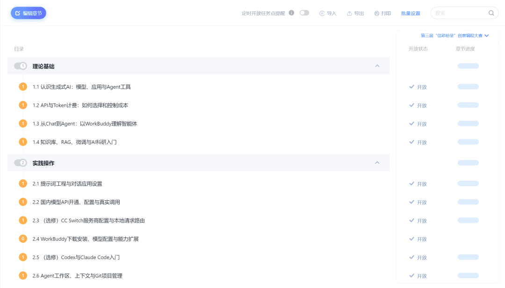
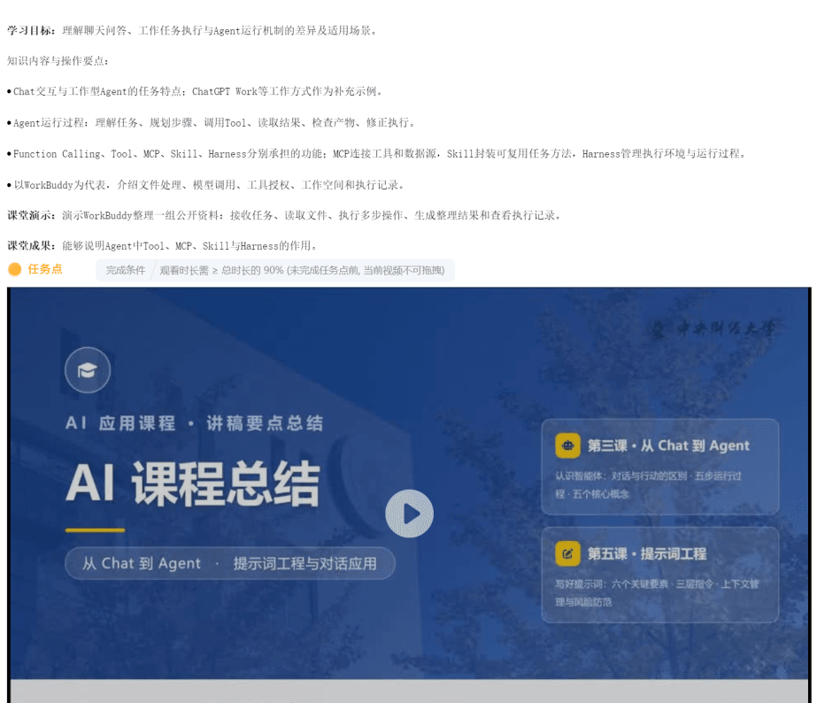
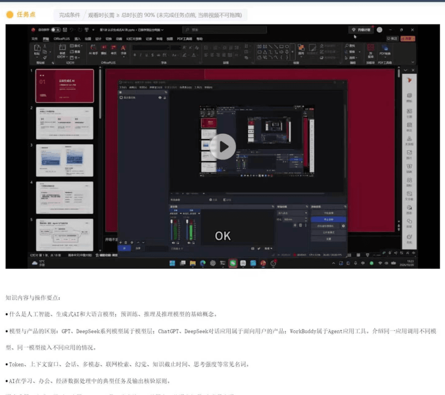

> **转载说明：** 本文为经授权的全文转载。原文标题《"信彩纷呈"课程推介 | AI应用基础与智能体实践系列课程重磅推出！》，作者/公众号：Cyber先锋社，[原文链接](https://mp.weixin.qq.com/s/CAuelJKmzt2_nQjRVC82zA)。版权所有：Cyber先锋社，All Rights Reserved。

**Cyber先锋社**

**智见未来·AI微思政工作室**

**AI应用基础&智能体实践**

系列课程推介

引言

**精研智能，笃行实操**

信息学院近期重磅开展**第三届"信彩纷呈"创意编程大赛**，提供学以致用、比拼能力的实战平台。为帮助同学们更好地完成参赛作品，Cyber先锋社联合智见未来·AI微思政工作室，特别推出系列课程。课程所学的AI实操技能可直接应用于创作，真正做到以赛促学，助你积累科创经历、提升综合竞争力。其中，参赛选手完成12课时的学习后，可在总成绩中获得十分的额外奖励。欢迎各位同学踊跃报名参与！

赛事链接👉

[https://mp.weixin.qq.com/s/VCZQAqA_R5COq6wNQHA0Tw](https://mp.weixin.qq.com/s?__biz=MzY4NTM0MjgwNQ==&mid=2247613691&idx=2&sn=64752574bfd11741c22daac0687814ea&scene=21#wechat_redirect)

本课程强调AI实操赋能，同时也直面当下的现实困境：AI虽已全面普及，但许多同学对大模型的原理、工具配置仍缺乏系统认知，日常使用往往停留在浅层问答层面。由于不了解底层逻辑，很难将AI真正应用到学习、科研与实操中，从而错失了效率提升的巨大优势。

为了打破AI学习的信息差与专业壁垒，面向全学科零基础学习者，全新推出《AI应用基础与智能体实践》12课时实战课程。课程摒弃碎片化科普，采用系统化的实操教学模式，手把手带你吃透大模型调用、智能体部署等核心技能，让零基础的你也能够轻松入门，真正实现AI的落地应用。

*PART 01*

*Course Highlights*

***打破信息壁垒，从零通用实战***

**01**

**闭环体系教学**

TECHNOLOGY

12课时循序渐进：AI理论认知 → API实操落地 → 智能体部署 → 场景实战应用 → 科研能力进阶

**02**

**全程硬核实操**

TECHNOLOGY

手把手教学模型API调用、WorkBuddy搭建、MCP连接器、Skill技能拓展与项目归档等，所有操作均可复现、直接自用。

**03**

**全学科通用场景**

TECHNOLOGY

聚焦数据整理、趋势分析、政策比对、文献梳理等刚需场景，适配各专业作业、论文、竞赛与课题研究。

*PART 02*

*Course Content Overview*

***课程内容速览***

—课程概要—

01 理论基础（1-4课时）

精讲大模型核心原理，读懂API、Token、RAG、智能体核心机制，搭建完整AI认知框架

02 工具实操（5-8课时）

系统学习提示词工程、模型API配置调用、WorkBuddy部署、MCP/Skill拓展与项目管理，全程动手实操。

03 场景实战（9-12课时）

落地多领域通用实操：数据整理可视化、政策对比核验、文献分析、AI辅助课题与论文写作，适配跨学科需求。

TECHNOLOGY

**课程示例**

*PART 03*

*Participation Method*

***课程参与方式***

扫描下方**二维码**，即可加入课程学习社群，解锁完整课程内容、实操素材与专属答疑服务。欢迎各位零基础同学踊跃参与，从零开启 AI 实战学习之旅，突破认知壁垒，收获全新技能！

出品 | Cyber先锋社、智见未来·AI微思政工作室

来源 | Cyber先锋社

撰稿 | 李雅晴

排版 | 苗圃铖

责编 | 马月慧、吴雨阳

校审 | 贺译民

审核 | 张琳琳