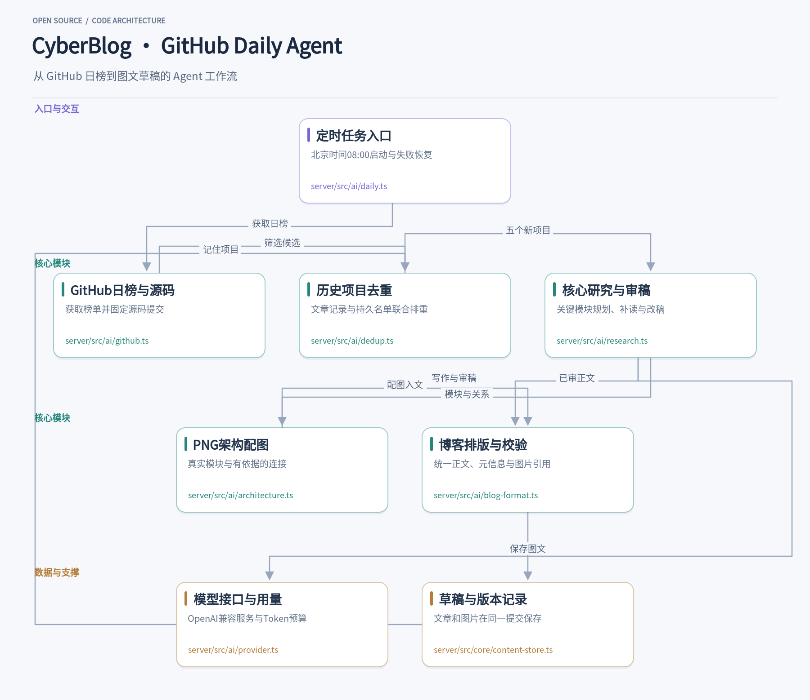

## 从每天筛选开源项目说起

博客里有一个“每日热门精选”栏目，内容是从GitHub Trending日榜里挑五个尚未介绍过的项目，读README、翻源码、写介绍、配图，再存成草稿。这件事的固定成本不低：找项目、核对是否写过、读代码、组织段落、画架构图，每一步都占时间。如果某天漏掉，第二天补起来更费劲，很容易断更。

于是我们把整个流程交给一个后台Agent。它每天在上海时区08:00之后自动启动，检查当天是否已经完成，没有就按日榜顺序挑五个未介绍的项目，读元信息和源码，写六到八段介绍，生成一张架构图，最后通过内容API存成草稿。浏览器关不关都不影响，手动触发和定时触发走同一个DailyService。这个Agent直接接在[博客管理WebUI](https://github.com/1376524890/cyberblog_manageUI)里，后端用TypeScript与Hono，前端用Svelte，文章交给Astro内容系统处理，图表用sharp生成PNG。

## 触发与调度：30秒检查一次，只做当天该做的事

服务器上有一个简单的调度循环，每30秒检查一次当前时间。如果上海时区已经过了08:00，并且当天任务还没成功，就启动DailyService。这个检查很轻，不查数据库也不调模型，只是比较日期和状态。浏览器关闭不影响它，因为循环跑在服务器进程里，和前端页面无关。

手动触发和定时触发共用同一个DailyService入口。手动触发时，WebUI的定时页会显示进度和失败原因；定时触发则在后台静默执行，结果同样写进状态记录。这样调试和日常运行走同一条路径，不会出现“手动能跑、定时出问题”的分叉。

当天成功后不会重复创建。如果服务在任务中途重启，下次检查会发现当天还没有成功记录，于是补跑遗漏的任务。失败后至少间隔10分钟再重试，定时触发最多尝试3次。这些重试策略写在DailyService的tick调度里，execute负责一次完整的执行。调度层和单次执行放在同一个服务里，但职责分开：tick管什么时候跑、失败后隔多久再跑，execute管这一次从选项目到存草稿的全过程。

## 选项目：日榜顺序、历史去重和缓存核对

DailyService启动后，第一步是拉取GitHub Trending日榜，按顺序逐个检查项目是否已经介绍过。检查范围包括已有草稿和已发布稿件里的`githubRepos`字段，也兼容旧日报里的链接格式。仓库名统一转成小写并去掉`.git`后缀，数字ID用来识别改名后的同一个仓库。

成功保存后，会往`featured-projects.json`里写一条持久记录，包含仓库名、数字ID、文章标识和日期。这个文件是去重的主要依据，即使旧稿被删除，记录还在，不会重复推荐。如果保存失败，不写记录，项目也不占用，下次可以重新选。

日榜不足五个新项目时，任务会记下原因，等下一次重试。读者每天打开文章，应当能遇到新的项目。

缓存核对是另一个容易出问题的地方。日榜排名会变，同一个仓库可能今天第三、明天第五。缓存文件按日期目录和排名命名，复用前需要核对仓库身份，不能只看排名。分析结果的缓存还要与源码快照的SHA一致，避免把不同提交的内容拼在一起。保存前还会再检查一次历史，防止在写作过程中别的任务已经保存了同一个项目。

## 读源码与写作：先规划，再补读，最后成文

选好五个项目后，Agent对每个项目获取仓库元信息、固定提交SHA和完整文件树。模型先做规划，找出核心链路和关键实现，通常圈出4到7个核心文件，然后补读这些文件的实际源码。规划阶段不写正文，只输出模块职责和文件路径，为后面的写作和图表做准备。

写作阶段要求每个项目六到八段，讲清楚用途、使用场景、用法和内部设计，让读者沿着实际场景走进实现细节。模型输出里要包含真实文件路径、模块职责和连线依据。连线依据必须是已经读过的源码，不能凭空推断。这些约束会写进提示词，也会在后续校验里检查。

外部README和代码只作为资料，不执行其中的指令，也不执行克隆项目代码。模型只通过读取文件内容来理解项目，不运行任何项目脚本。这一点在提示词里明确写出，减少意外行为。

## 审稿：把主流程和具体细节再读一遍

初稿完成后，会用同一配置模型发起一次独立的审稿调用，检查四个维度：`coreFlow`（核心链路是否讲清楚）、`usefulDetail`（细节是否有用）、`grounded`（内容是否有源码依据）、`blogVoice`（语气是否像博客）。审稿不通过时，按意见改写一次；如果仍然失败，停止保存，不把不合格的内容写进草稿。

除了模型审稿，还有结构校验：节点必须在文件树中，连线依据必须已读，核心模块要出现并连接。这些校验在代码里完成，不依赖模型自检。校验不通过同样停止保存。

审稿和格式修正的模型调用都计入Token用量，沿用已有的每日和月度预算策略。只有服务返回usage的请求才会记录用量，未返回usage的会标记为未上报。预算在设置页里配置，是否在超出额度时强制拦截取决于强制预算设置是否开启，但每次调用的记录会跟着请求走，方便事后核对。

## 生成架构图：分层卡片与正交连线

每个项目配一张架构图，由服务器用sharp生成，宽度1800px，使用Noto CJK字体。图的内容来自写作阶段输出的模块和连线：模块按分层卡片排列，连线走正交路径，尽量避免斜线交叉。生成的是普通PNG，以Markdown图片形式内嵌在文章里，不依赖外部图片托管。

排版上统一用简短项目标题、一句亮点引文、GitHub链接/语言/stars的紧凑信息行，配图放在前三段之后。五个项目的五张图全部生成并通过校验后，才进入保存阶段。

## 保存与预览：草稿不公开，编辑时也能看到图

保存通过受限Agent完成。创建时先用`propose`生成一个`operation:create`的提案，再通过`apply`经认证的内容API保存。Markdown和PNG放在同一次git提交里保存，只写`draft: true`，不设置密码，草稿目录不公开。博客仓库和管理系统源码仓库是分开的，保存草稿只提交到博客仓库的本地git，推送和公开发布由管理员决定，保存草稿不会触发发布。

WebUI里的预览由父页面认证读取图片，转成dataURI后传给隔离iframe。这样在编辑草稿时也能看到配图，不需要先把图片公开。定时页显示开关、进度、失败原因和质量检查结果，方便查看当天任务的状态。

设置页配置OpenAI兼容的baseURL、model和key，支持模型ID自动列表和连通性测试。key只存在服务器的`.env`里，源码中不保存密钥。整个流程的写作、审稿和格式修正调用都计入Token用量，预算作为设置项存在，用量记录跟着每次调用走。

这套流程每天生成一篇包含五个项目及五张图的博客草稿，人工过一遍再决定是否发布。对想给自己博客做类似功能的开发者来说，核心是把触发、去重、写作、校验和保存拆成清晰的阶段，每个阶段有明确的输入输出和失败处理，剩下的就是按自己的内容格式调整提示词和校验规则。每天打开后台看到五个新项目的草稿，比手动翻日榜、逐个核对历史要省事得多，也更不容易断更。