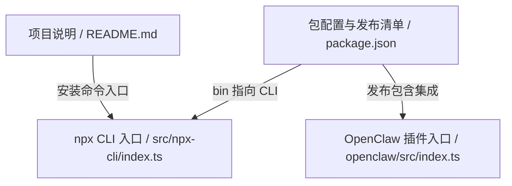
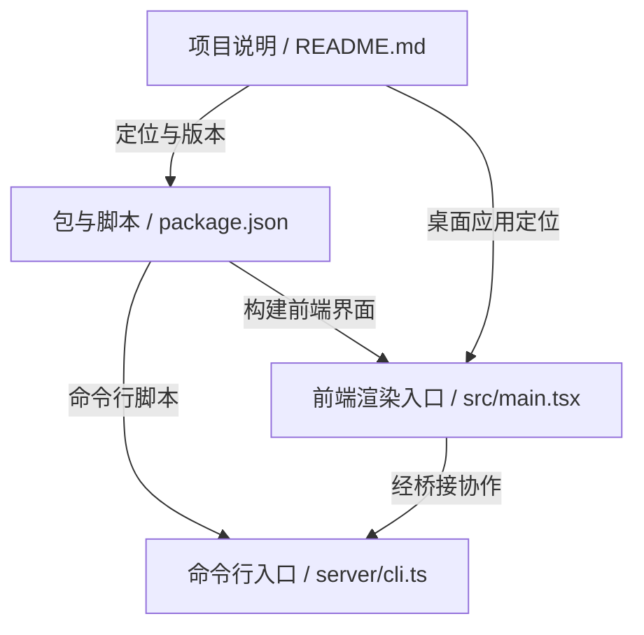
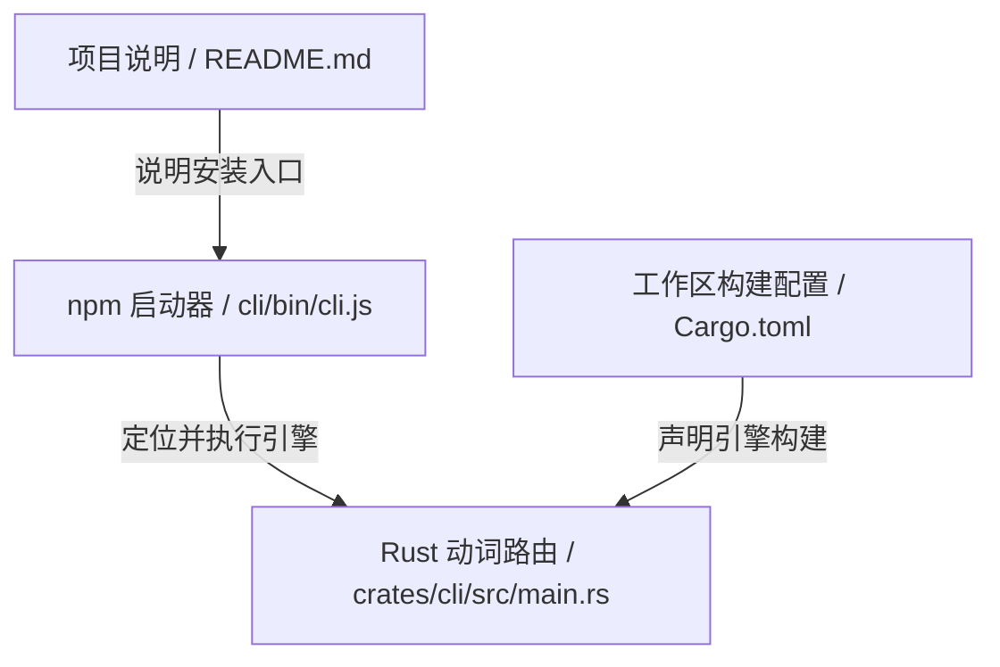
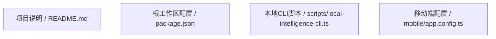
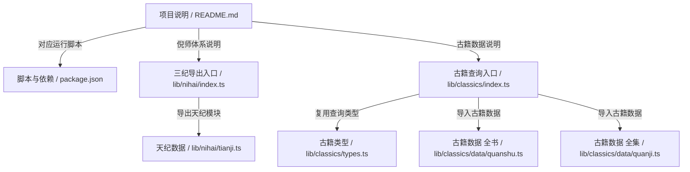

# GitHub 每日热门 Top 5 · 2026-10-30

本期采用 [GitHub Trending daily](https://github.com/trending?since=daily) 抓取时的前 5 名，保留页面原有顺序，并非总星标排名。榜单快照时间：2026/10/30 22:49:22（北京时间）。数据会变化，文中数字仅对应本次快照。

## 1. thedotmack/claude-mem

[仓库主页](https://github.com/thedotmack/claude-mem) · TypeScript · 总星标 105,580 · 当日新增 1,145 · 许可证 Apache-2.0

claude-mem 是面向 Claude Code 等 AI 编码助手的持久记忆压缩系统：它会捕获会话中的工具使用观察，生成语义摘要，并让后续会话获得相关上下文，以维持项目知识连续性。README 给出的安装方式以 npx claude-mem install 为主，也支持 --ide grok-bot、--provider host 等选项；还说明 Grok Bot 无宿主钩子时改为监控聊天日志、默认使用 CMEM Pro 托管记忆，并可通过环境变量关闭 awareness push。package.json 显示项目为 TypeScript/Node 与 Bun 工程，提供 claude-mem 命令入口及多平台打包文件。

### 代码怎样组织

入口线索来自 package.json：bin 将 claude-mem 指向 ./dist/npx-cli/index.js；对应源码 src/npx-cli/index.ts 先解析 process.argv，若首参数是普通选项则按 install 处理，-h/--help/-v/--version 单独保留，并导入版本读取、安装选项和 provider 选择模块。README 展示用户侧流程：通过安装命令选择 IDE/provider，后续由代理捕获观察并生成摘要。openclaw/src/index.ts 可见 OpenClaw 插件 API 类型、命令与事件回调定义，以及默认 worker 端口 37777、SSE 缓冲上限等常量；据此可推断其通过 worker/SSE 获取观察并响应代理事件，但该调用链未被完整读取，属于推断。

> 此图由已读取的源码或文档样本推导，表示模块或资料关系；未执行仓库代码，连线不代表已验证的运行时调用。

### 适合谁、有哪些限制

适合使用 Claude Code、Cursor、Codex、OpenClaw 等 AI 编码代理，并希望跨会话保留项目上下文、检索历史观察的开发者与团队；也适合需要了解 npx 安装入口、多 IDE 接入和基础排障的维护者。

本次仅读取 README、package.json、npx CLI 与 OpenClaw 入口的部分内容，未运行安装、未执行测试，也未验证捕获、压缩、注入的实际效果与性能；worker、MCP、数据库和平台兼容性未核对。OpenClaw 事件到 worker 的调用关系仅为基于类型与常量的推断。

### 本次读取的源码

- [README.md](https://github.com/thedotmack/claude-mem/blob/325afb60108d4ab04e24d715f244bd591ca33fbe/README.md)（前 153 行以内的截取）
- [package.json](https://github.com/thedotmack/claude-mem/blob/325afb60108d4ab04e24d715f244bd591ca33fbe/package.json)（前 147 行以内的截取）
- [src/npx-cli/index.ts](https://github.com/thedotmack/claude-mem/blob/325afb60108d4ab04e24d715f244bd591ca33fbe/src/npx-cli/index.ts)（前 69 行以内的截取）
- [openclaw/src/index.ts](https://github.com/thedotmack/claude-mem/blob/325afb60108d4ab04e24d715f244bd591ca33fbe/openclaw/src/index.ts)（前 220 行以内的截取）

分析提交：`325afb60108d4ab04e24d715f244bd591ca33fbe`。目录树已截断；仅读取 README、清单和关键源码样本，未进行完整审计或性能实测。

---

## 2. milind-soni/OpenMausBot

[仓库主页](https://github.com/milind-soni/OpenMausBot) · TypeScript · 总星标 8,111 · 当日新增 899 · 许可证 Apache-2.0

OpenMausBot 是面向本地优先的多 AI 智能体聊天桌面应用，定位为 Grok Bot 的开源替代。它把每个侧栏机器人视为独立代理，可为机器人配置人格、模型、云电脑或本地虚拟机与已连接应用；底层可调用本机已安装的 claude、codex、grok CLI，并使用本机现有登录，不需要额外代理服务。项目基于 TypeScript、React 19、Electron，命令行提供 setup、serve、pair、sessions 等能力，数据目录可配置在 ~/.openmausbot。亮点是本地桥接、代理拥有可操作环境、Apache-2.0 开源，适合自托管与自带模型的用户。

### 代码怎样组织

本次实际读取 README.md、package.json、src/main.tsx、server/cli.ts 四个文件。src/main.tsx 是前端渲染入口：启动时先执行界面模式、皮肤、字体和聊天宽度设置，再由 chooseRoot 按 location.pathname 与 window.ogb 桥接决定渲染 HomeScreen、ChromeRail、BrowserSignInPage/PairPage、DesktopViewer 或 App；未登录时还会用 SignedOutAtHome 提供回退，最后并行执行品牌初始化和根节点选择，再以 createRoot 挂载。server/cli.ts 是命令行参数解析模块，导出 CliOptions、COMMANDS 和 parseArgs，默认端口 8799、数据目录 ~/.openmausbot，并覆盖 setup、serve、pair、sessions 等命令面；文件注释说明 main 在其他模块，因此这里不推断其执行流程。package.json 显示 Electron 主入口为 electron/main.mjs、Node 版本要求和 pnpm 脚本，README 说明本地 harness、代理 CLI 与可操作电脑的产品定位。节点间关系图仅表示已读文件呈现的模块或文档关联，其中前端与服务端的协作细节属于推断，未做调用链验证。

> 此图由已读取的源码或文档样本推导，表示模块或资料关系；未执行仓库代码，连线不代表已验证的运行时调用。

### 适合谁、有哪些限制

适合希望本地优先、自托管并自带模型的开发者和技术团队：可用现有 claude、codex 或 grok CLI 搭建多机器人聊天桌面，按需接入云电脑、本地虚拟机或已连接应用；也适合评估 Electron、React 与本地服务桥接架构的贡献者。

仅审阅四个文件，仓库树被截断，未读取 App、会话桥接、配对、服务端主流程及云电脑或 Composio 实现，未运行构建或测试。桌面端与 CLI 的调用关系部分为推断；打包、跨平台宿主控制、隧道、安全与性能均未验证，README 中的平台限制也需以实际代码和文档为准。

### 本次读取的源码

- [README.md](https://github.com/milind-soni/OpenMausBot/blob/10af83e74dd7b5f7895fa498e0009c6ccc12a813/README.md)（前 98 行以内的截取）
- [package.json](https://github.com/milind-soni/OpenMausBot/blob/10af83e74dd7b5f7895fa498e0009c6ccc12a813/package.json)（前 101 行以内的截取）
- [src/main.tsx](https://github.com/milind-soni/OpenMausBot/blob/10af83e74dd7b5f7895fa498e0009c6ccc12a813/src/main.tsx)（前 58 行以内的截取）
- [server/cli.ts](https://github.com/milind-soni/OpenMausBot/blob/10af83e74dd7b5f7895fa498e0009c6ccc12a813/server/cli.ts)（前 149 行以内的截取）

分析提交：`10af83e74dd7b5f7895fa498e0009c6ccc12a813`。目录树已截断；仅读取 README、清单和关键源码样本，未进行完整审计或性能实测。

---

## 3. pbakaus/impeccable

[仓库主页](https://github.com/pbakaus/impeccable) · Rust · 总星标 96,562 · 当日新增 2,299 · 许可证 Apache-2.0

Impeccable 是面向编码代理的界面设计词汇与检查工具集：用 polish、bolder 等命令引导改稿，用 critique、audit 做评审，并通过确定性检测规则拦截常见的“AI 味”界面。README 列出 24 个命令、三种检测运行方式（代理钩子、终端或 CI、浏览器实时模式），并说明 init/document 生成 PRODUCT.md 与 DESIGN.md 作为后续上下文。仓库同时提供 Rust 引擎、npm 启动器以及多套代理技能说明。

### 代码怎样组织

入口分两层。npm 包入口 cli/bin/cli.js 先自行响应 --version，再由 locate() 按 $IMPECCABLE_BIN、平台可选依赖、~/.impeccable/bin/<版本> 缓存、校验后下载的顺序找到二进制；下载与缓存用 sha256 对照 engine-checksums.txt，随后 exec 引擎。Rust 侧 crates/cli/src/main.rs 是唯一动词路由：读取第一个参数，分发 detect、ignores、skills、install/update、context、hook、live*，并把路径形状参数回落到 detect；各动词 crate 约定返回 i32，main 统一刷新 stdout/stderr 后退出。Cargo.toml 表明这是 crates/* 工作区，并声明 detect、html、browser、live、context、hook 等内部依赖，发布配置启用 LTO、strip 与 panic=abort。上述“动词 crate 的实现细节”仅能从路由与依赖声明推断，未读取这些 crate 源码，因此不构成完整调用图。

> 此图由已读取的源码或文档样本推导，表示模块或资料关系；未执行仓库代码，连线不代表已验证的运行时调用。

### 适合谁、有哪些限制

适合使用 Claude Code、Cursor、Codex CLI 等编码代理，并希望把界面设计从“随意发挥”变成可复用命令的开发者与设计工程师；也适合在 CI 或本地对现有页面做可重复的界面质量扫描，以及需要在浏览器中快速挑选变体的前端团队。

未运行安装、CLI 或 live 模式，未验证平台二进制下载、校验缓存、代理钩子兼容性，也未核对 24 个命令与 62 条规则的实际覆盖。tree 中多个代理目录含重复技能文件，是否自动同步未验证。仅读取少数入口与配置，crate 间调用关系、检测准确性、性能与测试结论均未确认；README 的适用工具列表属于项目自述。

### 本次读取的源码

- [README.md](https://github.com/pbakaus/impeccable/blob/df3a4abe7d0840d5f60324812c432e00b66a4e75/README.md)（前 80 行以内的截取）
- [Cargo.toml](https://github.com/pbakaus/impeccable/blob/df3a4abe7d0840d5f60324812c432e00b66a4e75/Cargo.toml)（前 47 行以内的截取）
- [cli/bin/cli.js](https://github.com/pbakaus/impeccable/blob/df3a4abe7d0840d5f60324812c432e00b66a4e75/cli/bin/cli.js)（前 121 行以内的截取）
- [crates/cli/src/main.rs](https://github.com/pbakaus/impeccable/blob/df3a4abe7d0840d5f60324812c432e00b66a4e75/crates/cli/src/main.rs)（前 113 行以内的截取）

分析提交：`df3a4abe7d0840d5f60324812c432e00b66a4e75`。目录树已截断；仅读取 README、清单和关键源码样本，未进行完整审计或性能实测。

---

## 4. CopilotKit/OpenBot

[仓库主页](https://github.com/CopilotKit/OpenBot) · TypeScript · 总星标 8,532 · 当日新增 707 · 许可证 MIT

OpenBot 是面向自托管场景的开源 AI 同事平台模板：每个 Bot 拥有独立浏览器、文件与工具权限，可接入任意 AG-UI 代理，并通过统一网关在执行前做策略判定、执行后留痕。仓库强调可克隆、可改造，而非托管产品；Docker Compose、PostgreSQL、模型凭据自备，示例 Bot 以配置加入。亮点是框架无关的 AG-UI 接入、每个 Bot 独立计算机，以及“先决定、后记录”的治理叙事。项目处于 Beta，定位为起点模板。

### 代码怎样组织

本次读取的入口线索主要来自 package.json 与 README.md：根包为私有工作区，声明 app、server、worker、shared、toolkit、extension 六个 workspace；dev 脚本先生成应用配置，再并行启动 app 与 server，说明 Web 应用与服务端是本地开发主链路，但具体 server 启动文件未在所读样本中，属于推断。README 给出更高层数据流：用户请求进入服务端，再经 AG-UI 送到 Bot；Bot 的工具调用回到网关，由网关解析目标、按策略判定、写入审计，再执行或拒绝；这是文档描述，未通过源码验证。scripts/local-intelligence-cli.ts 是可读的桌面侧辅助脚本：它在 node_modules、Bun/npm 全局目录和 npx 缓存中查找已安装 copilotkit CLI，校验包名、bin、版本和路径，再用当前运行时 spawn 子进程，带超时、中止和 stdout 上限。mobile/app.config.ts 仅定义 Expo 应用标识、路由、安全存储与通知插件，不能据此推断移动端业务逻辑。所读文件间没有可直接确认的导入或调用关系，故不设连线。

> 此图由已读取的源码或文档样本推导，表示模块或资料关系；未执行仓库代码，连线不代表已验证的运行时调用。

### 适合谁、有哪些限制

适合希望把 AI 同事部署在自己基础设施上的团队，尤其是需要接入多种 AG-UI 代理、为每个 Bot 隔离浏览器与文件、并要求操作可审批可审计的组织；也适合想基于模板二次开发产品界面的 TypeScript 团队。需要具备 Docker、Bun、模型凭据与 CopilotKit Intelligence 的基本运维能力。

项目自称 Beta 模板，不提供托管版或可依赖的发布包，README 也提示粗糙边缘；本文未运行代码，未验证网关、浏览器隔离、审计与审批的实际行为，也未确认 server/app 主入口和测试结果。scripts/local-intelligence-cli.ts 只体现 CLI 查找与进程执行，不能代表整体架构。性能、安全性和跨框架兼容性均未独立验证。

### 本次读取的源码

- [README.md](https://github.com/CopilotKit/OpenBot/blob/9ff961895603b563f21ad691ab4c41c0179cd65d/README.md)（前 76 行以内的截取）
- [package.json](https://github.com/CopilotKit/OpenBot/blob/9ff961895603b563f21ad691ab4c41c0179cd65d/package.json)（前 55 行以内的截取）
- [mobile/app.config.ts](https://github.com/CopilotKit/OpenBot/blob/9ff961895603b563f21ad691ab4c41c0179cd65d/mobile/app.config.ts)（前 19 行以内的截取）
- [scripts/local-intelligence-cli.ts](https://github.com/CopilotKit/OpenBot/blob/9ff961895603b563f21ad691ab4c41c0179cd65d/scripts/local-intelligence-cli.ts)（前 161 行以内的截取）

分析提交：`9ff961895603b563f21ad691ab4c41c0179cd65d`。目录树已截断；仅读取 README、清单和关键源码样本，未进行完整审计或性能实测。

---

## 5. Renhuai123/ziwei-doushu

[仓库主页](https://github.com/Renhuai123/ziwei-doushu) · TypeScript · 总星标 10,931 · 当日新增 1,146 · 许可证 MIT

Renhuai123/ziwei-doushu 是一个以倪海厦《天纪》体系为背景的紫微斗数开源排盘项目，仓库简介称其包含排盘算法、四化系统、格局知识库与古籍原文数据。代码采用 TypeScript 与 Next.js，package.json 提供开发、构建、类型检查和一组回归测试脚本，README 则说明项目理念、数据集、界面 Demo 与开源边界。本次可读源码显示，lib/nihai/index.ts 统一导出天纪、人纪、地纪相关模块及倪海厦传记常量；lib/classics/index.ts 把三本古籍静态打包，提供按书、章节、段落查询和全文子串搜索。亮点是代码与知识数据分层清晰、古籍查询不依赖数据库，但排盘核心与前端集成未在本次读取范围内验证。

### 代码怎样组织

从已读取文件看，package.json 是运行入口说明：dev/build/start 指向 Next.js，test 串联 scripts/regression 下的多个 tsx 测试文件，typecheck 使用 tsc --noEmit；这里只能证明脚本存在，不能证明测试已通过。lib/nihai/index.ts 是倪海厦资料的统一导出层，集中导出 types、天纪模块（TIANJI_MODULES、HEXAGRAMS、TIANJI_QUOTES 等）、人纪模块、地纪模块，并定义 NI_HAIXIA_BIO 与 SANJI_CATEGORIES；数据实际来自 ./tianji、./renji、./diji，但本次未读取这些文件的具体内容。lib/classics/index.ts 是古籍查询入口：它导入 guSuiFu、ziWeiQuanJi、ziWeiQuanShu 三份数据，汇总为 ALL_BOOKS，再提供 getBookBySlug、getChapter、getParagraphById 和 searchClassics；搜索采用逐段落 indexOf 子串匹配，截取命中前后各 40 字，经 escapeHtml 处理并受 limit 限制。前端页面是否调用这些入口、排盘页如何组织数据流，未在本次读取文件中出现，相关模块协作只能视为推断。

> 此图由已读取的源码或文档样本推导，表示模块或资料关系；未执行仓库代码，连线不代表已验证的运行时调用。

### 适合谁、有哪些限制

适合学习紫微斗数排盘、整理倪海厦《天纪》资料、需要古籍原文检索数据的开发者；也适合作为 TypeScript/Next.js 命理知识库与排盘工具的二次开发起点。对只想直接获得命理结论的用户，需先确认仓库是否提供可运行界面与完整数据。

本次仅读取 README、package.json、lib/nihai/index.ts 与 lib/classics/index.ts，未读取排盘算法、前端页面、测试实现和古籍数据正文，故未验证排盘正确性、测试通过、性能、数据集可下载性及页面调用关系。README 中的数据集规模、界面 Demo 与许可范围应以仓库实际 Release 和文件为准；古籍搜索为简单子串匹配，未实现分词或繁简转换。

### 本次读取的源码

- [README.md](https://github.com/Renhuai123/ziwei-doushu/blob/ff9a1470ebe652e57b9d690f5d01db9a04f47aae/README.md)（前 139 行以内的截取）
- [package.json](https://github.com/Renhuai123/ziwei-doushu/blob/ff9a1470ebe652e57b9d690f5d01db9a04f47aae/package.json)（前 39 行以内的截取）
- [lib/nihai/index.ts](https://github.com/Renhuai123/ziwei-doushu/blob/ff9a1470ebe652e57b9d690f5d01db9a04f47aae/lib/nihai/index.ts)（前 149 行以内的截取）
- [lib/classics/index.ts](https://github.com/Renhuai123/ziwei-doushu/blob/ff9a1470ebe652e57b9d690f5d01db9a04f47aae/lib/classics/index.ts)（前 110 行以内的截取）

分析提交：`ff9a1470ebe652e57b9d690f5d01db9a04f47aae`。目录树未截断；仅读取 README、清单和关键源码样本，未进行完整审计或性能实测。

## 阅读与复核说明

本文由 CMS 配置的大模型基于公开源码辅助撰写，保存为待审核草稿。用途、限制与架构解释需要人工复核。Mermaid 为开源绘图工具，结构图随博客渲染，无需向第三方上传私有代码。
