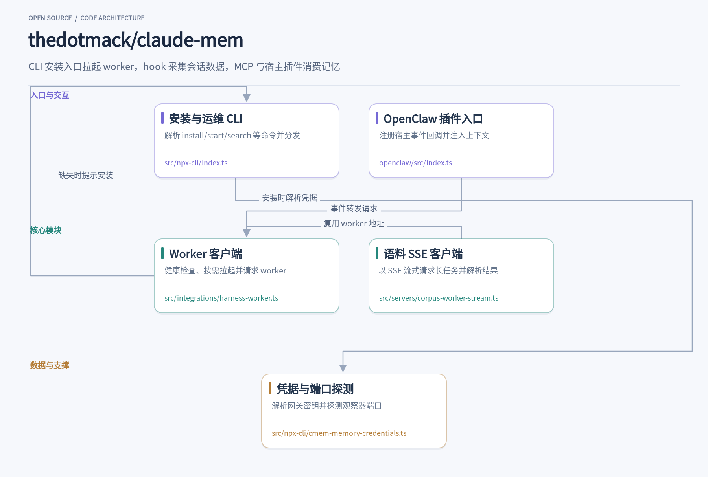
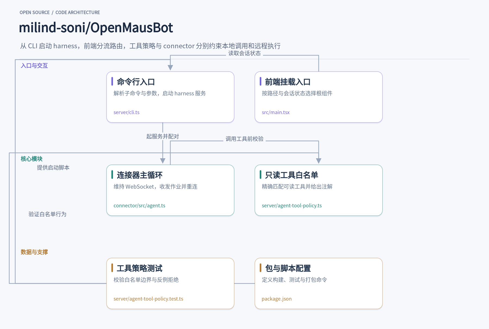
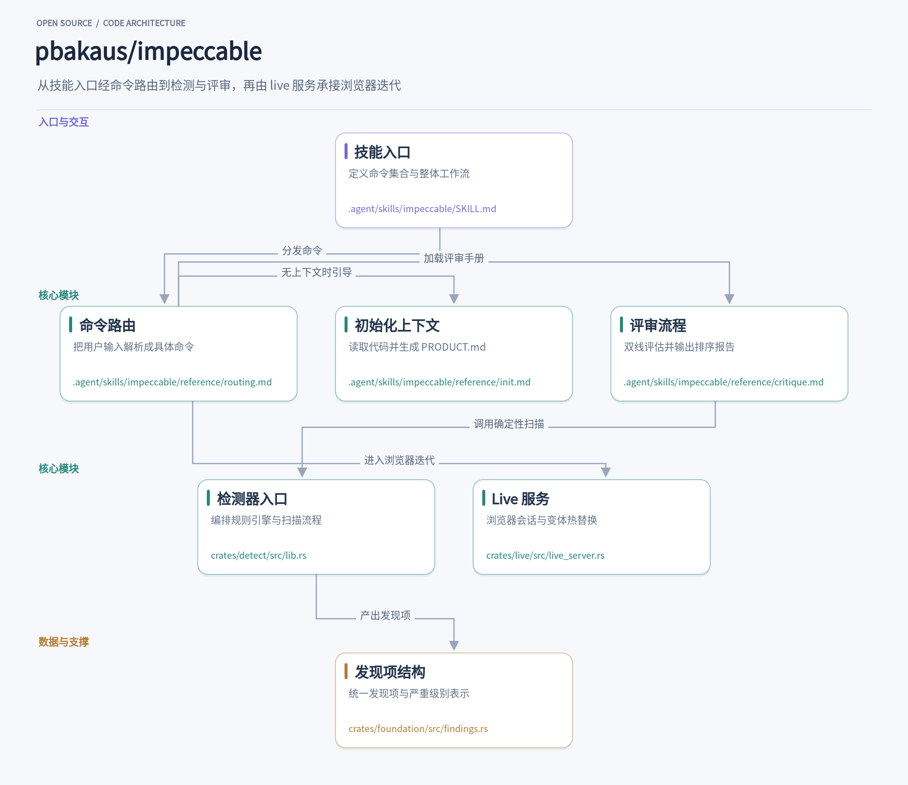
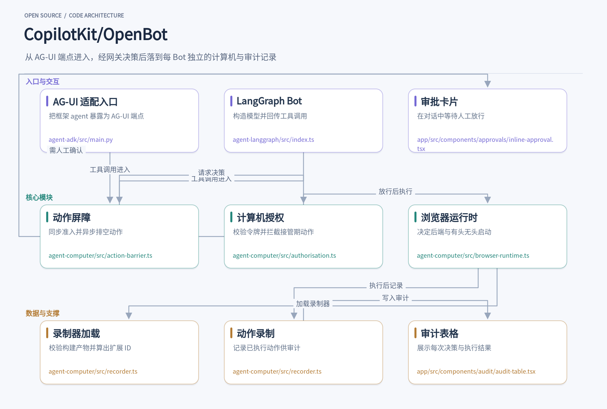
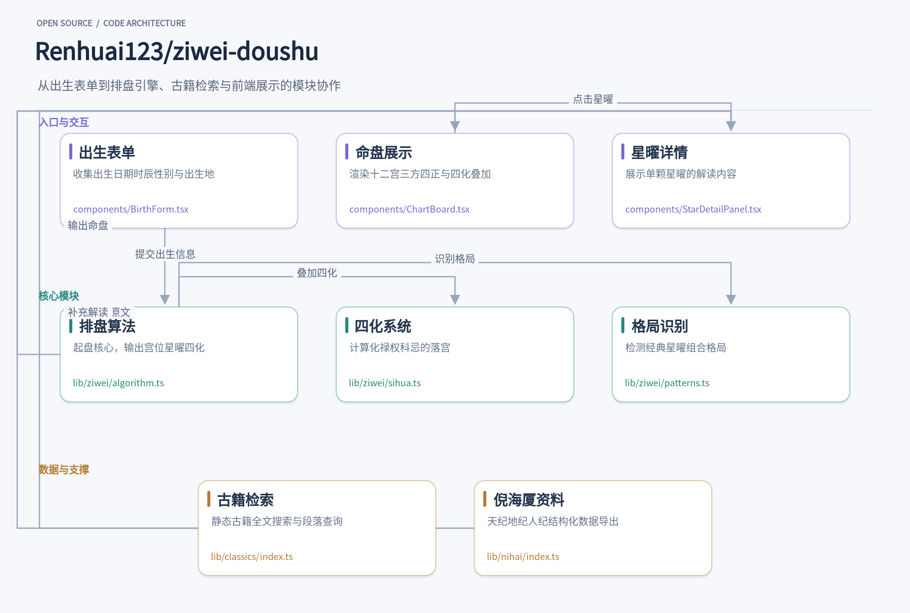

今天翻到的五个项目，各自解决一个具体问题。claude-mem 把 agent 会话压缩成可检索记忆，下次启动自动注入上下文；OpenMausBot 把 Claude Code 和 Codex CLI 装进聊天侧栏，每个 bot 有独立人格、记忆和一台可远程操作的计算机；Impeccable 给编码 agent 补上 24 个设计命令和 62 条确定性规则，把 AI 界面的俗套挡在发布前；OpenBot 让每个 AI 同事拥有自己的电脑，所有动作先裁决后执行；ziwei-doushu 用 TypeScript 把紫微斗数排盘算清楚，从真太阳时到十二宫星曜与四化。它们不共享同一套理念，但都值得打开源码，看看内部模块怎样配合。

## 1. claude-mem

> 把 agent 会话压缩成可检索记忆，下次启动自动注入上下文

[thedotmack/claude-mem](https://github.com/thedotmack/claude-mem) · `TypeScript` · **105,580** stars · 今日 **+1,145** · `Apache-2.0`

你在 Claude Code 里刚排查完一个跨模块的 bug，关掉终端，第二天再开新会话，它完全不记得昨天改过哪些文件、为什么那样改。claude-mem 要解决的就是这个断片问题：它在会话进行中通过宿主 hook 捕获工具调用和用户消息，把原始事件压缩成结构化的观察与摘要，存进本地 SQLite，等下一次会话启动时再按项目检索出来，拼成一段上下文塞回给 agent。安装后由 `npx claude-mem install` 完成宿主接入，运行时可以选择本地 worker 模式或 server 模式。

捕获的起点是各个 hook handler。以 `src/cli/handlers/observation.ts` 为例，每次 PostToolUse 触发时，它先做几项过滤：递归的记忆工具调用直接跳过，项目不在跟踪范围就返回，子 agent 的观察在发出任何网络请求前就被丢弃，避免 fan-out 把 provider 配额耗光。通过过滤后，事件要么在 server 运行时下直接 POST 到 `/v1/events`，要么写进本地 spool 交给 worker 消费。这个 handler 本身被约束成纯函数，不直接写 stdout/stderr，错误由外层统一兜底成 no-op，保证 hook 不会把宿主卡死。

会话初始化走 `src/cli/handlers/session-init.ts`。它先判断当前 prompt 是不是宿主自己的内部协议文本——Codex 的辅助线程、Grok Bot 的研究子 agent 简报、Qwen 的续写发送都会被识别并跳过，不写入假的用户轮次。真正的用户 prompt 会带着 cwd、项目键来源一起发给 `/api/sessions/init`，拿回 sessionDbId 和 promptNumber。如果配置里打开了 `CLAUDE_MEM_SEMANTIC_INJECT`，它还会用当前 prompt 去 `/api/context/semantic` 搜一次相关观察，把结果放进 `hookSpecificOutput.additionalContext` 返回给宿主；这个语义检索是开关控制的，不是每次会话都默认执行。

压缩环节在 server 运行时里由 `src/server/generation/ProviderObservationGenerator.ts` 承担。它是 BullMQ 的 worker processor，每次取到 job 后先按 id 重新加载 Postgres 里的 outbox 行，比对 team/project 与 payload 是否一致，不一致就审计并标记失败，不信任队列里携带的租户信息。随后检查发起 job 的 API key 是否已被吊销，再把 outbox 从 queued 锁到 processing，调用 provider 生成结构化响应，交给 `processGeneratedResponse` 在一个事务里落库、建关联、推进 outbox 状态。provider 调用有超时上限，超时按 transient 处理并走重试路径，但会受每 job 付费发送次数约束。

本地 worker 路径的数据落在 SQLite，由 `src/services/sqlite/SessionStore.ts` 管理。这个类在构造时先做 schema 版本兼容检查，拒绝比当前二进制更新的库，然后跑一长串幂等的迁移方法：加列、建索引、补触发器、修外键。观察的文件路径被单独抽到 `observation_files` 表，按 path 和 observation_id 建索引，这样按文件反查观察是索引查找而不是对 JSON 数组做全表 `json_each`。同一个库里还能看到 `sync_entity_heads`、`sync_content_outbox` 这些同步账本表，说明本地存储在写入时也记录了可同步的变更。

上下文注入侧由 `src/services/context/ContextBuilder.ts` 和 `ObservationCompiler.ts` 配合。Compiler 负责查询：按项目键取最新观察和摘要，项目键多的时候分批查询再合并去重，避免一条 `IN` 查询让 SQLite 排序全部匹配行。Builder 拿到行之后依次渲染 header、时间线、最近摘要、上一条消息和 footer，再交给 `fitContextToBudget` 按字符预算裁剪。观察者健康告警是在预算测量之内渲染的，不是事后追加，否则刚裁到上限的块会被警告顶出去，反而触发整块替换的兜底逻辑。

对 agent 暴露的检索接口在 `src/servers/mcp-server.ts`。它启动一个 MCP stdio server，把 console 输出重定向到日志以免污染协议流，然后按运行时把工具调用分派到 worker HTTP 或 server `/v1` 客户端。worker 模式下有 `search`、`context` 这类工具，server 模式下有 `observation_add`、`observation_record_event`、`observation_search`、`observation_context`，后者要求 `CLAUDE_MEM_RUNTIME=server` 且配置完整，否则返回明确的错误文本而不是静默失败。worker 连接被拒时会尝试拉起一次再重发，server 模式下则不会自动启动 worker。

这套设计里有几处值得借鉴。hook handler 被要求保持纯函数、错误统一降级，让记忆系统出问题时不会拖垮宿主会话；server 侧的生成器把队列 payload 当作不可信输入，每次从数据库重载权威行并校验作用域，把多租户隔离做在执行边界而不是入队边界；上下文预算把告警和正文放在同一次测量里，避免裁剪后又被追加内容顶破上限。这些约束都写在代码注释里，读源码时能直接看到它们对应的具体故障场景。

## 2. OpenMausBot

> 把 Claude、Codex 装进聊天侧栏，每个 bot 都有独立人格、记忆和一台可远程操作的计算机

[milind-soni/OpenMausBot](https://github.com/milind-soni/OpenMausBot) · `TypeScript` · **8,111** stars · 今日 **+899** · `Apache-2.0`

在 OpenMausBot 里，侧栏中的每个 bot 都不是一个套壳聊天窗口，而是一个真实的 agent 进程：Claude Code 或 Codex CLI 在本地运行，拥有独立的人格、模型、记忆、已连接应用和一台计算机。用户像给联系人发消息一样发一段文字或附件，harness 服务器把消息路由到对应 bot 的引擎驱动，agent 执行回合、调用工具，敏感操作以卡片形式回到聊天界面等待审批。整个应用是 Electron 桌面端加一个监听 127.0.0.1 的本地服务器，转录、密钥和事件都落在 ~/.openmausbot，而不是云端。

消息进入后，`server/index.ts` 是本地 harness 的组装点。它建立 HTTP/SSE 路由，加载配置，初始化会话、记忆、计算机控制、MCP 注册表、审批模式等子系统，再把一次发送交给 coordinator 或 `routeDirectTurn`。这个文件很长，但结构上就是“请求进来、找到 bot、组织上下文、调用驱动、把事件写回”的入口。bot 的转录与消息索引由 `server/message-db.ts` 维护，附件、头像和生成图片各有独立模块，聊天界面通过 SSE 接收流式事件。

真正决定一次 agent 回合能做什么的，是 `server/agents-turn.ts` 里的纯函数。它把对话的事实和这一回合的授权分开描述，再拼成一组 OMB_* 环境变量交给引擎：bot 是否启用记忆、是否允许共享计算机、是否在房间里、是否可做技能创作、是否可挑选计算机，都变成显式的开关。代码里 `directTurnKind` 还会区分这条消息来自人、例行任务、webhook、交接还是续跑，拒绝文案据此变化。这样做的好处是工具面在一段对话里保持稳定，避免因为工具增减导致提示缓存整体失效。

引擎驱动是“真实 agent”的落点。`server/drivers/claude.ts` 用 stream-json 双向通信，每个线程保留一个 Claude CLI 进程，prompt 走 stdin，回合由 CLI 自己的 result 帧收束；它按 CLI 版本决定是否传 `--autocompact`、`--setting-sources`、`--strict-mcp-config` 这类参数，并把权限请求和提问抽象成 Ask 结构，等待用户回答或超时拒绝。`server/drivers/codex.ts` 走 app-server 的 JSON-RPC，完成信号是 `turn/completed`，审批以 server→client 请求到达，resumeCursor 就是 Codex 的线程 id。两个驱动都把工具进度、错误和用量转成统一的 RuntimeEvent，界面因此不需要理解每个 CLI 的私有协议。

bot 的“手”由计算机层提供。`server/bot-box/box.ts` 在启动时探测宿主机是否具备 bubblewrap，若具备就打开出口网关、harness 网关和凭据代理三个 unix socket，并把每次 spawn 翻译成 bwrap 参数；box 关闭时，命令、参数和环境原样透传，非 Cloud 主机行为不变。在隔离网络且 broker 开启时，环境里的 API key 会被换成按进程签发、进程退出即撤销的令牌，同时 seccomp 过滤器通过文件描述符交给子进程。`server/computer-control.ts` 则管理“谁在操作这台计算机”：bot 只能请求帮助，只有人能取得和释放控制权，人持有期间 bot 的动作直接被拒绝而不是排队，避免一次迟到的点击落在别的元素上。

记忆不是一段不断增长的对话历史，而是 bot 工作区里的文件。`server/memory-store.ts` 只允许三种路径：`MEMORY.md`、`memory/<topic>.md` 和 `memory/log/<day>.md`，其他路径一律拒绝，防止任意文件读取。写入是原子的、权限 0600，文本先经过 `redactSecretsInText` 脱敏；带 `expectedHash` 的保存会在文件已被别人改过时返回 409，让调用方先看到新版本。单文件超过 `MEMORY_FILE_MAX_BYTES` 会返回 413，提示把长笔记拆到主题文件。索引的容量按行数和字节数双重截断，读取和展示用同一套规则，避免“看到的内容”和“加载的内容”不一致。

审批回流是这套架构里容易被忽略的一环。Claude 驱动的 `Ask` 把权限请求和提问变成可回答的对象，Codex 驱动把审批当作 JSON-RPC 的 server→client 请求处理；两者最终都落到聊天界面上的卡片，用户批准后驱动继续执行，拒绝或超时则让 agent 跳过该动作并收尾。`server/computer-control.ts` 里的求助请求也绑定到具体的消息卡片，只有对应的登录卡片被处理后才算结案。审批模式（手动、自动、完全访问）在共享的 `approval-mode.ts` 中定义，驱动和 harness 都按同一套语义判断。

值得借鉴的设计有三处。第一，把“对话事实”和“回合授权”拆成两层，用环境变量显式传递能力边界，而不是让每个工具在运行时猜。第二，引擎驱动只负责进程、协议和事件翻译，审批、记忆、计算机控制都在驱动之外，换一个 CLI 不需要重写这些子系统。第三，隔离层在关闭时完全透传，开启时才介入，这让同一份代码既能跑在普通开发机上，也能跑在需要强隔离的 Cloud 主机上。对于想构建多 agent 桌面应用的团队，这种“入口薄、驱动专、能力显式”的分层比把所有逻辑塞进一个 agent 循环更容易维护。

## 3. impeccable

> 给编码 Agent 装上 24 个设计命令和 62 条确定性规则，把 AI 界面的俗套挡在发布前

[pbakaus/impeccable](https://github.com/pbakaus/impeccable) · `Rust` · **96,562** stars · 今日 **+2,299** · `Apache-2.0`

让编码 Agent 做一个落地页，十有八九会得到同一套东西：Inter 字体、紫蓝渐变、卡片套卡片、彩色底上的灰字、每个标题上方一个圆角图标块。这些不是随机失误，而是模型在缺乏具体指令时反复收敛到的默认审美。Impeccable 的做法是给 Agent 补上一套设计词汇：用 `bolder`、`quieter`、`polish`、`critique` 这类命令把模糊的“让它好看点”拆成可执行的动作，再用一套不依赖大模型的规则引擎把俗套和可测量的质量问题抓出来。

安装从项目根目录的 `npx impeccable install` 开始，之后在 Agent 里运行 `/impeccable init`。init 会先扫一遍代码库，只问那些从仓库里推不出来的事——产品给谁用、要完成什么、有什么约束——然后写成 `PRODUCT.md`。这份文件是后续所有命令的共同输入：`critique` 拿它判断设计是否贴合产品，`polish` 拿它决定哪些细节值得收尾。再跑一次 `document`，把现有的视觉体系沉淀成 `DESIGN.md`，改动就不会偏离品牌。

命令的入口在 `SKILL.md` 里，一张 24 行的表定义了每个命令属于 Build、Evaluate、Refine、Enhance、Fix、Iterate 中的哪一类，以及该加载哪份 playbook。用户输入 `/impeccable critique the pricing cards` 时，路由先解析出命令和目标，再读取对应的 `reference/critique.md`。目标越窄效果越好，一个区块被仔细看过，胜过整页扫一眼。常用的命令可以用 `pin` 固定成独立快捷键，比如把 `audit` 变成 `/audit`。

`critique` 的 playbook 把评审拆成两条互不可见的评估线：A 线由设计视角读源码、看渲染结果，按 Nielsen 十条启发式逐项打分；B 线跑确定性检测器并做浏览器可视化。两条线各自在隔离子 Agent 里跑完，才在父上下文里汇合，避免检测器的输出先入为主地锚定人的判断。最终报告里，启发式得分表、设计特异性判断、按 P0 到 P3 排序的问题清单和具体到元素的修复建议会一起给出，最后才问用户下一步想改哪里。

检测器是这套工具里最不依赖模型的部分。`crates/detect/src/lib.rs` 把扫描编排成两条引擎接缝：`HtmlEngine` 处理静态 HTML/CSS，`UrlEngine` 处理渲染后的页面，而 detect crate 本身不依赖这两个实现，由 CLI 二进制在启动时注入。规则命中后统一产出 `Finding` 结构，字段顺序与 JS 版本严格一致，严重级别决定它是否带 `advisory: true` 标记。62 条规则覆盖渐变文字、嵌套卡片、过窄内边距、跳级标题这类问题，不需要 API key，在 CI 里跑和在本机跑结果一样。

`live` 模式走的是另一条路径。`crates/live/src/live_server.rs` 起一个本地 HTTP 服务，默认从 8400 端口往上找空位，向浏览器注入 `/live.js`，提供 SSE 事件流、Agent 长轮询、截图暂存和手动文案编辑的提交/丢弃接口。用户在页面上选中元素、切换几个变体，接受其中一个，改动就写回源码。服务端对并发连接设了上限，启动时会回滚上次中断留下的未完成事务，也会清理过期的接受回执。它只改本地工作副本，不适合注入已部署的站点。

值得借鉴的是命令与检测的分层方式。命令层是写给 Agent 读的自然语言 playbook，负责判断和取舍；检测层是确定性的规则引擎，负责给出可复现的证据。两者在 `critique` 里被强制隔离，在钩子里又被串起来：Agent 每次编辑 UI 文件后，设计钩子自动跑检测并把发现回传，在 Agent 宣布完成之前就把问题摆到桌面上。这种“判断归判断、证据归证据”的切分，比让一个模型既当作者又当审稿人更可靠。

另一处设计是上下文文件的单一权威。`PRODUCT.md` 记录产品事实，`DESIGN.md` 记录视觉体系，`init` 明确不碰视觉方向，`document` 只做记录不做发明。`impeccable context` 每次会话读一次，把目标文件、对应的 surface brief 和原生平台指引一起加载进来。当上下文过期时，系统只报告 `CONTEXT_STALE`，不会顺手在某个设计任务里悄悄修复——漂移被当成需要用户决定的事，而不是可以自动抹平的副作用。

## 4. OpenBot

> 让每个 AI 同事拥有自己的电脑，所有动作先裁决后执行

[CopilotKit/OpenBot](https://github.com/CopilotKit/OpenBot) · `TypeScript` · **8,532** stars · 今日 **+707** · `MIT`

你在频道里问一位 AI 同事“帮我查一下上季度的报销单有没有超预算”，它没有直接回答，而是打开自己的浏览器，登录财务系统，翻到对应页面，读取表格，再回到频道里给你一段带引用的结论。整个过程里，它点过的每个按钮、填过的每个字段、读过的每个文件，都先经过一道网关：网关把模型说的“点那个提交按钮”翻译成页面上真实存在的元素，对照你配置的规则判断能不能做，写下一行审计，然后才真正动手。OpenBot 想做的不是又一个聊天框，而是把这套“先决定、后执行、再记录”的流程变成智能体使用工具的唯一通道。

这个项目的起点是一个很实际的问题：让智能体连上浏览器和文件并不难，难的是让它连上之后你还敢让它碰真实系统。大多数框架把工具直接交给模型，模型说调用就调用，出了问题只能事后翻日志。OpenBot 把工具调用收回到服务端，在 `server/src/computer/gateway.ts` 里，每个动作按固定顺序走三步：先把调用方传来的不透明 ref 解析成服务端自己抓取的快照里真实指向的元素，再问策略，最后无论允许还是拒绝都先写审计行，然后才转发给那台电脑。注释里说得很直白：一个基于模型自报标签做决定的网关是表演，“永不点击提交”只要把按钮改名成“继续”就能绕过。

策略本身放在 `server/src/computer/policy.ts`，用 CEL 表达式而不是规则表格。原因写在文件开头：公司想要的边界往往是一句话，“不要在我们域名之外的页面上点任何写着提交的东西”，表格只能表达设计者想到的形状，表达式语言能表达使用者想到的那一条。规则分 `deny` 和 `allow` 两组，deny 优先，空策略默认拒绝，表达式写错也按拒绝处理。还有一个 `dry-run` 模式，规则照常判定、照常记录，但不真的拦，让管理员先拿真实流量试规则、看审计，再切到 `enforce`。这个设计解决的是治理功能最常见的死法：没人敢打开。

光有裁决还不够，被允许的动作得有个地方落。`server/src/computer/supervisor.ts` 负责向容器监督进程要一台电脑：每个人一个容器，他用的所有 Bot 都跑在上面；隔离的 Bot 则单独一个。服务端自己不碰 Docker，只按“这是谁的电脑”发四个动词，地址由监督进程决定，因为只有它知道容器是发布在端口上还是坐在共享网络里。电脑被重置后地址会变，所以服务端不再持有地址，而是每次动作前问一次。文件里还处理了一个细节：`localhost` 在不同运行时解析到不同协议栈，所以默认用 `127.0.0.1` 拼端口，避免“明明在监听却连不上”。

审计不是事后补的报告，而是动作路径的一部分。`server/src/audit.ts` 定义了很长一串事件类型，浏览器动作分 `action_allowed`、`action_refused`、`action_failed`、`action_stopped` 四种，因为“允许了”和“发生了”是两件事，把用户按停止也算进失败会报告出一台坏掉的电脑。人接管浏览器记录成一段时间而不是每一次点击，因为调查者想知道的是“这期间有人在开”，不是把人的每个动作也埋进日志。敏感字段在写入前被一张键名表挡掉，token、密码、工具参数和结果都不进审计。

接入外部智能体的入口在 `server/src/agents/endpoint.ts`。任何说 AG-UI 的端点都能注册成一位同事，但注册时给的 URL 会被这个服务端在每一轮里 POST，这就是典型的 SSRF 形状：不检查的话，`http://169.254.169.254/` 也能注册成“智能体”，运行时替用户去取云凭据。这里的做法是复用浏览导航的目标检查，先拒永不许可的地址，再看是否允许私有网络，并且允许按主机名逐个点名放行——公司自己的智能体确实住在内网，让人关掉整个私有网络开关是最糟的建议。重定向也逐跳检查，跨主机时把凭据和运行断言从请求里剥掉。

频道这一层在 `server/src/channels/routes.ts`，它把“人发消息”变成“某一轮跑起来”。这里能看到几个被真实并发逼出来的设计：频道列表用键集分页，因为侧边栏曾经每次渲染都拉全部频道，而频道只增不减；`direct` 用 PostgreSQL 的咨询锁做 find-or-create，因为两次投递同时到达时，各自没找到就各自建了一个，用户会看到两个 Knowledge 频道、答案分在两边。忙碌状态只广播不落表，因为“正在跑”是一个瞬间而不是关于频道的事实，错过一次最多丢一个点。

数据落在 `server/src/db/schema/computer.ts` 里。策略表的主键是一个常量，构造上只允许一行，因为“哪条策略在生效”这个问题不该存在。快照表按电脑一行、每次快照覆盖，并带上电脑自己打的代号和会话标识，这样来自旧页面的 ref 不会解析到新页面上恰好同名的元素。页面截图按轮次存，一轮只写一次、永不更新，因为对话是记录，记录不该改主意——早先按页面存，两次访问同一地址会互相覆盖，历史回答下面的图会变成后来那张。值得借鉴的地方不在于某个单点，而在于把治理做进了调用路径：ref 对调用方不透明，deny 先于 allow，审计先写再执行，电脑地址每次现问。这些选择单独看都很朴素，合在一起才让“把工具交给模型”和“敢让模型碰真实系统”之间那条线变得可以画出来。项目本身是 MIT 的模板而非托管产品，克隆下来替换 `examples/` 下的租户包，就能把示例同事换成自己公司的那些。

## 5. ziwei-doushu

> 用 TypeScript 把紫微斗数排盘算清楚，从真太阳时到十二宫星曜与四化

[Renhuai123/ziwei-doushu](https://github.com/Renhuai123/ziwei-doushu) · `TypeScript` · **10,931** stars · 今日 **+1,146** · `MIT`

打开一个排盘页面，填上出生年月日、时辰、性别和出生地，几秒后得到十二宫星曜、四化标记和格局判断。这套流程背后是 Renhuai123/ziwei-doushu 的排盘引擎：它基于倪海厦《天纪》体系，把传统排盘规则写成 TypeScript 模块，输入出生信息，输出结构化的命盘数据。项目同时附带格局知识库和古籍原文数据，排盘算法与古籍数据都开放，解读断语库则不在开源范围。

排盘首先要处理时间。用户填的是钟表读数，但紫微斗数排盘用的是地方真太阳时。`lib/ziwei/true-solar-time.ts` 把经度差和均时差合起来算：经度修正按出生地经度与时区中央经线之差乘以 4 分钟，均时差用 NOAA 的 fractional-year 近似式。海外出生地可以传 `utcOffsetMinutes`，中央经线随之变化；国内不传则按东八区 120° 处理，结果逐位不变。算出来的分钟数再映射成十二时辰，子时跨日的情况交给 `resolveZiweiDayOffset` 决定排盘日是否顺延。

时间确定后，农历转换是下一步。`lib/ziwei/lunar-solar.ts` 只做历法换算，不掺命理逻辑。闰月用负月份表示，闰五月就是 -5；某年有没有闰月、某月有几天，一律查 `LunarMonth` 表，不用公历月长去猜。输入非法时返回 null，不会静默滚动到相邻日期——排到一张错盘比报错更麻烦。这个模块被单独抽出来，是因为原生 App 需要一次 HTTP 请求拿到公历日期，换算口径统一收在这里，避免表单层和接口层各写一套闰月规则。

核心排盘在 `lib/ziwei/algorithm.ts`。它调用 iztro 完成安星，但做了大量口径修正。换年规则从立春换年改为正月初一换年，与主流排盘软件对齐；星曜亮度表按《紫微斗数全书》逐宫覆写，注释里记着每一处修正的依据和日期。天魁天钺在辛年按默认派 KY1 对调，大耗、截空、副截、旬空这些杂曜也有专门的修正函数，比如 `applySchoolJiekong` 处理阴干年截空与副截的换宫并重算亮度。

四化系统独立在 `lib/ziwei/sihua.ts`。`getSiHuaByStem` 按天干索引取出禄权科忌四星，`getDaXianSiHua` 取大限宫干、`getLiuNianSiHua` 取流年干，流月用五虎遁、流日取农历日柱干、流时用五鼠遁。闰月后半月的流月归属由 `getEffectiveLiuYueMonth` 决定，跨年时用 `nextYearStem`。模块还提供 `detectSelfSihua` 检测宫干自化，`findIncomingPalaces` 追溯来因宫，多层四化通过 `buildOverlayForStar` 合成展示。

命盘数据齐了，格局识别在 `lib/ziwei/patterns.ts`。每个格局按“必须、加分、破格”三层条件判断，比如君臣庆会要求紫微入命且左辅右弼同会三方四正，再会昌曲或魁钺算加分，地空地劫双夹会照则破格。火贪格、铃贪格检查贪狼与火铃是否同宫或三方会照，武贪格要求武曲贪狼同宫或对拱。每个识别器都带古籍出处字段，描述文本直接写在函数里，输出的是结构化 Pattern 对象。

类型契约集中在 `lib/ziwei/types.ts`。`BirthInfo` 里 `hour` 是时辰地支索引 0 到 11，不是钟点；`origInput` 保留用户原始输入，方便页面提示“已按子时换日归到次日”。`ZiweiChart` 包含十二宫、大限、五行局、命主身主等字段，`Palace` 记录宫干、星曜、自化标记和空宫借星信息。读其他模块之前先看这个文件，数据形状一目了然。

解读层在 `lib/ziwei/db-analysis.ts`，开源版只保留主题标签和宫位映射，`STAR_DB` 置空，知识库详情页因此生成零条静态路由，但列表框架仍可运行。排盘内核、四化、格局和古籍原文完全开放，断语内容库属于线上核心资产。这种切分让引擎可以独立使用：拿到 `ZiweiChart` 之后，接自己的解读数据或直接展示盘面都行。

这五个项目放在一起看，能发现一个共同点：它们都在把模糊的指令拆成可执行、可检查的步骤。claude-mem 把会话拆成观察和摘要，Impeccable 把“好看点”拆成设计命令和规则，OpenBot 把工具调用拆成裁决、执行、审计，ziwei-doushu 把排盘拆成真太阳时、十二宫和四化。OpenMausBot 则把 bot 拆成引擎、记忆和计算机。源码都在，读一读内部模块怎样配合，比看介绍更有收获。
