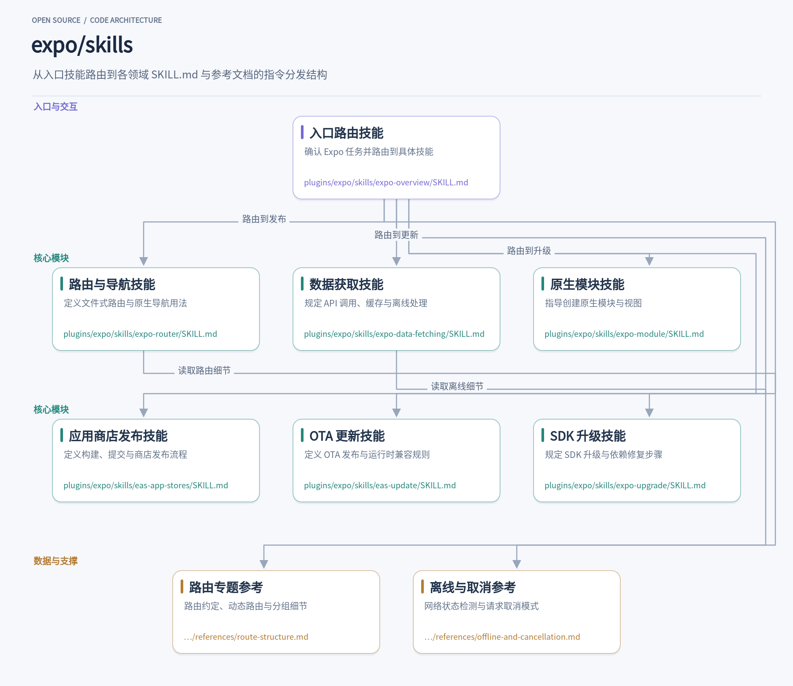
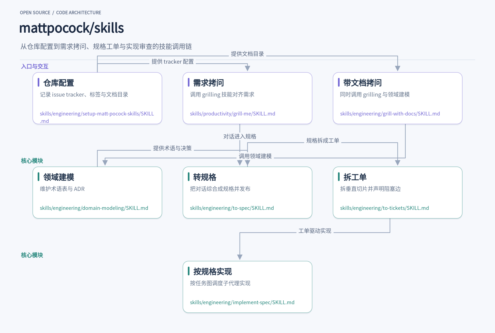
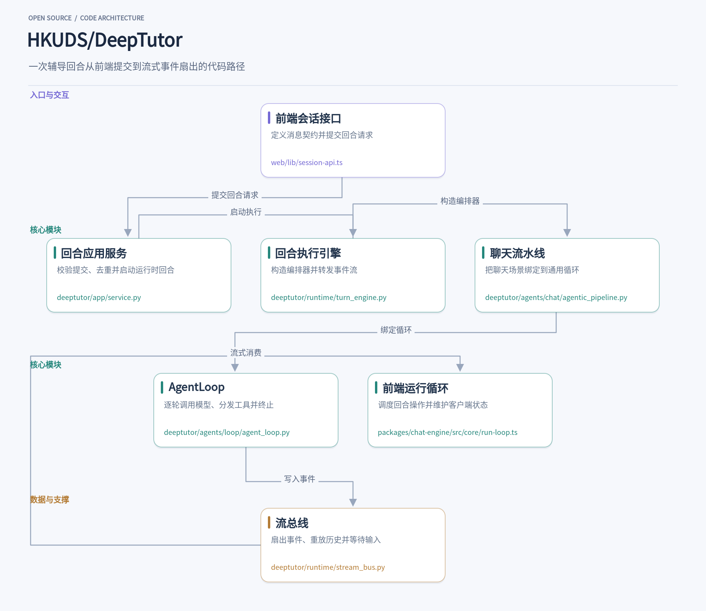
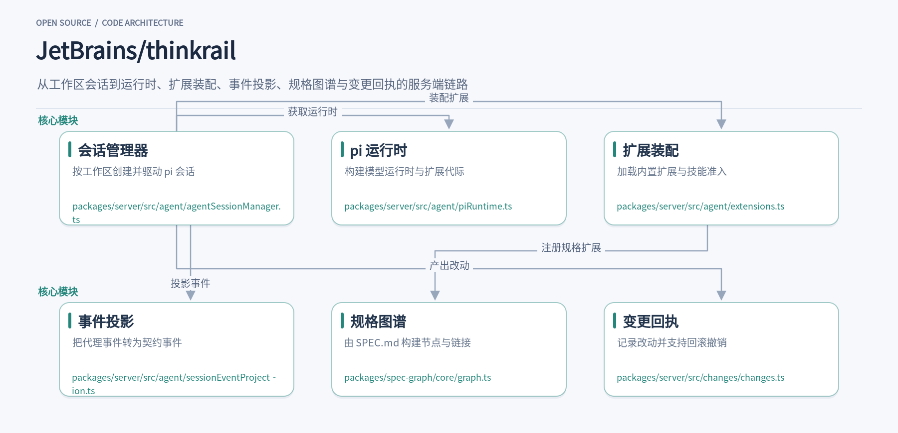
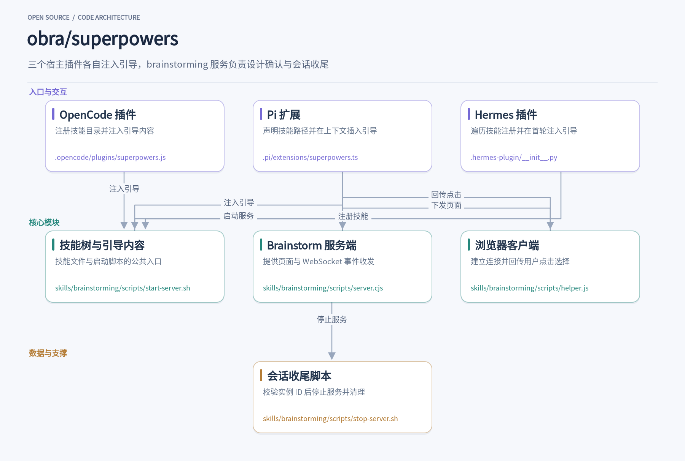

在Claude Code里让代理升级Expo应用，它没有直接翻文档，而是先加载入口技能确认项目依赖，再转给升级技能给出具体命令和版本避坑提醒；在OpenCode里提一个导出需求，代理先反问使用场景和数据量，再进入实现。这些行为背后是几个把开发方法论封装成可组合技能的开源项目。本文介绍五个近期值得留意的仓库：expo/skills、mattpocock/skills、HKUDS/DeepTutor、JetBrains/thinkrail和obra/superpowers。它们分别解决代理领域知识注入、需求拷问与工单拆解、辅导对话回合管理、git worktree隔离代理会话、以及先对齐再写码的流程引导问题。

## 1. skills

> 为 AI 编码代理提供 Expo 与 EAS 领域知识的官方技能集合

[expo/skills](https://github.com/expo/skills) · `Shell` · **3,890** stars · 今日 **+38** · `MIT`

你在 Claude Code 里输入“帮我把这个 Expo 应用升级到最新 SDK”，代理没有直接翻文档，而是先加载了 `expo-overview` 技能。这个入口技能确认项目 `package.json` 里有 `expo` 依赖，识别出目标是 SDK 升级，于是把任务转给 `expo-upgrade`。后者给出了从 `npx expo install expo@latest` 到 `npx expo install --fix`、`npx expo-doctor`、清理缓存的具体步骤，还提醒 SDK 55 及更早版本应直接跳到 SDK 57 以避开 Hermes V1 的内存回归。这就是 expo/skills 的日常用法：把 Expo 官方知识封装成代理可读取的指令文件，让 AI 在正确的约束下工作。

这个仓库解决的核心问题是 AI 代理对 Expo 生态的理解不够精确。Expo 的 API 随 SDK 版本变化，EAS 的构建、更新、发布各有自己的概念模型，React Native 与原生平台的边界也容易混淆。代理如果只靠通用训练数据，容易给出过时的导入路径、错误的依赖安装命令，或者把 OTA 更新当成能改原生代码的手段。expo/skills 把这些问题拆成一个个技能目录，每个目录下有一份 `SKILL.md` 作为主指令，`references/` 里放更细的专题文档，代理按需读取。

安装方式分两条路径。Claude Code 和 Codex 用户通过官方插件市场安装，更新由市场管理；Cursor、OpenCode、GitHub Copilot 等代理则用 skills CLI，在项目根目录执行 `npx skills@latest add expo/skills --skill '*'`，CLI 会询问安装到哪个代理。安装后重启或刷新代理会话，代理就能发现这些 `SKILL.md` 文件。之后你问“用 Expo Router 做一个带标签页和模态框的原生感界面”，代理会从任务上下文和技能描述里选中 `expo-router`，读取其中的路由约定、`Link` 用法、`Stack.Screen` 的模态与表单页配置。

`expo-overview` 是整个体系的入口。它要求代理先确认这是 Expo 或 EAS 工作，再读用户目标，然后按技能地图分类。地图把任务分成“构建应用”“发布与运维”“原生扩展”“维护与学习”四组，每组下列出具体技能。比如“让它看起来原生”这种模糊说法，会被翻译成 `expo-ui`（分组控件）、`expo-native-ui`（屏幕样式）、`expo-animation`（动效）或 `expo-router`（导航）的组合。入口还定义了共享设置规则：检测 SDK 版本、读对应版本的文档而不是 `latest`、用 `npx expo install` 装包、判断项目是托管还是预构建。这些规则在后续技能里反复生效。

路由与数据是应用主流程的两块。`expo-router` 规定路由文件放在 `app` 目录，组件和工具不能混进去，用 `_layout.tsx` 定义原生栈，用 `Stack.Screen` 的 `presentation: 'formSheet'` 做表单页，用 `Link.Preview` 和 `Link.Menu` 补上 iOS 的预览与上下文菜单。`expo-data-fetching` 则要求每个加载数据的屏幕都设计加载、错误、空、内容四种状态，用 React Query 的 `isLoading` 区分首次请求和后台刷新，用 `ListEmptyComponent` 处理空列表，用 `expo-secure-store` 存令牌而不是 AsyncStorage。两个技能都指向 `references/` 下的专题文档，代理在需要细节时才展开。

原生扩展和发布环节由另外几个技能覆盖。`expo-module` 指导用 `create-expo-module` 脚手架生成 Swift、Kotlin 和 TypeScript 三端代码，再按 `expo-module.config.json` 配置自动链接；它明确区分本地模块和独立模块，本地模块默认不生成 `index.ts` 桶文件。`eas-app-stores` 处理构建与提交，给出 `eas.json` 的 profile 示例、`eas build --auto-submit` 命令，以及原生 iOS 项目不引入 Expo 运行时也能用 EAS 交付的路径。`eas-update` 则把构建、更新、分支、通道、运行时版本这几个概念的关系讲清楚，强调原生代码变更必须重新构建，OTA 只能送 JavaScript 和资源。

`expo-upgrade` 是维护阶段的关键技能。它不只列命令，还处理版本间的具体断裂点：SDK 54 的 React 19 变化、SDK 55 的 `expo-av` 拆分为 `expo-audio` 和 `expo-video`、SDK 56 的 `@react-navigation/*` 导入迁移到 `expo-router` 入口。它要求升级后跑 `npx expo-doctor`，检查 `expo.install.exclude` 里的临时排除项是否还需要，清理 `patches/` 下过时的补丁，并提醒 `expo-constants` 在装了 `expo-router` 时要保留为直接依赖。这些细节来自真实项目里的依赖纠缠，代理照着做能少踩坑。

从设计上看，这个仓库把“知识”和“执行”分开：技能文件只写约束、模式和步骤，具体命令交给 Expo CLI 和 EAS CLI，文档链接指向版本化页面。每个技能有独立的 `description` 字段，代理靠它做路由决策，而不是靠文件名猜测。`references/` 的分层让主文件保持可读，细节按需加载。对于想给自家框架写代理技能的人来说，这种“入口路由 + 共享规则 + 叶子技能 + 专题引用”的结构值得借鉴，它让代理在有限上下文里拿到足够精确的指令，又不至于把整个文档库塞进一次对话。

## 2. skills

> 把需求拷问、领域建模与工单拆解串成可组合的 agent 技能链

[mattpocock/skills](https://github.com/mattpocock/skills) · `Shell` · **307,543** stars · 今日 **+876** · `MIT`

当你让编码代理直接动手改代码，最常见的结果是它做了一堆你没要的东西。mattpocock/skills 把这个问题拆成几个小技能：先用 `/grill-me` 让代理反过来问你问题，把模糊需求逼成具体场景，再把对话转成规格与工单，最后才进入实现。每个技能都是独立的 `SKILL.md`，可以单独安装、单独修改，也可以串起来用。

安装方式按代理不同：Claude Code 用 `claude plugin install mattpocock-skills@claude-plugins-official`，Codex 用 `codex plugin add mattpocock-skills@mattpocock`，其他代理可用 `npx skills@latest add mattpocock/skills -a <agent>`。装好后在仓库里运行一次 `/setup-matt-pocock-skills`。这个技能会先读 `git remote -v`、`AGENTS.md`、`CLAUDE.md`、`GLOSSARY.md` 和 `.scratch/` 等痕迹，再逐项问你 issue 放哪、triage 标签叫什么、领域文档放哪，最后把答案写进 `docs/agents/issue-tracker.md`、`docs/agents/triage-labels.md` 和 `docs/agents/domain.md`，并在 `CLAUDE.md` 或 `AGENTS.md` 里加一个 `## Agent skills` 块指向它们。

需求对齐靠 `grill-me`。它的 `SKILL.md` 只有一行：调用 `grilling` 技能。真正的拷问逻辑在 `skills/productivity/grilling/SKILL.md` 里，代理会连续追问你打算怎么用、边界在哪、哪些情况不该发生。`grill-with-docs` 则同时调用 `grilling` 和 `domain-modeling`，在问问题的过程中把术语和决策沉淀下来。比如你说“取消订单”，它会追问你指的是整单取消还是部分取消，因为这两个概念在代码里可能是不同的状态迁移。

`domain-modeling` 维护 `GLOSSARY.md` 和 `docs/adr/`。它要求术语表只放词汇定义，不夹带实现细节；ADR 只在三个条件同时满足时才写：以后改起来代价大、未来读者会问为什么这么做、当时确实有取舍。遇到用户用词和术语表冲突时，它当场指出；遇到模糊词时，它提议一个精确的规范词。这些文档不是写给人类看的摆设，后续 `to-spec` 和 `to-tickets` 会直接使用这套词汇，代理的输出因此变短、变准。

对话对齐之后，`to-spec` 不再访谈，只做综合：它读当前对话和代码库，先和你确认测试接缝放在哪，再按模板写出问题陈述、用户故事、实现决策、测试决策和范围外事项，发布到配置好的 issue tracker，并打上 `ready-for-agent` 标签。`to-tickets` 接着把规格拆成 tracer-bullet 式的垂直切片，每个切片穿过 schema、API、UI 和测试，能独立演示，并声明自己依赖哪些工单。对于跨全库的机械重构，它改用 expand–contract 序列：先加新形式，再分批迁移调用点，最后删旧形式。

实现阶段由 `implement-spec` 驱动。它把工单看成带阻塞边的任务图，始终存在一个可以立即开工的前沿。每个工单交给一个全新的实现子代理，在独立 worktree 和分支上调用 `tdd` 技能推进，完成后由合并子代理合入集成分支，再根据前沿变化启动下一批。子代理之间主要通过指向规格、工单和提交的上下文指针通信，不重复搬运信息。全部完成后，它在集成分支上调用 `code-review`，把问题集中修掉，再按 tracker 的方式关闭工单或把草稿 PR 转为可审查状态。

这套技能的设计值得借鉴的地方在于组合方式：`grill-me` 和 `grill-with-docs` 都是薄入口，真正的行为在 `grilling` 和 `domain-modeling` 里，入口只负责声明调用哪几个技能。`setup-matt-pocock-skills` 把仓库差异收进三个配置文件，后续技能读配置而不是硬编码 GitHub 或本地文件。`to-spec` 和 `to-tickets` 都把“不写具体文件路径和代码片段”作为规则，避免文档随代码漂移。每个 `SKILL.md` 都短到可以读完再改，作者在 README 里也鼓励你直接改。

## 3. DeepTutor

> 把一次辅导对话拆成可去重、可暂停、可重放的回合

[HKUDS/DeepTutor](https://github.com/HKUDS/DeepTutor) · `Python` · **51,847** stars · 今日 **+2,282** · `Apache-2.0`

在 DeepTutor 里向辅导老师提一个追问，前端并不会直接调用模型。`web/lib/session-api.ts` 先检查后端是否支持提交替换（`supportsSubmissionReplacement` 探测 `/api/sessions/capabilities` 的 `submission_replacement` 字段，失败时关闭该能力），然后把会话 ID、附件、LLM 选择等打包成请求。这次提交会带着 `client_submission_id` 进入后端，后续去重、编辑重发都围绕这个标识展开。

进入 `deeptutor/app/service.py` 后，`TurnApplicationService.start_turn` 把请求规整为 `TurnRequest`，按 `client_submission_id` 和请求内容摘要调用 `reserve_submission` 预留提交身份，再查询该提交是否已有对应回合。这样同一次提交在网络重试时不会凭空多出一个新回合，编辑重发也能沿用原消息的父子关系。服务层还负责解析当前 workspace 作用域，让 SDK 或 CLI 调用方不必自己包一层上下文。

服务层解决的是“一次提交如何变成可追踪的回合”，`deeptutor/runtime/turn_engine.py` 解决的是“回合如何被执行”。`TurnEngine.execute` 在交互内存作用域内构造 `ChatOrchestrator`，把 `UnifiedContext` 交给它并逐条转发 `StreamEvent`。默认引擎由 `get_turn_engine` 单例持有，需要替换能力注册表时通过构造函数传入 `capability_registry`，不必改动调用方。

真正决定辅导质量的是 `deeptutor/agents/loop/agent_loop.py`。一个回合就是一次不断增长的对话循环：每一轮调用 LLM，文本立即作为 `content` 流给用户，工具调用则把 `role=tool` 的结果追加回对话。没有工具调用的那一轮就是终止轮；如果探索预算耗尽但还有未完成的工作，会进入最多 3 轮的结算阶段，最后才强制一次无工具收尾。`ask_user` 会暂停回合等待用户回复，再在协议内继续。

`deeptutor/agents/chat/agentic_pipeline.py` 把聊天场景绑到这套循环上。这个类本身几乎是空的，因为聊天就是宿主描述的默认循环；solve、reading、mastery 等深模式在构造时覆盖预算和流命名空间，而不是重写一套调度。这种分层让工具白名单和提示词包留在同一处，聊天模式不会悄悄移除用户已打开的工具。

回合内的事件由 `deeptutor/runtime/stream_bus.py` 统一扇出。`StreamBus.emit` 按订阅者所在的事件循环投递事件，并保留历史供 `subscribe(after_seq=...)` 重放；`stage` 上下文管理器包住阶段开始与结束，`wait_for_input` 把提示发给前端并挂起一个输入队列，`submit_input` 再把用户回复送回等待者。总线注册表 `register_bus` / `get_bus` 让 WebSocket 层能按 `turn_id` 找到对应回合，把用户输入路由到正确位置。

客户端侧 `packages/chat-engine/src/core/run-loop.ts` 与后端循环形成对称。`runLoop` 按 `explorationBudget`、`settlementBudget`、`emptyRecoveryBudget` 调度 `call_round`、`dispatch_tools`、`check_finish` 等操作，每一步都先检查 `AbortSignal`；源码注释明确写着，已经可见的部分响应不能再被重放，因此重试只发生在用户看到输出之前。

值得借鉴的是提交身份与回合执行被拆成两层：`client_submission_id` 让重试和编辑有稳定锚点，`StreamBus` 让工具、阶段、输入请求都走同一条事件通道，前端和后端各自维护一个循环调度器却共享同一套预算语义。读源码时可以从 `service.py` 的 `start_turn` 入手，再顺着 `turn_engine.py` 到 `agent_loop.py`，最后回到 `stream_bus.py` 看事件如何抵达浏览器。

## 4. thinkrail

> 用 git worktree 隔离每个 pi 代理会话，让改动可审查可回滚

[JetBrains/thinkrail](https://github.com/JetBrains/thinkrail) · `TypeScript` · **6,618** stars · 今日 **+722** · `Apache-2.0`

在 ThinkRail 里打开一个 git 仓库，切出一个工作区，就等于得到一份独立的 worktree 和分支。代理在这个目录里改文件、跑命令，你的主检出完全不受影响。多个会话可以并行推进，好的分支合并，其余删掉。真正决定体验的不是界面，而是服务端怎么把「一个工作区」变成「一个可运行的代理会话」——这条链路从 `packages/server/src/agent/agentSessionManager.ts` 开始，所有会话都登记在模块级的 `sessions` Map 里，每条记录绑定工作区、pi 会话实例、运行时代际和一组待处理队列。

会话创建前要先有运行时。`packages/server/src/agent/piRuntime.ts` 负责构建 `ModelRuntime` 代际，它先在离线模式下创建运行时，再通过 `createAgentSessionServices` 加载附加扩展路径，最后对比加载前后的 provider 注册集合，把新出现的 provider 标记为不透明。代际被缓存成 `activeGeneration`，`getPiRuntimeGeneration()` 在首次调用时才真正构建，失败则清空缓存以便重试。切换扩展包时，`preparePiRuntimeGeneration` 会先尝试构建候选代际，成功后才由 `activatePiRuntimeGeneration` 替换当前代际，避免半加载状态污染正在运行的会话。

运行时只提供模型和扩展底座，代理实际能做什么由 `packages/server/src/agent/extensions.ts` 装配。`buildResourceLoader` 把内置扩展、`pi-spec-graph`、工作流、待办等工厂和技能来源一起交给 `DefaultResourceLoader`。技能不是照单全收：`skillsGate` 会按来源分组，项目别名、插件、bundled 各有准入规则，`decideSkill` 返回 `load` 才保留。扩展被禁用时，`omitDisabledRegistryExtensions` 从加载结果里剔除对应工具，`packagePolicyKey` 把安装修订、开关代际和禁用集合拼成一个键，用来判断某个 loader 的包策略是否已经过期。

会话跑起来后，pi 产生的是 `AgentSessionEvent`，前端需要的是契约里的 `PiEvent`。`packages/server/src/agent/sessionEventProjection.ts` 里的 `projectSessionEvent` 做这层转换：`agent_settled` 附带终态结算信息，`compaction_end` 只保留 token 前后对比和错误消息，`tool_execution_end` 和 `tool_execution_update` 则通过 `withoutStructured` 剥掉 `structuredContent` 字段。工具结果里的结构化数据可能很大，也可能包含前端不需要渲染的内部结构，投影层把它挡在事件流之外，下游拿到的就是稳定、可序列化的形状。

代理的项目知识落在 SPEC.md 图谱上。`packages/spec-graph/core/graph.ts` 的 `buildGraph` 接收一组带 frontmatter 的文件条目，用 `scalar` 读出 `id` 和 `type`，缺一不可，然后为每个节点遍历 `LINK_KINDS` 里的单值和列表链接字段，同时填充 `forward` 和 `reverse` 两套邻接表。重复的 id 不会被静默覆盖：`pathsById` 记录同一 id 下的所有路径，最后汇总进 `duplicateIds`，让上层能提示规格冲突。这个结构让代理既能顺着链接找下游依赖，也能反向查谁引用了当前规格。

代理改完文件，用户要能看到改了什么、能撤回。`packages/server/src/changes/changes.ts` 用回执环保存最近若干次变更，`retainReceipts` 同时受条数和字节数限制，默认 20 条、64MB。`revertChange` 先通过 `resolveDiffRange` 解析 diff 范围，如果修改侧是提交而非工作区，直接抛 `SCOPE_IMMUTABLE`；随后用 `assertSameView` 比对原始侧和修改侧的哈希，任何一侧在渲染后被改动都会得到 `STALE_VIEW`，避免把过期的 diff 应用到已经变化的文件上。

回滚本身也分粒度。整文件回滚时，如果原始侧不存在，文件会被 `claimForTrash` 改名后送进回收站，回执里记下 `trashed` 路径；如果原始侧存在，`writeAtomic` 先写临时文件、改权限、再 rename，避免中途失败留下半个文件。范围回滚走 `revertedRange`，要求两侧都是文本，行号必须落在各自行数范围内，否则报 `RANGE_INVALID`。`undoChange` 则从回执环里找回变更前的字节，同样先校验当前哈希与回执记录一致，再写回或移入回收站。

把这几块拼起来看，ThinkRail 的服务端有一条清晰的边界：工作区是隔离单元，运行时和扩展决定代理的能力面，投影层把内部事件收敛成契约形状，规格图谱承载跨会话的意图，变更回执把代理产出变成可逆操作。每一层都只依赖下一层的稳定接口，比如会话管理器只通过 `projectSessionEvent` 消费事件，变更模块只通过哈希和回执判断状态，而不是直接读代理的中间产物。这种分层让并行会话、扩展热切换和细粒度回滚能各自演进，而不必互相牵制。

## 5. superpowers

> 让编码代理先想清楚再动手的技能框架

[obra/superpowers](https://github.com/obra/superpowers) · `Shell` · **309,485** stars · 今日 **+1,259** · `MIT`

在 OpenCode 里敲下一句“帮我加个导出功能”，代理没有直接打开编辑器，而是先反问：导出给谁用、数据量多大、要不要保留历史版本。这种“先对齐再写码”的行为，来自 Superpowers 注入会话的引导内容。它把一整套开发方法论拆成 `skills/` 下的技能文件，再通过各宿主插件在会话开始时就塞给模型，让代理自动按流程走。Pi、Hermes 也各有对应接入实现，Claude Code 则走官方插件市场安装，本文不展开。

技能目录的组织方式很直接：每个技能一个子目录，里面放 `SKILL.md`。以 `skills/brainstorming/` 为例，它不只有说明文档，还带 `scripts/` 下的启动、服务端和前端脚本。代理读到技能描述后，知道在什么场景该调用哪个脚本、该把设计拆成几块给用户看。这种“文档即产品”的做法，让技能本身可以携带可执行工具，而不只是提示词。

接入层要解决的是同一件事：把 `using-superpowers/SKILL.md` 的正文读出来，剥掉 frontmatter，拼上宿主特有的工具映射，再注入会话。`.pi/extensions/superpowers.ts` 监听 `context` 事件，在首条非压缩摘要消息前插入引导消息，并用 `messageContainsBootstrap` 检查是否已经注入过，避免重复。`.hermes-plugin/__init__.py` 则在 `pre_llm_call` 钩子里判断 `is_first_turn`，只在首轮返回 `{"context": bootstrap}`。两处都缓存了引导内容，减少每轮重复读文件。

OpenCode 插件 `.opencode/plugins/superpowers.js` 要同时兼容 V1 和 V2，所以工具映射分成 `V1_MAPPING` 和 `V2_MAPPING` 两份。V2 没有 todo 工具，映射里就建议把计划写进 markdown 文件；子代理调用从 `task` 换成 `subagent`。引导内容按映射做模块级缓存，`_bootstrapCache` 以映射字符串为键，命中后直接返回，避免每个 agent 步骤都重新读盘和跑正则。

当代理需要和用户确认设计时，brainstorming 技能会调用 `skills/brainstorming/scripts/start-server.sh`。脚本解析 `--project-dir`、`--host` 等参数，生成包含 PID 和时间戳的会话目录，写入一个随机实例 ID，然后后台拉起 `server.cjs`。它最多等 5 秒，从日志里 grep 到 `server-started` 才输出含 URL 的 JSON；如果进程起来又被回收，会明确报错并建议前台模式重试。

`server.cjs` 自己实现了 RFC 6455 的帧编解码，没有引入 WebSocket 库。它绑定端口后生成 32 字节的会话密钥，授权请求会写入 HttpOnly Cookie，同时校验 `?key=` 查询参数和 Cookie，比较用 `crypto.timingSafeEqual`。页面请求会读取 `content/` 下最新的 HTML 文件，不是完整文档就套进 `frame-template.html`，再把 `helper.js` 注入 `</body>` 前。用户点击选项时，`helper.js` 里的 `sendEvent` 把事件通过 WebSocket 发回，服务端追加到 `state/events` 文件。

浏览器端 `helper.js` 的重连逻辑值得单独看：初始延迟 500ms，每次翻倍，上限 30 秒；断开超过 15 秒才显示“Companion paused”遮罩。它把未发送的事件先放进 `eventQueue`，连接恢复后统一 flush。如果之前显示过遮罩又恢复了，会带着密钥重新走一遍 bootstrap 页面，刷新 Cookie 后再回到干净路径。这套处理让本地服务重启后，已经打开的标签页能自己接上。

会话结束时，代理调用 `stop-server.sh`。脚本不只看 PID 文件，还会从 `/proc/<pid>/cmdline` 或 `ps` 里确认命令行带有本会话的 `--brainstorm-server-id`，匹配不上就当作 stale_pid 处理，不误杀别的进程。确认后才先发 SIGTERM，等约 2 秒，仍在就升级到 SIGKILL。只有会话目录在 `/tmp` 下才删除，项目目录里的 mockup 会保留下来供事后查看。

这五个项目从不同角度处理代理协作中的具体摩擦：技能文件让领域知识可加载，拷问链把模糊需求逼成工单，提交标识让对话回合可去重可重放，worktree隔离让并行改动可审查可回滚，会话引导让代理先对齐再动手。它们没有统一的理念口号，各自解决各自场景里的实际问题。对开发者来说，值得挑一个与当前工作流最接近的仓库，读一读它的技能文件或会话管理代码，看看哪些设计能直接搬进自己的工具链。
