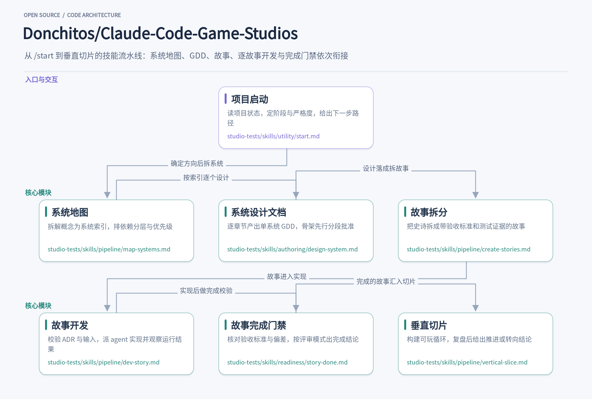
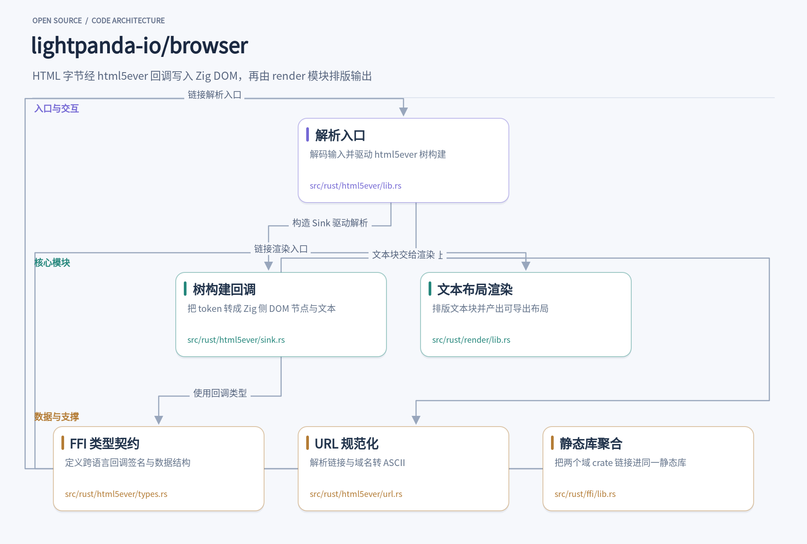
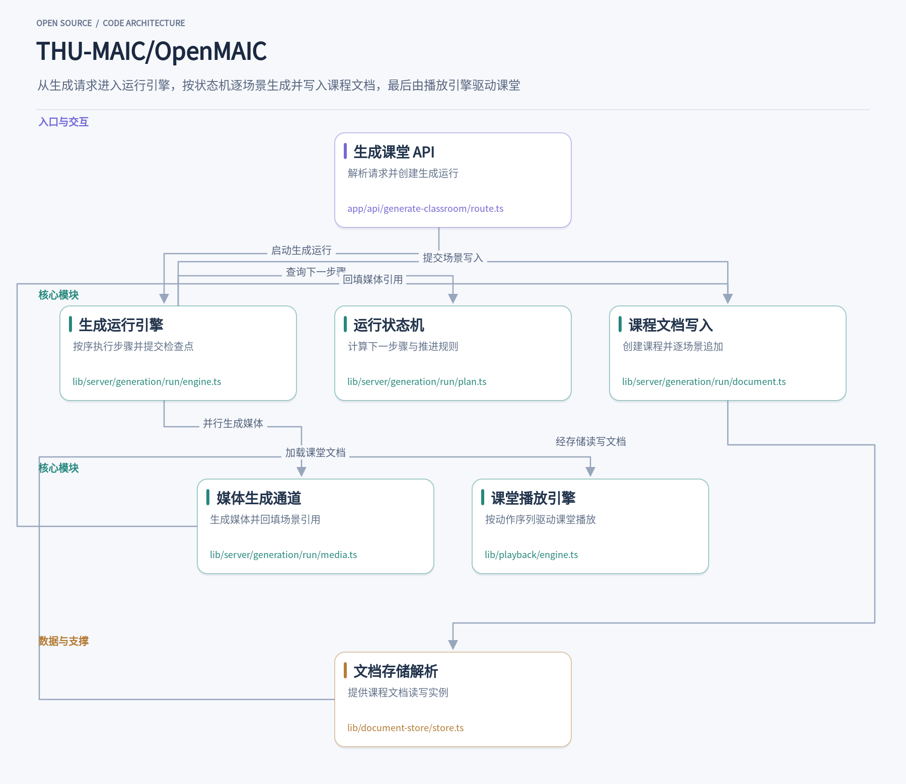

用 Claude Code 做游戏时，数值硬编码、设计文档缺位、系统做完才发现与核心幻想对不上，这些问题往往源于单会话里缺少评审与 QA 角色。Claude Code Game Studios 把 49 个 agent 和 74 个斜杠命令组织成总监、部门主管、专员三层，让每个阶段都有流程节点可依。另一边，Lightpanda 用 Zig 从零实现无头浏览器，把 HTML 解析与文本渲染交给 Rust crate，fetch 命令直接输出 markdown，也能通过 CDP 让 Puppeteer 连接。OpenMAIC 则把一句学习需求变成带大纲、讲解智能体和旁白的多智能体课堂，生成任务落在服务端，关掉页面也不会中断。三个项目分别面向游戏开发流程、网页内容提取和互动教学，下面按各自解决的问题与内部配合展开。

## 1. Claude-Code-Game-Studios

> 把一次 Claude Code 会话拆成 49 个角色、74 条技能的游戏工作室流水线

[Donchitos/Claude-Code-Game-Studios](https://github.com/Donchitos/Claude-Code-Game-Studios) · `Shell` · **31,146** stars · 今日 **+742** · `MIT`

一个人用 Claude Code 做游戏，最常卡住的地方不是写不出代码，而是没人拦着你写错方向。数值随手硬编码、设计文档跳过不写、做完一个系统才发现它和核心幻想对不上——单会话里没有 QA、没有设计评审、也没有人问“这符合游戏愿景吗”。Claude Code Game Studios 用技能文件把这些问题变成流程节点：49 个 agent 分成总监、部门主管、专员三层，74 个斜杠命令覆盖从头脑风暴到上线检查的每个阶段，每个技能在动手写文件前都要先征得同意，并把阶段、严格度、自动化程度记进 project.yaml。

入口是 `/start`。它先用 `project-state.sh` 静默读一遍项目：引擎、代码根目录、概念或简报、GDD 与 ADR 数量、origin 是否还指向模板仓库；`source_files: unknown` 会被当作“代码根未知”，而不是“没有代码”。然后只问一个问题——你现在处在哪一步（没想法 / 模糊想法 / 清晰概念 / 已有项目），引擎留给 `/setup-engine` 决定。它把推断出的阶段和严格度放在一张假设卡上，只有用户明确选“保存”才通过 `set-stage.sh` 写 `project.yaml` 和 `production/stage.txt`，再按严格度打印下一步路径，最后只输出一行“Type `[skill]` to begin.”，绝不替用户启动下一个技能。

有了方向，`/map-systems` 把概念拆成系统索引。它读 `design/gdd/game-concept.md`（minimal 档读 `design/game-brief.md`）和支柱，列出显式系统，也推断隐式系统——战斗会隐含生命值、伤害计算、命中检测和战斗 UI，每条都标注 implicit 和理由。接着排依赖分层（Foundation → Core → Feature → Presentation → Polish），标出瓶颈、叶子节点和循环依赖，再按 MVP / 垂直切片 / Alpha / 完整愿景分优先级。full 模式下三个总监门依次介入：技术总监查系统边界，制作人查范围是否现实，创意总监在索引写完后核对它是否忠于核心幻想；lean 和 solo 模式各自跳过并留下具名说明。

`/design-system <system-name>` 负责把单个系统写成 GDD。它先读概念、系统索引、实体注册表、依赖系统的 GDD 段落和引擎参考，给出上下文摘要与技术可行性简报，问“May I create the skeleton file at `design/gdd/[system-name].md`?”，同意后才建只含 `[To be designed]` 的骨架。之后每个章节走一遍“上下文 → 提问 → 选项 → 决策 → 草稿 → 批准 → 写入”，草稿和“Approve the [Section Name] section?”出现在同一条回复里，批准后立刻用锚定章节标题的 Edit 写进文件。full 档要求 8 个章节，standard 档 5 个加条件性公式，minimal 档 5 个；`retrofit <path>` 只补缺失或占位的章节，已有内容不动。全部写完后 CD-GDD-ALIGN 才跑一次，结论记进 GDD 的 Status 头。

设计落定，`/create-stories` 把单个史诗拆成开发者可直接上手的故事。standard/full 档读 `production/epics/[epic-slug]/EPIC.md`、史诗对应的 GDD、治理 ADR（按标题映射做有界读取，不整篇吞）、控制清单里本层的规则和 TR 注册表中本系统的条目；minimal 档则从简报合成一个隐式史诗，连 EPIC.md 本身也要在写入询问里点名后才创建。每个故事按 Logic / Integration / Visual/Feel / UI / Config/Data 分类，类型决定它需要什么测试证据；治理 ADR 还是 Proposed 的故事直接标 `Status: Blocked`，并在故事列表里提前标出，而不是写完才发现。所有故事一次性展示，只问一次“May I write these [N] stories…”，然后写 `story-NNN-[slug].md` 并更新 EPIC.md 和 `production/epics/index.md`。

`/dev-story` 是真正产生代码的一环，但它自己不写源码。它先定位故事（参数或 `production/session-state/active.md` 里的当前任务），按档位检查输入，用一次 grep 读出 ADR 的 Status、Last Verified 和 Date——Proposed、Deprecated、Superseded 在任何档位都直接 BLOCKED，并给出 `/architecture-decision accept ADR-0005` 这样的解封动作；ADR 版本和故事记录不一致时，会问你是重读变更章节、按旧摘要实现还是停下。确认后它问“May I mark this story In Progress?”，把故事状态和 sprint-status 一起更新，再把实现派给主程序员 agent 加引擎专员，简报里内联 ADR 的决策摘要和本层规则。agent 返回后跑引擎解析检查、启动构建观察玩家可见行为，打印一行 `Run result:`，覆盖 active.md 里的 CHECKPOINT 块，并把下一步指向 `/code-review` 和 `/story-done`。

`/story-done` 收尾。它重读 TR 注册表里的当前需求文本（不用故事里引用的旧版本）和治理 ADR 的 Decision、Consequences 两节，逐条核对验收标准：能自动验证的自动验证，主观或玩法相关的用批量 AskUserQuestion 问用户，需要完整试玩的标 `DEFERRED — requires playtest session`，然后生成“标准 | 测试 | 状态”的可追溯表。GDD 偏差、硬编码数值、范围外改动按 BLOCKING / ADVISORY / OUT OF SCOPE 分类，比如注册表写“最多携带 3 个光源”而代码里是 5，就是 BLOCKING，结论直接 BLOCKED 并说明要改什么。评审模式决定 QA 覆盖门和代码评审步骤：full 档派 qa-lead 和 lead-programmer，lean 档只问一句是否跑过 `/code-review`，solo 档记下跳过。只有用户在最后的 AskUserQuestion 里选择关闭，故事才会被标 Complete 并写完成备注。

整条链路的终点是 `/vertical-slice`：一个 3–5 分钟、接近生产质量的“开始 → 挑战 → 解决”完整循环，用来回答一个可证伪的问题——玩家体验和构建可行性是否都成立。它读概念（minimal 档读简报）、系统索引、架构和控制清单，确认范围并把计划记进 active.md，问过之后才创建 `prototypes/[concept-name]-vertical-slice/`，每个切片文件头部都带本文件注释语法的 `VERTICAL SLICE - NOT FOR PRODUCTION`。构建完让用户从零完整玩一遍，再逐个问六个复盘问题，然后写 REPORT.md 和 `prototypes/index.md` 的一行记录。结论是 PROCEED / PIVOT / KILL，没人玩过就是 NOT ASSESSED，排在 PROCEED 之上、PIVOT 和 KILL 之下，绝不记成 PROCEED；只要验证项里有一个 NO，`/gate-check production` 就会让切片失败，PROCEED 也就不成立。这套设计里值得借鉴的是把“人做决定、AI 做执行”落到了文件层面：每个技能写之前都点名要动的文件，`project.yaml` 只放阶段、严格度和自动化三个键，门禁在 lean 和 solo 模式下不是消失，而是留下“TD-SYSTEM-BOUNDARY skipped — Lean mode.”这样的具名记录；ADR 用标题映射做有界读取、用 Last Verified 判断新鲜度，故事把需求指向 TR 注册表而不是内联复制，需求改了故事不会悄悄过期。

## 2. browser

> 用 Zig 重写的无头浏览器，把页面解析与文本渲染做成可跨语言复用的核心链路

[lightpanda-io/browser](https://github.com/lightpanda-io/browser) · `Zig` · **39,231** stars · 今日 **+929** · `AGPL-3.0`

当自动化脚本需要从网页中提取正文、链接或结构化数据时，往往要启动一个完整的 Chromium 实例。Lightpanda 选择另一条路：从零实现一个面向 AI 与自动化的无头浏览器，用 Zig 编写主程序，把 HTML 解析和文本渲染分别交给 Rust 域 crate 完成。命令行里执行 `./lightpanda fetch --dump markdown https://example.com`，或者通过 CDP 服务让 Puppeteer 连接，都能直接拿到页面内容。它不追求像素级还原，而是把“页面文本长什么样、链接指向哪里”作为核心输出。

HTML 字节进入系统的第一站是 `src/rust/html5ever/lib.rs` 中的 `html5ever_parse_document` 与 `html5ever_parse_document_with_encoding`。后者接收可选的 charset 参数，用 `encoding_rs` 把输入解码成 UTF-8；如果内容本身已经是合法 UTF-8，`Cow<str>` 路径不会产生额外分配。解码完成后，入口构造一个 `sink::Sink`，把 Zig 侧传入的上下文、文档引用以及一组回调函数指针装进去，再调用 `parse_document` 驱动 html5ever 的树构建流程。

真正把 token 变成 DOM 节点的是 `src/rust/html5ever/sink.rs`。它实现了 html5ever 的 `TreeSink` trait，每个树构建动作都对应一个 `extern "C"` 回调：创建元素时调用 `create_element_callback`，追加文本或节点时走 `append_callback`，处理模板内容、声明式 shadow root、doctype 也各有专用回调。`ElementData` 被分配在 `typed_arena::Arena` 里，保证在整次解析期间生命周期稳定；Zig 侧拿到的 `Ref` 就是指向这些数据的裸指针，节点归属和内存管理留在 Zig 的 DOM 实现中。

跨语言调用的数据契约集中在 `src/rust/html5ever/types.rs`。`CQualName` 把命名空间、本地名和可选前缀拆成 `StringSlice`，`CNodeOrText` 用一个 `tag` 区分“节点”和“文本”，`CAttributeIterator` 则让属性列表以迭代器形式越过 FFI 边界。这些 `#[repr(C)]` 结构没有复杂的所有权语义，回调签名也统一用 `Ref = *const c_void` 表示节点句柄。这样设计的好处是 Zig 侧只需要按固定布局读取字段，不必理解 Rust 的 trait 或泛型。

页面里的链接和资源地址需要规范化，这部分由 `src/rust/html5ever/url.rs` 承担。`url_parse` 和 `url_parse_with_base` 把字符串解析成 `Url` 对象并以裸指针返回，`lpurl_domain_to_ascii` 则基于 `idna` crate 实现 WHATWG 的 domain-to-ASCII。文件里还处理了 rust-url 在非 `file` scheme 下把 `..` 路径段误判为 Windows 盘符的问题：先按 base 拼接，再把不该保留的段弹掉。对抓取场景来说，这意味着相对链接能稳定解析成绝对地址，国际化域名也能正确转成 punycode。

解析完成后，页面文本要变成可导出的布局，入口在 `src/rust/render/lib.rs`。Zig 侧把文本块和样式 span 组织成 `LpBlock` 与 `LpSpan` 数组传进来，render 模块用 `parley` 做断行、字形整形和双向文本处理，用 `skrifa` 取字形轮廓，用 `tiny-skia` 填充像素。输出是一个扁平的 `LpLayout`：块持有行范围，行持有 run 和 cluster 范围，run 持有字形范围，字体信息单独列出。`Page.captureScreenshot` 和 `--dump png` 都走这条路径，PDF 导出则复用同一份布局数据。

两个 Rust 域 crate 通过 `src/rust/ffi/lib.rs` 聚合成一个静态库。这个文件本身很短，只有 `extern crate lightpanda_html5ever;` 和 `extern crate lightpanda_render;` 两行，作用是让 edition 2018 之后的链接器不会丢弃未被直接引用的 crate。Zig 主程序链接这个静态库后，就能调用 html5ever 的解析入口和 render 的布局入口。这种“Zig 管运行时与 DOM，Rust 管解析与排版”的分工，让每个域可以用各自生态里成熟的库，同时保持 FFI 边界足够窄。

从工程角度看，Lightpanda 把浏览器拆成了可独立验证的几段：HTML 字节到 DOM 的回调链路、URL 规范化、文本布局到像素或 PDF。每段都有明确的输入输出结构，跨语言边界只传扁平的 C 布局数据。对于需要批量抓取或做页面内容抽取的自动化任务，这种结构意味着可以只复用解析链路而不启动完整浏览器；对于想借鉴跨语言架构的开发者，`sink.rs` 里对 `TreeSink` 的逐回调映射和 `render/lib.rs` 里用范围数组描述布局的做法，都是值得细读的实现。

## 3. OpenMAIC

> 一键把学习主题变成可播放的多智能体互动课堂

[THU-MAIC/OpenMAIC](https://github.com/THU-MAIC/OpenMAIC) · `TypeScript` · **42,175** stars · 今日 **+116** · `MIT`

在 OpenMAIC 里，输入一句学习需求，比如“给零基础同学讲清楚傅里叶变换”，系统会生成一份带大纲、讲解智能体、逐页内容和旁白的课堂，随后在浏览器里像看一场有老师与助教参与的直播课那样播放。这个体验的起点是 `POST /api/generate-classroom`：请求体只带 `requirement` 和可选的 `materialIds`，接口先解析请求、检查运行所需的大纲/动作/内容模型是否已配置，再调用 `startGenerationRun` 创建一个归属于请求所有者的生成运行，返回 202 和任务视图。生成不再依赖浏览器标签页存活，关掉页面、服务重启，任务仍留在服务端。

生成运行的核心是 `lib/server/generation/run/engine.ts`。它按经典顺序执行步骤：有材料时先做材料分析，然后研究、大纲、等待大纲确认、生成智能体，再逐场景生成内容、动作和旁白。每一步的检查点、运行的下一个状态和事件都在同一个事务里提交，并由租约代次围栏保护——被接管的旧 worker 无法再写入。失败会按步骤重试，重试次数对首场景和后续场景不同；重试耗尽后运行停在该步骤，而不是整体丢弃。

“下一步做什么”并不写在引擎里，而是由 `lib/server/generation/run/plan.ts` 用纯函数描述。`preparationSteps` 给出材料分析、研究、大纲三步，`generationSteps` 按场景数展开出 `scene:<i>:content`、`actions`、`narration` 三连。`advanceRun` 根据运行状态和已完成步骤集合返回下一个要执行的步骤，或者返回“等待大纲确认”“全部完成”。这种把状态机抽成纯函数、把副作用留在引擎里的做法，让断点续跑和测试都变得直接：给定输入和检查点集合，就能算出运行该往哪走。

生成结果要落到课程文档，这一步在 `lib/server/generation/run/document.ts`。第一个场景就绪时创建课程，同时写入大纲和 `producer: 'server-job'`，表明它由服务端任务生产、浏览器不再往里生成；之后每个场景完成就追加，最后把 `generationComplete` 置为真。每次写入都通过 `fencedStore` 绑定运行租约，并把写入与运行检查点放在同一事务里，所以“场景写进去了但检查点没记”这类半完成状态不会出现。课程若在生成期间被删除，写入会抛出 `RunCourseDeletedError`，运行随之结束。

大纲里请求的图片和视频走一条独立的媒体通道 `lib/server/generation/run/media.ts`。它在课程存在后启动，与场景生成并行，按大纲顺序一次处理一项；槽位关闭或未配置的媒体会被标记为跳过，失败只影响该项本身，不阻塞场景。视频在提交给供应商时就把任务记录写进检查点，接管后的运行会继续等待同一个任务，而不是重新付费提交；字节写入资产池与检查点在同一事务提交，避免重复生成。资产池满时通道停止，未处理的项统一记为配额失败，并保留可重试语义。

课堂文档的读写统一经过 `lib/document-store/store.ts`。`getDocumentStore` 解析出服务端配置的文档存储，浏览器持久化引导负责配置它，浏览器之外的调用方（服务端渲染、测试）必须注入自己的 store，否则直接报错而不是悄悄退回本地存储。这个解析结果会被缓存，但只在解析成功后赋值，配置工厂抛错时下一次调用会重试。生成侧通过带租约围栏的后台文档存储写入，课堂页面则按课程 id 从同一存储读出文档。

用户最终看到的教学体验由 `lib/playback/engine.ts` 驱动。它是一个状态机：`idle`、`playing`、`paused`、`live` 之间按 `start`、`pause`、`resume`、`confirmDiscussion`、`handleUserInterrupt` 等操作迁移，消费 `Scene.actions[]` 并交给 `ActionEngine` 执行讲解、白板绘制和互动。旁白有预生成音频时走 `AudioPlayer`，没有时退化为按阅读时长计时的定时器，浏览器原生 TTS 则按句切块顺序播放。暂停时它保存剩余时长和未播完的句子块，恢复时从断点继续，而不是重头再来。

这套实现里有几处值得借鉴的设计。把生成计划写成纯函数、把执行和提交留在引擎，使“运行到哪了”可以从检查点集合重新推导；用租约代次围栏所有写入，让接管和并发提交不会互相踩踏；媒体作为独立通道与场景并行，并用检查点记录供应商任务，把昂贵的外部调用变成可恢复的操作。前端播放引擎则把“讲课”拆成可暂停、可跳转、可被用户打断进入讨论的动作序列，让一次生成的内容拥有接近实时课堂的交互节奏。

三个项目切入的方向不同，但都把原本依赖人工判断或重型运行时的环节拆成了可复用的模块：游戏工作室用技能文件把评审变成流程节点，Lightpanda 把页面解析与文本渲染做成跨语言核心链路，OpenMAIC 把课堂生成从浏览器标签页移到服务端任务。对开发者来说，值得看的不是它们覆盖了多少场景，而是各自如何组织角色、crate 与生成运行，让一次请求或一次会话的结果可追踪、可继续。
