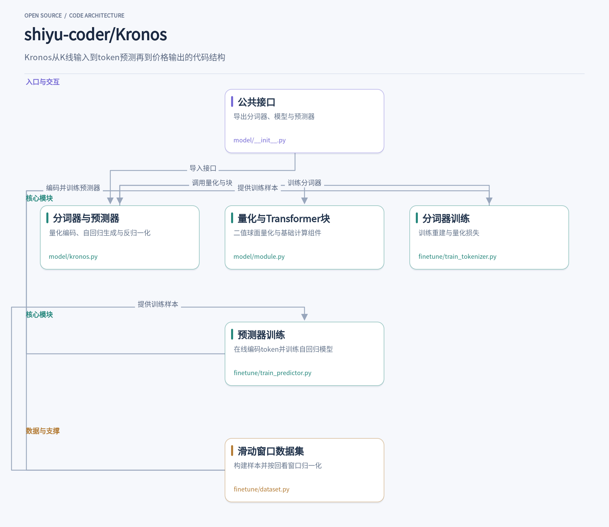
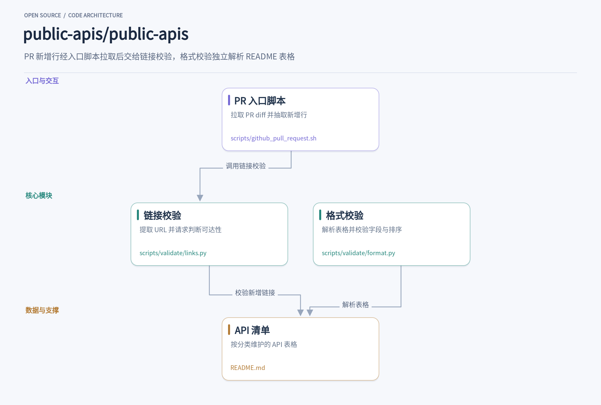
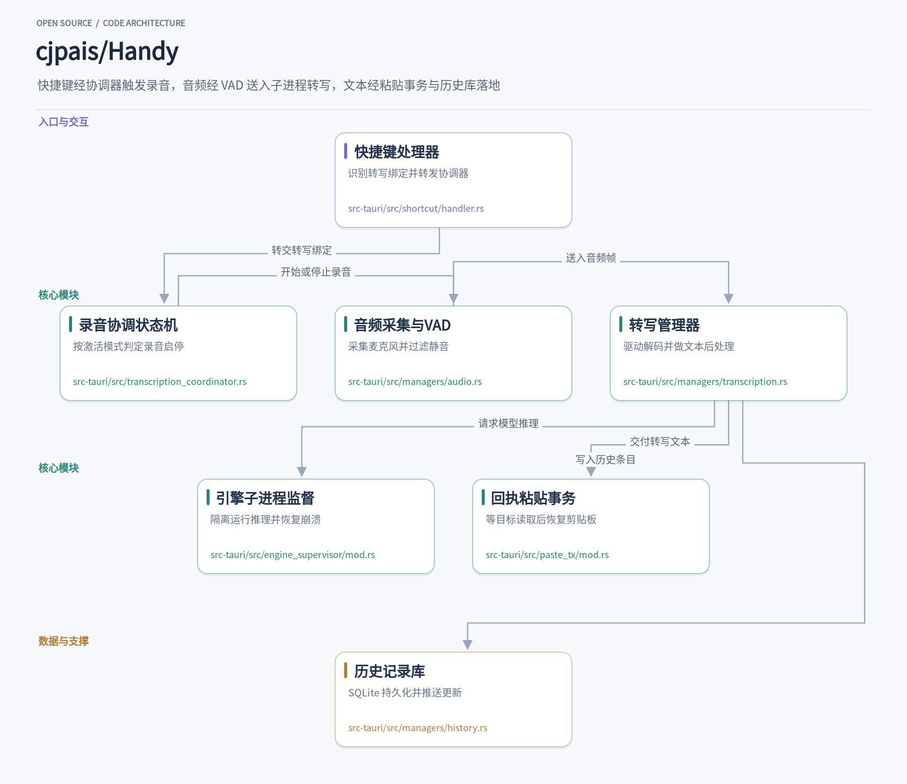
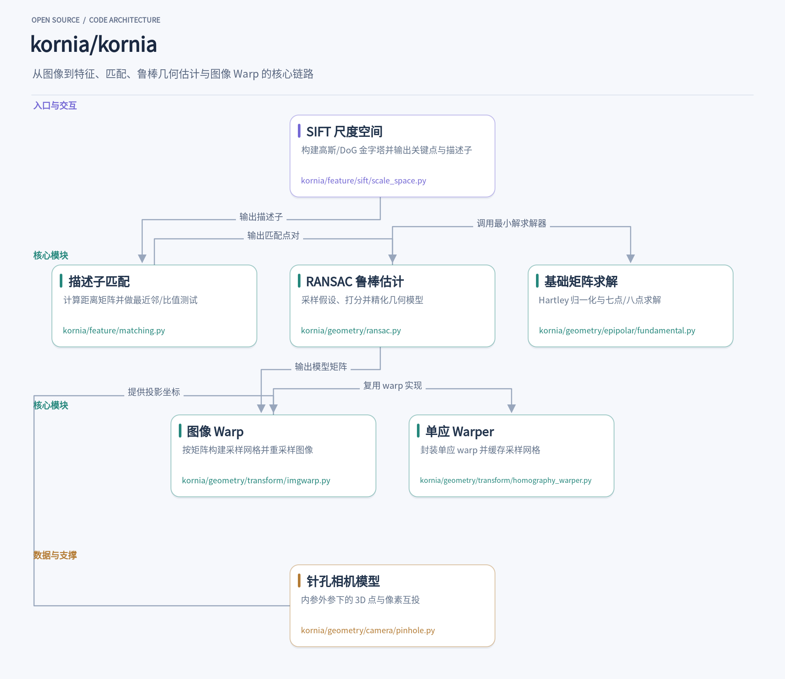
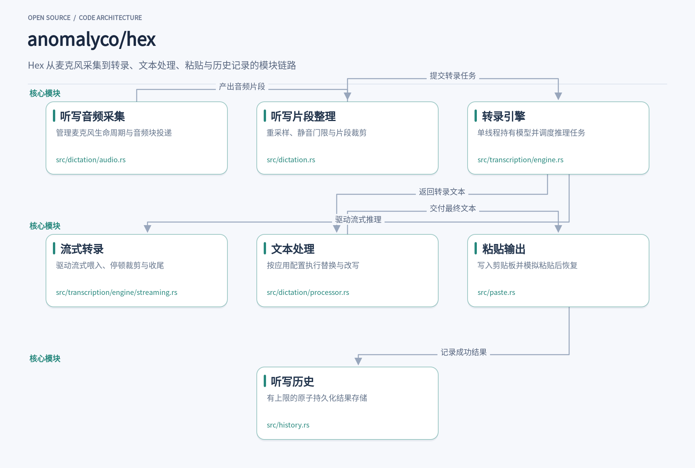

周末翻开源榜单时，我习惯先看那些能直接解决手头问题的项目。这次挑出的五个项目各有明确的使用场景：Kronos 把 K 线序列当作语言来建模，输入一段 OHLCV 历史就能生成未来行情；public-apis 用两个校验脚本维护一份近五十万星标的 API 索引，把失效链接挡在合并之前；Handy 和 Hex 都把语音听写做成本地工具，按住快捷键说话、松开即粘贴；Kornia 则把 SIFT、特征匹配、RANSAC 和图像 Warp 串成 PyTorch 张量算子，整条几何链路可以在 GPU 上跑并参与自动求导。下面按各自解决的问题、调用方式和内部设计依次展开。

## 1. Kronos

> 把K线当语言，用分层token与自回归Transformer预测未来行情

[shiyu-coder/Kronos](https://github.com/shiyu-coder/Kronos) · `Python` · **45,356** stars · 今日 **+630** · `MIT`

如果你手头有一份BTC/USDT的1小时K线DataFrame，想直接得到未来24小时的OHLCV预测，Kronos的`KronosPredictor`把归一化、截断、token化、自回归生成、反归一化串成一条调用链。从`model/__init__.py`导入`Kronos`、`KronosTokenizer`、`KronosPredictor`后，加载Hugging Face上的分词器与模型，传入包含`open`、`high`、`low`、`close`的DataFrame和对应时间戳，就能拿到未来序列。`max_context`决定了模型一次能看多长的历史，`Kronos-small`和`Kronos-base`是512，超出部分由预测器自动截断。

这条链路要解决的核心问题是：金融K线噪声大、维度多，直接让Transformer回归连续价格容易过拟合。Kronos的做法是先把连续OHLCV离散化成token，让语言模型在token空间里做下一token预测，再把token解码回价格。分词器`KronosTokenizer`的`forward`里，输入先经过线性嵌入`self.embed`，穿过若干`TransformerBlock`编码器，再由`quant_embed`投影到码本维度，送入`BSQuantizer`。量化器输出分层索引，前`s1_bits`位构成粗粒度token，完整码本构成细粒度token，两个层级分别解码重建，训练时同时约束粗重建和全重建。

`BSQuantizer`的实现放在`model/module.py`，它把连续隐向量二值化到球面上：`quantize`里用`torch.where(z > 0, 1, -1)`得到符号向量，再用直通估计器`z + (zhat - z).detach()`保留梯度。前向还计算提交损失和熵惩罚，熵项用分组码本近似，避免在2的幂级码本上做全量计算。这些损失和量化向量一起返回给分词器，分词器再把量化结果送进解码器Transformer，输出重建的K线。训练分词器的脚本`finetune/train_tokenizer.py`把重建MSE和`bsq_loss`相加，用DDP多卡跑，每个epoch按验证损失保存最佳检查点。

分词器训练好之后，预测器训练在token序列上进行。`finetune/train_predictor.py`里，每个batch先用`tokenizer.encode(batch_x, half=True)`在线把K线编码成两段token序列，然后构造`token_in = [token_seq_0[:, :-1], token_seq_1[:, :-1]]`和`token_out = [token_seq_0[:, 1:], token_seq_1[:, 1:]]`，让`Kronos`模型根据历史token和时间特征预测下一个token。模型的`head.compute_loss`分别计算两段token的交叉熵，损失回传更新自回归Transformer。这里分词器是冻结的，只训练预测器，两阶段框架在代码里分得很清楚。

数据侧的组织在`finetune/dataset.py`的`QlibDataset`里。它从pickle加载按symbol组织的DataFrame，为每个symbol预计算所有滑动窗口起点，训练时随机采样。归一化只用回看窗口的均值和标准差，再对整段序列做裁剪，避免未来信息泄漏。时间特征（分钟、小时、星期几、日、月）直接拼进DataFrame，和价格特征一起返回。这个归一化口径和推理侧`KronosPredictor`保持一致，所以微调后的模型可以直接用于预测。

推理时，`KronosPredictor`先按`max_context`截断历史，用回看窗口统计量归一化，再调用分词器编码成token。自回归生成阶段，`Kronos`模型以历史token和时间特征为条件，逐token采样未来序列，预测头输出`s1`和`s2`两段token的logits。生成的token经分词器解码回连续K线表示，最后用保存的均值和标准差反归一化，得到未来OHLCV和时间戳。整个流程对调用方只暴露`predict`方法，内部把预处理、生成、后处理都封装好了。

代码结构上值得借鉴的是分层token的设计：粗token先抓住K线的主要形态，细token补充细节，两个层级共享解码器但分别重建。这种设计让自回归模型可以在较短的粗序列上做决策，再细化到完整码本，降低生成难度。另一个细节是量化器的熵惩罚用分组码本近似，避免在2的幂级码本上做全量softmax，训练时更省显存。分词器和预测器分开训练，也让微调时可以只动预测器，保留已经学好的离散化能力。

项目还提供了`finetune_csv`目录下的配置加载和顺序训练脚本，以及`webui`的演示入口。对于想在自己的数据上微调的开发者，`finetune/config.py`集中了学习率、batch size、窗口长度等参数，`train_tokenizer.py`和`train_predictor.py`都要求用`torchrun`启动。模型权重从Hugging Face加载，分词器和预测器各有对应的仓库名。整体上，Kronos把金融时序预测拆成离散化加自回归生成两步，代码里每个环节都有对应的模块和训练脚本，适合按需替换或扩展。

## 2. public-apis

> 用两个校验脚本守住一份近五十万星标的人工 API 清单

[public-apis/public-apis](https://github.com/public-apis/public-apis) · `Python` · **494,569** stars · 今日 **+324** · `MIT`

你想在业余项目里接一个免费天气 API，翻到 public-apis 的分类表格，点开链接却发现站点已经 404。这类失效条目正是仓库维护者要挡在合并之前的东西。贡献者按表格格式在 README 里加一行，PR 触发后，脚本会把这次新增的链接逐个请求一遍，把连不上的、SSL 报错的、超时或重定向过多的行挑出来。清单本身不提供 API，它提供的是可被信任的索引。

入口是 `scripts/github_pull_request.sh`，它接收仓库名、PR 编号和文件名三个参数，用 curl 拉取 `patch-diff.githubusercontent.com` 上的 diff 存成 `diff.txt`，再用 `egrep "\+"` 把新增行抽到 `additions.txt`。这个文件就是后续链接校验的输入，脚本最后执行 `python scripts/validate/links.py "$LINK_FILE"`。它只负责链接这一条线，格式校验是另一个独立脚本，两者如何被 CI 调度不在这个 shell 文件里体现。

`scripts/validate/links.py` 里的 `find_links_in_text` 用一条较长的正则从文本中抓出 URL，`find_links_in_file` 则先找 `## Index` 再截取之后的内容，这个跳过逻辑对完整 README 有意义，但 PR 场景传入的是 `additions.txt`，通常不含该标记，实际会从文件开头读起。抓到链接后，`check_duplicate_links` 会把末尾斜杠去掉再比对，重复出现的链接会被收集出来。

真正发请求的是 `check_if_link_is_working`：它用 `requests.get` 带上随机挑选的 User-Agent 和从链接里解析出的 host 头，超时设 25 秒。返回码大于等于 400 时默认记为错误，但先交给 `has_cloudflare_protection` 判断——如果状态是 403 或 503、Server 头是 cloudflare，且响应正文里出现 `_cf_chl`、`Ray ID:` 等特征串，就认为这是防护页而非死链。SSL 错误、连接错误、超时、重定向过多分别被归到 `ERR:SSL`、`ERR:CNT`、`ERR:TMO`、`ERR:TMR` 前缀，方便贡献者一眼看出问题类型。

格式这条线在 `scripts/validate/format.py`。`get_categories_content` 按 `###` 切分类，把每个表格行第一列里的 `[标题](链接)` 提取出来转成大写，供 `check_alphabetical_order` 比较排序是否一致。`check_entry` 把一行拆成标题、描述、认证、HTTPS、CORS 五段，分别交给 `check_title`、`check_description`、`check_auth`、`check_https`、`check_cors`。

这些检查很具体：标题必须是 Markdown 链接语法，且不能以“ API”结尾，因为每一行本来就是 API；描述首字母要大写、结尾不能是标点、长度不超过 100 字符；认证字段要么是 `No`，要么用反引号包住并落在 `apiKey`、`OAuth`、`X-Mashape-Key`、`User-Agent` 这几个取值里；HTTPS 只接受 Yes/No，CORS 多一个 Unknown。分类内条目少于 3 条也会被拦下。报错信息带 `(L042)` 这样的行号，贡献者能直接定位到 README 的哪一行。

两个脚本的分工值得借鉴：链接校验只处理 diff 新增行，不去碰历史条目，PR 的反馈范围因此被压得很小；格式校验则面向整份 README 的结构，保证分类、排序和字段取值长期一致。`links.py` 依赖 `requests`，`format.py` 只用标准库的 `re`、`sys`、`string`，入口 shell 还依赖 `curl` 和 `egrep`，部署时按脚本分别准备环境即可。

把 Cloudflare 防护页和真正的死链区分开，是链接校验里比较实用的一处设计。很多免费 API 站点挂了 Cloudflare，直接请求会拿到 403 或 503，如果一律判错，贡献者会被大量误报淹没。`has_cloudflare_protection` 同时看状态码、Server 头和正文特征串，命中就放行。这种“先识别防护、再判失败”的顺序，对任何需要批量探测外部 URL 的工具都适用。

## 3. Handy

> 按一下快捷键，离线听写直接落进任意输入框

[cjpais/Handy](https://github.com/cjpais/Handy) · `Rust` · **36,522** stars · 今日 **+339** · `MIT`

在会议记录、写代码注释或填表单时，最顺手的方式往往是按住一个键说话，松开后文字已经出现在光标处。Handy 把这件事做成了完全本地运行的桌面应用：按下可配置的全局快捷键开始录音，松开或再按一次结束，Whisper 或 Parakeet 模型在本地完成转写，文本被粘贴回当前前台应用。整个过程不需要把音频送出本机，安装后授予麦克风和辅助功能权限即可使用。

一次按键要变成一段可靠的录音，中间有不少状态需要处理。`src-tauri/src/shortcut/handler.rs` 里的 `handle_shortcut_event` 是统一入口，它先查 `ACTION_MAP`，遇到转写类绑定就交给 `TranscriptionCoordinator`，取消键只在录音中生效。协调器内部是一个纯状态机 `CoordinatorState`，把按下、松开、切换模式、按住阈值和流水线忙闲都折算成 `Effect::Start` 或 `Effect::Stop`，副作用由单独的线程执行。这样按住说话、点按切换、按住或点按三种激活模式共用一套判定，连 X11 自动重复造成的假松开也有 50 毫秒的宽限窗口来吸收。

录音开始后，`AudioRecordingManager` 负责采集麦克风数据。它接入 Silero 或 Earshot 两类 VAD，用 `SmoothedVad` 平滑判定，把静音段过滤掉再缓冲，避免把大段空白送进模型。录音期间它还会把 16 kHz 的帧通过 `StreamRouter::feed` 转发给流式转写，路由未打开时只是一次原子读，开销很小。这个设计让实时字幕和最终批量转写可以共用同一路音频，而不必在录音回调里做 Tauri 状态查找或加锁。

转写本身由 `TranscriptionManager` 驱动，实际推理跑在 `EngineSupervisor` 管理的子进程里。`src-tauri/src/engine_supervisor/mod.rs` 用 `--transcribe-worker` 重新拉起自身作为 worker，模型加载、设备枚举、推理和流式解码都发生在子进程中；GPU 驱动崩溃或 `GGML_ASSERT` 只会杀掉 worker，父进程可以重试或在纯 CPU worker 上恢复。模型与 worker 同生命周期，卸载即归还显存和内存，空闲超时后自动卸载的逻辑也在这里统一处理。

解码出来的文本还要经过一层后处理。`managers/transcription.rs` 会做语言检测、中文简繁转换、自定义词替换和填充词清理，流式场景下用 `committed` 与 `tentative` 两段文本驱动浮层，避免已确认内容闪烁。批量与流式两条路径共用 `policy` 模块的模型特性判断，最终都归一到同一份输出结构，后续粘贴和历史记录拿到的文本是一致的。

文本进入前台应用这一步，Handy 没有用固定延时恢复剪贴板，而是实现了带回执的粘贴事务。`src-tauri/src/paste_tx/mod.rs` 在 Windows 上用延迟渲染、在 macOS 上用 pasteboard 所有者回调，等目标应用真正读取剪贴板后才恢复原内容；只有注入粘贴按键之后收到的读取才算数，避免剪贴板管理器提前读取造成误判。若用户在等待期间复制了别的内容，所有权丢失会让事务立即结束，用户的操作优先。

每次转写都会写入 `HistoryManager` 维护的 SQLite 历史库。`managers/history.rs` 用 `rusqlite_migration` 管理表结构，从旧版 `tauri-plugin-sql` 迁移时把 `_sqlx_migrations` 的最高版本转成 `user_version`，避免迁移重跑；新增的可空列单独检查后添加，旧版本打开新库也不会失败。插入、更新、删除都会发出带类型的 `HistoryUpdatePayload` 事件，前端列表可以实时刷新，录音文件按保留策略清理。

把这几块拼起来看，Handy 的取舍很清楚：输入侧用纯状态机把不稳定的按键边沿收敛成确定的录音生命周期，推理侧用子进程隔离把崩溃风险挡在主应用之外，输出侧用回执机制替代经验延时。对做桌面工具或本地 AI 应用的开发者来说，这三处边界划分比具体模型选择更值得借鉴——每一层都只暴露稳定的接口，让上层不必关心进程、重启或剪贴板竞态。

## 4. kornia

> 在 PyTorch 里把 SIFT、匹配、RANSAC 与图像 Warp 串成一条可微几何链路

[kornia/kornia](https://github.com/kornia/kornia) · `Python` · **11,773** stars · 今日 **+101** · `Apache-2.0`

假设你手头有两张同一场景、视角不同的照片，希望自动对齐它们。典型做法是：先在两幅图上找关键点并计算描述子，再把描述子互相匹配，然后用匹配点估计一个单应矩阵，最后把其中一张图按这个矩阵变换到另一张图的视角。Kornia 把这条链路的每一步都做成了 PyTorch 张量算子，输入输出都是 `(B, C, H, W)` 或 `(B, N, 2)` 这样的批张量，可以在 GPU 上跑，也可以参与自动求导。

特征提取的入口在 `kornia/feature/sift/scale_space.py`。`_SIFTScalePyramid` 先对输入图像做双倍上采样，再按 σ=1.6 的初始模糊和每倍频程三层间隔构建六层高斯金字塔；`_SIFTScaleSpaceDetector` 在相邻层之间做 DoG，对每个候选极值在 3×3×3 邻域内比较，并用 Cramer 法则求解三元二次方程组做亚像素精化。这个实现刻意省略了对比度阈值和 Hessian 边缘剔除，改为按精化后 DoG 响应的绝对值取前 K 个极值，因此 `num_features` 直接控制输出数量，行为比 OpenCV 的 SIFT 更可预测。

描述子计算也在这个文件里完成。它复用同一套金字塔，按 OpenCV SIFT 的 19/41 采样网格对梯度做双线性采样，再把梯度旋转到 LAF 坐标系后投票到 4×4×8 的方向直方图，最后做 L2 归一化和 RootsSIFT 处理。检测和描述共享倍频程/层约定，避免了两套尺度空间之间的坐标换算误差。如果只需要检测器，可以单独调用 `_SIFTScaleSpaceDetector`；需要完整 LAF 和描述子时，走上层封装即可。

拿到两组描述子后，`kornia/feature/matching.py` 负责算距离矩阵。`match_nn` 做最近邻，`match_snn` 做比值测试，`match_smnn` 做双向一致性检查。这些函数默认用 `torch.cdist` 算 L2 距离，但在导出 ONNX 或 MPS 缺少反向核时会退回矩阵乘法形式；对不需要梯度的 float32/float64 大矩阵，还会走 `_squared_distances`，在平方距离上做选择、只对选中的项开方，省掉整矩阵的 sqrt 和 clamp。匹配结果统一返回 `(dists, idxs)`，`idxs` 是 `(M, 2)` 的 int64 张量，直接可以喂给几何估计。

匹配点里必然有外点，`kornia/geometry/ransac.py` 的 `RANSAC` 类负责鲁棒估计。构造时指定 `model_type`（`"homography"`、`"fundamental"`、`"essential"` 等）和像素单位的 `inl_th`，调用时传入 `(N, 2)` 的两组点。它按模型类型抽最小样本：单应 4 点、基础矩阵 7 点或 8 点、本质矩阵 5 点，批量生成假设后用 MSAC 打分，默认再用 Levenberg-Marquardt 在 CPU float64 上精化前 8 个候选模型。返回的 `(3, 3)` 矩阵和内点掩码可以直接交给后续 warp。

RANSAC 调用的基础矩阵求解器在 `kornia/geometry/epipolar/fundamental.py`。`normalize_points` 做 Hartley 归一化，把两组点平移到零均值、缩放到平均半径 √2，避免像素坐标下 DLT 的病态条件；`_seven_point_candidates` 从 7 个对应构造 2 维零空间，再解三次多项式得到最多 3 个秩 2 候选；`_eight_point_fundamental` 用一次批量 LU 求零向量再做秩 2 投影。这些函数都支持批处理，RANSAC 一次可以评估几千个假设。

几何矩阵最终要作用到像素上，入口是 `kornia/geometry/transform/imgwarp.py` 的 `warp_perspective` 和 `warp_affine`。它们接收 `(B, 3, 3)` 或 `(B, 2, 3)` 的源到目标像素坐标矩阵，内部先归一化到 `[-1, 1]` 网格，再调用 `grid_sample` 重采样。`warp_perspective` 要求矩阵 batch 与图像 batch 一致，`warp_affine` 允许单矩阵广播；零尺寸输出也会返回带梯度的空张量，不会在数据管道里炸掉。如果同一单应要反复 warp 多张图，`homography_warper.py` 的 `HomographyWarper` 可以 `precompute_warp_grid` 缓存采样网格，之后每次 `forward` 只做采样。

相机参数参与时，`kornia/geometry/camera/pinhole.py` 的 `PinholeCamera` 持有 `(B, 4, 4)` 内参和世界到相机的外参，`project` 把世界点投到像素，`unproject` 把像素加深度反投回世界。它约定像素中心在整数坐标，`cx=(W-1)/2` 对应居中主点，和 `create_meshgrid` 的枚举方式一致。这条链路和前面的特征匹配、RANSAC、warp 共享同一套坐标约定，因此从 SIFT 关键点到单应变换再到相机投影，不需要在模块边界手工翻转坐标轴。

## 5. hex

> 按住快捷键说话，松开即在本机完成转录与粘贴

[anomalyco/hex](https://github.com/anomalyco/hex) · `Rust` · **3,238** stars · 今日 **+1,179** · `MIT`

在任意应用里写邮件、记笔记或填表单时，按住快捷键说完一句话再松开，文字就出现在光标处——这是 Hex 的核心体验。它把语音听写做成一个常驻后台的本地工具，首次运行下载语音模型，之后音频不离开机器。对开发者来说，更有意思的是它如何把麦克风采集、流式推理、文本处理和系统粘贴串成一条可控的流水线，并在每个环节处理失败与回退。

音频入口在 `src/dictation/audio.rs`。`DictationAudio` 拥有一个独立线程，通过命令通道接收开始、结束、取消等指令，内部用 `RecoveringAudioInput` 打开麦克风。它维护一条时间轴，记录按键与音频块的对应关系，并保留按键前约 450 毫秒的前滚音频，避免用户开口过快时丢掉第一个字。松开后还会多收 200 毫秒尾部，因为释放动作常落在最后一个词仍在发声的时候。若麦克风中途断开，程序化采集会保留已收到的音频，交给上层决定是否继续。

采集到的原始采样率通常不是模型需要的 16 kHz，`src/dictation.rs` 里的 `DictationClip` 负责整理。它用 `rubato` 的 FFT 重采样器分块转换，并记录按键前样本数、尾部样本数和时间轴信息。这里还有一道静音门限：取最响的 30 毫秒窗口计算 dBFS，低于 -50 就判定为空采集直接丢弃，因为模型在纯静音上容易编出“谢谢”之类的收尾语。门限刻意保守，轻声说话仍远高于它。

转录由 `src/transcription/engine.rs` 里的 `TranscriptionEngine` 承担。它用一个线程独占已加载的 GGUF 模型，所有推理命令按序处理，因为一个活跃的流式转录会持有模型的计算租约。命令枚举区分 `Begin`、`Feed`、`Finish`、`Foreground` 和 `Background`：听写流优先，后台任务如会议分块在听写期间拿不到模型就跳过，前台任务则排队等待。每个任务都有按音频时长放宽的截止时间，只用来发现卡死的引擎，不惩罚慢机器。

流式路径的具体实现在 `src/transcription/engine/streaming.rs`。按住快捷键期间，音频块被持续喂给 `transcribe_cpp::Stream`，松开时只解码最后一两秒。`PauseCap` 包装了流，把长停顿裁到头部 40,000 个样本加尾部 4,800 个样本，绕开 Parakeet 缓冲流在长停顿后丢词的问题。收尾时，如果流收到的音频远超片段长度、或最终没有文本，就返回错误，让引擎改用整段离线转录。这条回退规则让流式只是加速手段，完整片段始终是权威结果。

文本离开引擎后进入 `src/dictation/processor.rs`。`Profiles` 根据当前前台应用或浏览器域名选择配置，先跑全局替换，再跑模式自己的替换，然后按需调用 OpenCode 的生成接口做改写。提示词明确要求只返回可粘贴文本，模型候选按延迟和协议遵从度排序，失败或超时则回退到规则处理后的文本。Labs 里的口语格式化、符号替换和填充词移除也在这里按开关依次应用，位置在替换之前，保证原始听写和会议记录不受影响。

输出终点是 `src/paste.rs` 的 `Paster`。它先把剪贴板完整快照下来，写入听写文本，再模拟 ⌘V，等待约 100 毫秒让目标应用消费，然后异步恢复原剪贴板。快照通过 Application Services 的 pasteboard API 逐项逐格式抓取，包含纯文本之外的富文本和图片数据。针对 Chromium 155 和 156 在 macOS 上会丢掉与剪贴板变更通知竞争的粘贴，代码检测前台应用的框架版本，改为直接键入文本。连续听写时，`Continuation` 会把同一输入会话的多段结果拼接起来。成功的结果随后写入 `src/history.rs` 的 `HistoryStore`：最多一万条、文本总量 16 MB，单条文本截断到 16 KB，写入走临时文件加原子重命名，文件权限限制为仅所有者可读。保留策略支持关闭、一天、一周、一月和永久，后台线程定期清理过期条目。Linux 上监听进程和历史面板是两个进程，存储通过比较文件修改时间和长度来同步，避免一方用旧副本覆盖另一方的删除。这些约束让历史记录成为可预期的产品数据，而不是无限增长的日志。

这五个项目放在一起看，共同点是边界清晰：Kronos 只负责从历史 K 线生成未来序列，public-apis 只做索引和链接校验，Handy 与 Hex 把音频留在本机，Kornia 把几何步骤拆成可组合的算子。它们没有试图包揽整个工作流，而是把一件事做扎实，再通过清晰的接口交给调用方。如果你正在找能直接嵌入现有代码或工作习惯的工具，这几个仓库值得打开源码读一读。
