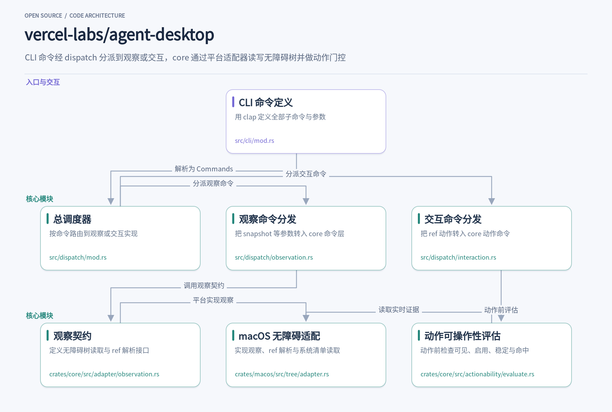
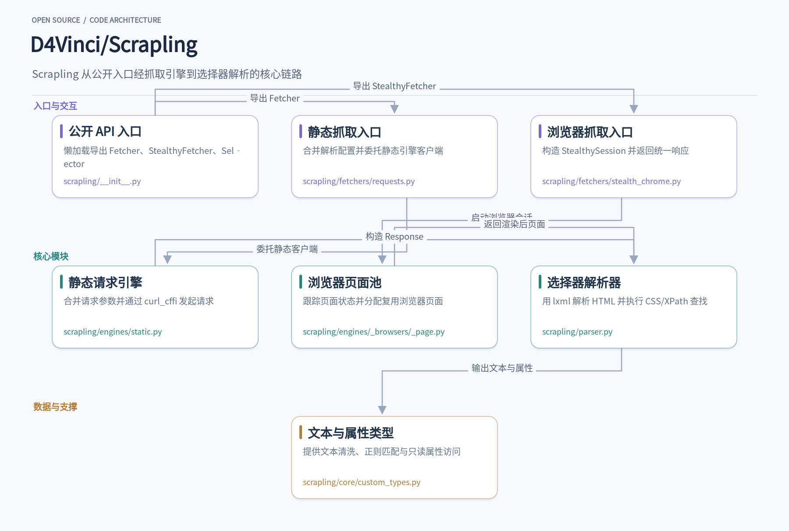
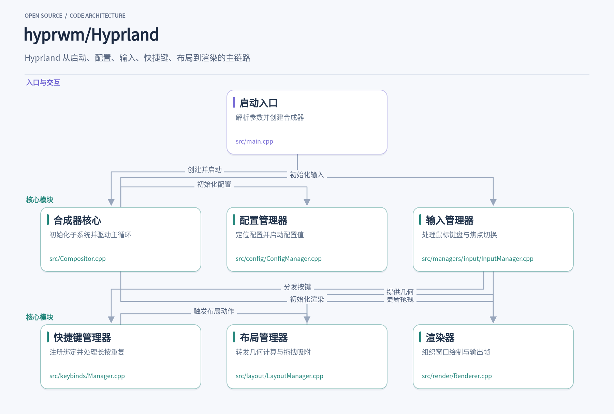
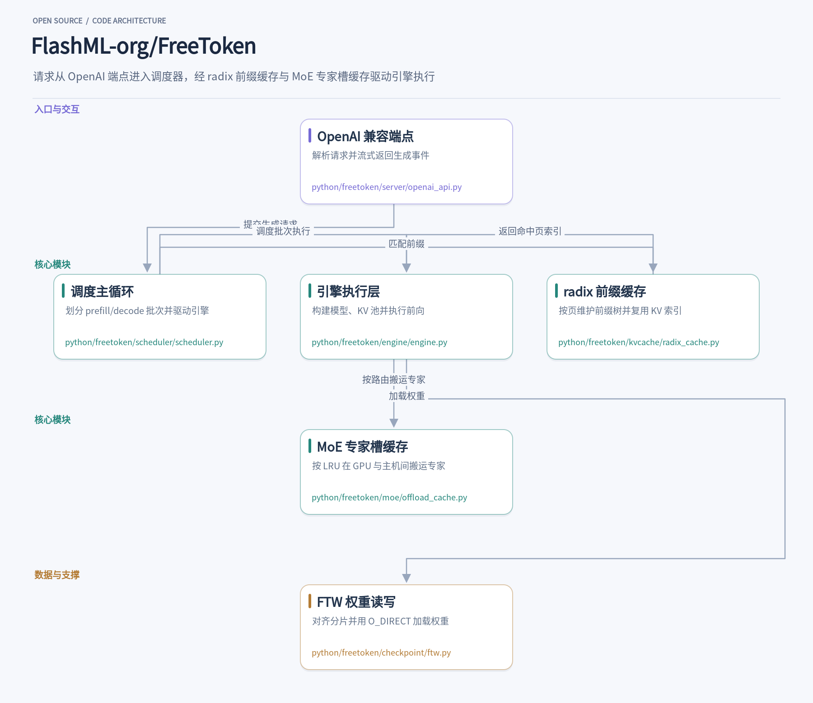
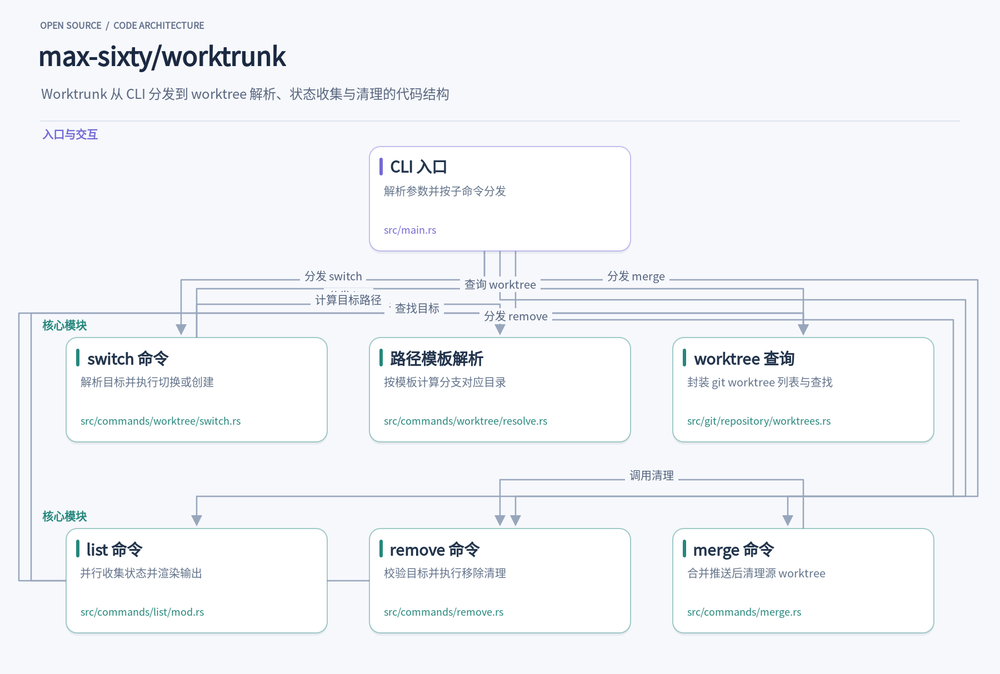

桌面自动化还在截图找坐标？爬虫要同时应付静态页和动态渲染？本地跑大模型总被显存卡住？这一期整理五个近期值得动手试的开源项目，覆盖的场景各不相同。agent-desktop 把桌面操作建立无障碍树的 ref 快照上，Scrapling 用一个 Python 包串起请求、渲染与解析，Hyprland 自己实现了 Wayland 协议栈与渲染管线，FreeToken 用专家槽缓存把 MoE 权重留在主机内存，Worktrunk 则把 Git worktree 收成三条命令，让并行代理各占一个目录。每个项目都从具体用法切入，顺着解决什么问题、内部模块怎样配合展开，源码路径只在有助于理解时出现。

## 1. agent-desktop

> 用无障碍树上的 ref 快照驱动桌面应用操作

[vercel-labs/agent-desktop](https://github.com/vercel-labs/agent-desktop) · `Rust` · **9,569** stars · 今日 **+2,275** · `Apache-2.0`

在桌面自动化里，让 agent 点一个按钮往往要先截图、找坐标、再模拟鼠标。agent-desktop 换了一条路径：它读取操作系统的无障碍树，把每个可操作元素编成一个快照内唯一的 ref，agent 先执行 `snapshot` 拿到这些 ref，再执行 `click @s8f3k2p9:e8` 这样的动作，然后重新快照确认结果。整个循环由调用方控制，CLI 每次调用都是独立进程，默认不移动指针、不抢焦点。

这个项目要解决的是坐标匹配的脆弱性。窗口一挪、分辨率一变，像素坐标就失效；而无障碍树里的元素带着角色、名称、状态和可用动作，语义更稳定。`src/cli/mod.rs` 用 clap 定义了 60 个命令名，观察类有 `snapshot`、`find`、`get`、`is`，动作类覆盖点击、输入、选择、滚动、窗口管理和剪贴板。每个命令输出一个 JSON envelope，成功时带 `data`，失败时带 `error` 和重试建议。

命令解析成 `Commands` 枚举后，`src/dispatch/mod.rs` 负责分派。它先判断命令是否修改状态，再套上会话作用域：只读命令走 `command_scope`，动作命令走 `mutating_command_scope`。观察命令进入 `src/dispatch/observation.rs`，把 CLI 参数转换成 core 层的 `snapshot_command::SnapshotArgs`，连同 `PlatformAdapter` 和 `CommandContext` 一起交给 `execute`。交互命令则进入 `src/dispatch/interaction.rs`，把 ref 和超时参数交给对应的 core 动作命令。

观察的契约集中在 `crates/core/src/adapter/observation.rs` 的 `ObservationOps` trait 上。`observe_tree` 接收 `ObservationRoot` 和 `ObservationRequest`，返回 `ObservedTree`；`resolve_element_strict` 把保存的 `RefEntry` 重新解析成平台句柄；`get_live_state`、`get_live_actions` 和 `get_element_bounds` 提供动作前的实时证据。trait 默认返回 `not_supported`，平台只需要实现自己具备的能力。

macOS 的实现位于 `crates/macos/src/tree/adapter.rs`。`observe_tree` 委托给 `crate::tree::query::observe_tree`，`get_tree` 把一个窗口的观察结果转成 `AccessibilityNode` 树；`resolve_element_strict` 调用 `resolve_element_with_deadline`，按 ref 记录的身份谓词在截止时间内重新找到元素。`list_apps`、`list_windows` 和 `list_surfaces` 也在这里接上系统清单，让 agent 能先列出应用和窗口再决定观察哪个。

动作执行前，`crates/core/src/actionability/evaluate.rs` 会做一轮门控。`build_report` 根据 `ActionRequest` 计算所需条件，依次检查可见性、稳定性、启用状态、可编辑性和动作支持，物理指针动作还会做命中测试。任何一项不通过，`finish` 就把报告转成带 `code`、`details` 和 `suggestion` 的错误。比如目标已不可见时，建议重新快照；元素不支持语义写入时，建议改用 `--headed type` 或剪贴板粘贴。

这套设计里值得借鉴的是 ref 的生命周期管理。ref 只在所属快照内有效，裸 `@e8` 会被拒绝；UI 变化后动作返回 `STALE_REF` 或 `AMBIGUOUS_TARGET`，调用方必须重新快照。多窗口场景下 `snapshot` 在错误详情里列出候选窗口 id，由调用方用 `--window-id` 指定。把“观察—动作—再观察”的验证责任留给 agent，CLI 只保证每一步的输入输出可判定，这让重试逻辑可以写在 agent 侧而不必塞进工具本身。

## 2. Scrapling

> 从单次请求到完整爬取，一个库覆盖静态抓取、隐身浏览器与解析提取

[D4Vinci/Scrapling](https://github.com/D4Vinci/Scrapling) · `Python` · **92,812** stars · 今日 **+706** · `BSD-3-Clause`

当你需要从一个商品页拿到标题、价格和库存状态，或者从一批动态渲染的页面里收集结构化数据，Scrapling 把 HTTP 请求、浏览器渲染和 HTML 解析放在同一个 Python 包里。它由 Karim Shoair 维护，采用 BSD-3-Clause 许可，要求 Python 3.10 及以上。最直接的用法是 `from scrapling import Fetcher`，然后 `Fetcher.get(url)` 拿回一个 Response 对象，再用 CSS 选择器或 XPath 从里面取字段。

静态抓取走的是 `scrapling/fetchers/requests.py` 里的 `Fetcher` 类。它的 `get`、`post`、`put`、`delete` 都是类方法，调用时会把类级别的解析参数合并进 `selector_config`，再委托给一个模块级的 `_FetcherClient` 实例。`AsyncFetcher` 提供同样的接口，但返回可等待对象，适合在异步循环里并发发起多个请求。这种设计让单次调用和批量调用共享同一套参数语义。

真正执行 HTTP 请求的是 `scrapling/engines/static.py` 中的 `_ConfigurationLogic`。它在初始化时收集 impersonate、代理、超时、重试、重定向策略等默认值，`_merge_request_args` 再把单次请求参数与默认值合并，交给基于 `curl_cffi` 的会话执行。`impersonate` 可以是一个浏览器名，也可以是一个列表，`_select_random_browser` 会从中随机挑一个，用于在多次请求之间轮换浏览器指纹。代理轮换器与静态代理互斥，构造时会直接报错，避免配置歧义。

动态页面交给 `scrapling/fetchers/stealth_chrome.py` 的 `StealthyFetcher`。`fetch` 接收 headless、资源拦截、Cloudflare 挑战处理、页面动作回调等参数，内部构造 `StealthySession` 并在上下文管理器里完成导航，最后返回与静态抓取同类型的 Response。异步版本 `async_fetch` 使用 `AsyncStealthySession`。这意味着解析代码不需要关心数据来自 HTTP 响应还是浏览器渲染后的 DOM。

浏览器会话的页面生命周期由 `scrapling/engines/_browsers/_page.py` 的 `PagePool` 管理。每个页面被包装成 `PageInfo`，状态在 `ready`、`busy`、`error` 之间迁移，`get_ready_page` 取出空闲页面并标记为忙碌，`clear` 一次性交还所有页面供调用方关闭。页面池有上限，超过 `max_pages` 再添加会抛错。这种显式状态机让并发抓取时页面复用和释放变得可追踪。

拿到响应后，解析发生在 `scrapling/parser.py` 的 `Selector` 类里。它用 lxml 的 `HTMLParser` 把字符串或字节解析成元素树，并预编译了 `.//*`、`.//text()` 等 XPath 表达式供内部复用。`Selector` 支持 CSS、XPath 和文本查找，结果会被包装成新的 `Selector` 或 `Selectors`，因此可以链式继续查询。`tag`、`text`、`attrib` 等属性做了惰性缓存，避免初始化大量元素时重复计算。

解析结果的文本和属性由 `scrapling/core/custom_types.py` 承载。`TextHandler` 继承自 `str`，额外提供 `clean`、`re`、`re_first` 等方法，正则匹配时可以选择清理空白或替换 HTML 实体。`AttributesHandler` 是基于 `MappingProxyType` 的只读映射，属性值自动转成 `TextHandler`，还能通过 `search_values` 按值查找属性。这些类型让提取后的清洗和二次筛选不必离开当前对象。

公开入口在 `scrapling/__init__.py` 里通过 `__getattr__` 做懒加载，只有真正访问 `Fetcher`、`Selector` 等名字时才导入对应模块。这样 `import scrapling` 不会立刻拉起 curl_cffi 或浏览器依赖，对只使用解析功能的场景更轻。从入口到引擎再到解析器，Scrapling 把“取回页面”和“从页面取数据”拆成可替换的两段，同时用统一的 Response 类型把两条抓取路径接在一起。

## 3. Hyprland

> 一个不依赖 wlroots 的 Wayland 合成器，从配置到渲染的完整链路

[hyprwm/Hyprland](https://github.com/hyprwm/Hyprland) · `C++` · **39,910** stars · 今日 **+509** · `BSD-3-Clause`

当你按下某个关闭窗口的快捷键，Hyprland 需要在一帧之内完成从输入事件到画面更新的整条链路。这个合成器不依赖 wlroots，自己实现了 Wayland 协议栈、渲染管线和窗口布局。它的源码结构把启动、配置、输入、快捷键、布局和渲染拆成独立模块，每个模块通过事件总线和共享状态协作，而不是层层嵌套调用。

启动入口在 `src/main.cpp`。它先解析命令行参数，比如 `--config` 指定配置文件、`--verify-config` 只检查配置、`--safe-mode` 进入安全模式，然后设置 `XDG_SESSION_TYPE=wayland` 等环境变量。接着创建 `CCompositor` 对象，调用 `initServer` 初始化 Wayland 显示、事件循环和各个管理器，最后进入 `startCompositor` 主循环。`CCompositor` 的构造函数还会生成实例签名、创建运行时目录，并在 `initServer` 里注册信号处理、启动 Aquamarine 后端、创建 Wayland socket。

配置加载由 `src/config/ConfigManager.cpp` 负责。`Config::initConfigManager` 先通过 `Supplementary::Jeremy::getMainConfigPath` 定位配置文件，然后创建 `Lua::CConfigManager` 实例。如果文件不存在，它会调用 `generateDefaultConfig` 生成默认配置。之后遍历 `Values::CONFIG_VALUES` 逐个调用 `commence()`，让配置值就绪。模块在运行时通过 `CConfigValue` 读取这些值，比如 `InputManager` 里的 `CConfigValue<Config::INTEGER>("input:follow_mouse")`。

输入处理集中在 `src/managers/input/InputManager.cpp`。`onMouseMoved` 接收鼠标移动事件，先根据设备配置翻转坐标，再通过 `Pointer::mgr()->move` 更新指针位置，然后调用 `mouseMoveUnified` 做命中测试和焦点切换。键盘事件类似，会先经过快捷键管理器。`CInputManager` 的构造函数里还监听了光标形状协议、虚拟键盘、虚拟鼠标等事件，把不同来源的输入统一到同一套处理流程。

快捷键管理在 `src/keybinds/Manager.cpp`。`CKeybindManager` 维护一个绑定注册表，`addBind` 和 `removeBind` 负责增删。它用两个定时器处理长按和重复触发：`m_longPressTimer` 在长按超时后执行绑定，`m_repeatTimer` 按 `m_repeatRate` 的频率重复执行。代码里引入了 `MatchResolver.hpp`，并维护 `m_inputState` 来跟踪按键状态。绑定被移除时会调用 `invokeReleaseCallbacks`，确保释放回调不会丢失。

布局计算由 `src/layout/LayoutManager.cpp` 协调。`CLayoutManager` 不直接算几何，而是把请求转给 `CSpace` 对象。比如 `recalculateMonitor` 会调用工作区 `space()->recalculate`，`layoutMsg` 把布局消息转发给当前工作区的 `space()->layoutMsg`。浮动窗口的移动、缩放和吸附逻辑也在这一层处理，`performSnap` 会根据配置的 `general:snap:window_gap` 等值计算吸附位置。拖拽状态由 `m_dragStateController` 管理，输入管理器在鼠标移动时调用 `moveMouse` 更新拖拽。

渲染由 `src/render/Renderer.cpp` 组织。`IHyprRenderer` 的构造函数会检测 DRM 驱动，识别 NVIDIA 或 Intel 设备，并设置光标隐藏的定时器。`shouldRenderWindow` 判断窗口是否需要在当前显示器上绘制，考虑工作区可见性、全屏状态和动画偏移。渲染器引用了 `pass/` 下的各种 PassElement 头文件和 `OpenGL.hpp`，但具体的合成提交路径在资料中没有完整展开。`renderWorkspaceWindowsFullscreen` 展示了窗口按平铺、浮动、全屏分组的绘制顺序。

各模块之间通过 `Event::bus()` 发布和监听事件。`Renderer.cpp` 里用 `Event::bus()->m_events.input.keyboard.key.listen` 监听键盘事件来隐藏光标，`InputManager.cpp` 也通过事件总线接收光标形状变化。`Compositor.cpp` 在 `initServer` 里按阶段调用 `initManagers`，依次初始化基础管理器、协议和 IPC。`main.cpp` 里可以看到 `IPC::Socket1::version` 和 `systemInfo` 的调用，用于 `--version` 和 `--systeminfo` 参数，但 S1 运行时 socket 分发在资料中没有展开。

## 4. FreeToken

> 把 290B 级 MoE 模型塞进消费级显卡，靠专家槽缓存和前缀复用跑本地推理

[FlashML-org/FreeToken](https://github.com/FlashML-org/FreeToken) · `Python` · **16,035** stars · 今日 **+653** · `Apache-2.0`

在本地跑大模型时，显存往往是最先撞上的墙。FreeToken 的做法是把 MoE 专家的权重放在主机内存里，GPU 只保留一个按 LRU 调度的专家槽缓存，按每步路由结果把用到的专家搬进来。启动服务后，它对外暴露 OpenAI 兼容的 `/v1/chat/completions` 和 `/v1/completions`，Codex、Claude Code 这类工具可以直接把 base URL 指过来。请求进来后先被解析成 `ChatCompletionRequest`，再由 `chat_request_to_genspec` 转成内部的 `GenSpec`，交给调度器排队。

调度器是整个系统的中枢。`Scheduler.__init__` 里一次性建好 `TableManager`、`CacheManager`、`DecodeManager` 和 `PrefillManager`，然后 `run_forever` 在 overlap 与 normal 两种循环间选择。overlap 模式下，当前批次的前向和上一批次的采样结果处理同时进行，CPU 侧的 tokenize、页面分配和 GPU 计算被叠在一起。`_schedule_next_batch` 决定这一轮是继续 prefill 还是切到 decode，`_process_last_data` 负责把采样出的 token 写回请求并释放已结束请求的页。

前缀缓存复用的关键在 `RadixPrefixCache`。它按页粒度把 token 序列组织成一棵 radix 树，`match_prefix` 沿树走，找到最长匹配前缀后返回对应的 KV 页索引；`insert_prefix` 把新算出的页挂到树上。节点带引用计数，被请求锁住的部分进入 `protected_size`，其余进入 `evictable_size`。`evict` 用时间戳做堆，从叶子节点开始回收，直到腾出足够页数。多轮对话或 agent 反复带同一段系统提示时，这部分 KV 不需要重算。

MoE 层的执行落在 `OffloadMoeCache`。它按量化格式声明专家权重的 bank 布局，比如 `fp8_block` 对应 gate_up、scale、down、down_scale 四组张量，`nvfp4` 则拆成 packed 和 scale 多组。`slot_for_id` 记录每个专家当前在槽缓存里的位置，`id_of_slot` 是反查表，`usage` 和 `step` 支撑 LRU 决策。decode 时，缺失的专家通过 PCIe 从主机内存搬进槽缓存，GPU 只算命中加新搬入的部分；`decode_target` 设成 `cpu` 或 `hybrid` 时，CPU 执行器会分担一部分专家的 GEMV。

权重加载走的是 FTW 格式。`FTWWriter` 把稠密权重和专家 bank 写进一个逻辑连续的字节区域，每 4096 字节对齐，再按 8 GiB 切成多个 `.ftw` 分片。`FTWReader` 用 `preadv` 配合 `O_DIRECT` 直接读进目标缓冲区，读不了 `O_DIRECT` 的文件系统会退回 mmap。`iter_ftw_weights` 在后台线程预取后续张量，消费者把当前张量拷到 GPU 时磁盘保持忙碌。这个格式同时覆盖了 `kind="weight"` 的普通权重和 `kind="experts_bank"` 的专家 bank，转换一次后加载路径不再依赖原始 safetensors 的排布。

`Engine` 负责把配置变成可执行的运行时。`EngineConfig` 里的 `max_running_req` 会被 `_clamp_decode_batch_to_pools` 按最小专家池的槽数压下来，保证一个 decode 步里所有请求路由到的专家能同时放进池子。`_require_offload_cache_size` 在 `moe_cache_size` 小于专家数时直接报错，避免运行到一半才发现槽不够。注意力后端由 `_resolve_auto_attention_backend` 按模型需要的 `AttnType` 和本机算力挑选，DSV4、MLA 这类特殊注意力会优先匹配专用后端，普通 FULL 注意力则按 sm_100、sm_90、flashinfer、triton 的顺序回退。

服务层的流式返回由 `stream_chat_completion_chunks` 拼装。它从 `generate_events` 里逐条取 `ReasoningDelta`、`ContentDelta`、`ToolCallStart`、`ToolCallArgsDelta`，分别映射成 OpenAI 的 `reasoning_content`、`content` 和 `tool_calls` 增量。工具调用的参数只在 `args_prefix_stable` 为真时才流式下发，否则等关闭时一次性补全，避免客户端拼出半截 JSON。`_maintenance_gate` 在模型加载或缓存重建期间返回 503，让客户端知道该重试而不是当成空回复。

这套设计里值得借鉴的是把“资源在哪”和“算什么”拆开。专家槽缓存不关心具体量化格式，只按 bank 布局管理槽位；radix 树不关心模型结构，只按页维护 token 到 KV 索引的映射；FTW 不关心模型类型，只按名字和 kind 组织张量。三者通过 `Engine` 和 `Scheduler` 串起来，换模型或换量化格式时，改动集中在布局声明和加载器，调度与缓存逻辑基本不动。对于想在单机上把 MoE 模型跑起来的场景，这种分层比把所有逻辑塞进一个推理循环更容易调。

## 5. worktrunk

> 用分支名管理 Git worktree，让并行 AI 代理各占一个目录

[max-sixty/worktrunk](https://github.com/max-sixty/worktrunk) · `Rust` · **10,021** stars · 今日 **+77**

同时跑几个 AI 编码代理时，最麻烦的往往不是模型本身，而是它们会改同一份工作区。Git 的 worktree 本来能解决这个问题：每个代理拿到独立目录，互不踩踏。但原生用法很笨重，建一个 worktree 要把分支名写三遍，清理时又要先切回主仓库再删目录删分支。Worktrunk 把这些动作收拢成 `wt switch`、`wt list`、`wt remove` 三条命令，worktree 用分支名寻址，路径由模板算出来，代理拿到的就是一个干净目录。

`wt switch feat` 是入口。`src/commands/worktree/switch.rs` 里的 `SwitchTarget::resolve` 先判断参数是什么：已经存在的 worktree、只有分支没有目录，还是 `--create` 下尚未存在的分支名。`pr:N` 或 `mr:N` 这类写法会走 forge 查询，把 PR 的分支、来源仓库和推送地址解析出来，再交给后面的创建流程。解析结果统一成 `SwitchDestination`，后续规划只面对“已有目录”和“待建分支”两种情形。

分支名到目录的映射在 `src/commands/worktree/resolve.rs`。`compute_worktree_path` 读取配置里的 `worktree-path` 模板，默认分支落在仓库根目录，其他分支按模板展开，比如 `../repo.{{ branch | sanitize }}`。`worktree_display_name` 再判断实际路径是否与模板预期一致：一致就只显示分支名，不一致显示 `branch @ path`，detached HEAD 则显示路径加 `(detached)`。这样列表里一眼能看出哪个 worktree 被挪过位置。

真正的 Git 状态由 `src/git/repository/worktrees.rs` 提供。`list_worktrees` 执行 `git worktree list --porcelain -z`，解析成 `WorktreeInfo` 后缓存，后续 `worktree_for_branch`、`worktree_at_path` 都复用这份结果。这里处理了一个细节：子模块和 `--separate-git-dir` 仓库下，Git 会把 git 数据目录误报为主 worktree 路径，代码用 `repo_path()` 修正。`worktree_is_unusable` 则同时检查目录是否存在和注册是否 prunable，避免命令走进一个被删掉又重建的空壳。

`wt list` 是观察多个代理进度的窗口。`src/commands/list/mod.rs` 先拿到 worktree 列表，再对每个 worktree 并行执行 `git status --porcelain`、`rev-list --count` 和 diff 统计，表格先出骨架再逐格填充。它自己的缓存放在 `.git/wt/cache/`，ahead/behind 和分支 diff 在热缓存下可以跳过对应 Git 命令。输出支持表格和 JSON，JSON 里保留了每个 worktree 的分支、路径、脏状态与领先落后计数，适合脚本消费。

清理是 `wt remove` 的职责。`src/commands/remove.rs` 先对所有目标做校验，把计划分成“其他 worktree”“仅分支”“当前 worktree”三类，当前目录最后处理，避免删掉自己脚下的目录。每个目标经过 `prepare_worktree_removal` 检查未提交改动和分支删除安全性，再交给输出层执行：默认把目录重命名进 `.git/wt/trash/` 后异步清理，加 `--foreground` 则同步删除。分支是否一起删由 `delete-branch` 配置和命令行标志共同决定。

`wt merge` 把合并和清理串成一条流水线。`src/commands/merge.rs` 先解析源 worktree 和目标分支，按配置决定 squash、commit、rebase、remove 几步是否执行，然后在一次审批里冻结所有要运行的钩子计划。合并完成后调用 `finish_after_merge`，由它决定是否移除源 worktree、是否切回目标分支。这里把“源 worktree 是不是当前目录”单独跟踪，因为移除别的 worktree 不该触发 shell 目录切换。

代码结构上值得借鉴的是分层：`main.rs` 只做参数解析和子命令分发，命令层负责规划和审批，`git/repository/worktrees.rs` 封装所有 Git 查询并缓存，路径模板和显示逻辑独立在 `resolve.rs`。worktree 在系统里始终以分支名或路径作为稳定标识，而不是依赖当前目录。对需要并行跑多个代理的团队来说，这种“分支即 worktree”的约定减少了协调成本，也让清理动作有明确的归属。

这五个项目解决的问题分散在桌面操作、网页抓取、窗口管理、本地推理和并行开发几个方向，共同点是都在既有做法上换了一条更直接的路径：用无障碍树替代坐标、用统一接口覆盖多种抓取模式、绕开 wlroots 自建协议栈、把专家权重挪出显存、用分支名给 worktree 寻址。如果你正好被其中某个问题绊住，不妨按文中提到的入口装一个跑跑看，源码里的模块划分本身也值得翻一翻。
