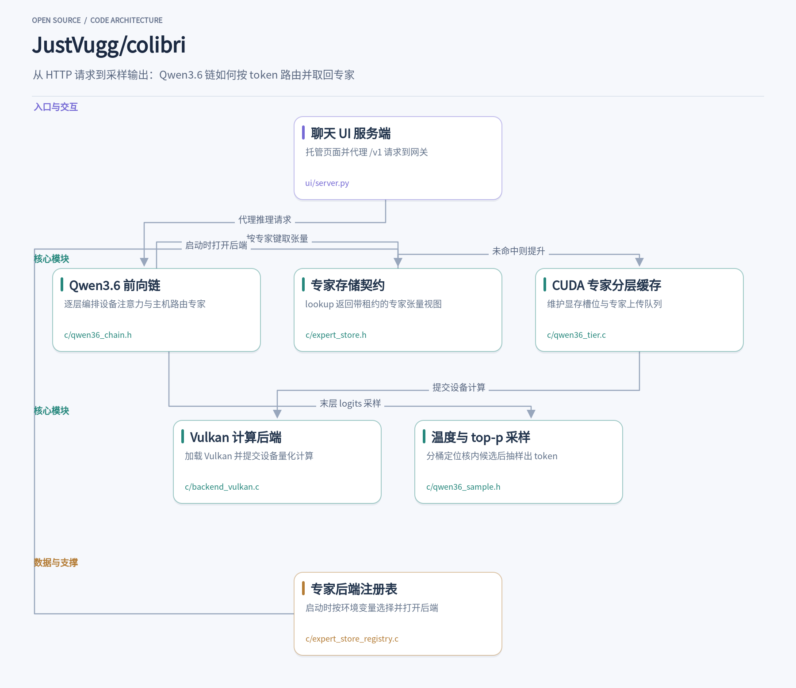
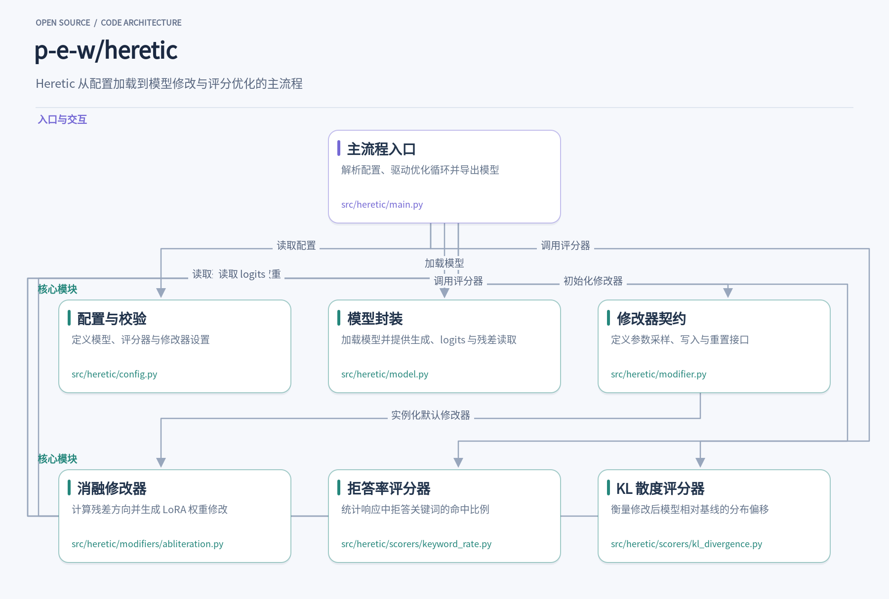
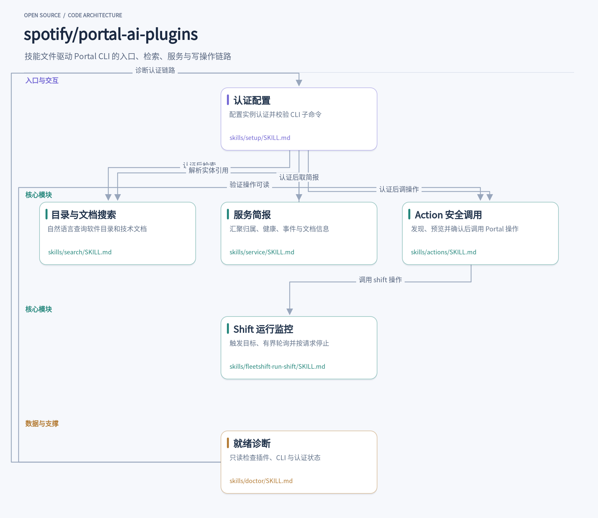
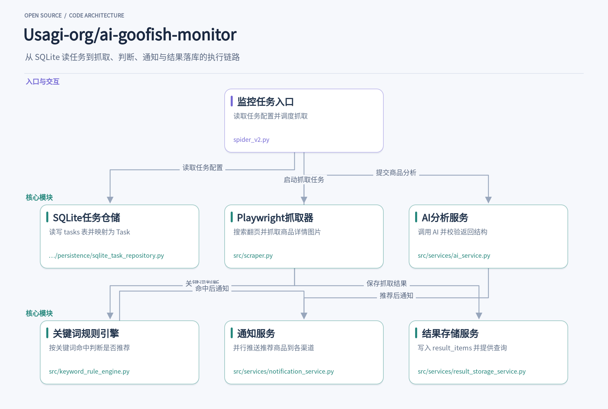

今天想聊四个项目，它们各自解决一个具体问题。colibri 把数百亿参数的 MoE 模型拆成热、温、冷三层，让 8 GB 内存的机器也能起步跑本地推理；heretic 用对比提示和评分器搜索权重修改方向，在消费级显卡上把模型的模板化拒答压下去；spotify/portal-ai-plugins 把 Portal CLI 封装成编码代理能照着执行的工作流技能，补上“知道要做什么、不知道怎么安全调用”的断层；ai-goofish-monitor 用 Playwright 抓闲鱼商品，按规则判断后推到手机。下面按各自的使用场景和内部设计展开。

## 1. colibri

> 把数百亿参数 MoE 拆成热/温/冷三层，用 8 GB 内存起步在本地跑推理

[JustVugg/colibri](https://github.com/JustVugg/colibri) · `C` · **47,236** stars · 今日 **+802** · `Apache-2.0`

你在笔记本上执行 `./coli chat`，终端打印出 GLM-5.2、744B MoE、int4、streaming CPU，准备就绪后常驻内存约 9.9 GB。README 把最低内存写成 8 GB、推荐 16 GB 以上，这个 9.9 GB 是示例模型的常驻占用，下限机器需要选更小的模型。启动脚本会先看 RAM、磁盘、CPU 和 GPU，再推荐一个“常驻部分加最小专家缓存能装进内存”的模型，下载支持断点续传，最后打开浏览器面板并给出 OpenAI 兼容地址。

面板背后的 `ui/server.py` 只做三件事：托管页面、把 `/v1/`、`/health`、`/profile`、`/experts` 代理到 `coli serve` 网关、按块透传 SSE。浏览器断开时它关闭上游连接，网关随之停止引擎。`/agents`、`/web/`、`/models/` 这些本机敏感路由共用 `_local_ok` 校验 Host、Origin 和自定义请求头，避免被其他站点调用。

真正的前向编排在 `c/qwen36_chain.h`。以 Qwen3.6 为例，它同时覆盖注意力层和 Gated DeltaNet 层，也有路由专家路径。每层设备侧先做残差合并、RMSNorm、注意力或 DeltaNet、router logits；主机侧取 top-k 得到本 token 选中的专家键，再调用专家存储取回对应张量。专家结果回传后与共享专家、残差合并，进入下一层。这个文件把“哪些留在设备、哪些回主机”写成了逐层帧序列，而不是一个笼统的 offload 开关。

专家存储的契约在 `c/expert_store.h`：`lookup` 返回一个带租约的 `ColiExpertView`，调用方必须恰好 `release` 一次；失败时视图被清零，不能使用也不能释放。`prefetch` 是建议性的，不持有租约，也不能驱逐仍有活跃租约的槽位。这层抽象让上层只关心“我要第几层第几个专家”，不关心它此刻在显存、内存还是磁盘。

后端选择发生在打开阶段，不在每个 token 的路径上。`c/expert_store_registry.c` 用构造函数在静态链接期注册内置的 `auto` 后端，运行时读 `COLI_EXPERT_STORE` 环境变量，找到对应 open 函数并打开一个具体 store。之后 `lookup` 走的是这个已打开实例的 `ops`，registry 不再参与逐 token 调用。默认不设环境变量时就是 `auto`，行为与引入这层接缝之前一致。

GPU 侧的分层缓存由 `c/qwen36_tier.c` 实现，但它只在 `COLI_CUDA` 下编译，是 CUDA 的 VRAM 专家 tier：维护每层每个专家的槽位、热度、本对话路由计数，以及一个带暂存拷贝的上传队列。未命中时从主机 RAM 取权重提升到显存，按 LFRU 思路替换。Vulkan 路径不走这个 tier，链内的路由专家由 `vk_dmoe.h` 那套设备批处理承担；`c/backend_vulkan.c` 负责加载 Vulkan、管理设备内存、提交量化计算，两者不要混为一谈。

末层归一化后 `lm_head` 给出 logits，`c/qwen36_sample.h` 做温度加 top-p 采样。它先对全词表算一遍概率，再按二进制指数分桶，从高到低累加到超过 top-p，只对核内的候选排序，省掉的是全词表排序，而不是整次概率计算。温度不大于零时退化为 `argmax_first`，top-p 为 1 时直接走全排序路径。KV 与前缀缓存留在主机侧作为规范副本，设备只持有带水位线的镜像，复用前缀时不需要重新计算。

这些设计里值得借鉴的是边界感：专家存储用租约把生命周期说清楚，后端注册在启动时完成而不是每步查表，设备与主机各自持有明确的状态副本，采样器把“必须全量”和“可以剪枝”的部分分开。C 语言加一个文件对应一个模型家族，让新增引擎时不必改动其他家族的链路，这也是它能同时维护十三套引擎的原因。

## 2. heretic

> 在本地显卡上无需训练，用对比提示和评分器搜索权重修改方向，默认去除模型拒答

[p-e-w/heretic](https://github.com/p-e-w/heretic) · `Python` · **38,768** stars · 今日 **+701** · `AGPL-3.0`

你下载了一个本地能跑的对话模型，问它某个敏感话题时，它回一句“抱歉，我不能协助”。想让它少一点这种模板化拒答，通常要么重新训练，要么手工调权重。Heretic 把这件事变成一条命令：`heretic Qwen/Qwen3-4B-Instruct-2507`，在消费级显卡上跑几十分钟，产出一个拒答率下降、同时尽量少偏离原模型的新权重。它不训练模型，而是用对比提示算出“好”与“坏”两类残差方向，再让优化器搜索在哪些层、以多大强度把坏方向减掉。

整个流程从配置开始。`src/heretic/config.py` 里的 `Settings` 用 pydantic-settings 同时读取 TOML、环境变量和命令行参数，默认加载工作目录的 `config.toml`。它把模型 ID、量化方式、评分器列表、修改器列表、数据集规格都收进一个强类型对象。评分器配置里带 `optimization` 字段，取 `minimize`、`maximize` 或 `none`，直接决定这个评分在 Optuna 里是目标还是只做观测。默认配置挂两个评分器：拒答关键词率和 KL 散度，都取最小化。

`src/heretic/model.py` 负责把 Hugging Face 模型变成可操作的对象。`Model.__init__` 加载 tokenizer，检测聊天模板是否接受 system 角色，不支持时把系统提示折进第一条用户消息。它统一用左填充，避免 decoder-only 模型在生成时把 PAD 当成序列结束。`get_residuals_mean` 批量跑提示、抓取每层残差并求均值，`get_logits` 取首 token 分布，`apply_lora` 给指定层注入 LoRA 适配器。量化在加载时通过 bitsandbytes 完成，4bit 模式下后续修改会先反量化再计算。

修改器的抽象在 `src/heretic/modifier.py`。`Modifier` 继承插件基类，要求实现 `suggest_parameters`、`modify_model` 和 `reset_model` 三个方法：Optuna 每轮先让修改器采样一组参数，再把参数写进模型，评分后重置回基线。`load_and_init_modifiers` 读取配置、解析插件路径、实例化并调用 `init`。`Context` 对象把 `Settings` 和 `Model` 一起传给修改器和评分器，双方共享同一套模型与提示加载能力。

默认修改器是 `src/heretic/modifiers/abliteration.py` 里的 `Abliteration`。`init` 先加载 good 提示（默认 `mlabonne/harmless_alpaca`）和 bad 提示（默认 `mlabonne/harmful_behaviors`），分别求每层残差均值，相减并归一化得到“坏方向”。开启 `orthogonalize_direction` 时，它会把这根方向中与好方向平行的分量投影掉，只保留正交部分再减，减少对正常行为的误伤。`row_normalization` 设为 `full` 时，它用低秩 SVD 近似保持原权重行范数，避免修改后权重整体缩放。

`suggest_parameters` 用 Optuna 的 `trial.suggest_*` 采样一组参数：方向作用范围是全局还是逐层、方向索引落在层栈中后段、每个可修改组件（如 `attn.o_proj`、`mlp.down_proj`）的最大权重、峰值位置、最小权重和衰减距离。`modify_model` 按这些参数逐层计算权重，把 `delta W = -lambda * v * (v^T W)` 拆成 LoRA 的 A、B 矩阵写入适配器。MLP 的下界允许取负再截断到 0，让优化器可以选择完全不动 MLP，因为动它往往更伤模型能力。

评分器决定优化往哪走。`src/heretic/scorers/keyword_rate.py` 对每条提示生成响应，把文本转小写、去掉星号、统一弯引号，再匹配一组拒答关键词，命中比例就是分数；空响应也算命中，防止优化器靠不输出刷低分。`src/heretic/scorers/kl_divergence.py` 在 `init` 时记录原模型在无害提示上的首 token 对数概率，每轮计算修改后模型与基线的 KL 散度，作为“别改坏”的约束项。两个分数被 Optuna 共同优化，形成拒答率与能力保持之间的权衡前沿。

`src/heretic/main.py` 把上述模块串起来：解析配置、加载模型、初始化修改器和评分器、跑 `n_trials` 轮优化，每轮记录参数与分数，结束后让用户从 Pareto 前沿里挑一个 trial。选定后按 `export_strategy` 合并 LoRA 或只保留适配器，再选择保存、上传到 Hugging Face、直接聊天测试或跑 lm-eval 基准。值得借鉴的是它对插件契约的约束：评分器和修改器都通过 `Context` 拿模型和提示，参数用可序列化的 dataclass 表达，trial 结果能完整还原，复现和扩展都不需要改主循环。

## 3. portal-ai-plugins

> 把 Portal CLI 封装成编码代理可执行的工作流技能

[spotify/portal-ai-plugins](https://github.com/spotify/portal-ai-plugins) · `TypeScript` · **3,030** stars · 今日 **+91** · `Apache-2.0`

在 Claude Code 或 Codex 里敲一句“帮我查一下 payments 服务谁负责、有没有 runbook”，代理通常不知道下一步该跑什么命令。spotify/portal-ai-plugins 把这类请求落成一组技能文件：每个 `SKILL.md` 描述一个 Portal 工作流，代理按其中的命令序列调用 `npx @spotify/portal-cli`，再把 JSON 结果整理成可读答案。它解决的是“代理知道要做什么，但不知道 Portal CLI 怎么安全地用”这一层断层。

`skills/setup/SKILL.md` 是整条链路的起点。它要求代理先跑 `node --version`、`npx @spotify/portal-cli --help`，确认 CLI 暴露了 `auth`、`actions`、`owner`、`search`、`service` 五个子命令，再用 `auth list` 检查已有实例。多个实例并存时，技能明确禁止代理自行挑默认值，必须把名称和 URL 列给用户选择。认证走 `auth login` 的浏览器流程，凭据始终不进入对话。最后用 `actions list --json` 证明 CLI 能连上实例并读到 action 列表，才算配置完成。

检索场景由 `skills/search/SKILL.md` 承担。用户说“找一下和结账相关的 API”，代理把原话作为查询传给 `search <query> --limit 10 --json`，只有在意图明确时才加 `--type software-catalog` 或 `--type techdocs` 收窄范围。结果不整段回吐，而是整理成短列表，保留实体引用、标题和链接。首次查询为空时允许放宽关键词重试一次，但不得凭空编造服务名。分页只在用户要求或首页明显不足时才继续。

服务简报是另一个高频用法。`skills/service/SKILL.md` 先通过 `owner <service-name> --json` 拿到规范实体引用，再按用户关心的维度分流：归属、on-call、Slack 和 runbook 走 `owner`；构建、部署、运行时和事件走 `service status <entity-ref>`；文档走 `service docs`。需要完整简报时三条都跑。这里有个值得借鉴的约定：取不到的维度记为“不可用”，不能当成“健康”，同时保留数据新鲜度和来源链接，避免代理把缺失信息读成好消息。

写操作的安全护栏集中在 `skills/actions/SKILL.md`。代理先 `actions list --json` 发现 action，再对目标 action 跑 `--help` 看参数。变更类操作必须先 `--dry-run --json` 预览输入，把将要改动的对象展示给用户，获得授权后才真正执行；`--yes` 只在该 action 被标记为破坏性且用户已同意时追加。技能还特别写明：dry-run 成功不等于执行成功，不能据此汇报完成。这套顺序把“代理误触写接口”的风险压到了确认环节。

出问题时用 `skills/doctor/SKILL.md` 做只读诊断。它分四步检查：宿主插件是否安装启用（Claude Code 用 `claude plugin list --json`，Codex 用 `codex plugin list --available --json`，Cursor 则引导到设置页）、Node/npm 与 CLI 命令面是否齐全、`auth list`/`auth show` 的实例状态是否明确、`actions list --json` 是否可读。报告是一张四行状态表，任一项阻塞就不给总体“就绪”结论，并区分“插件版本新但命令描述旧”这类需要重载会话的情况。

异步任务链路由 `skills/fleetshift-run-shift/SKILL.md` 补全。触发前必须让用户看到确切的 shift 名和目标列表并明确同意，`trigger-shift` 一次只跑一个目标，返回 `jobIdentifier` 和 `portalJobUrl` 供后续监控。监控是有界循环：最多 10 次轮询、间隔不少于 30 秒、总时长不超过 15 分钟，命中终态即停。用户中途说“停”，代理立刻停止触发剩余目标、结束轮询，并对未终结的 job 调用 `fleetshift:stop-jobs`，不再二次确认。

这些技能文件本身没有运行时代码，价值在于把 CLI 的调用约束写成代理可遵循的文本协议：先 help 再执行、优先 `--json`、写前 dry-run、多实例必问、缺失不等于健康、等待必有上限。`package.json` 只做一件事——通过 `pi.skills` 指向 `./skills` 目录，让 pi 宿主加载整组工作流。想扩展新场景，照着现有 `SKILL.md` 的结构补一份，把前置校验、命令序列和失败处理写清楚即可。

## 4. ai-goofish-monitor

> 用 Playwright 抓闲鱼商品，按 AI 或关键词规则判断后推送到手机

[Usagi-org/ai-goofish-monitor](https://github.com/Usagi-org/ai-goofish-monitor) · `Python` · **16,339** stars · 今日 **+228** · `MIT`

在闲鱼上盯一款二手相机或显卡，手动刷新既费时又容易错过好价。ai-goofish-monitor 把这个过程拆成可配置的监控任务：你给一个关键词、价格区间和筛选条件，它用 Playwright 驱动浏览器搜索并翻页，把新出现的商品抓下来，再按 AI 或关键词规则判断值不值得关注，推荐的结果通过 ntfy、Bark、Telegram 等渠道推送到手机。Web 后台负责创建任务、管理闲鱼登录态和查看结果，任务本身由后台进程或 Cron 定时触发。

任务配置不再散落在 JSON 文件里。`spider_v2.py` 作为执行入口，默认通过 `SqliteTaskRepository.find_all()` 从 SQLite 的 `tasks` 表读取任务，只有显式传入 `--config` 时才走旧的 JSON 配置兼容模式。仓储把数据库行映射成 `Task` 模型，布尔字段和 `keyword_rules_json` 都在这一层还原。读取后入口会统一 `decision_mode` 的取值，并把旧的 `keyword_rule_groups` 拍平成 `keyword_rules` 列表，这样后续抓取和判断拿到的就是规范化的配置。

AI 模式的任务需要提示词。入口会检查任务是否启用了 `ai_prompt_base_file` 和 `ai_prompt_criteria_file`，读取两个文件后用基础提示词里的 `{{CRITERIA_SECTION}}` 占位符拼进判断标准，得到最终的 `ai_prompt_text`。如果文件缺失或替换后仍残留占位符，就打印警告并把该任务的提示词置空，AI 分析会被跳过。关键词模式不需要这一步，入口直接把提示词清空，后续用关键词规则引擎判断。

真正抓数据的是 `src/scraper.py` 里的 `scrape_xianyu`。它按任务的关键词、价格、包邮、发布时间和区域拼出搜索条件，用 Playwright 打开移动端页面，监听搜索接口的响应来解析商品卡片，再按 `max_pages` 翻页。对每个新商品，它进入详情页抓取标题、售价、卖家和图片，图片会临时落到 `images/task_images_<task_name>/` 目录。已处理过的商品链接通过 `load_processed_link_keys` 从 `result_items` 表读出，避免重复分析。

判断环节有两条路。AI 模式下，`AIAnalysisService.analyze_product` 把商品数据和图片路径交给 `AIClient`，拿到结果后由 `_validate_result` 检查 `is_recommended` 是否为布尔、`risk_tags` 是否为列表、`criteria_analysis` 是否非空字典，任何一项不满足就丢弃这次分析。关键词模式则由 `src/keyword_rule_engine.py` 处理：`build_search_text` 把商品标题、商品信息和卖家信息里的文本片段收集起来做小写归一，`evaluate_keyword_rules` 按 OR 逻辑匹配，纯英数字关键词用词边界正则，避免 `Q1` 误命中 `Q1R5`。

被判定为推荐的商品会进入通知环节。`NotificationService` 在构造时只保留 `is_enabled()` 为真的渠道客户端，`send_notification` 用 `asyncio.gather` 并行调用每个客户端的 `send`，再按渠道汇总成功或失败信息。渠道来自 `build_notification_clients`，包括 Bark、Gotify、ntfy、PushPlus、Telegram、企业微信机器人和通用 Webhook。即使某个渠道抛异常，其他渠道的推送也不会被拖住，返回结果里会带上该渠道的错误消息。

无论是否推荐，结果最终都落到 SQLite。`save_result_record` 从商品链接截取唯一键，没有链接时用商品 ID 或整条记录的哈希兜底，然后以 `INSERT OR IGNORE` 写入 `result_items`，同时记录价格、发布时间、卖家昵称、分析来源和关键词命中数。Web 端的结果列表和导出都从这张表查询，`query_result_records` 支持按 AI 推荐或关键词推荐过滤、按价格或发布时间排序，还会结合黑名单规则和手动隐藏状态决定哪些记录对用户可见。

这个项目值得借鉴的地方在于把“抓取—判断—通知—存储”拆成了职责清晰的模块，入口只负责配置规范和调度，抓取器专注页面交互，判断逻辑按模式分派，通知和存储各自独立。`result_storage_service` 里用链接唯一键做去重、把原始记录整条存进 `raw_json` 的做法，让结果查询和后续扩展都不必回头改抓取代码。任务仓储通过 `asyncio.to_thread` 包住同步 SQLite 操作，也避免了在异步爬虫流程里阻塞事件循环。

这四个项目放在一起看，切入点都很窄：一个管内存分层，一个管权重方向搜索，一个管代理调用 CLI 的中间层，一个管二手商品的抓取与推送。窄的好处是读源码时能顺着一条主线走完，改起来也知道该动哪一块。如果你手头正好有内存吃紧的机器、想压一压模型的拒答、在给编码代理补工具链，或者只是盯着某款二手硬件，这几个仓库都值得翻一翻。
