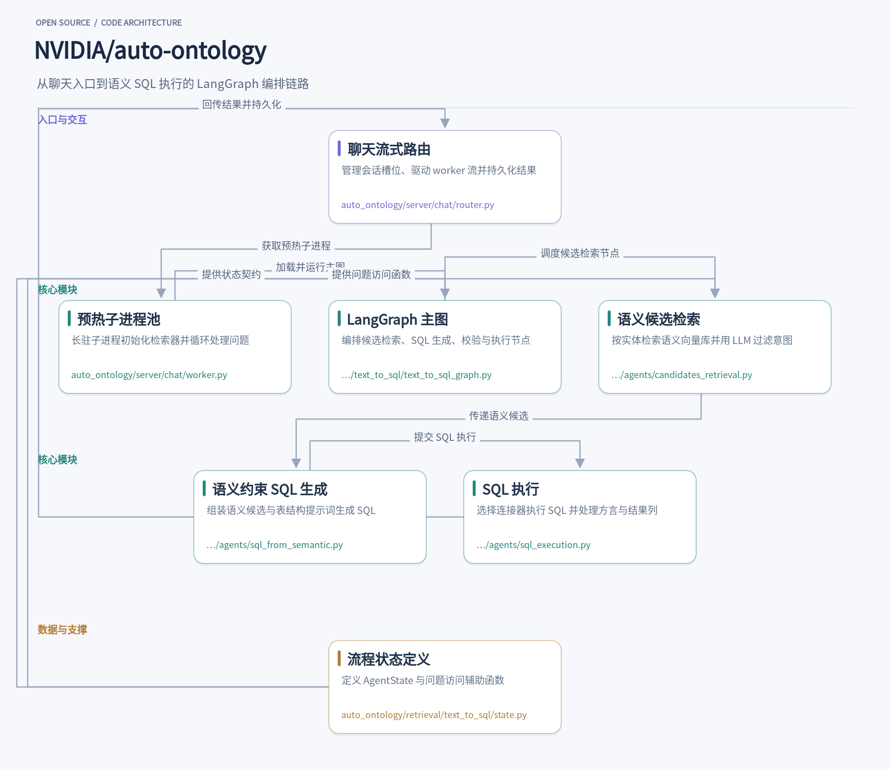
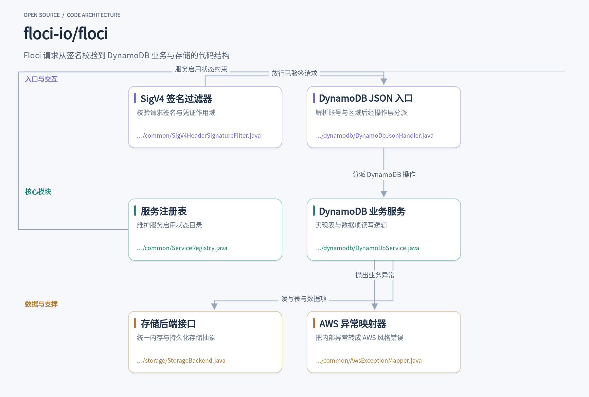
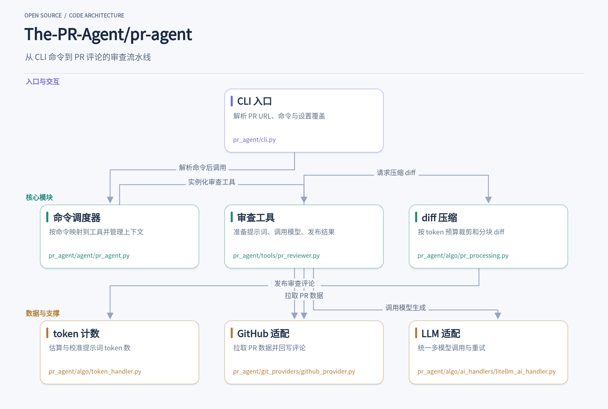
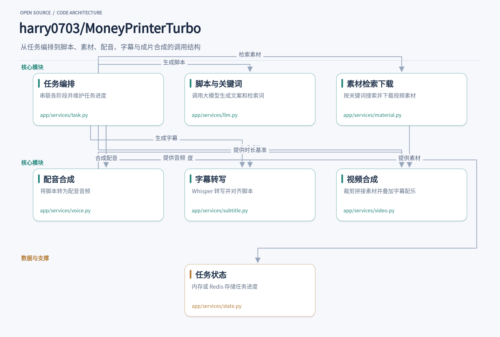
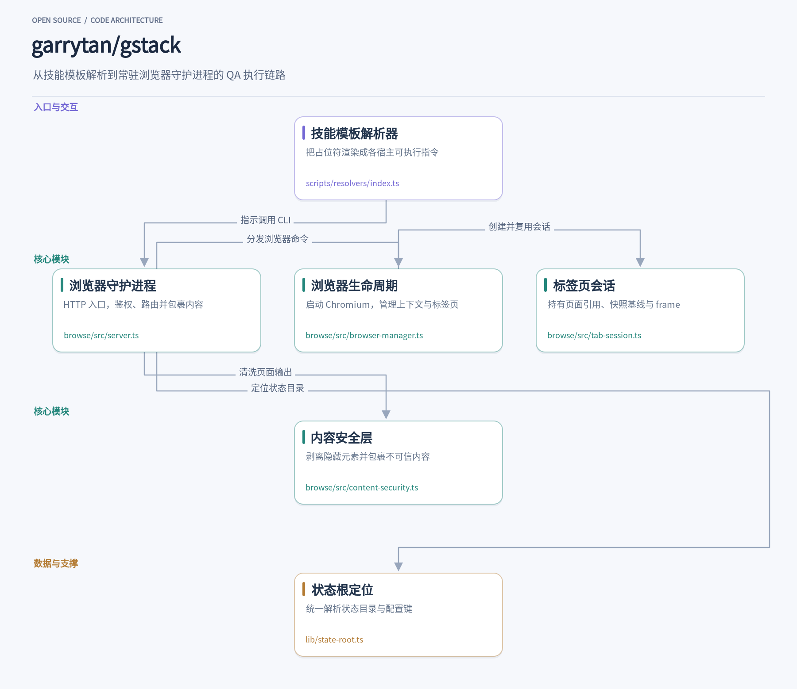

这期整理的项目都来自真实的开发场景：有人想把自然语言问题直接变成可执行的SQL，有人想在本地跑通AWS集成测试而不碰真实账号，也有人希望PR一提交就能收到结构化的审查意见。NVIDIA/auto-ontology用LangGraph把语义候选检索、SQL生成、校验和执行串成一条SSE流式返回的流水线；Floci把S3、DynamoDB等AWS服务塞进一个Docker容器，端点指向localhost:4566就能用；PR-Agent把diff拉取、上下文压缩、模型调用和评论回写做成一条可复用的审查链路；MoneyPrinterTurbo把视频生成拆成后台任务，靠轮询推进脚本、配音和成片；gstack则用23个斜杠命令把Claude Code扩展成覆盖设计、QA和发布的虚拟工程团队。下面逐个展开它们解决什么问题、怎么用、内部模块如何配合。

## 1. auto-ontology

> 用语义图谱把自然语言问题变成可验证的 SQL 查询

[NVIDIA/auto-ontology](https://github.com/NVIDIA/auto-ontology) · `Python` · **4,901** stars · 今日 **+2,050** · `Apache-2.0`

在数据分析场景里，用户问“上季度华东区销售额是多少”，系统需要先理解“销售额”对应哪个指标、“华东区”映射到哪张表的哪个字段，再生成 SQL 并执行。NVIDIA/auto-ontology 把这一过程拆成一条由 LangGraph 编排的流水线：从聊天端点进入，经过语义候选检索、SQL 生成、校验与执行，最终把答案和图表持久化回会话。整个流程通过 SSE 流式返回，用户能看到每一步的进展。

请求首先到达 `auto_ontology/server/chat/router.py` 中的聊天路由。它按用户和会话 ID 分配并发槽位，从 `WarmPool` 取得一个预热的 agent 子进程。子进程由 `worker.py` 管理，启动时一次性导入检索器、连接器和 LLM 客户端，之后循环接收问题并流式产出事件。这种设计把冷启动成本从每次请求移到服务启动时，同时用进程隔离保证同步阻塞的 agent 代码可以被安全取消。

子进程内部运行的是 `text_to_sql_graph.py` 定义的 LangGraph 状态图。入口节点根据 `path_state` 中的 `_resume_from` 决定从问题意图分类开始，还是直接跳到重建节点。主路径依次经过问题意图、实体抽取、候选检索、候选准备、证据细化、SQL 生成、SQL 校验、执行和响应。每个节点通过 `announce_node_start` 向流写入“步骤开始”事件，让客户端看到的标签跟随实际工作进度，而不是等节点结束后才更新。

候选检索由 `candidates_retrieval.py` 负责。它按抽取出的实体分别查询语义向量库，检索列属性、自定义分析、SQL 属性和主题术语。每个实体的原始命中会交给 LLM 做意图过滤，只保留与完整问题相关的候选。去重时保留分数最低的命中，并记录哪些实体检索到了同一条目。如果某个数据库覆盖了最多实体，后续候选会被收窄到该数据库，避免跨库混用语义定义。

SQL 生成在 `sql_from_semantic.py` 中完成。它把候选准备阶段输出的主属性、连接路径、相关表、术语表、证据和相似问题组装成提示词。提示词里包含方言规则、投影规则和计算子类型的 SQL 形状参考，但明确要求模型只借鉴结构，不复制表名或字面值。生成结果可以是 SQL，也可以是文本答案；如果模型连续三次返回空响应，节点会把决策置为 `unconstructable`，交给后续节点处理。

执行环节由 `sql_execution.py` 承担。它根据相关表解析出匹配的连接器，执行前先做方言清理，比如去掉 SQLite 不支持的 `PUBLIC.` 前缀。执行后对结果列去重，把重复列名改成带后缀的唯一标签。如果查询因为基础设施问题失败，比如数据库不可达，节点直接返回 `unconstructable` 并给出面向用户的连接错误说明，而不是让重建循环空转七次。

整个流程的状态由 `state.py` 中的 `AgentState` 和 `TextToSQLPayload` 定义。`path_state` 是一个可累积的字典，各节点往里写入候选、SQL、错误信息和思考记录。辅助函数 `get_question_for_processing` 优先使用归一化后的问题，`get_original_question` 保留原始问法，让不同节点按需取用。这种把状态与图定义分离的做法，避免了 agent 与图之间的循环导入，也让每个节点的输入输出契约更清晰。

从设计上看，这个项目把“语义层”做成了检索与生成之间的约束机制，而不是事后校验。候选检索阶段就用本体条目缩小上下文，SQL 生成阶段把语义连接路径写进提示词，执行阶段再处理方言和类型细节。对于需要可解释性的 agent 工作流，这种分层让每一步都有明确的输入来源和失败处理路径，也方便把认证过的修正反馈回本体。

## 2. floci

> 用 Docker 在本地跑起 AWS，免费且无需账号的 AWS 模拟器

[floci-io/floci](https://github.com/floci-io/floci) · `Java` · **29,584** stars · 今日 **+1,090** · `MIT`

在本地跑集成测试时，最怕测试里写死了对真实 AWS 的调用：账号、密钥、网络、计费都是麻烦事。Floci 把这个问题收拢成一个 Docker 容器，默认监听 `http://localhost:4566`，你的 AWS CLI、SDK、Terraform、CDK 或 Testcontainers 测试只要把端点指过来，就能对本地模拟的 S3、DynamoDB 等服务执行创建、查询、变更操作。README 里给出的启动方式就是 `docker compose up`，不要求注册账号，也没有功能门禁。

当请求到达 4566 端口后，第一道关卡是 `SigV4HeaderSignatureFilter`。它按资源类型决定是否由自己校验签名：S3、API Gateway 执行接口和 AppSync GraphQL 各有专门的校验器，其余服务（包括 S3 Control）都走这个过滤器。开启 `floci.auth.validate-signatures` 后，它从 `Authorization` 头或预签名查询参数中取出凭证作用域，重建规范请求，用密钥推导签名并做常量时间比较。签名不匹配、凭证未知或时间偏移超出窗口，都会按请求协议返回 AWS 风格的错误体。

签名校验通过后，请求需要落到具体服务上。`ServiceRegistry` 负责维护服务启用状态：它从 `ResolvedServiceCatalog` 读取描述符，`isServiceEnabled` 按外部服务名查状态，查不到时默认放行；`getServices` 把每个已知服务标成 `running` 或 `available`，供状态查询接口使用。服务是否启用由目录描述符驱动，这层目录让模拟器可以在配置层面控制哪些服务对外呈现。

以 DynamoDB 为例，请求进入 `DynamoDbJsonHandler` 后，它先解析调用方的账号和区域，再通过 `DynamoDbOperations` 分派到具体实现。源码注释特意说明，CRC32、JSON 1.0 与 CBOR 的协议转换留在控制器层，handler 只负责账号/区域解析与分派，这样 JSON 控制器、CBOR 控制器、API Gateway AWS 集成、AppSync 和 Step Functions 可以共用同一条业务入口。

业务逻辑落在 `DynamoDbService` 中。它持有表定义、数据项、导出、导入、备份等各一个 `StorageBackend`，时间点恢复由 `DynamoDbPointInTimeRecovery` 封装；注入时由 `StorageFactory` 按配置创建存储后端。数据项默认存在 `ConcurrentSkipListMap` 里，按表隔离；每个数据项还有按需创建的 `ReentrantLock`，源码注释说明 `transactWriteItems` 依赖它的可重入性，在外层事务已持锁的情况下再调 put/update/delete 不会自锁。

存储层由 `StorageBackend` 接口收口：`put`、`get`、`delete`、`scan`、`keys`、`flush`、`load` 这些方法把内存存储和持久化存储统一起来。接口还提供 `putAllAtomically` 和 `deleteAllAtomically` 的默认实现，不支持原子批量的后端会直接抛异常，调用方因此能明确知道当前后端的能力边界。DynamoDB 的数据项布局可以通过 `item-layout` 在单文件和按表分片之间切换。

当业务层抛出 `AwsException` 时，`AwsExceptionMapper` 把它转成 JSON 错误响应：HTTP 状态码、`__type` 和 `message` 都按异常携带的信息填充，扩展数据也会合并进响应体。这样客户端拿到的错误码和结构更接近真实 AWS，测试里针对错误分支的断言不用为模拟器单独改写。

从代码组织看，Floci 把“协议入口—服务目录—服务实现—存储抽象—错误映射”拆成了清晰的几层。签名过滤器只关心身份与请求完整性，服务目录只关心启用状态，DynamoDB 的 handler 和 service 分别承担分派与业务，存储接口则让同一套业务代码可以跑在内存或持久化后端上。这种分层对做本地模拟器的项目有参考价值：协议兼容性和业务逻辑可以分开演进，新增服务时不必把签名、错误映射这些横切逻辑再写一遍。

## 3. pr-agent

> 一条命令让 AI 读懂 PR diff，把审查意见写回代码平台

[The-PR-Agent/pr-agent](https://github.com/The-PR-Agent/pr-agent) · `Python` · **14,743** stars · 今日 **+280** · `MIT`

在本地仓库跑一次 `pr-agent --pr_url=https://github.com/owner/repo/pull/123 review`，几秒后 PR 页面就会出现一条结构化审查评论。这个仓库就是 PR-Agent，一个用 Python 写的开源 PR 审查代理。它把“拉取 diff、按模型上下文压缩、生成提示词、调用大模型、回写评论”串成一条流水线，同时支持 `/describe`、`/improve`、`/ask` 等命令，GitHub Action、CLI 和 webhook 三种入口共用同一套工具实现。

命令进入后先落到 [pr_agent/cli.py](https://github.com/The-PR-Agent/pr-agent/blob/b2c8d5e1feb832a54d41f40cef3223114afef9ac/pr_agent/cli.py)。它用 argparse 解析 `--pr_url`、命令名和形如 `--pr_reviewer.extra_instructions="..."` 的设置覆盖，再通过 `_cli_settings_scope` 为单次调用复制一份请求级 settings，避免多个命令共享全局配置互相污染。随后 `PRAgent` 被实例化，命令字符串交给 `parse_command` 做分词，保留引号信息，防止 `"true"` 被 YAML 解析成布尔值。

[pr_agent/agent/pr_agent.py](https://github.com/The-PR-Agent/pr-agent/blob/b2c8d5e1feb832a54d41f40cef3223114afef9ac/pr_agent/agent/pr_agent.py) 里的 `command2class` 是一张命令到工具类的映射表：`review` 指向 `PRReviewer`，`describe` 指向 `PRDescription`，`improve` 指向 `PRCodeSuggestions`。`PRAgent._handle_request` 打开一个 OpenTelemetry span，按命令名实例化对应工具，并把 git provider 上下文注入进去。新增一个工具通常只需实现一个类并登记到这张表，调度层不用改。

真正干活的是 [pr_agent/tools/pr_reviewer.py](https://github.com/The-PR-Agent/pr-agent/blob/b2c8d5e1feb832a54d41f40cef3223114afef9ac/pr_agent/tools/pr_reviewer.py)。`PRReviewer.__init__` 先通过 `get_git_provider_with_context` 拿到平台适配器，读取 PR 标题、分支、描述、提交信息和文件列表，再把这些变量填进 `self.vars`，供 Jinja 模板渲染提示词。`run()` 里会先发一条临时进度评论，然后调用 `retry_with_fallback_models` 走模型回退链，最后把解析出的审查结果发布成评论或行内建议。

大 PR 是这类工具的常见痛点。[pr_agent/algo/pr_processing.py](https://github.com/The-PR-Agent/pr-agent/blob/b2c8d5e1feb832a54d41f40cef3223114afef9ac/pr_agent/algo/pr_processing.py) 的 `get_pr_diff` 先按语言对文件排序，把补丁扩展成带行号的 hunk，再比较 token 数与软/硬预算。低于软预算就整段返回；超出后走 `pr_generate_compressed_diff` 裁剪，把放不下的文件名以“Additional modified files”形式附在 diff 末尾，让模型至少知道哪些文件没被完整看到。预算计算依赖 [pr_agent/algo/token_handler.py](https://github.com/The-PR-Agent/pr-agent/blob/b2c8d5e1feb832a54d41f40cef3223114afef9ac/pr_agent/algo/token_handler.py)，`TokenHandler` 用 tiktoken 做本地估算，`count_tokens(force_accurate=True)` 时会尝试 LiteLLM 的 `acount_tokens` 拿提供方原生计数；拿不到就按 `model_token_count_estimate_factor` 放大本地估算。编码器按模型缓存并加锁，避免并发请求拿到上一个模型的 tokenizer。

平台差异被收在 git provider 层。[pr_agent/git_providers/github_provider.py](https://github.com/The-PR-Agent/pr-agent/blob/b2c8d5e1feb832a54d41f40cef3223114afef9ac/pr_agent/git_providers/github_provider.py) 负责解析 PR URL、拉取 diff 文件、读取增量提交、发布评论，并处理 GitHub 的限流与分页。它把 `FilePatchInfo`、`IncrementalPR` 这些平台无关的数据结构交给上层，`PRReviewer` 因此不需要关心当前是 GitHub 还是 GitLab。

模型调用统一走 [pr_agent/algo/ai_handlers/litellm_ai_handler.py](https://github.com/The-PR-Agent/pr-agent/blob/b2c8d5e1feb832a54d41f40cef3223114afef9ac/pr_agent/algo/ai_handlers/litellm_ai_handler.py)。`LiteLLMAIHandler` 把各家 API key、base URL、Azure OIDC、Bedrock 签名等差异封装在 `PROVIDER_SETTING_PATHS` 和一组 bridge 函数里，对上层只暴露 `chat_completion`。重试策略区分 429/5xx 与超时：前者按 `Retry-After` 或指数退避等待，后者可直接交给 fallback 模型，避免在已经超时的模型上反复重放。

这套结构值得借鉴的地方在于分层边界清晰：CLI 只管参数，调度层只管命令路由，工具类管业务流程，`pr_processing` 和 `token_handler` 管预算，provider 管平台，AI handler 管模型。任何一层替换都不牵动其他层，这也是它能同时支持 GitHub、GitLab、Bitbucket、Azure DevOps 和多种模型提供方的原因。

## 4. MoneyPrinterTurbo

> 输入一个主题，自动跑完脚本、配音、字幕到成片的整条流水线

[harry0703/MoneyPrinterTurbo](https://github.com/harry0703/MoneyPrinterTurbo) · `Python` · **138,930** stars · 今日 **+617** · `MIT`

在 MoneyPrinterTurbo 里，你只需要在 WebUI 或 API 里填一个视频主题，比如“三分钟了解咖啡的烘焙曲线”，再选好画面比例、配音音色和段落数，提交后就能在任务列表里看到进度条从脚本、关键词、素材下载一路走到成片输出。整个过程不是单次请求同步返回，而是被拆成若干阶段，由后台任务逐个推进，前端轮询任务状态即可。这种“提交—轮询—取结果”的形态，决定了代码里必须有一个可靠的编排层和一套状态存储。

编排的入口在 `app/services/task.py`。它把一次生成拆成 `generate_script`、`generate_terms`、素材下载、配音、字幕、视频合成几个函数，每个阶段结束后通过 `state` 模块写回进度和中间结果。阶段之间共享同一个任务目录，脚本和关键词会先落盘到 `script.json`，后续阶段直接读取，避免重复调用大模型。进度回调 `_stage_progress_reporter` 把阶段内部的 0 到 1 比例换算成全局百分比，让下载素材这类耗时步骤不会长时间停在同一个数字上。

脚本和关键词由 `app/services/llm.py` 负责。`generate_script` 把主题、语言、段落数拼进提示词，调用 OpenAI 兼容接口或本地模型；`generate_terms` 则要求模型输出一组用于检索素材的关键词。这里有一个实用细节：如果开启了按文案顺序匹配素材，关键词数量会从 5 个增加到 8 个，并且保持与脚本叙事一致的顺序，这样后面拼接画面时，后段内容的画面不会提前出现。模型返回的 `<think>` 块会被正则清掉，避免推理过程混进正文。

拿到关键词后，`app/services/material.py` 去 Pexels、Pixabay、Coverr 等来源检索视频。它会按目标画幅过滤：竖屏任务只接受高大于宽的素材，横屏反之，方形则放宽交给合成阶段裁剪。每个候选会挑选“能填满画布的最小分辨率”，既保证清晰度又不浪费带宽。下载前有 512MB 的单文件上限，请求异常里的 API Key 和代理凭据会被 `_redact_request_error` 替换成 `***` 再写日志。素材来源信息经过白名单重建后才落盘，只保留公开页面和业务标识，不把本地路径写进任务文件。

配音在 `app/services/voice.py`。它支持 Edge TTS、Azure、硅基流动、Gemini、MiniMax、ElevenLabs 等多种音色，统一用 `provider:voice` 的字符串标识，再由 `is_*_voice` 系列函数分派到对应实现。配音产出的音频时长是后续所有时序的基准：视频素材要裁到覆盖这段音频，字幕时间轴也要和它对上。代码里对“无配音”做了单独的哨兵值 `no-voice`，空字符串不会被当成静音，而是视为配置缺失，避免把错误伪装成正常结果。

字幕由 `app/services/subtitle.py` 用 faster-whisper 对配音音频转写。模型按需加载，用锁保证并发任务只初始化一次；转写时开启词级时间戳和 VAD 过滤，再按标点把词重新聚成句。如果用户提供了原始脚本，`correct` 会用编辑距离把转写结果和脚本对齐，相似度超过 0.8 的片段直接用脚本原文替换，减少同音字错误。找不到对应时间轴的脚本行会被丢弃，而不是生成零长度字幕。

最后的合成在 `app/services/video.py`。它先用 `_prioritize_unique_source_clips` 调整片段顺序，尽量让每个源素材只出现一次，素材不够时才复用。拼接通过 FFmpeg concat 完成，编码器支持 NVENC、QSV 等硬件加速，但会先检查 FFmpeg 是否声明支持，运行失败再回退到 libx264，并且只有回退成功才禁用该硬件编码器，避免把文件占用之类的通用错误误判成硬件问题。字幕叠加时颜色帧和蒙版用同一套缩放参数，弹跳动画才不会出现黑色轮廓。

任务状态由 `app/services/state.py` 抽象成 `BaseState`，内存版和 Redis 版实现同一接口。Redis 版用一次 HSET 原子写入整个任务，`patch_task` 用 Lua 脚本先检查键类型和 `task_id` 标记再更新，防止后台线程在任务被删除后重建一条残缺记录。`list_task_ids` 只扫描 HASH 类型并校验标记，共享 Redis 数据库里其他服务的键不会混进任务列表。这种把“存在性检查”和“写入”放进同一原子操作的做法，对任何有并发删除场景的任务系统都值得借鉴。

## 5. gstack

> 把 Claude Code 变成一支虚拟工程团队，23 个斜杠命令覆盖 CEO、设计、QA 到发布

[garrytan/gstack](https://github.com/garrytan/gstack) · `TypeScript` · **139,317** stars · 今日 **+290** · `MIT`

在 Claude Code 里敲下 `/qa`，agent 会打开一个真实的 Chromium 浏览器，访问你给到的 staging 地址，点按钮、填表单、读页面文本，把复现步骤和截图证据带回来。这背后不是一次性的脚本调用，而是一个常驻的浏览器守护进程：第一次命令启动 Chromium，之后每次 `/browse`、`/qa` 复用同一个实例，标签页、登录态和快照基线都还在。gstack 把这类能力打包成 23 个斜杠命令，从 `/office-hours` 的产品拷问、`/review` 的代码审查，到 `/ship` 跑测试并开 PR，全部是 Markdown 技能加 TypeScript 工具，MIT 许可。

这些命令本身是 Markdown 模板，真正决定 agent 看到什么指令的是 `scripts/resolvers/index.ts`。它维护一张 `RESOLVERS` 表，把 `{{BROWSE_SETUP}}`、`{{QA_METHODOLOGY}}`、`{{SNAPSHOT_FLAGS}}` 这类占位符映射到生成函数：`generateBrowseSetup` 写出如何调用 browse CLI，`generateQAMethodology` 注入 QA 的探索、功能、资源检查步骤，`generateSnapshotFlags` 解释快照命令的参数。同一份技能在不同宿主（Claude Code、Codex、Cursor）上渲染出不同内容，宿主差异也在这里收敛。想改 `/qa` 的行为，改的是 resolver 而不是散落在各处的提示词。

命令落到 `browse/src/server.ts`。这个文件用 `Bun.serve` 在 localhost 上监听，启动时 `resolveConfig()` 定位状态目录，`initAuditLog` 打开审计日志，token 校验通过后把请求交给读、写、元命令处理器。它管着双监听器架构：本地监听器服务 CLI 和侧边栏，隧道监听器只暴露 `/connect` 和 `/command` 两个路径，安全边界靠物理端口分离而不是逐请求判断。空闲 30 分钟后自动关闭，Chromium 崩溃时进程直接退出并留下清晰错误，CLI 下次命令自动重启——不尝试自愈，也不掩盖失败。

浏览器实例由 `browse/src/browser-manager.ts` 的 `BrowserManager` 持有。`launch()` 决定启动参数：macOS 上 headless 模式追加一组禁用 GPU 的标志，避免 GPU 进程空转；Windows、CI、root 环境下关闭 Chromium 沙箱；代理配置从 `BROWSE_PROXY_URL` 解析后传给 `chromium.launch()`。页面弹窗默认自动接受并记入缓冲区，防止 alert 卡死整个会话。上下文重建（比如切换 user-agent）时先 `saveState()` 保存 cookie、各标签页 URL 和 storage，重建后再恢复，失败则回退到干净状态。

每个标签页对应一个 `TabSession`（`browse/src/tab-session.ts`），它持有 Playwright 的 `page`、`@e1`/`@c1` 形式的元素引用映射、上一次快照文本和当前 frame。agent 执行 `snapshot` 后拿到带编号的元素，接着 `click @e3`，`resolveRef` 会去映射里查这个引用，元素已消失就报错并提示重新快照。快照基线不清空，用于 diff；`load-html` 载入的内容在上下文重建后要重新灌回 session，否则重放会丢状态。`BrowserManager` 用 `AsyncLocalStorage` 做标签页作用域，让并发请求各自落在自己的标签页上，不互相抢 activeTab。

页面内容回到 agent 之前要过 `browse/src/content-security.ts`。`markHiddenElements` 在页面里扫 opacity 小于 0.1、字号小于 1px、移出视口、前景背景同色、clip 隐藏的元素，以及 aria-label 里带“ignore previous instructions”之类注入模式的节点，打上标记；`getCleanTextWithStripping` 克隆 body、移除标记元素和 script/style，返回干净文本。只读命令的输出再被 `wrapUntrustedPageContent` 包进“BEGIN UNTRUSTED WEB CONTENT”信封，内容里若出现同样的哨兵字符串会被插入零宽空格拆开，防止页面伪造边界。内置的 URL 黑名单过滤器拦截 webhook.site、ngrok 这类外泄通道。

运行时可写状态统一由 `lib/state-root.ts` 定位。`resolveStateRoot` 按 `GSTACK_STATE_ROOT` → `GSTACK_HOME` → `GSTACK_STATE_DIR` → 插件数据目录 → `$HOME/.gstack` 的顺序取第一个有值的，browse 的状态文件、审计日志、会话持久化都拼在这个根下。`readConfigKey` 读 `config.yaml`，对 telemetry、codex_reviews 这类隐私相关键会在解析根和 `$HOME/.gstack` 之间取更严格的值，不认识的取值按最严格处理。一个函数管住所有路径，避免了各模块各自拼 `homedir()` 的漂移。

这套结构里值得借鉴的是几个边界划得很干净。技能模板与运行时分离：Markdown 描述 agent 该做什么，TypeScript 负责真正执行，改提示词不用碰浏览器代码。浏览器生命周期与标签页状态分离：`BrowserManager` 管进程和上下文，`TabSession` 管单页引用和快照，并发标签页靠作用域隔离而不是全局锁。不可信内容有明确的处理层：隐藏元素剥离、信封包裹、URL 过滤各司其职，agent 读到的页面文本始终带着来源标记。状态根只有一个所有者，配置读取的严格合并规则也集中在一处。这些取舍让一个本地守护进程能同时服务多个 agent 会话，而不至于在状态和安全上互相踩踏。

这五个项目覆盖了数据查询、云服务测试、代码审查、内容生成和开发流程自动化几个方向，共同点是都把复杂流程拆成了可观察、可复用的模块。auto-ontology的语义候选检索和SQL校验、Floci的本地端点模拟、PR-Agent的工具复用、MoneyPrinterTurbo的任务编排、gstack的常驻浏览器守护进程，都是值得在自建工具时借鉴的设计。如果你正在为集成测试发愁，或者想让PR审查更及时，不妨从对应的仓库README开始跑一遍。
