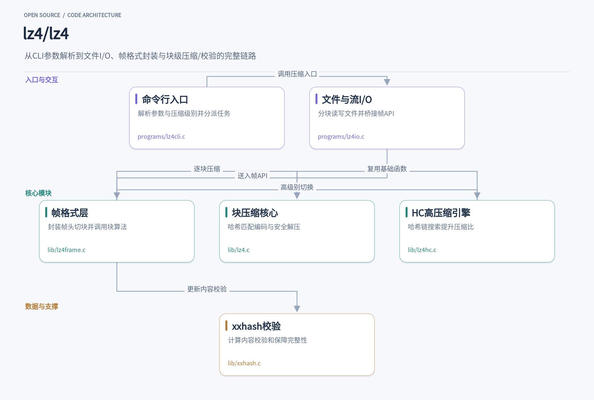

日志采集管道每秒落盘上百兆数据时，用 zlib 压缩往往先把 CPU 打满；换成 LZ4，单核压缩数百 MB/s，解压直接进入每秒数 GB 的量级。它凭什么这么快？答案藏在一套围绕解压速度做取舍的设计里：跳过复杂的熵编码，只做哈希表驱动的字典匹配；把格式拆成块压缩与帧格式两层，块内靠 offset 定位重复序列，帧层用 xxhash 做快速校验；默认档与 HC 档分别服务在线压缩与离线高压缩比。这篇文章顺着这些具体机制展开，看它怎样在压缩比、速度和可靠校验之间画出一道清晰的取舍曲线，以及哪些设计值得数据库、消息队列乃至内核开发者借鉴。

## 1. lz4

> 以解压速度为核心取舍的极快压缩算法，帧格式、块压缩与哈希校验的分层协作

[lz4/lz4](https://github.com/lz4/lz4) · `C` · **12,368** stars · 今日 **+23**

在需要压缩快、解压更快的场景里，LZ4 几乎是默认答案。日志采集管道每秒要落盘几十上百兆数据，如果用 zlib 压缩，CPU 很快成为瓶颈；换成 LZ4，单核压缩速度可达数百 MB/s，解压则进入每秒数 GB 的量级，多核环境下基本贴着内存带宽跑。官方基准里，LZ4 默认档在 Silesia 语料上压缩比 2.112、压缩 770 MB/s、解压 4950 MB/s，而 LZ4_HC -9 档压缩比提升到 2.717，解压速度几乎不掉。这种压缩比换速度、解压永远快的曲线，正是它被大量数据库、消息队列和内核采用的原因。

使用层面，LZ4 提供三个层次的接口。最外层是命令行工具，一条 `lz4 filename` 就生成 filename.lz4，支持 stdin/stdout 的管道模式，也支持 -D 指定字典文件来提升小文件压缩比。中间层是帧 API（lib/lz4frame.h），负责把任意长的数据流切成块、加帧头、可选地附上内容校验和，产出符合规范的可互操作格式。最底层是块 API（lib/lz4.h），直接对一段内存做压缩解压，格式极简：一个 token 描述字面量长度和匹配长度，后跟字面量数据和两字节的偏移。想嵌入自己系统的开发者通常从帧 API 入手，性能敏感的路径再下沉到块 API。

整个仓库的分工很清晰。programs/lz4cli.c 是命令行入口，解析 -1 到 -12 的压缩级别、-T 的线程数、-B 的块大小等参数后，把控制权交给 programs/lz4io.c。lz4io 负责真实的文件与流操作：打开源文件或 stdin、按块读入（在 64 位 POSIX 系统上默认用 mmap 映射输入以省一次拷贝）、调用帧 API 产出压缩数据并循环写出。LZ4IO_prefs_t 这个结构体集中存放了所有可调项，从块校验开关到内存预算，CLI 层只管往里填值，I/O 层按值执行。

帧层 lib/lz4frame.c 是承上启下的枢纽。它写帧头描述符（块大小 ID、是否独立块、是否带内容校验和），把输入切成 64KB 到 4MB 的块，逐块调用块级压缩，压缩结果如果反而变大就置上 LZ4F_BLOCKUNCOMPRESSED_FLAG 直接存原文。每个块压缩完顺手用 XXH32 更新内容哈希，帧结束时写入 EndMark 和校验和。同一份解压代码可以还原默认档和 HC 档的输出，因为两者共享同一种块格式——压缩端引擎可以随意替换，解压端永远只有一条路径。

块核心 lib/lz4.c 里，压缩用一张哈希表记录 4 字节序列最近出现的位置，命中就输出由字面量、偏移、匹配长度组成的三元组；解压端 LZ4_decompress_safe 逐 token 解析，按 offset 回拷还原数据，完全不需要哈希表，这就是解压速度远超压缩的根源。源码里大量编译期分支服务于性能：LZ4_FORCE_MEMORY_ACCESS 让不同平台选择 memcpy、__packed 或直接指针访问来读非对齐内存；LZ4_FAST_DEC_LOOP 在 x86、aarch64、PPC64 等架构上启用展开的快速解压循环；甚至针对 ppc64le 上 GCC -O3 会生成拖慢解压 30% 的 SIMD 循环这一具体情况，专门加了 LZ4_FORCE_O2 强制这些函数按 O2 优化。

高压缩档由 lib/lz4hc.c 实现。它不是独立模块，编译时直接 include lz4.c 复用 LZ4_count 等基础函数。核心差异在匹配搜索：默认档每个位置只在哈希表里查一个候选，HC 档维护 hashTable 加 chainTable 的链式结构，沿链尝试多个候选。k_clTable 把 12 个级别映射成三档策略——级别 2 用轻量的 lz4mid，3 到 9 用经典哈希链且搜索次数从 4 指数级加到 256，10 以上进入 lz4opt 做短程最优解析，级别 12 每个位置最多尝试 16384 次。LZ4HC_encodeSequence 把找到的序列编码成与默认档完全相同的字节格式，所以换来压缩比的同时解压端零成本。

完整性校验由 lib/xxhash.c 承担。XXH32 用四个累加器状态 v1 到 v4 各处理一个 32 位字，主循环每轮推进 16 字节，尾部不足 16 字节的部分通过一个 fallthrough 贯穿的 switch 按余数分发处理，最后经 avalanche 混合输出。压缩端在 lz4frame 里流式更新这个哈希，把终值写进帧尾；解压端同样计算并与帧尾比对，不匹配即报错。错误处理也有一套统一约定：错误码是负的 ptrdiff_t，RETURN_ERROR 和 FORWARD_IF_ERROR 宏层层上抛，任何一步失败都会让帧失效，直到重新调用 LZ4F_compressBegin。

对想借鉴设计的人，这个项目有几处值得细读。三层接口的切分让同一套块算法既服务于一次性内存压缩，也服务于流式文件处理，职责边界干净；块格式与帧格式的分离，使得 HC 这样的替代压缩引擎可以即插即用而解压格式不变；性能敏感代码里的编译期开关全部集中在文件头部并有注释说明取舍理由，例如三种内存访问方式的优先级 0 优于 1 优于 2；多线程压缩默认不编译，需要 pthread 时由 LZ4F_MULTITHREAD 显式开启，让嵌入式或内核场景可以拿到零依赖的构建。构建也简单，make 加 make install 即可，另有 CMake、Meson、vcpkg 多条路可选。

LZ4 的价值在于把一件事做到可预测的极致：解压永远快，格式稳定，跨语言绑定齐全。压缩比不够时可以切 HC 档，或者交给上层的 Zstandard；校验需求则由帧格式的 xxhash 兜底。对任何在采集、传输、存储链路上被压缩 CPU 卡住的开发者，花一个下午读读 lz4.c 的哈希匹配和 frame 的封包逻辑，会得到比基准数字更多的东西。
