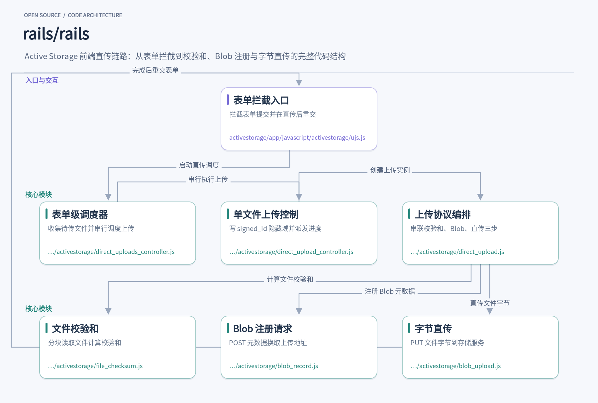
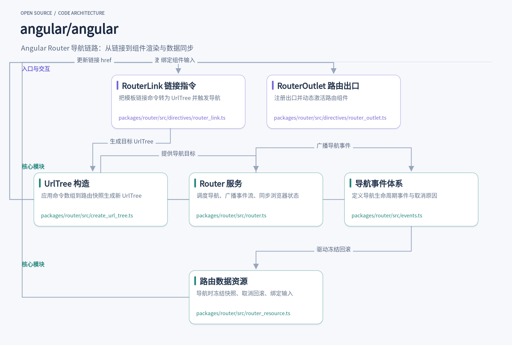
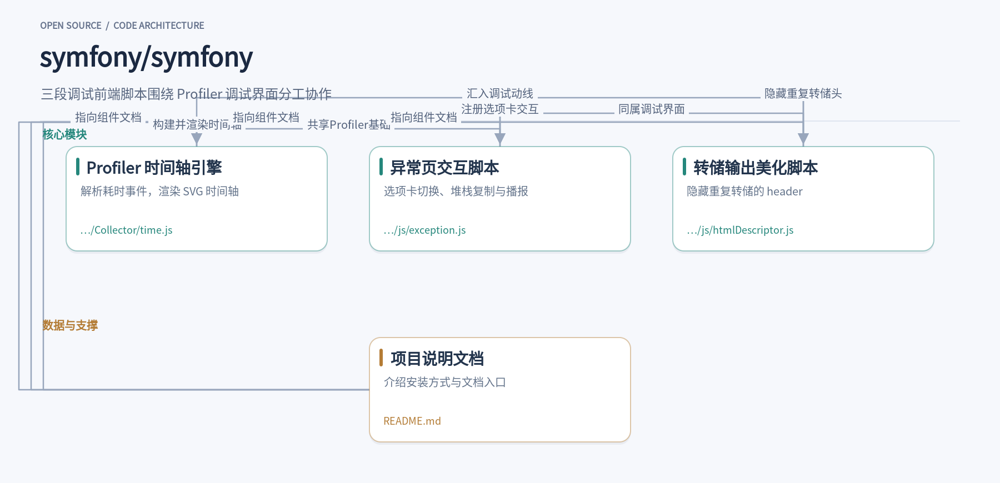

这周挑了三个看起来不相关、其实都在解决同一类日常摩擦的开源项目。Rails 的 Active Storage 把几百 MB 视频上传的服务端中转砍掉，让浏览器直连存储；Angular Router 用一套严谨的映射，让地址栏字符串和组件渲染不再互相打架；Symfony 则把开发者天天在用的 dump 输出、异常页和 Profiler 时间轴做成了顺手的工具。三个项目分属 Ruby、TypeScript 和 PHP 生态，各自的实现路径差别很大，但读源码时都能找到可以直接借走的设计：直传链路里的签名与回显约定、路由器里的命令数组解析、十几行前端脚本里的去重逻辑。下面按项目展开。

## 1. rails

> Active Storage 前端直传链路把大文件上传从服务端中转解放出来

[rails/rails](https://github.com/rails/rails) · `Ruby` · **59,022** stars · 今日 **+142** · `MIT`

在 Rails 应用里给一条记录加附件，很多团队的默认体验是：用户选完文件点提交，浏览器把整个 multipart 表单发到 Rails 服务器，服务器再把文件字节转发到 S3 或者本地磁盘。文件小的时候无感，一旦用户上传的是几百 MB 的视频，请求超时、内存占用、进度条卡死这些问题就全来了。Active Storage 的直传（direct upload）方案换了一条路：文件字节从浏览器直接进存储服务，Rails 服务器只经手一份元数据。

这条链路的入口在 [ujs.js](https://github.com/rails/rails/blob/f4a33dbbd3e38d6def4f776cb6b60eb4070a9aff/activestorage/app/javascript/activestorage/ujs.js)。调用 `ActiveStorage.start()` 后，它在 document 上监听 `submit` 和 `ajax:before` 事件。一旦提交的表单里存在带 `data-direct-upload-url` 属性且选了文件的文件输入框，就调用 `preventDefault()` 拦下这次提交，给表单打上 `data-direct-uploads-processing` 标记防止重复触发，然后启动直传。所有文件传完之后，它会找到（或临时造一个）提交按钮，用一次真实的 click 重新提交表单——此时表单里已经多了一个装着 `signed_id` 的隐藏域。

拦截之后的调度由 [direct_uploads_controller.js](https://github.com/rails/rails/blob/f4a33dbbd3e38d6def4f776cb6b60eb4070a9aff/activestorage/app/javascript/activestorage/direct_uploads_controller.js) 负责。它的构造函数用选择器 `input[type=file][data-direct-upload-url]:not([disabled])` 扫出表单内所有待传文件，为每个文件各建一个 `DirectUploadController`，然后在 `start()` 里用一个 `startNextController` 的递归函数把它们串行跑完——前一个文件成功才启动下一个，任何一个失败就整体回调报错。这种逐个执行的取舍很务实：避免多文件并发上传时互相挤占带宽，也让进度条的行为可预期。

单个文件这一层在 [direct_upload_controller.js](https://github.com/rails/rails/blob/f4a33dbbd3e38d6def4f776cb6b60eb4070a9aff/activestorage/app/javascript/activestorage/direct_upload_controller.js)。它在文件输入框前面插入一个同名隐藏域，上传成功后把返回的 `signed_id` 填进去，失败则移除隐藏域并通过事件通知页面。进度处理有个耐心的细节：XHR 的 `upload.onprogress` 只映射到 0–90%，因为字节传完并不代表存储服务已确认。剩余区间由 `simulateResponseProgress` 接管，它按文件大小估算响应时间（小于 1MB 按 1 秒，1–10MB 按 2 秒，更大则随体积线性增加），用 `requestAnimationFrame` 把进度平滑推进到 99%，等真正的 `loadend` 到来再跳到 100%。用户看到的进度条因此很少停在原地干等。

三步上传协议的本体在 [direct_upload.js](https://github.com/rails/rails/blob/f4a33dbbd3e38d6def4f776cb6b60eb4070a9aff/activestorage/app/javascript/activestorage/direct_upload.js) 的 `create()` 里：先用 `FileChecksum` 算校验和，再用 `BlobRecord` 向 Rails 注册文件元数据，最后用 `BlobUpload` 把字节直传出去。三步是回调串联的，任何一步出错就短路返回。算法可以通过输入框的 `data-checksum-algorithm` 属性选择 md5 或 sha256，默认仍是 md5。它还实现了一个极简的 delegate 协议——`directUploadWillCreateBlobWithXHR` 和 `directUploadWillStoreFileWithXHR` 两个钩子把底层 XHR 交给调用方，供设置自定义请求头或附加进度监听，整个文件不到一百行。

校验和计算在 [file_checksum.js](https://github.com/rails/rails/blob/f4a33dbbd3e38d6def4f776cb6b60eb4070a9aff/activestorage/app/javascript/activestorage/file_checksum.js)：把 File 按 2MB 分块，用 FileReader 逐块读入，喂给 md5 或 sha256 的增量 buffer，最后取 base64 摘要。分块的意义在于大文件不会一次性读进内存，浏览器主线程也不会被长时间阻塞。空文件的情况也被照顾到——`chunkCount === 0` 时仍会执行一次读取，保证零字节文件也能产出校验和。服务端拿到这个值后，在 Blob 落盘时做完整性比对，前端算的和后端存的不一致就会被拒收。

与 Rails 端的协议衔接在 [blob_record.js](https://github.com/rails/rails/blob/f4a33dbbd3e38d6def4f776cb6b60eb4070a9aff/activestorage/app/javascript/activestorage/blob_record.js)。它向 `data-direct-upload-url` 指向的端点 POST 一段 JSON：文件名、content_type、byte_size 和 checksum。成功响应里除了 Blob 的属性（包括 `signed_id`），还有一段 `direct_upload` 数据——存储服务的上传 URL 和所需的请求头。请求里自动带上页面 meta 标签中的 CSRF token，也支持调用方注入自定义头。最后的 [blob_upload.js](https://github.com/rails/rails/blob/f4a33dbbd3e38d6def4f776cb6b60eb4070a9aff/activestorage/app/javascript/activestorage/blob_upload.js) 拿着这段数据，对存储服务发起一次带预置头的 PUT，把文件字节送到位，浏览器到 Rails 之间自始至终没有流过一比特文件内容。

这套实现里值得借鉴的设计有几处。分层清晰：表单拦截、多文件调度、单文件控制、协议编排、三步实现各占一个文件，每层只依赖下一层的公开接口，改进度 UI 不会碰上传协议。可扩展点选得准：算法注册表、delegate 钩子、`data-*` 属性配置，都是在不引入框架依赖的前提下留出的扩展面。进度模拟这种容易被略过的体验细节也有认真的工程处理。如果自己的项目要接直传存储，这七个文件构成的前端协议是一条可以照着走通的参考路径。

## 2. angular

> 一条链接从命令数组到组件渲染的完整导航链路

[angular/angular](https://github.com/angular/angular) · `TypeScript` · **101,422** stars · 今日 **+135** · `MIT`

在一个典型的 Angular 后台应用里，侧边栏有几十个 `<a routerLink="/orders/42">` 这样的链接，点击之后页面组件被替换、查询参数被更新、滚动位置被恢复，整个过程不到一瞬。支撑这套体验的是 `@angular/router` 包，它把“浏览器地址栏里的字符串”和“当前应该显示哪个组件”这两件事严谨地对应了起来。这个包属于 Angular 主仓库 `angular/angular`，和 core、common 等包并列在 packages 目录下，源码可以直接阅读，比如 [router.ts](https://github.com/angular/angular/blob/26f22e5423a062edc89c0675372f54a1cfc1262b/packages/router/src/router.ts)。理解它的内部协作方式，对排查导航不触发、参数丢失这类问题很有帮助。

链路的起点通常是 [router_link.ts](https://github.com/angular/angular/blob/26f22e5423a062edc89c0675372f54a1cfc1262b/packages/router/src/directives/router_link.ts) 里的 `RouterLink` 指令。模板里写的 `['/team', teamId, 'user', userName, {details: true}]` 会进入它的 `routerLink` 输入，指令把这个命令数组交给 `Router.createUrlTree` 计算出目标 `UrlTree`。值得留意的是 href 的维护方式：新版实现用 `linkedSignal` 包装了一个 `reactiveHref`，它会根据当前路径、fragment 和查询参数的变化自动重算。也就是说当用户在别的入口改了查询参数，页面上的链接 href 会跟着更新，而点击时才真正调用 Router 发起导航。指令还处理了不少细节，比如非锚点元素上补 `tabindex`，以及 Ctrl/Shift 按下时放行浏览器默认行为，让用户能新开标签页。

`createUrlTree` 的真正实现集中在 [create_url_tree.ts](https://github.com/angular/angular/blob/26f22e5423a062edc89c0675372f54a1cfc1262b/packages/router/src/create_url_tree.ts)。它先从当前 `ActivatedRouteSnapshot` 重建出 `UrlSegmentGroup` 树，然后把命令数组归一化成一个 `Navigation` 对象——记录路径是否以 `/` 开头（绝对路径）、包含多少个 `..`（回退层级）。接着 `findStartingPositionForTargetGroup` 找到命令应该应用的起点，`updateSegmentGroup` 和 `updateSegmentGroupChildren` 递归地替换或新增 segment，最后通过 `tree()` 函数组装出新的 `UrlTree`，查询参数在组装时经过序列化再解析的规范化处理，保证通过代码传入的值和浏览器刷新后解析出的值一致。这套纯函数式的设计让 URL 计算完全可预测，也方便独立测试。

拿到目标 `UrlTree` 后，[router.ts](https://github.com/angular/angular/blob/26f22e5423a062edc89c0675372f54a1cfc1262b/packages/router/src/router.ts) 里的 `Router` 服务接手。它是 `@Service()` 装饰的根级服务，通过 `provideRouter` 配置注入，内部组合了 `NavigationTransitions`（执行匹配、守卫、重定向的实际引擎）、`StateManager`（维护当前 URL 树与路由状态）、`UrlSerializer` 和 `Location`。构造函数里它订阅 `navigationTransitions.setupNavigations(this)` 产生的事件流，在 `subscribeToNavigationEvents` 中对每类事件做处理：`NavigationEnd` 时标记 `navigated` 并清理不再使用的路由注入器，收到 `RedirectRequest` 时合并 URL 并立刻调度一次新的导航。浏览器后退按钮触发的 popstate 则走 `setUpLocationChangeListener` 注册的监听，转换成一次正常的 Router 导航，保证守卫和事件照常触发。所有公开事件通过 `events` 这个 Observable 暴露给应用。

事件本身的类型体系定义在 [events.ts](https://github.com/angular/angular/blob/26f22e5423a062edc89c0675372f54a1cfc1262b/packages/router/src/events.ts)。从 `NavigationStart` 到 `RoutesRecognized`、`GuardsCheckStart`、`ResolveStart`、`ActivationEnd`，再到 `NavigationEnd`，事件类按导航生命周期排列，应用可以精确地在某个阶段插入逻辑。取消和跳过各有独立的枚举：`NavigationCancellationCode` 区分重定向、被新导航取代、守卫拒绝等场景，`reason` 字符串只用于调试，`code` 才是生产环境可依赖的稳定标识。文件里还有 `BeforeActivateRoutes`、`RedirectRequest` 这类内部事件，通过 `isPublicRouterEvent` 过滤后才进入公开的事件流——内部协议和对外 API 分得很清楚，这是整个包里值得借鉴的一个设计。

导航的终点落在 [router_outlet.ts](https://github.com/angular/angular/blob/26f22e5423a062edc89c0675372f54a1cfc1262b/packages/router/src/directives/router_outlet.ts) 的 `RouterOutlet`。这个指令在初始化时把自己注册进 `ChildrenOutletContexts`，当 Router 匹配到路由，就调用它的 `activateWith`：用 `OutletInjector` 构造一个能提供 `ActivatedRoute`、子级 outlet 上下文和 `ROUTER_OUTLET_DATA` 的注入器，然后通过 `ViewContainerRef.createComponent` 动态创建路由组件，并 `markForCheck` 以兼容 OnPush 变更检测。`detach` 和 `attach` 方法配合 `RouteReuseStrategy` 支持组件的卸载与复用。同文件里的 `RoutedComponentInputBinder` 实现了 `withComponentInputBinding` 特性：订阅路由的 params、queryParams 和 data，合并后用 `ComponentRef.setInput` 写进组件输入，key 冲突时按“资源 > data > 路径参数 > 查询参数”的优先级覆盖，匹配不到的输入会被设成 `undefined` 以避免残留旧值。

比较新的一部分是 [router_resource.ts](https://github.com/angular/angular/blob/26f22e5423a062edc89c0675372f54a1cfc1262b/packages/router/src/router_resource.ts)，它把 signal 时代的 `Resource` 概念接进了路由。`routerResource` 函数包装一个数据资源，订阅导航事件：`NavigationStart` 时冻结当前快照，`NavigationEnd` 时解冻，导航被取消触发回滚时保留冻结值直到恢复加载完成——这样用户被守卫弹回原页面时不会看到一闪而过的 loading 状态。`nonBlocking` 标记允许某个资源不阻塞导航。`createResourceOutletBindingEffects` 则为阻塞型资源建立 effect，把解析后的 `.value()` 响应式地绑定到组件输入上。整条链路串起来看：RouterLink 算 URL，Router 调度并广播事件，RouterOutlet 渲染组件，router_resource 保证数据与导航同步——各文件职责单一、通过事件流协作，这种组织方式对任何做前端状态管理的团队都有参考价值。

## 3. symfony

> 把 dump、异常页和 Profiler 时间轴做成了顺手的调试工具

[symfony/symfony](https://github.com/symfony/symfony) · `PHP` · **31,478** stars · 今日 **+128** · `MIT`

调试 PHP 应用时，最常用的三样东西几乎都出自 Symfony：`dump()` 的彩色输出、出错时那个信息密集的异常页，以及 Web Profiler 里按毫秒排列的请求时间轴。很多开发者天天与它们打交道，却很少意识到这些界面的交互细节是由仓库里几段不起眼的前端脚本撑起来的。`src/Symfony/Component/VarDumper/Resources/js/htmlDescriptor.js` 只有十几行，却在 `DOMContentLoaded` 时遍历页面上所有 `article` 元素，比较相邻条目的 `dedupId`，一旦相同就隐藏后一个的 header。循环里输出两次 `dump($user)`，页面上只会看到一个标题，重复样本安静地并在一起，不会刷屏。

异常页的交互集中在 [exception.js](https://github.com/symfony/symfony/blob/8bf3b847e1034f2ae2a02142adf567a7753f92cb/src/Symfony/Component/ErrorHandler/Resources/assets/js/exception.js)。文件开头的注释点明它源自 WebProfilerBundle 的 `base_js.html.twig`，改一处要同步另一处，这种自我提醒的注释在开源项目里并不多见，也说明异常页与 Profiler 共享同一套界面基础。脚本为每个 `.sf-tabs` 分组注册独立的选项卡切换逻辑，点击激活之外，还监听方向键、Home 和 End 键在选项卡之间移动焦点。选项卡查找用 `tab.closest('.sf-tabs') === group` 判断归属，嵌套的选项卡组因此不会被外层的遍历吞并，各自保持独立的 tablist，这是处理嵌套组件时很实用的技巧。

同一个脚本里的细节还能看出对辅助功能的认真程度。`announce()` 函数操作一个 `[data-announcer]` 元素，先清空再延迟 50 毫秒填入消息，5 秒后再次清空——注释解释了原因：先清后填才能让屏幕阅读器播报重复内容。复制文件路径的按钮在 `navigator.clipboard` 存在时才显示，点击后把图标短暂换成对勾 1.5 秒作为反馈，同时调用 `announce('File path copied to clipboard')`。`e.stopPropagation()` 则防止点击复制按钮时误触外层的折叠开关。视觉反馈、键盘操作和读屏提示三条线都照顾到了。

Profiler 的 Time 面板由 [time.js](https://github.com/symfony/symfony/blob/8bf3b847e1034f2ae2a02142adf567a7753f92cb/src/Symfony/Bundle/WebProfilerBundle/Resources/views/Collector/time.js) 驱动，核心是 `TimelineEngine` 类。构造函数接收 theme、renderer、legend、threshold 等协作者，第一行就算出 `this.scale = renderer.width / request.end`，把请求总时长映射为像素比例。构建与渲染分成两个阶段：`createElements()` 先为每个事件创建 SVG 分组、边框、标签和时间段路径，`render()` 再根据当前过滤条件决定每个分组的位置与可见性。构造时绑定了一堆方法保证 this 指向正确，随后立即监听 threshold 和 legend 的 change 事件以及窗口 resize，任何变化都触发重渲染。它与异常页脚本同属 Profiler 家族的界面代码，只是各自绑定不同的 DOM 结构。

时间轴的过滤逻辑值得细看。`isActive()` 同时检查两个条件：事件时长必须达到阈值滑块的值，事件类别必须在图例中处于激活状态。`render()` 先过滤出可见事件，用它们的数量乘以 `eventHeight` 得到画布高度，设置 SVG 的 viewBox，然后对全部事件执行 `renderEvent()`，可见的设置 transform 定位到对应行，不可见的直接 `visibility: hidden`。这种全量遍历、按可见性分流的写法，避免了频繁增删 DOM 节点，窗口尺寸变化时 `onResize()` 只需重测宽度、更新 scale 再整体重画。

事件的视觉呈现也有层次。类别为 `section` 的事件走 `createBackground()`，其中名为 `__section__.child` 的子请求会得到不同的背景样式，主请求与子请求在时间轴上一眼可分。普通事件由 `createEventElements()` 生成带类别颜色的分组，标签文本附加一个 tspan 子标签，内容是 `${duration} ms / ${memory} MiB`，耗时和内存占用直接跟在事件名后面。构造函数里的 `this.FqcnMatcher` 用正则从完整类名中截取短名，避免时间轴左侧被冗长的命名空间撑爆。

从更大的视角看，这三段脚本分属三个组件——VarDumper、ErrorHandler、WebProfilerBundle——没有共享的运行时，各自只做一件事。这正是 Symfony 组件化思路在前端资产上的延续：`dump()` 输出的 HTML 自带 `dedupId` 这类结构约定，htmlDescriptor 只负责展示层的去重；异常页的选项卡、异常链展开、堆栈复制全部内聚在一个文件里，随错误响应一次性下发，其基础又明确脱胎于 WebProfilerBundle 的模板脚本；Profiler 时间轴则依赖服务端收集好的 events 数据，浏览器端只管画。三块功能各自演进，共同组成从转储检查、异常定位到性能分析的一条调试动线，README 里指向的组件文档也把它们分列在同一条产品线之下。

对想借鉴的开发者来说，可取的点很具体：选项卡的键盘导航与 ARIA 属性同步（`aria-selected`、`tabindex`、`hidden` 三者联动）是一份现成的无障碍实现参考；`TimelineEngine` 的 create/render 两阶段模式和协作者注入，适合任何数据可视化组件；`announce()` 的清空-延迟-填充模式可以直接搬进需要读屏反馈的项目。Symfony 用 Composer 安装，遵循语义化版本并维护 LTS 发行版，README 里指向的 Symfony Demo 应用是上手这些调试工具最直接的途径——跑起来之后，故意抛个异常、多 dump 几次、翻翻 Time 面板，上面提到的每处细节都能亲眼看到。

这三个项目放在一起读，收获不在框架本身，而在那些被日常使用掩盖的细节：直传签名如何避免服务端经手文件字节，路由命令数组如何让导航可预测，一段十几行的脚本如何让调试输出不再刷屏。下次遇到上传超时、导航异常或者重复日志刷屏，至少知道该去仓库的哪个目录里找答案。
