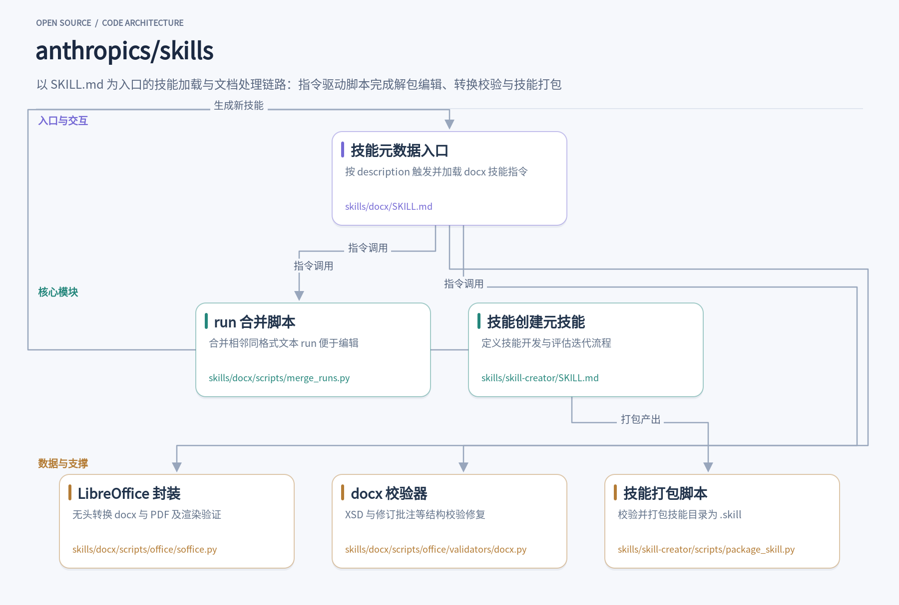
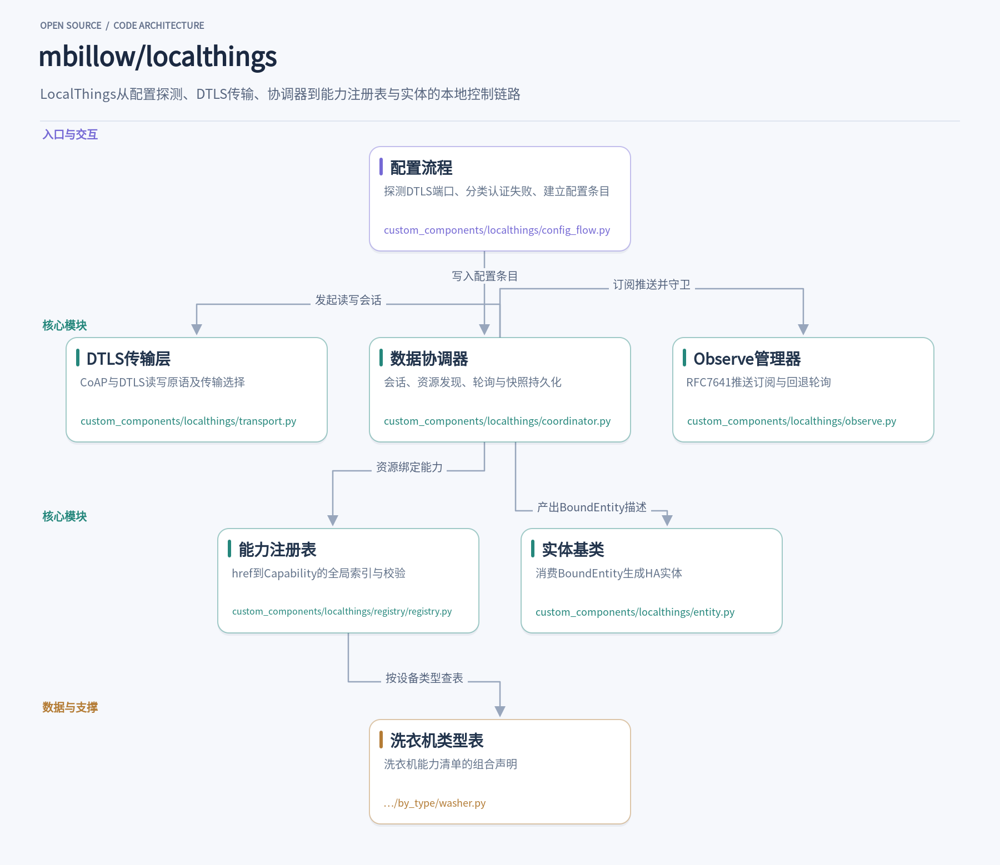

让 AI 助手改一份带修订记录的 Word 合同，听起来简单，实际经常翻车：.docx 是个装满 XML 的 ZIP 包，Word 还爱把一句话拆进多个 run，查找替换屡屡失灵。anthropics/skills 里的 docx 技能就是冲着这类活儿来的——一个 SKILL.md 加一整套脚本，Claude 按需加载，解包、编辑、校验、重打包一条龙。另一边，Home Assistant 的 SmartThings 集成全靠云端，账号或三星服务一出问题，家里实体全灭。LocalThings 反其道而行，直接在局域网里跟洗衣机、冰箱、空调对话，配置完就不再碰三星服务器。这两个项目一个管 AI 干活的可复用性，一个管智能家居的本地化，各有各的解法，都值得拆开看看。

## 1. skills

> 用 SKILL.md 加载专属脚本，让 Claude 可复用地完成 Word 文档等专门任务

[anthropics/skills](https://github.com/anthropics/skills) · `Python` · **188,773** stars · 今日 **+390**

一个常见的场景：让 AI 助手改一份带修订记录的合同 Word 文档。直接把 .docx 丢给模型，它往往不知道 .docx 其实是一个装满 XML 的 ZIP 包，更不知道 Word 会把一句话拆散到多个带格式的 run 里，find-and-replace 因此频繁失灵。anthropics/skills 仓库里的 docx 技能就是为了这类任务准备的：它是一个自包含的文件夹，核心是一份 [SKILL.md](https://github.com/anthropics/skills/blob/2c5958ecac7cee2b583967a2c4981d0f4a75c579/skills/docx/SKILL.md)，里面有元数据、指令和一整套可以直接执行的脚本。Claude 在任务匹配到技能描述时加载它，然后按照指令调用脚本完成解包、编辑、校验、重打包这一整条链路。

每个技能的本质是一个目录：`SKILL.md` 是必需品，YAML frontmatter 只要求 `name` 和 `description` 两个字段，正文就是 Claude 会照着执行的指令。可选地，目录里可以放 `scripts/`（确定性任务的可执行代码）、`references/`（按需加载的文档）和 `assets/`（模板、图标等输出资源）。这个设计的关键在于渐进式加载：元数据常驻上下文约一百词，正文在技能触发时进入（理想不超过五百行），捆绑资源则无限量、脚本甚至可以不进上下文直接执行。对上下文窗口紧张的 agent 来说，这种三层结构把“知识”和“能力”分层安放，是很实用的模式。

docx 技能最能体现这套模式的深度。它的 SKILL.md 用一张表把任务分成三路：新建文档用 docx-js 写脚本；编辑既有文档则 unzip 解包、改 `word/document.xml`、再 zip 回去；读取内容交给 pandoc。指令里塞满了踩坑经验，比如表格必须同时设 `columnWidths` 和每个单元格的 `width`（百分比宽度在 Google Docs 会出问题）、`ShadingType` 用 `CLEAR` 而非 `SOLID`、换行不能写 `\n` 而要拆成独立的 Paragraph。这些细节来自生产环境的真实使用——README 明确说 docx、pdf、pptx、xlsx 这几个技能正是 Claude 文档能力的底层实现，以 Apache 2.0 开源出来作为复杂技能的参考。

编辑流程中最有意思的一环是 [merge_runs.py](https://github.com/anthropics/skills/blob/2c5958ecac7cee2b583967a2c4981d0f4a75c579/skills/docx/scripts/merge_runs.py)。Word 会因为修订号、拼写检查标记、编辑历史把一段连续文字切成许多 `<w:r>` 元素，你在文档里看到的短语在 XML 里根本不是连续字符串。这个脚本用 defusedxml 解析 `document.xml`，删掉 `proofErr` 标记和 rsid 属性，把相邻且 `<w:rPr>` 格式完全一致的 run 合并，并正确处理 `xml:space="preserve"` 的边界空白语义。它刻意不合并处在不同 `<w:ins>`/`<w:del>` 包裹里的 run——那会改写修订结构。一个看似简单的文本规范化脚本，边界考虑得相当周全。

转换与校验环节同样体现了“脚本兜底”的思路。[soffice.py](https://github.com/anthropics/skills/blob/2c5958ecac7cee2b583967a2c4981d0f4a75c579/skills/docx/scripts/office/soffice.py) 封装 LibreOffice 的无头调用，专门处理沙箱环境里 AF_UNIX socket 被禁的情况：运行时探测限制，如果存在就现场生成一个 C 语言 LD_PRELOAD shim，用 socketpair 替代被封锁的 socket 调用，靠管道唤醒阻塞的 accept()，并在转换完成时干净退出。这类环境适配通常不会写进任何文档，却是技能能在受限 VM 里真正跑起来的前提。校验侧的 [validators/docx.py](https://github.com/anthropics/skills/blob/2c5958ecac7cee2b583967a2c4981d0f4a75c579/skills/docx/scripts/office/validators/docx.py) 做 XSD 校验之外，还会检查被删除文本是否误用 `<w:t>`、批注标记是否配对、paraId 是否越界，并能自动修复越界的 durableId——修订文档里每一处没有包在 `<w:ins>`/`<w:del>` 里的改动都逃不过它。

仓库里还有 teaches-you-to-fish 的 skill-creator：一个教 Claude 创建技能的元技能。它的 [SKILL.md](https://github.com/anthropics/skills/blob/2c5958ecac7cee2b583967a2c4981d0f4a75c579/skills/skill-creator/SKILL.md) 定义了完整迭代循环——起草技能、生成测试提示词、同时跑带技能和不带技能的两组子代理、在等待结果时起草断言、用 grading 和 benchmark 脚本汇总 pass rate 与 token 消耗、再启动一个本地 viewer 让用户逐条给反馈，最后根据反馈改写技能。它对写作的建议也值得借鉴：解释为什么比堆砌 MUST 更有效，description 要写得“主动一点”来对抗模型触发不足的倾向，技能要面向百万次复用而非眼前几个测试样例。

开发完成的技能可以用 [package_skill.py](https://github.com/anthropics/skills/blob/2c5958ecac7cee2b583967a2c4981d0f4a75c579/skills/skill-creator/scripts/package_skill.py) 打包分发。脚本先调用 quick_validate 确认 SKILL.md 存在且格式合规，再把整个目录压成 zip 格式的 `.skill` 文件，自动排除 `__pycache__`、`node_modules`、编译产物和根目录下的 evals 测试数据。在 Claude Code 里把这个仓库注册为 plugin marketplace，一条 `/plugin install document-skills@anthropic-agent-skills` 就能装好整套文档技能，之后用自然语言说“用 PDF 技能提取表单字段”即可触发。对想给 agent 添加可复用能力的团队来说，这个仓库既是现成的工具箱，也是一套关于“指令与代码如何分工协作”的参考实现。

从更大的视角看，skills 仓库展示的其实是一种介于提示词和传统软件之间的交付形态：SKILL.md 承担判断与流程编排，scripts 承担精确操作与质量校验，references 按需提供领域知识。三者的边界划得清楚——模型擅长读指令做决策，不擅长保证 XML 字节级的正确性，那就把后者交给 Python。无论是想直接复用文档技能，还是想为自己的业务构建专属技能，clone 下来读几个 SKILL.md 的写法，都比读十篇教程更有收获。

## 2. localthings

> 不注册云账号，在家庭局域网内直接控制三星家电的Home Assistant集成

[mbillow/localthings](https://github.com/mbillow/localthings) · `Python` · **1,052** stars · 今日 **+186** · `MIT`

Home Assistant官方的SmartThings集成走云端，账号、家庭网络、三星服务任何一环出问题，实体就跟着失效。LocalThings（github.com/mbillow/localthings）换了一条路：直接在家庭网络里与洗衣机、冰箱、空调、烤箱等三星家电对话，配置完成后不再联系三星服务器。支持推送的家电状态变化即时到达，其余设备每30秒轮询一次；断网后也能继续工作，配置的前提是知道家电的IP地址。

它解决的核心问题，是让用户不需要云账号也能完成设备接入。配置流程在custom_components/localthings/config_flow.py里实现得相当细致：探测指定IP的DTLS端口时，会区分地址无响应、端口全关、有端口但不说DTLS、是OCF栈但不是家电、证书被拒、PSK被拒等十多种失败情形，每种都对应一条不同的用户提示。比如CertRejected会比对TLS alert集合判断是不是CA不受信任，而PSK相关的失败则归入另一组alert。这种异常分类的价值在于，用户报告问题时，维护者拿到的是一个明确的错误码，而不是一句笼统的连不上。

认证环节有个巧妙的设计。首次添加设备时，LocalThings会连接一次三星云网关connect-v2.samsungiotcloud.com，但不用账号登录——它只是读取该服务器TLS证书subject里的uuid字段，用这个UUID现场签发一张X.509客户端证书去和家电做DTLS握手。部分AC14K_M代际的家电甚至不校验证书签名链，只比对subject里的UUID，所以自签证书就能通过，config_flow里的_mint_self_signed就是为这类设备准备的默认路径。之后添加新设备复用同一个标识，不再需要外网。

运行期的核心是custom_components/localthings/coordinator.py的LocalThingsCoordinator。它经transport.py建立的DTLS CoAP会话读取/device/0的批量响应，拿到家电暴露的全部资源快照，再把这份快照交给注册表去解析。transport.py定义了一个Transport协议，read/write返回统一的code和body二元组，legacy的TCP 8888 HTTP桥接也会把HTTP状态映射成CoAP响应码，上层代码因此对线缆格式无感知。write的响应体即使解码失败也不会抛异常——洗衣机的固件会在拒绝写入时于响应体里给出Control fail原因，这里不抛异常是为了避免上层重连重发造成重复写入。

状态更新的机制在observe.py。ObserveManager按RFC 7641订阅资源推送，订阅后等待一个宽限期，八成的href有通知到达就进入observe模式，否则回退轮询。这里有几处针对真实固件行为的处理：设备推送的rep常常只带部分字段，一次洗衣机旋钮变更可能只推送一个options token，apply()会把新rep合并进缓存而不是整体替换；/alarms/vs/0是唯一例外，它的items数组是当前活动告警的完整快照，合并会永远留下已清除的旧告警，所以做整体覆盖。写入后的settle窗口会短暂丢弃该href的回显更新，防止一台状态回写慢的设备把用户的乐观写入冲掉。

最值得借鉴的是声明式的能力映射。registry/registry.py把所有Capability对象按href建成CAPABILITIES注册表，每个设备类型则是一张表——registry/by_type/washer.py组合了washer.WASHER_SETTINGS、washer.WASHER_COURSE、laundry.BUZZER_SOUND等能力块，读起来就是一张洗衣机功能的清单。coordinator发现设备类型后选对应的表，把资源href绑定为BoundEntity；entity.py的LocalThingsEntity再消费BoundEntity生成HA实体，处理唯一ID、翻译键和字段存在才建实体的门控逻辑。README提到测试会拿九十多份真实家电抓包来校验这些表，所以支持一个新机型通常只需要加表项，不用动协议代码。

对开发者的启发主要有三点。其一，异常分类本身就是产品功能，config_flow里那一串CannotConnect子类把模糊的连接失败变成了可操作的指引；其二，对协议规范忠实但不天真——标准资源与三星扩展并存时优先用标准的，同时针对固件的怪癖（部分更新、完整快照告警、错位的observe token）在正确的层做修正；其三，把设备差异收进数据表而非代码分支，是这个集成能覆盖二十多种家电品类还能持续维护的关键。项目要求Python 3.13以上，ruff按一组严格的规则集检查，涵盖bugbear、异步、日志格式、性能等类别，异步测试模式默认开启。

如果家里有支持SmartThings的三星家电又不想把控制权交给云端，LocalThings在HACS默认仓库里可以直接安装。遇到没有识别的设备，按提示提交一份已脱敏的诊断下载，维护者通常据此就能补上能力表——这种把支持缺口变成社区数据来源的流程设计，和代码本身一样值得学习。

这两个项目体量都不大，但切入点很实：skills 把"模型不知道的领域知识"固化成文件加脚本，一次编写反复使用；LocalThings 抓住的是"云端依赖"这个智能家居最常被吐槽的软肋，用局域网直连换回可靠性。如果你在日常用 Claude Code 或者家里跑着 Home Assistant，都不妨克隆下来试一试，源码读起来也不费劲。
