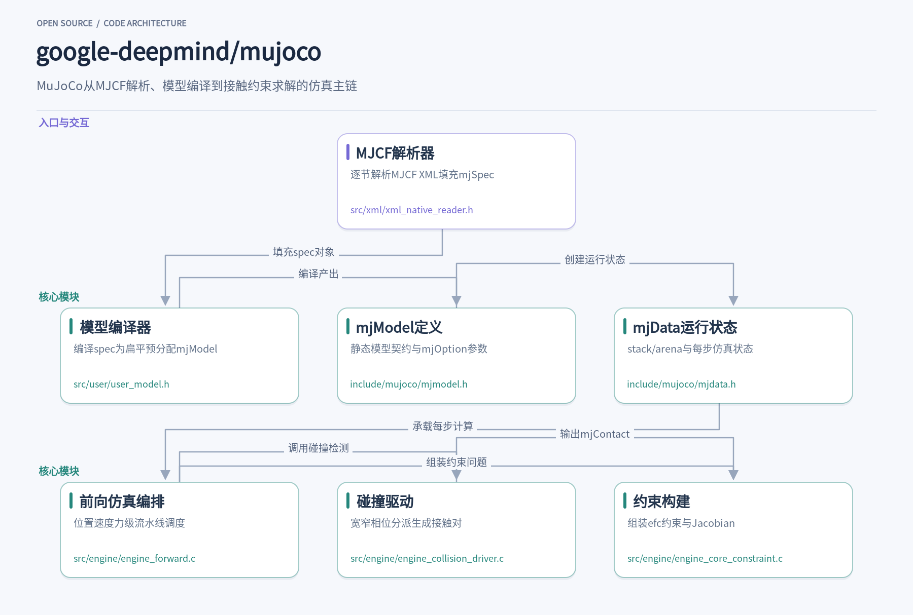
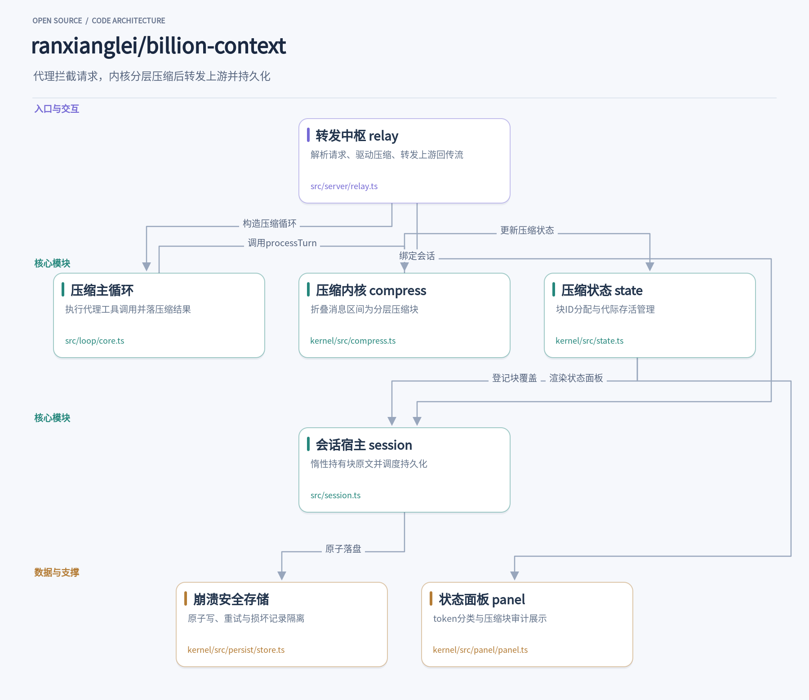

这周挑了两个方向完全不同的开源项目细读。一个是 Google DeepMind 维护的 MuJoCo，物理仿真引擎里的老牌选手，2021 年开源后代码可读性反而成了它的卖点：MJCF 模型如何被编译成定长数组，接触动力学每步到底算了什么，都能顺着源码看清楚。另一个是 billion-context，一个本地代理层，解决的是长会话编码助手的实际痛点——上下文窗口和 token 账单一起爆炸。它拦截请求、把历史折叠成分层摘要块，让 100K 窗口撑起月级十亿 token 量级的会话。一个向下钻到数值计算，一个向上管住模型调用链路，各自都有值得借鉴的工程设计。

## 1. mujoco

> 把MJCF模型编译为预分配数组，再用位置级流水线跑出接触动力学的物理引擎

[google-deepmind/mujoco](https://github.com/google-deepmind/mujoco) · `C++` · **16,393** stars · 今日 **+41** · `Apache-2.0`

训练一个机械臂抓取策略时，你写一段MJCF的XML描述连杆、关节和几何体，交给MuJoCo编译，之后每一步仿真只需在预分配的缓冲区上做数值计算。这套流程背后是一条清晰的主链：XML解析器把模型读成内部spec对象，编译器将其扁平化为mjModel的定长数组，运行时再据此创建mjData执行仿真。Google DeepMind维护的这个C++项目以Apache-2.0发布，Python侧一个pip install mujoco就能装好带引擎的绑定，浏览器里还能通过WebAssembly版本直接拖拽模型。

入口在src/xml/xml_native_reader.h的mjXReader。它逐节解析MJCF：Compiler、Option、Default、Body、Geom、Actuator、Sensor等各有一个对应方法，比如OneJoint、OneMesh、OneActuator这些单元素解析函数，配合表驱动的ReadAttrTable按生成的属性表读取机械属性。defaults机制是MJCF的实用特色——同类元素可以继承一份默认参数，mjXReader在读取时维护defaults上下文，解析body树时逐层套用，让大型机器人模型的XML不至于重复上百行惯量参数。

解析结果进入src/user/user_model.h的mjCModel。这个类的头文件里密密麻麻的mjtSize字段不是装饰：nq、nv、nu是广义坐标、自由度和控制维度，nflexvert、nmeshface、nsensordata等几十个计数覆盖了从柔性体顶点到传感器数据的所有数组长度。Compile方法把这些对象列表压平成mjModel——一块连续的预分配内存。也支持不用XML、直接调AddJoint、AddActuator等函数手工构建spec再编译，Python的mjspec教程演示的就是这条程序化建模路径。

include/mujoco/mjmodel.h定义了编译产出的契约。mjOption集中了求解器与物理参数：timestep、integrator、solver迭代上限、摩擦锥类型、重力风介质粘度，还有SDF碰撞的梯度下降起点数。mjModel本身除了数百个尺寸字段，主要是geom_type、body_pos这类扁平数组的布局说明。编译完模型后mjCModel即可销毁，运行时只需要mjModel和mjData两个结构，这是引擎性能取向的直接体现——所有内存在编译期定好，仿真循环里没有动态分配。

include/mujoco/mjdata.h描述运行时状态。mjData同样采用预分配策略，分为栈和arena两块：栈用于函数内部的临时数组，通过mj_markStack/mj_freeStack管理；arena存放数量随步变化的接触和约束数据，指针parena手动推进。字段按依赖关系分组注释——位置相关的xpos、xmat、M矩阵，再加速度相关的cvel、qfrc_bias，再到控制相关的actuator_force。这个分组直接对应仿真流水线的计算顺序，读代码时按注释导航非常省力。

src/engine/engine_forward.c是流水线的编排者。mj_fwdPosition先做运动学，再构建并分解惯性矩阵M，然后调用mj_collision做碰撞检测，接着mj_makeConstraint把接触、限位、等式约束组装成约束问题，最后mj_transmission算传动。mj_fwdVelocity用稀疏矩阵乘算出肌腱和执行器速度，mj_fwdActuation里还能看到DC电机模型的细节：电流方程、反电动势补偿、绕组温升dT/dt = (R·i²−T/RT)/C，甚至PID积分抗饱和，执行器建模的物理保真度在引擎层就做了进去。碰撞检测的另一半在src/engine/engine_collision_driver.c：核心是一张mjCOLLISIONFUNC二维分派表，行列表geom类型，格子填mjc_PlaneSphere、mjc_CapsuleCapsule这类特化函数，球对球走解析解，网格走凸包，SDF走梯度下降。宽相位用包围球过滤，mj_filterSphere在启用speculative碰撞时会计算几何体一步内的扫掠距离做扫掠球测试，以防快速物体穿隧；窄相位产出的mjContact直接写进mjData的arena。

约束侧的src/engine/engine_core_constraint.c把接触变成可解的问题。mj_contactParam处理两个几何体参数的合成：优先级不同取高者，相同时solref按solmix加权、摩擦取max、condim取max。mj_addConstraint往稀疏Jacobian里追加行，按类型累加ne、nf、nl计数，等式约束里connect用球铰三点约束、weld六维全约束，Jacobian差分方向与接触相反。接触求解采用软约束模型，solref/solimp参数控制约束的刚度与阻抗，这是MuJoCo区别于刚性惩罚类引擎的核心设计——对做强化学习的人来说，意味着梯度平滑、仿真稳定。

整体读下来，MuJoCo值得借鉴的地方有三处。编译期与运行期的严格切分，让热路径零分配；arena加栈的双内存区设计，把变长接触数据和临时计算分开管理；分派表加特化函数的碰撞架构，新增几何类型只需填表实现函数。加上MJX提供的JAX分支可以整体跑在加速器上做可微仿真，这套引擎在机器人学习工作流里的位置短期内很难被替代。

## 2. billion-context

> 本地代理层对长会话做分层压缩，让 100K 窗口跑月级超长会话

[ranxianglei/billion-context](https://github.com/ranxianglei/billion-context) · `TypeScript` · **5,127** stars · 今日 **+460**

一个跑了几周的编码助手会话迟早撞上两堵墙：上下文窗口爆掉，或者 token 账单随历史线性膨胀。常见的自救是手动开新会话、把关键结论粘过去，代价是丢失中间过程，模型对早期决策只剩模糊印象。billion-context 换了一条路：它以本地代理的形式插在客户端与上游模型之间，拦截每次请求，把累积的历史消息增量地折叠成分层摘要块，再把瘦身后的请求转发上去。README 给出的定位很直接——小窗口够用（100K 上下文足矣）、token 省约 5 倍、单会话可以跑月级十亿 token 量级。它兼容 Claude Code、Codex、OpenCode、Gemini CLI 等二十多个宿主。

安装方式是一个全局 npm 包，README 给出的命令是 `npm install -g billion-context --prefix=~/.local`，要求 Node 20 以上。它提供 `bili` 命令行入口，宿主把 API 端点指向这个本地代理即可。整个项目还附带一篇开源论文（paper/ 目录，MIT 协议），描述其"模型驱动的增量分层压缩"方法，并附有一段 4.5 个月、累计约 187.6 亿输入 token 的生产纵向记录，声称在 204,800 token 窗口的模型上零次越界。这种把方法论文随代码一起维护的做法在工具类项目里并不多见。

运行期的核心概念是 CompressionBlock。代理在每次转发前调用内核的 `processTurn`（见 [kernel/src/compress.ts](https://github.com/ranxianglei/billion-context/blob/848f59b9963f293b8beac5b95bb861a7dcf25a0c/kernel/src/compress.ts)），评估当前 token 压力；压力到达阈值时注入一段 nudge 提示，驱动模型调用 compress 工具，对指定的消息区间产出摘要。`applyCompression` 随后把这些消息折叠成一个块：原文从后续请求中裁掉，摘要留在窗口里，原文另存。块有层级（tier 1/2/3），tier-1 块累积到一定数量后可以再蒸馏成 tier-2、tier-3，摘要的摘要——这正是月级会话不至于失控的关键。被折叠的原文没有丢，模型可以通过 decompress、search_context 等代理工具按需取回。

值得留意的是压缩的裁决权交给模型本身。系统提示会告诉模型哪些区间可压（refs 引用边界、可压缩范围清单），模型自己决定摘要内容和压缩时机，内核只负责校验边界、保护近期消息、防止误折。compress.ts 里能看到大量防御性细节：摘要里的孤立代理字符在入口就被清洗，避免污染后续所有请求体；请求的 ref 越界时返回的诊断信息会明确告知 ref 空间是稀疏的、不要逐个数字试探。`src/loop/core.ts` 的压缩主循环则处理代理工具调用的执行、失败重试与流式续传——网络中断时它会带上已转发文本的尾部重发一次续写请求，让客户端看到无缝衔接而非从头重答。

状态管理走两层。内核的 [kernel/src/state.ts](https://github.com/ranxianglei/billion-context/blob/848f59b9963f293b8beac5b95bb861a7dcf25a0c/kernel/src/state.ts) 是压缩状态的单一事实来源：块 ID 分配（b1、b2…）、run ID、每个块的 effectiveMessageIds 覆盖集合、存活计数与代际晋升（survivedCount 达阈值后标记为 old）都在这里。宿主侧的 [src/session.ts](https://github.com/ranxianglei/billion-context/blob/848f59b9963f293b8beac5b95bb861a7dcf25a0c/src/session.ts) 用 LazyBlockContents 管理被折叠块的原文——一个可以整体"折起"的 Map 子类：保存落盘后清空内存，下次访问（解压、导出、fork 继承）时从存储重新物化，且物化失败会直接抛错而非静默变成空集，防止一次保存把磁盘上的原文抹掉。对同时挂多个长会话的进程，这个设计显著压住了内存水位。

持久化由 [kernel/src/persist/store.ts](https://github.com/ranxianglei/billion-context/blob/848f59b9963f293b8beac5b95bb861a7dcf25a0c/kernel/src/persist/store.ts) 的 StateStore 承担，写法相当扎实：临时文件加原子 rename 保证崩溃不留下截断记录；针对 Windows 上杀毒软件、索引器占用文件导致的 EPERM/EBUSY 做整周期指数退避重试；重试窗口耗尽后溢出写到 `.fb.json` 侧文件而非丢数据，加载时按 savedAt 取最新；loadAll 会跳过损坏 JSON、孤儿临时文件和文件名与 id 不匹配的记录，一个坏文件不会阻塞启动。每个 id 有写链串行化并发写，防抖合并突发保存。这一层看起来是从代理的 SessionStore 里抽出来泛化的，注释里保留了编号 issue 的出处，能看出每个机制都对应一次真实事故。

入口和出口都汇聚在 [src/server/relay.ts](https://github.com/ranxianglei/billion-context/blob/848f59b9963f293b8beac5b95bb861a7dcf25a0c/src/server/relay.ts)：请求进来后按 OpenAI、Responses、Anthropic、Google 等线协议解析成统一的 CoreMessage，绑定会话与压缩状态，走完压缩管线后重新渲染、转发上游，流式响应再改写回客户端方言。这里还有不少针对真实上游的补丁式处理——Anthropic 对 thinking 块逐字节校验、DeepSeek 要求 reasoning 必须回传、网关 5xx 不报 usage 时的紧急截断兜底。可观测性方面，用户敲 `/acp` 命令能看到 [kernel/src/panel/panel.ts](https://github.com/ranxianglei/billion-context/blob/848f59b9963f293b8beac5b95bb861a7dcf25a0c/kernel/src/panel/panel.ts) 渲染的状态面板：token 按系统提示、工具、文本、代码、摘要分类拆条，列出每个压缩块的层级与压缩前后 token 数，并给出前缀缓存命中率。README 明确说健康会话应保持 95–97% 的缓存命中，压缩本身开销不超过 2%，命中率持续偏低时用 `/acp` 归因——缓存保护与压缩省 token 在这里被当成同一件事来盯。

对想做类似系统的开发者，这个仓库有几处可以直接借鉴。其一是"模型驱动"的边界设计：内核不猜哪段历史重要，只提供保护规则和可压区间，摘要质量交给模型，取回原文留给工具调用，职责切分干净。其二是分层块加上惰性物化的原文存储，把"摘要永远在线、原文按需载入"做到内存可控。其三是 StateStore 这种从生产事故里长出来的存储层，原子写、瞬态重试、溢出侧写、损坏隔离，拿来复用到任何需要崩溃安全 JSON 状态的项目都合适。源码注释里密布的 issue 编号和决策理由，也让它成为研究长上下文代理工程的一份难得的一手材料。

两个项目的共同点是都把复杂问题切成了清晰的执行链：MuJoCo 用编译期扁平化换运行时的确定性，billion-context 用代理层的增量压缩换长会话的可延续性。读它们的源码，收获不在功能本身，而在边界怎么划——模型与数据、客户端与上游，切好之后每个环节都变得可测试、可替换。有兴趣的话clone下来跟一遍调用链路，比看文档印象深得多。
