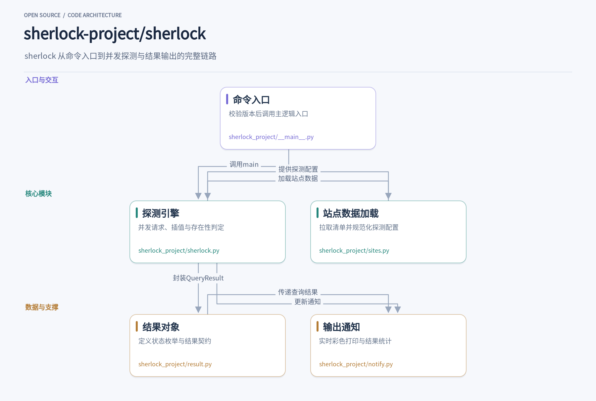
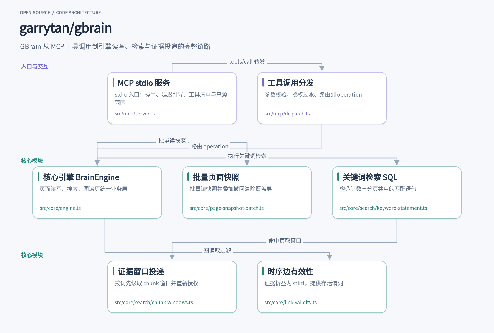
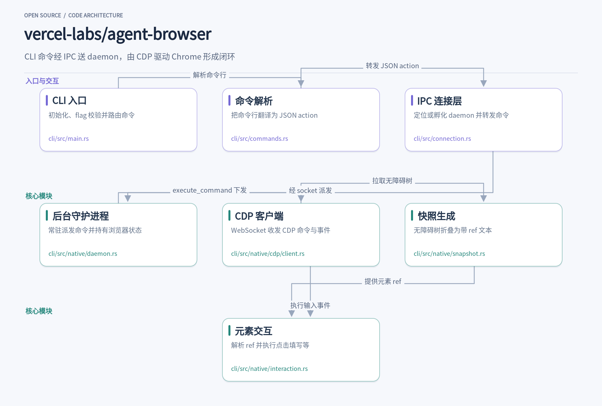
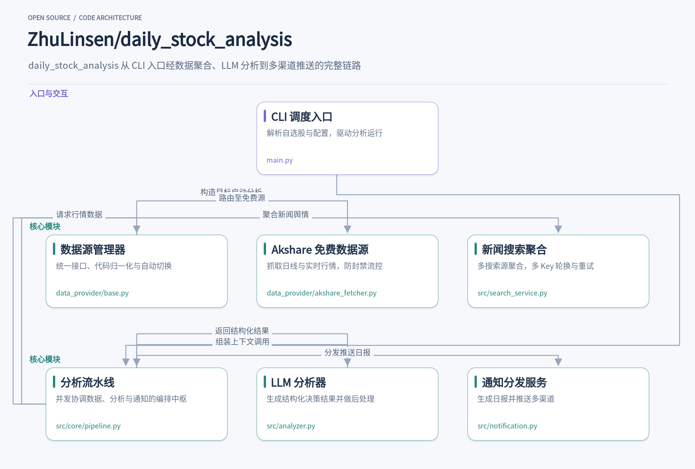
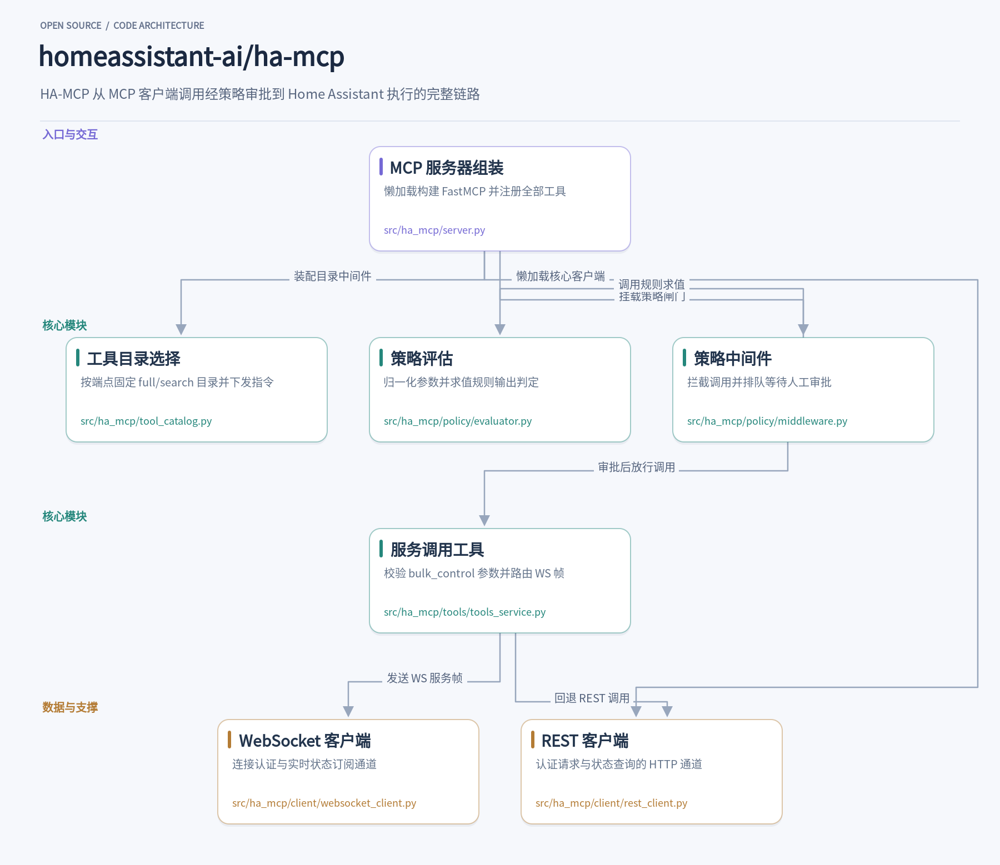

开发者的日常里总有一些反复出现的小摩擦：想在几百个社交平台上查一个用户名是否存在、想让编码 Agent 操作真实浏览器、想给自用的 AI 助手配一套能溯源的记忆、想让 Claude 直接管理家里的 Home Assistant，或者只是想在开盘前快速看一份自选股决策摘要。这些需求各自零散，但社区里都有人认真做成了开源项目。这次挑的五个项目覆盖命令行安全工具、TypeScript 记忆层、Rust CLI、Python 自动化流水线和 MCP 服务器，语言和技术栈各不相同，共同点是都能装完即用，代码可读，解决的问题具体。下面逐个展开，看看它们各自的设计思路和值得借鉴的工程细节。

## 1. sherlock

> 一个用户名扫遍数百个社交站点的开源侦探工具

[sherlock-project/sherlock](https://github.com/sherlock-project/sherlock) · `Python` · **106,968** stars · 今日 **+4,267** · `MIT`

用户名是互联网身份最稳定的线索之一。同一个人在 GitHub、Reddit、Steam 上往往使用相同或相近的 ID，安全研究员做 OSINT 调查时，手动一个个站点去试探既费时又容易遗漏。sherlock 把这件事压缩成一条命令：`sherlock someuser`，几秒内并发探测数百个社交站点，实时打印哪些平台上存在同名账号，命中的站点直接给出个人页 URL。它支持代理、Tor、超时控制和 CSV/JSON 导出，Python 3.9 以上即可运行，`pip install sherlock-project` 装完即用。

整个工具要解决的核心问题是：不同站点判断“账号是否存在”的方式千差万别。有的看 404 状态码，有的返回 200 但页面里藏着错误文案，有的干脆把不存在的用户重定向到首页。sherlock 的做法是把差异全部外置到一份 JSON 清单里，每个站点声明自己的 URL 模板、探测方法、错误类型和正则约束，程序本身只负责按规则执行。这样站点失效时改数据即可，不用动代码。

入口很薄。[`__main__.py`](https://github.com/sherlock-project/sherlock/blob/c588d7c8b476df9f9c84912a05d1430fb8cdcdae/sherlock_project/__main__.py) 只做两件事：校验 Python 版本不低于 3.9，然后调用 `sherlock.main()`。真正的参数解析和扫描逻辑都在 [`sherlock.py`](https://github.com/sherlock-project/sherlock/blob/c588d7c8b476df9f9c84912a05d1430fb8cdcdae/sherlock_project/sherlock.py) 里，pyproject.toml 把 `sherlock` 命令直接指到这个 `main` 函数，所以命令行调用和 `python -m sherlock_project` 走的是同一条链路。

数据加载由 [`sites.py`](https://github.com/sherlock-project/sherlock/blob/c588d7c8b476df9f9c84912a05d1430fb8cdcdae/sherlock_project/sites.py) 的 `SitesInformation` 完成。默认它会从 `https://data.sherlockproject.xyz` 拉取实时清单而非打包的本地副本——这是个很务实的取舍：站点规则频繁变动，用最新数据能避免用户报告早已修复的误判。加载后还会请求一份排除列表，把已知误报率高的站点剔掉；`SiteInformation` 对象里除了 URL 模板，还记录 `username_claimed` 这类验证数据和 NSFW 标记，后者可通过 `remove_nsfw_sites()` 过滤。

扫描本身是 `sherlock()` 函数里一次漂亮的并发编排。它用 `requests-futures` 的 `FuturesSession` 建立最多 20 个线程的会话，把用户名通过 `interpolate_string()` 插进每个站点的 URL 模板，然后一次性发出所有请求存成 future，再逐个回收判定。`SherlockFuturesSession.request()` 重写了父类方法，用 `monotonic()` 计时钩子给每个响应挂上耗时统计，verbose 模式下能看到每个站点的毫秒级延迟。站点的 `regexCheck` 会先做本地校验，用户名格式不合法的站点直接跳过网络请求，省一次往返。

判定阶段值得细看。`get_response()` 把各类异常——HTTP 错误、代理错误、连接超时——分门别类捕获；正常响应则按清单声明的 `errorType` 处理：`status_code` 看返回码，`message` 在响应文本里找 `errorMsg` 指纹，`response_url` 则禁用重定向、比较落地地址。更难得的是 WAF 意识：代码里维护了一组带日期注释的 WAF 指纹，比如 Cloudflare 挑战页和 AWS WAF 的特征字符串，命中时结果标记为 WAF 而非简单的未找到，避免了把反爬拦截当成账号不存在。

结果流转靠 [`result.py`](https://github.com/sherlock-project/sherlock/blob/c588d7c8b476df9f9c84912a05d1430fb8cdcdae/sherlock_project/result.py) 的 `QueryResult` 和五态枚举 `QueryStatus`（Claimed、Available、Unknown、Illegal、WAF），把判定和输出干净解耦。[`notify.py`](https://github.com/sherlock-project/sherlock/blob/c588d7c8b476df9f9c84912a05d1430fb8cdcdae/sherlock_project/notify.py) 的 `QueryNotify` 是个典型的模板方法基类，子类 `QueryNotifyPrint` 用 colorama 实时彩色打印，命中为绿色加号，还可以配合 `--browse` 直接在浏览器打开。整个设计里最值得借鉴的是“规则数据与执行引擎分离”加上“future 池先发后收”的模式——任何需要按站点差异化规则做大规模探测的工具，都可以照这个骨架搭起来。

## 2. gbrain

> 给 AI agent 一个带来源、可撤回、跨客户端共享的 Postgres 记忆大脑

[garrytan/gbrain](https://github.com/garrytan/gbrain) · `TypeScript` · **32,122** stars · 今日 **+216** · `MIT`

AI agent 用得越久，一个矛盾就越明显：聊天里的记忆要么锁在单一客户端，要么就是一堆无法溯源的摘要。问它“Alice 现在在哪家公司”，答案可能是三个月前的旧信息，你也没法追问这句话是哪封邮件、哪次会议纪要里来的。GBrain 是 Garry Tan 开源的 TypeScript 项目，定位是“Postgres-native personal knowledge brain with hybrid RAG search”。它把 agent 的记忆做成显式存储的事实：每条事实带来源页面，支持修正与撤回，同一份记忆通过 MCP 协议供 Claude Code、Codex、Cursor、ChatGPT 等多个客户端共用。作者的公开部署里有 15 万页面、2.4 万人物、5300 家公司，由 66 个 cron 任务在夜间自动摄取、富化、整理。MIT 协议，可以完全自托管，付费托管只是可选项。

上手路径刻意设计得很轻。README 强调“Start keyless”——本地大脑默认无 key 运行，关键词检索不需要任何模型 API；语义搜索、合成层、后台富化这些吃 token 的能力，等需要时再逐项打开。接入已有 agent 有三种方式：直接给 Claude Code 或 Codex 加一个 MCP server，记忆存在本机；用 `gbrain mcp expose` 把大脑发布到 Tailscale 上，从任何地方访问；或者连接托管实例。`package.json` 里 `gbrain` 的 bin 指向 `src/cli.ts`，核心引擎通过 `./engine` 等几十个子路径导出，Bun 一条命令编译成单文件可执行。数据落在 Postgres，本地轻量场景用内嵌的 PGLite，两套引擎跑同一套 SQL。

agent 侧的协议入口是 `src/mcp/server.ts`。它做了一件有意思的事：延迟启动。initialize 和 tools/list 只读生成的 `OPERATION_MANIFEST`，真正庞大的 handler 图（注释里说约 760 个模块）等第一次 tools/call 才动态加载。`BOOT_LIST_GRACE_MS` 只有 25 毫秒——如果客户端握手后 25ms 内没发 tools/list，引导流程照样开始，超时兜底是 1 秒。这样客户端的握手永远不会被卡在引擎加载后面。传输缓冲也按业务上限设计：单条 JSON-RPC 消息上限提到 64 MiB，因为一页内容可达 24 MiB，JSON 转义后翻倍，默认的 10 MiB 会直接断连。这些数字都是从真实约束反推出来的，不是拍脑袋。

工具调用进来后由 `src/mcp/dispatch.ts` 统一分发。文件头注释写明了它的来历：stdio 和 HTTP 两条传输曾经各自实现校验，结果出现参数顺序颠倒、上下文丢失的漂移 bug（PR #483），于是把参数校验、OperationContext 构造、错误序列化收敛到这一个模块。授权边界在这里执行得很细：调用者的来源范围（source scope）、可见性过滤、per-token 的 takes holder 白名单、受众断言，都由传输层解析后传入，绝不信任工具参数里的自报身份。日志也做了隐私处理——请求日志只记操作的“形状”（哪个 op、哪些声明的参数、大致体积），不记值，因为原始 payload 会把私人笔记写进数据库并广播到管理后台。

引擎层的核心是 `src/core/engine.ts` 的 `BrainEngine`，页面读写、检索、图遍历、时间线都归它。值得读的是注释里的工程纪律：批量原语（`addLinksBatch`、`upsertChunks` 等）内部已带 `withRetry`（默认 3 次、decorrelated 抖动），调用方再包一层就会在熔断器恢复期打出 3×3=9 次重试，CI 里有专门的 lint 脚本禁止双重重试。`AbortSignal` 贯穿事务——中止时 Postgres 连接直接丢弃、服务端回滚，嵌套 savepoint 会连父事务一起中止。这种“语义写进注释并用 CI 守住”的风格在全仓库反复出现。

读取路径上最能体现“记忆可撤回”的是 `src/core/page-snapshot-batch.ts`。`readPageSnapshotsBatch` 用一条 CTE 语句批量取一组 `(slug, sourceId)` 的完整快照：页面正文、标签、fact 撤回记录、全局清除标记，一次拿齐。页面正文无上限，所以语句用窗口函数累加字节数，只返回装得下 `maxBytes`（默认 32 MiB）的最长前缀，`covered` 告诉调用方这批答了几个。撤回的实现方式是叠加覆盖：`overlayWithdrawalBody` 根据正文行指纹，把已撤回的行从读出的正文里抹掉，指纹只对有撤回或清除记录的页面计算，省掉无谓开销。批量读的结果与单页 `readPageSnapshot` 完全一致，由测试钉死。

检索是“无 key 也能用”的地基。`src/core/search/keyword-statement.ts` 里 `buildKeywordMatch` 构造一个共享的 WHERE：英文走 `websearch_to_tsquery` 加 `ts_rank`，CJK 查询则把每个词拆成 LIKE/ILIKE 子串匹配并按出现次数计分。关键设计是计数语句和分页语句共用同一个匹配构造——`buildKeywordCountStatement` 和 `buildKeywordPagesStatement` 都从 `buildKeywordMatch` 出发，所以“共 N 条结果”永远不会包含分页查不出来的页面。分页用 keyset（score DESC, page_id ASC），score 存 float8 保证经 JSON 往返后精确，游标才能稳定续读。每页取最佳 chunk 再分页，避免一个有几百个命中 chunk 的页面挤掉其他页。

命中之后如何变成“带引用的回答”，靠 `src/core/search/chunk-windows.ts` 的证据投递：按 page_id（绝不用 slug，防止两个 source 的同名页混淆）批量取命中 chunk 的邻居窗口，每个请求的页面都在调用者当前的读范围下用与检索腿相同的谓词重新授权——过不了就干脆缺席，不报错。行数有硬上限，按优先级截断并标记 `row_limited`。图查询那层由 `src/core/link-validity.ts` 支撑：把一段关系的全部证据折叠成 stint 区间，与到达顺序无关；`works_at` 是 state 关系会过期，`founded` 是 event 关系永久为真，矛盾时 `closeContradiction` 只做日期算术、绝不发明日期。整条链路把“谁有权看到什么”和“事实从哪来”当作一等公民，这是 GBrain 最值得借鉴的地方——不过它假设你认真维护一个 Postgres（或接受 PGLite 的单机局限），跨 agent 共享时本地文件和数据库凭证是另一条信任边界，README 建议先读 sharing boundaries 再配置。无论是否直接采用，dispatch 的传输防漂移、快照的撤回叠加、关键词检索的计数行集一致性，都是可以直接搬走的设计。

## 3. agent-browser

> 让 AI Agent 用一条条短 shell 命令驱动真实浏览器的 Rust CLI

[vercel-labs/agent-browser](https://github.com/vercel-labs/agent-browser) · `Rust` · **48,443** stars · 今日 **+916** · `Apache-2.0`

设想你在终端里让一个编码 Agent 去某个网站查资料并填写表单。它先执行 `agent-browser open example.com`，再执行 `agent-browser snapshot -i`，屏幕上出现一行 `- link "Learn more" [ref=e1]`。接着 `agent-browser click @e1`，用 `agent-browser get url` 确认跳转结果，最后 `agent-browser close` 收尾。每一步都是一次短促的 shell 调用，浏览器在命令之间保持打开，页面以带 ref 的紧凑文本回读给模型。这就是 agent-browser 的核心工作方式：把浏览器自动化压缩成 Agent 天然擅长的命令行交互。

它解决的问题是上下文开销。传统方案要么把整页 HTML 塞给模型，要么依赖截图多模态解析，token 消耗大且容易失焦。agent-browser 的 snapshot 走无障碍树路线：在 `cli/src/native/snapshot.rs` 的 `take_snapshot` 里调用 CDP 的 `Accessibility.getFullAXTree`，再按角色分类折叠——button、link、textbox 这类交互角色保留 ref，heading、listitem 等内容角色仅有名字时才保留，generic、group 等结构角色直接吞掉。一个复杂页面最终只剩几十行带 `[ref=e1]` 标记的文本，Agent 读快照、对 ref 施加动作、再读新快照验证，形成感知-行动闭环。

安装与上手成本很低。`npm install -g agent-browser` 后跑一次 `agent-browser install` 下载 Chrome for Testing，Linux 上加 `--with-deps` 顺带装好系统库；不想装也可以 `npx agent-browser open example.com` 直接试。底层是 Rust 原生二进制，npm 包只是各平台二进制的分发壳（见 `bin/agent-browser.js` 和 `package.json` 的 postinstall 脚本）。除默认 Chrome 外，还能用 `--cdp` 挂到已运行的浏览器、用 `--engine` 切换 Lightpanda 或 Obscura 引擎、驱动 iOS 模拟器里的 Mobile Safari，或接入 Browserbase、Browserless 等云端浏览器。

架构上最有意思的一点是 CLI 与浏览器的分离。每次 shell 调用其实是短命进程：`cli/src/main.rs` 做初始化和 flag 校验，`cli/src/commands.rs` 的 `parse_command` 把 `click @e1` 翻译成 JSON action，然后 `cli/src/connection.rs` 通过 Unix socket（Windows 上是本地 TCP）把命令发给一个后台 daemon。daemon 不存在就孵化一个，`ensure_daemon` 负责这套定位与拉起逻辑；浏览器由 daemon 持有，所以第二条命令来时 Chrome 还活着，会话状态不丢。每个 `--session` 对应独立的 daemon 和浏览器实例，互不干扰。

daemon 本体在 `cli/src/native/daemon.rs` 的 `run_daemon`：启动时先读会话的安全设置——如果存的配置无法使用就直接报错退出，而不是带病运行；然后写 pid 文件、绑定 socket，进入 tokio 的 select 循环，一边接受新连接、派发 `execute_command`，一边管理空闲计时。默认一小时无命令就自动保存状态并退出，headed 模式或人工接入的浏览器则豁免，避免把人正在用的窗口突然拉走。`connection.rs` 里的 `walk_daemons` 还会顺手清理进程已死、pid 无法解析或 socket 孤立的陈旧会话文件，防止残留状态污染下次连接。

所有页面操作的终点是 `cli/src/native/cdp/client.rs` 的 `CdpClient`。它维护一条到 Chrome DevTools Protocol 的 WebSocket，用自增 id 和 pending map 匹配请求与响应，用 broadcast channel 把事件分发给订阅者。细节处理相当务实：每 30 秒发 WebSocket Ping 防止中间代理掐断空闲连接；接受 Binary 帧，因为 Browserless 这类远程代理可能用二进制发响应；解析失败时还会修复 JSON 里的孤立代理对再重试。命令被取消时 `PendingGuard` 在 Drop 中清理 pending 表，避免泄漏到连接关闭。行动端在 `interaction.rs`：`click` 先经 `resolve_element_center` 把 ref 换算成元素中心坐标再派发鼠标事件，目标被遮挡或不可点会明确失败而非假成功；`fill` 则是聚焦、清空、`Input.insertText` 三步。

几个设计值得借鉴。ref 的持久化由 `RefMap` 的 durable ref 机制保证：同一个文档里同一个 backendDOMNodeId 两次快照拿到同一个 ref，而 iframe 文档替换后 ref 立即失效，源码里还配了专门回归测试覆盖这些边界。失败语义为 Agent 优化——`select_option` 匹配不到选项时会把可选列表原样返回，让模型下一轮直接修正，而不是返回一个误导性的 Done。命令发现也有巧思：`agent-browser skills get core` 让 Agent 按需加载与当前版本同步的使用说明，装进 harness 的技能只是一个指向它的薄壳。如果要做自己的 Agent 工具，这套"紧凑感知输出 + 短命令 + 常驻执行端"的组合，以及 README 里那句往 AGENTS.md 加两行约定的做法，都是可以直接抄的模板。

## 4. daily_stock_analysis

> 多源行情聚合加 LLM 决策报告，每天定时推到你的飞书和企业微信

[ZhuLinsen/daily_stock_analysis](https://github.com/ZhuLinsen/daily_stock_analysis) · `Python` · **68,818** stars · 今日 **+506** · `MIT`

早上开盘前，你想快速过一遍自己的自选股：A 股几只、港股腾讯、美股苹果。手动打开行情软件看 K 线，再翻新闻查有没有突发事件，一只股票就要花掉十几分钟。daily_stock_analysis 解决的正是这个场景——把自选股列表交给它，它会自动抓取行情与技术指标、聚合新闻舆情，调用大模型生成一份包含核心结论、评分、买卖点位、风险警报和操作检查清单的决策报告，最后推送到企业微信、飞书、Telegram、Discord、Slack 或邮箱。整个流程可以在 GitHub Actions 上零成本定时运行，Fork 仓库、配置几个 Secrets 就能跑起来，不需要服务器。

项目入口在 main.py，这个文件承担的职责比一般的脚本入口重得多。它解析命令行参数和环境配置，从 STOCK_LIST 读取自选股代码，支持 600519、hk00700、AAPL、7203.T、005930.KS、2330.TW 这样的多市场混排写法，甚至能识别已登记的指数代码如 sh000016。除了单次运行，它还提供定时任务模式、Web 界面模式、FastAPI 服务模式、大盘复盘模式、回测和 ETF 轮动等入口。值得留意的是交易日过滤逻辑：_compute_trading_day_filter 会查询各市场当日是否开市，休市市场的股票自动跳过，避免在非交易日浪费 LLM 调用。配置校验也做得细，比如 Web 界面绑定到公网地址却没开启管理认证时，启动就会告警。

进入分析流程后，行情数据的获取统一走 data_provider/base.py 定义的 DataFetcherManager。这是一个典型的策略模式实现：BaseFetcher 抽象基类规定了 _fetch_raw_data 和 _normalize_data 两个必须实现的接口，各数据源子类按 priority 字段排序，失败自动切换到下一个。代码归一化是这里的核心工程量——normalize_stock_code 要把 SH600519、600519.SH、1810.HK、7203.T、005930.KS 等各种写法收敛成统一的规范形式，注释里列了十几种边界情况。标准化后的 DataFrame 统一包含 date、open、high、low、close、volume 等列，并自动计算 MA5、MA10、MA20 均线和量比，让下游模块不必关心数据来自哪个源。

默认数据源是 data_provider/akshare_fetcher.py，基于 AkShare 的免费接口，无需任何 Token 即可运行，这也是项目能零配置启动的关键。免费爬虫接口最大的风险是被反爬封禁，这个实现里的防御手段相当完整：每次请求前随机休眠 2 到 5 秒并补充最小间隔、随机轮换 User-Agent、用 tenacity 做指数退避重试、实时行情缓存 20 分钟减少调用频率，还有熔断器在连续失败后自动冷却。面对 akshare 库偶尔的接口卡死，_akshare_call_with_timeout 把每次调用放进独立子进程执行，超过 30 秒直接 terminate 再 kill，保证单次故障不会拖垮整轮分析。它还能根据代码类型自动分流：指数走 stock_zh_index_daily_em，港股走 stock_hk_hist，ETF 走 fund_etf_hist_em，美股则主动抛错让位给 YfinanceFetcher，因为 akshare 的美股复权存在已知问题。

新闻舆情是 LLM 分析的另一半输入，src/search_service.py 负责统一聚合。它同时支持 Bocha、Tavily、Brave、SerpAPI、SearXNG 等多个搜索源，多 Key 负载均衡和故障转移内建在服务层。与行情侧同样的子进程超时保护在这里也出现了——_call_topic_news_in_subprocess 用有界信号量把并发搜索进程限制在 4 个，每个请求带硬性截止时间，超时直接终止进程。这种把不可信的外部调用隔离在子进程里、用容量上限保护主进程的写法，在任何需要调用不稳定第三方接口的项目里都可以直接借鉴。

所有数据汇合的地方是 src/core/pipeline.py 的 StockAnalysisPipeline。从它的 import 列表就能看出这个编排中枢的分量：DataFetcherManager、SearchService、GeminiAnalyzer、NotificationService，再加上市场阶段上下文、大盘环境摘要、市场结构分析、社交舆情、决策信号提取等十几个服务。单股分析用线程池并发执行，单只失败不影响整体。一个有意思的细节是 INDEX_SKIP_MODULES 常量：指数目标不适用筹码分布、基本面、所属板块、龙虎榜等模块，跳过发生在任何组合服务调用之前，避免对指数发起无意义的 provider 请求。LLM 输出经过多重护栏校正——阶段决策护栏、大盘上下文护栏、结构稳定性校正，最后由 src/analyzer.py 里的 check_content_integrity 检查必填字段，缺失的用占位文案补齐，保证推送到用户面前的报告永远是完整结构。

分析结果通过 src/notification.py 的 NotificationService 落地。这个类用多重继承组合了十几个渠道 Sender——企业微信、飞书、钉钉、Telegram、邮件、Pushover、ntfy、Gotify、PushPlus、Server酱、Discord、Slack 等，初始化时自动检测所有已配置渠道并并发推送。报告支持中文、英文、韩文三种语言，涉及本地化的文案统一收在 report_language 模块，字符串拼接渲染和模板渲染共用同一套实现，避免同一份结果在不同渠道出现不一致的披露。还支持 Markdown 转图片、历史信号对比、按路由和降噪规则过滤推送内容。对于想学习如何把 LLM 稳定地嵌入定时数据管道、如何用策略模式驯服一堆不稳定的免费数据源的开发者，这个仓库的分层和防御性设计都值得通读一遍。

## 5. ha-mcp

> 用一套 MCP 服务器让 Claude 和 ChatGPT 直接配置、审批并操控 Home Assistant

[homeassistant-ai/ha-mcp](https://github.com/homeassistant-ai/ha-mcp) · `Python` · **5,946** stars · 今日 **+31** · `MIT`

深夜想给厨房的灯写一条自动化，却不想翻 YAML；或者让 Claude 顺手把一堆零散的 helper 整理成场景——这类需求正是 HA-MCP 存在的理由。它把 Home Assistant 的设备控制、配置编辑、仪表盘管理、备份等能力封装成 87 个 MCP 工具，AI 客户端接入后就能查状态、调服务、写自动化。推荐安装方式是 HA-MCP 集成：装进 Home Assistant 之后服务器以进程内方式运行，OS、Supervised、Container、Core 四种安装形态功能完全一致，配置时只需给一个管理员令牌并选择客户端连接方式，然后把生成的 webhook URL 粘贴进 Claude 或 ChatGPT 即可。

对很多 MCP 服务器来说，几十上百个工具会直接撑爆小上下文客户端的注意力。HA-MCP 的做法写在 [tool_catalog.py](https://github.com/homeassistant-ai/ha-mcp/blob/4d9d4315ad3a27e1ab5522e4e2739eb57327c451/src/ha_mcp/tool_catalog.py) 里：每个 URL 固定服务一种目录——主端点跟随 `ENABLE_TOOL_SEARCH` 设置，`/catalog/full` 永远给全量目录，`/catalog/search` 永远给搜索工具集。目录按 URL 固定而非按请求协商，注释解释得很直白：客户端不会在目录变化时刷新工具列表，所以让客户端通过选择 URL 来选择目录。目录模式存在 ContextVar 里，`ToolCatalogInstructionsMiddleware` 在 initialize 和 server/discover 两个协议版本上都会把对应模式的指令塞回去。一个实例被多个需求不同的客户端共享时，这比维护多份配置省事得多。

真正让这个项目站住脚的是它的安全闸门。AI 操控家居最大的顾虑不是它做错事，而是做错事时没人拦着。[evaluator.py](https://github.com/homeassistant-ai/ha-mcp/blob/4d9d4315ad3a27e1ab5522e4e2739eb57327c451/src/ha_mcp/policy/evaluator.py) 是一组纯函数：先把调用参数归一化——有些客户端（包括 Claude Desktop 的 stdio 通道）会把嵌套对象当成 JSON 字符串发过来，如果不在策略评估前修复，针对 `args.selector.domain` 这类嵌套字段的谓词会静默匹配不到任何东西，规则形同虚设。归一化之后，`iter_path_values` 沿点分路径取值，`*` 展开容器、`*~` 展开 dict 的键，再由 `match_predicate` 做 eq、in、regex、contains、gt/lt 等判断，最后 `evaluate` 输出 ALLOW 或 REQUIRE_APPROVAL。

谓词设计的细节能看出对失败模式的反复推敲。拦截模式下任意一个值命中就触发审批；放行模式下语义反过来，一次匹配意味着批准执行，所以 `match_predicate` 的 strict 路径要求路径能到达的每个分支都持有该字段、每个值都满足操作符，且字符串大小写两边都要成立——因为 Home Assistant 会把域名和实体 ID 转小写，`LOCK` 真的会作为 `lock` 执行。带逗号的字符串永不匹配，理由是 HA 会把 `"light.a, lock.x"` 拆成两个实体。`has_dynamic_selector_targets` 专门识别 `ha_bulk_control` 的 selector 模式：这类调用的目标实体要到工具内部解析 selector 之后才存在，静态规则看不到叶子目标，所以走兜底逻辑。

策略落地的位置在 [middleware.py](https://github.com/homeassistant-ai/ha-mcp/blob/4d9d4315ad3a27e1ab5522e4e2739eb57327c451/src/ha_mcp/policy/middleware.py) 的 `PolicyMiddleware.on_call_tool`。它在 FastMCP 的调用链上拦截每次工具调用：先在线程池里加载策略文件，文件损坏时 fail closed 并抛出带修复建议的结构化错误；然后解析工具名、归一化参数、计算参数哈希，交给 evaluator 判定。需要审批的调用会进 ApprovalQueue，相同的静态调用共享一行审批记录，但批准只能被消费一次——`PendingApproval.claim` 保证两个并发等待者不会共用同一次点击把动作执行两遍。动态 selector 调用则永远不共享、不复用别人的审批，注释里把竞态和超时后旧审批被后来调用套用的两种事故路径写得明明白白。等待期间还能通过 Home Assistant 事件总线广播待审批项，用户在设置界面点一下，调用才继续。

闸门放行之后，请求落到 [tools_service.py](https://github.com/homeassistant-ai/ha-mcp/blob/4d9d4315ad3a27e1ab5522e4e2739eb57327c451/src/ha_mcp/tools/tools_service.py)。`ha_bulk_control` 的每一行操作是带 Pydantic 校验的 `BulkControlOperation`：实体 ID、动作、可选参数、确认超时、validate_first。服务调用有两条路：传统路径是 REST POST 之后靠硬编码的状态映射猜测结果；组件路径则通过一条 WebSocket 帧 `ha_mcp_tools/call_service` 在进程内完成，恰好触发一次 `async_call` 并返回真实的前后状态转换。`wait_for_state_change` 借助 WebSocket 订阅等待设备实际变化，替代了对 `_SERVICE_TO_STATE` 猜测表的依赖。组件不支持某命令时，`is_unknown_command` 会让工具优雅降级而不是报一堆错。

与 Home Assistant 通信的两条底层通道在 client/ 目录下。[rest_client.py](https://github.com/homeassistant-ai/ha-mcp/blob/4d9d4315ad3a27e1ab5522e4e2739eb57327c451/src/ha_mcp/client/rest_client.py) 的 `HomeAssistantClient` 用 httpx 维护认证头，错误分类做得很细：`HomeAssistantCommandNotSent` 表示一帧 provably 没发出去，写操作可以安全重试；发送后断线则是模糊态，重放可能双写。网关 5xx 只对 GET 等 safe method 重试——502 不代表后端没执行，重放一个写请求可能把脚本跑两遍。[websocket_client.py](https://github.com/homeassistant-ai/ha-mcp/blob/4d9d4315ad3a27e1ab5522e4e2739eb57327c451/src/ha_mcp/client/websocket_client.py) 处理实时订阅，它刻意 import 项目自带的 vendored websockets 副本：Home Assistant 环境里那份共享的 websockets 被 20 来个集成库用互相冲突的版本要求拖着，任何一方的安装都可能把它原地换掉，私有副本免疫这类事故。日志层还会把 `pin` 字段打码，避免审批 PIN 被调试日志明文记录。

整体读 [server.py](https://github.com/homeassistant-ai/ha-mcp/blob/4d9d4315ad3a27e1ab5522e4e2739eb57327c451/src/ha_mcp/server.py) 的 `_initialize_server`，能看出一条中间件装配纪律：工具可见性、只读目录过滤、轻量 docstring、BM25 关键词增强按顺序先行，随后依次挂上重命名别名、校验错误转换、审批策略、实体可见性的入站与出站两半、密钥脱敏——每一步的注释都在解释为什么它必须在这个位置，比如入站可见性要赶在只读守卫之前，否则一个点名隐藏实体的调用会以 not-found 之外的错误形态泄露它的存在。依赖策略同样值得学：pyproject.toml 里 fastmcp、mcp、websockets 全部 vendored，理由是 HA Core 自己 pin 了 mcp 1.x，声明式依赖会撞车；cryptography 的版本下限对齐到所支持的每个 HA Core 的 pin。对做 MCP 服务器的开发者来说，fail closed 的取舍、按 URL 固定目录、审批一次性消费、写操作不重放，每一条都能直接搬进自己的项目。

这五个项目里，sherlock 和 agent-browser 把复杂交互压缩成一条条短命令，GBrain 和 HA-MCP 则围绕 MCP 协议把数据和设备能力开放给 AI 客户端，daily_stock_analysis 展示了 GitHub Actions 跑定时任务的省事做法。如果只挑一个动手，建议从和自己工作流最贴近的那个开始——Fork、配置、跑通一遍，往往比读十篇介绍更有收获。仓库都活跃维护，遇到问题提 issue 也是参与开源的起点。
