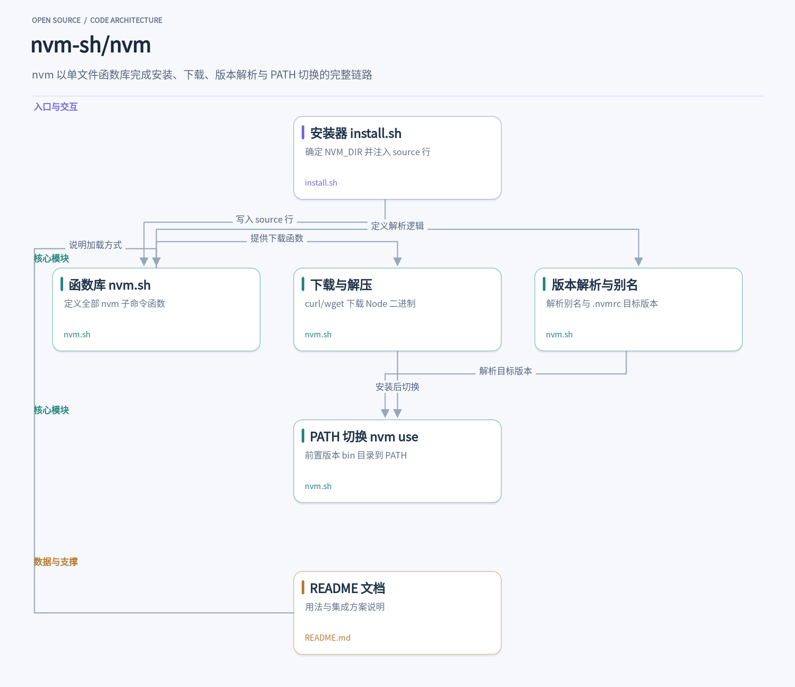
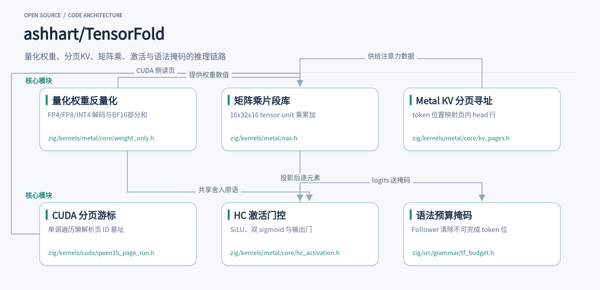

同一台机器上跑多个 Node 版本，和在没有 Python 的环境里部署一个本地大模型，看起来是两件不相干的事，这周却各有一个项目把它们做得干净利落。nvm 用一个 bash 函数库管理 `~/.nvm` 下并排安装的多个 Node 版本，`nvm use 22` 一条命令切换，`.nvmrc` 加 shell 集成让切换完全自动化。TensorFold 更激进，把 checkpoint 读取、分词、Metal/CUDA 内核执行和 OpenAI 兼容 API 全部塞进一个 Zig 二进制，`brew install` 之后拉权重、起服务、发 curl，三步跑通本地推理。一个是老牌的版本管理器，一个是新兴的原生推理引擎，都在各自的方向上把依赖收得很窄。

## 1. nvm

> 用一个 bash 函数库在多个 Node 版本之间自由切换的版本管理器

[nvm-sh/nvm](https://github.com/nvm-sh/nvm) · `Shell` · **96,005** stars · 今日 **+63** · `MIT`

同一台机器上，老项目跑 Node 20，新项目想试 Node 24，全局只装一个 Node 的做法很快就不够用了。nvm 解决的正是这个问题：它在 `~/.nvm` 下并排安装多个 Node 版本，用一条 `nvm use 22` 让当前 shell 立刻切到对应版本的 node 和 npm，再 `nvm use 24` 切回去，互不干扰。项目根目录放一个 `.nvmrc` 写上版本号，进入目录执行 `nvm use` 就能按文件内容切换，README 里还给出了在 bash、zsh、fish 中 cd 时自动执行 `nvm use` 的集成方案。

它不是编译出来的二进制，而是一个纯 POSIX 兼容的 bash 函数库。这一点决定了它的全部形态：切换 Node 版本本质上是修改当前 shell 的 PATH，只有以函数身份活在你的 shell 进程里才做得到。仓库的 [install.sh](https://github.com/nvm-sh/nvm/blob/09e620c401382f4b3d3147333dd64c1e09188fdb/install.sh) 只做三件事——确定 `NVM_DIR`（支持 `XDG_CONFIG_HOME`）、用 git 克隆或直接下载 nvm 文件、往 `~/.bashrc`、`~/.zshrc` 等 profile 文件里追加一行 `source` 语句。之后每次开 shell，主文件 [nvm.sh](https://github.com/nvm-sh/nvm/blob/09e620c401382f4b3d3147333dd64c1e09188fdb/nvm.sh) 被加载，所有 `nvm_*` 函数就此可用。

nvm.sh 是整个产品本身，install、use、ls、alias 等子命令全部实现在这一个文件里。执行 `nvm install 24` 时，`nvm_download` 负责取回官方 Node 二进制包——它优先用 curl，并特意把 `-q` 放在最前面以跳过用户 `.curlrc` 的干扰；没有 curl 时退到 wget，并通过逐个参数翻译把 curl 风格的选项映射成 wget 等价形式。下载完成后解压到 `NVM_DIR` 下的版本目录，与已装的其他版本互不影响。

切换发生在 `nvm use` 一刻。它先把用户输入解析成具体版本：可能是精确版本号，可能是 `lts/*` 这类别名，可能来自 `.nvmrc`，也可能落到默认设置。nvm 在本地维护别名文件来记录 `default`、`lts/iron` 这类名字指向哪个版本，`nvm alias` 与 `nvm unalias` 就是在增删这些记录。解析完成后，函数把目标版本 bin 目录前置到当前 shell 的 PATH，`node -v` 立刻反映变化，退出当前 shell 或再执行一次 `nvm use` 即可再次切换——这就是所谓的 per-user、per-shell 模型。

安全细节在这个脚本里随处可见。`nvm_download` 的注释明确写道：每个参数都作为字面 argv 元素传递，镜像提供的版本字符串永远不会被 shell 重新解析，避免命令注入。设置 `NVM_AUTH_HEADER` 向私有镜像传递认证头时，函数会先调用 `nvm_sanitize_auth_header` 清洗，并逐个检查 URL 是否匹配授权范围。install.sh 里也有类似考量：当 `NVM_INSTALL_GITHUB_REPO` 指向非默认仓库时，它会打印一段醒目的警告横幅，提醒你可能遭遇了仓库替换攻击。

跨 shell 兼容同样花了功夫。文件开头的 `nvm_is_zsh`、`nvm_echo`、`nvm_cd` 等函数专门处理 zsh 与其他 POSIX shell 的差异：zsh 里 `command cd` 会绕过内建，于是改用 `builtin`；`nvm_err` 用子shell 包裹重定向，防止调用方关闭 stderr 时 zsh 直接中止脚本。`nvm_has_executable` 在子 shell 里先 `unalias`、`unset -f` 再 `command -v`，确保检测的是 PATH 上的真实可执行文件而不是用户定义的函数或别名。

对一个想读懂它的开发者来说，这个项目的可借鉴之处在于克制：没有构建产物、没有运行时依赖，一个函数文件加一个安装脚本就是全部；README 覆盖了从 `.nvmrc`、镜像配置、离线安装到 Alpine、WSL 排障的大量实际场景；package.json 只承载 doctoc、eclint、urchin 等开发工具和按 shell 分类的测试入口，不参与运行。MIT 协议，装完即用，读源码也只需要一份 nvm.sh。

## 2. TensorFold

> 一个 Zig 二进制直接跑 Metal/CUDA 内核的 LLM 推理引擎

[ashhart/TensorFold](https://github.com/ashhart/TensorFold) · `Zig` · **1,929** stars · 今日 **+54** · `Apache-2.0`

在一台 Apple Silicon 的 Mac 上，`brew install ashhart/tensorfold/tensorfold` 装好之后，`tensorfold pull` 拉下一个 pinned 的 Qwen3.5-2B 4-bit checkpoint，`tensorfold serve` 起服务，再向 `http://127.0.0.1:8080/v1/chat/completions` 发一条 curl，模型就开始生成。整个过程不需要 Python，不需要 MLX，不需要任何机器学习框架的运行时。TensorFold 把读取 checkpoint、分词、执行 Metal 或 CUDA 内核、对外提供 OpenAI 兼容 API 这些事全部塞进一个 Zig 原生二进制里，这正是它最吸引人的地方：部署面收窄到极致，一个可执行文件加一份权重就是全部依赖。

官方推荐的入口模型是 `mlx-community/Qwen3.5-2B-MLX-4bit`，一个在 Metal 和 GB10 上都验证过的 4-bit checkpoint，README 给出了 pinned revision 用于可复现下载。Linux 侧走 NVIDIA GPU 的路径用 release archive，要求 glibc 2.28 以上、驱动 R580 以上（CUDA 13.0），内核是用 CUDA 13 编译的，驱动太旧会在启动时直接拒绝。`--parallel N` 控制并发流数，缺省是 auto，引擎会按显存情况最多开八个流；启动日志里的 `8 streams at once` 就是实际接受的数字。`/health` 暴露 `live.connections` 和 `live.waiting`，可以区分正在跑的和排队中的请求。

4-bit 权重怎么变成可计算的数值，答案在 [weight_only.h](https://github.com/ashhart/TensorFold/blob/8e13440712017a964c49973da4da3ab7cfb1f4e1/zig/kernels/metal/core/weight_only.h)。核心函数 `tf_wo_weight` 按列和 k 索引取出压缩码，format 字段区分 BF16、INT4、INT8、FP8 和带 FP8 局部缩放的 FP4。FP4 路径里，半个字节解出符号和量级，乘以每 16 个 k 共享的 FP8 局部缩放，再乘全局缩放；INT4/INT8 路径则按组取缩放和偏置，用 `TF_FMA` 做 fused 乘加。`tf_wo_partial` 把激活值与反量化权重逐 k 累加成 FP32 部分和，32 个 lane 按步长分摊循环，一个组内每条 lane 只碰自己的那些 k。整个文件是一份纯头文件的算术库，被各个后端的投影内核共享。

矩阵乘的重活在 [nax.h](https://github.com/ashhart/TensorFold/blob/8e13440712017a964c49973da4da3ab7cfb1f4e1/zig/kernels/metal/nax.h) 里。它定义了 16x16 的 simdgroup 片段：每个 lane 持有 8 个值，`frag_home` 按 lane 编号算出该 lane 负责的行列。最有意思的是对 M5 的适配——新的 M5 tensor unit 用 cooperative tensors 做一次 16x32x16 的乘累加，`mma_16x32` 把左右操作数和累加器装进 `matmul2d` 描述的 cooperative tensor 再调 `op.run`；而在 M5 之前的硬件上，同一组接口退回 8x8 simdgroup 矩阵的布局，列索引模式由 `TF_COL(e)` 宏切换。一个头文件同时覆盖两代硬件的寄存器布局，注释里明确标注了松弛精度是照 MLX 的行为来的。

KV 缓存按 256-token 分页管理。Metal 侧的 [kv_pages.h](https://github.com/ashhart/TensorFold/blob/8e13440712017a964c49973da4da3ab7cfb1f4e1/zig/kernels/metal/core/kv_pages.h) 用 `TF_PAGE_TOKENS` 宏固定页大小，`tf_page_offset` 从每流的页表里查位置对应的页 ID，乘页字节再定位页内行；页内布局是 head-major 的，`tf_paged_row` 在此基础上叠加 head 偏移。CUDA 侧对应的是 [qwen35_page_run.h](https://github.com/ashhart/TensorFold/blob/8e13440712017a964c49973da4da3ab7cfb1f4e1/zig/kernels/cuda/qwen35_page_run.h)，思路不同：`TfQ35PageRun` 是一个游标结构，块内按逻辑键单调遍历时，`tf_q35_page_base` 只在逻辑键变化时才去读一次页表数组，页 ID 保持稳定的前提下每个 ID 只读一次。小文件解决的是同一个大问题——分页 KV 的随机访问如何少读内存。

矩阵乘之外，层内的逐元素计算由 [hc_activation.h](https://github.com/ashhart/TensorFold/blob/8e13440712017a964c49973da4da3ab7cfb1f4e1/zig/kernels/metal/core/hc_activation.h) 补齐，这份头文件被 Metal 和 CUDA 共享。`tf_hc_activation` 先做 BF16 除法，再走 SiLU 或两次 BF16 sigmoid 的注入路径；`tf_hc_branch` 处理分支残差，`tf_hc_output_gate` 是输出门，g 为负时用 `exp(0.5g)` 的重排公式避免溢出。值得注意的是这里到处都是显式的 BF16 舍入调用 `tf_wo_round`——它复用 weight_only.h 里的位级舍入原语，把中间结果一次次压回 BF16。两个头文件之间这种跨职责的原语共享，让不同内核的数值行为保持一致，这是手写内核工程里很实用的做法。

生成端的约束解码在 [tf_budget.h](https://github.com/ashhart/TensorFold/blob/8e13440712017a964c49973da4da3ab7cfb1f4e1/zig/src/grammar/tf_budget.h)，名字里的 budget 指的是从一个语法解析状态出发、到达一个可完成回复还差的最少 token 数。`tfb::Follower` 镜像一个 matcher 的位置，`Accept` 逐 token 前进，`Rollback` 回退 n 步；`Mask` 接口接收一个 bitmask 数组和剩余预算 `left`，把那些选了之后剩余预算内不可能完成的 token 位清零，采样器只能在剩下的合法 token 里挑。`Cache` 按 `xgrammar::TokenizerInfo` 缓存最近编译过的语法表，用 `std::once_flag` 懒构建 trie。这套设计把“结构化输出必须能按时收尾”变成采样前的一次位掩码过滤，接口干净，也方便和任何采样策略组合。对想理解一个完整推理引擎从权重到采样各环节如何拼装的开发者，TensorFold 的这些内核头文件是密度很高的阅读材料。

从工程整体看，TensorFold 的取舍很清楚：不做训练，不做框架抽象，专注把量化 checkpoint 的推理服务压进一个原生二进制。Zig 负责 shell 和服务编排，真正的算子是嵌入的 Metal/CUDA 头文件内核，一个 `weight_only.h` 同时服务两个后端，`nax.h` 一个文件兼容两代 Apple tensor unit。仓库里还有配套的 `tensorfold web` 本地网页应用和桌面工作区，以及大量 bench 与 conformance 工具脚本，但从内核视角看，前面那六个文件已经勾出了前向推理的主干。

nvm 的价值在于它把自己限制在一个 bash 函数里，却把多版本共存这件事做到了顺手；TensorFold 则用 Zig 把推理引擎的部署面压缩到一个可执行文件加一份权重。两个项目的共同点是边界划得清楚——该管的管好，不该依赖的一律不带。如果你的日常在 Node 多版本之间来回，或者想在 Mac 上轻量跑一个本地模型，这两个仓库都值得 clone 下来读一读源码。
