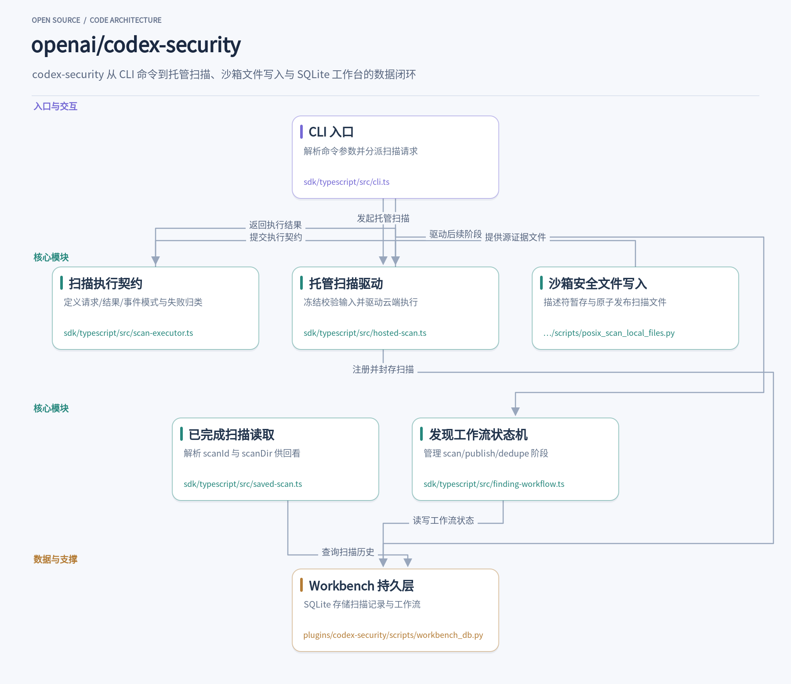
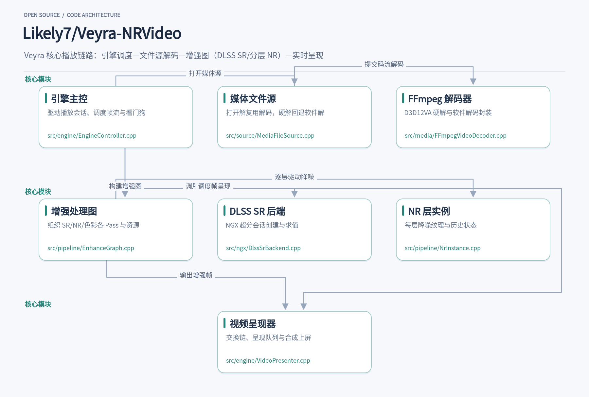

这周挑了两个方向完全不同的项目。一个是 OpenAI 的 codex-security，一个 npm 包，把安全扫描做成 CLI 和 TypeScript SDK，从发现漏洞到验证、打补丁、分配负责人，整条链路都在终端里跑完，结果可以导出 SARIF 或直接推进 Linear、Jira。另一个是 Likely7 的 Veyra-NRVideo，用 C++ 在 Windows 上搭了一条 D3D12 实时增强流水线，DLSS 超分、分层神经降噪、帧生成，处理的不是游戏画面，而是本地视频、采集卡和串流进来的主机画面。一个管代码质量，一个管画面质量，各自在自己的领域把工程细节做得很扎实，下面展开讲。

## 1. codex-security

> OpenAI 的安全扫描 CLI/SDK，把托管模型调查、沙箱文件访问与本地 SQLite 工作台串成闭环

[openai/codex-security](https://github.com/openai/codex-security) · `TypeScript` · **13,122** stars · 今日 **+751** · `Apache-2.0`

在终端里对一个仓库执行 `cs scan .`，几分钟后你会得到一份 Markdown 报告，里面列出安全发现、源码证据和覆盖率说明。这是 openai/codex-security 提供的日常体验：一个 npm 包 `@openai/codex-security`，既是 CLI 也是 TypeScript SDK，用于发现、验证并修复代码中的安全漏洞。它要求 Node.js 22.13.0+（22.x 内）、24.x 或 26.x，外加 Python 3.10+。除了命令行，它还能以 GitHub Action 或 Codex 会话插件的形式进入 CI 和日常开发流程，扫描结果可以导出 SARIF、JSON、CSV，也能推送到 Linear、Jira 或 GitHub。它解决的核心问题很具体：安全扫描不只是跑一遍工具，还要能验证发现是否真实、生成补丁、核对已有修复、按团队自己的严重度标准分级、根据 Git 历史建议负责人——而这一切的前提是扫描结果被可靠地封存下来。

这个项目把一次扫描做成一份"封存契约"（sealed contract）：revision、scope、findings、报告都在完成时被哈希校验并写入本地状态目录，后续的去重、发布、补丁工作流都引用这份不可变的产物，而不是重新推断。这种设计贯穿了从命令行到持久层的每一层代码，也是它最值得细读的地方。

从入口看，一切从 [cli.ts](https://github.com/openai/codex-security/blob/f26b669b56a4423abd773c81f6c6c9c2ebadc42a/sdk/typescript/src/cli.ts) 开始。这个文件用 `incur` 框架和 zod 定义了所有命令与选项：`cs scan` 支持 `--path` 限定路径、`--diff origin/main` 扫描提交变更、`--mode deep` 做深度扫描、`--max-time 15` 设定咨询性的调查时限。CLI 在这里完成参数解析、认证模式选择（ChatGPT 登录或 `OPENAI_API_KEY`）、模型与推理力度的配置覆盖，然后把请求交给 SDK 层的 `CodexSecurity` 类。命令面非常宽——policy、patch、verify、dedupe、publish、import 都从这里分发。

扫描本身的边界定义在 [scan-executor.ts](https://github.com/openai/codex-security/blob/f26b669b56a4423abd773c81f6c6c9c2ebadc42a/sdk/typescript/src/scan-executor.ts)。它导出的 `ScanExecutionRequest` 描述一次标准扫描的全部输入：仓库、revision、scope 路径、模型、推理力度、运行时目录，以及用于关联的 runId/attemptId/buildId。结果用 `ScanExecutionResultSchema` 严格校验，状态只有 completed、failed、canceled、acceptance_unknown 四种，且 completed 必须携带 sessionId。这个文件最有意思的是 `hostedScanFailureStatus`：它把扫描失败与执行器保留的结果分开归类，明确区分用户主动取消、成本超限中断和连接异常，让重试与对账逻辑有据可依。

[hosted-scan.ts](https://github.com/openai/codex-security/blob/f26b669b56a4423abd773c81f6c6c9c2ebadc42a/sdk/typescript/src/hosted-scan.ts) 是托管扫描的驱动层。它在提交执行前做一轮严格的输入冻结：`prepareHostedRepository` 会校验 checkout 的 revision 与请求一致，逐个路径做 `realpath` 检查，拒绝逃出仓库的路径、符号链接别名和空 scope。执行完成后它再验一遍——manifest 里的 revision、includePaths 必须与请求完全一致，每个产物文件计算 SHA-256 并与封存时的摘要比对，任何一个文件在回执生成前被改动都会报错。这种"前后双验"的做法，让云端执行的结果在回到本地时仍然对应你请求的确切代码。

沙箱侧的文件写入由 [posix_scan_local_files.py](https://github.com/openai/codex-security/blob/f26b669b56a4423abd773c81f6c6c9c2ebadc42a/plugins/codex-security/scripts/posix_scan_local_files.py) 负责，这份代码值得每个写文件 IO 的人读一遍。它全程持有父目录的文件描述符，用 `O_WRONLY | O_CREAT | O_EXCL` 创建随机命名的暂存文件，写入后 `fsync`，再通过 `os.link` 或平台专属的独占重命名（Linux 的 `renameat2` 带 `RENAME_NOREPLACE`，macOS 的 `renameatx_np` 带 `RENAME_EXCL`，甚至为 musl 缺 wrapper 的情况准备了按 ABI 直接发系统调用的回退）原子发布。目标是防止符号链接劫持、部分写入和覆盖已有文件——安全工具自己先做到不可被竞态攻击。

扫描结果的长期归宿是 [workbench_db.py](https://github.com/openai/codex-security/blob/f26b669b56a4423abd773c81f6c6c9c2ebadc42a/plugins/codex-security/scripts/workbench_db.py)，一个相当庞大的 SQLite 持久层。它启用 WAL、外键和 busy_timeout，带迁移机制，跨进程用文件锁（POSIX flock 或 Windows msvcrt.locking）保护单个扫描的完成阶段。`verify_manifest_binding` 逐项核对 manifest 的 scanId、targetId、revision、snapshotDigest 和 scope 是否与注册的扫描一致，任何一项不匹配直接终止。回看侧的 [saved-scan.ts](https://github.com/openai/codex-security/blob/f26b669b56a4423abd773c81f6c6c9c2ebadc42a/sdk/typescript/src/saved-scan.ts) 通过 workbench 的 list-scans/get-scan 命令解析 `latest` 或指定 scanId，确认 scanDir 真实存在后才返回。扫描之后的闭环则由 [finding-workflow.ts](https://github.com/openai/codex-security/blob/f26b669b56a4423abd773c81f6c6c9c2ebadc42a/sdk/typescript/src/finding-workflow.ts) 编排：`FindingWorkflow` 把 scan、publish、dedupe 三个阶段做成可恢复的状态机，状态存在 workbench 数据库里并与封存产物严格隔离，`workflowDigest` 对键排序后做 SHA-256，让阶段结果可以幂等地绑定到确切的输入。

使用上的取舍也值得知道：Deep 模式会重复标准扫描并返回去重后的发现，耗时会相应增加；扫描会读取根目录与组件级 `SECURITY.md` 作为指引，`cs policy` 可起草或更新它；状态目录由 `CODEX_SECURITY_STATE_DIR` 控制，保持稳定才能在 linked worktree 间共享扫描历史。部分网络安全类请求需要 Trusted Access for Cyber，Cloud 是可选连接，本地扫描不依赖它。整个仓库 TypeScript 与 Python 各司其职——TS 管协议、校验与编排，Python 管持久化与沙箱文件操作，Rust native 层辅助跨平台读取。对想做代码分析平台的人来说，这种"契约先行、状态外置、每步可对账"的工程范式，比扫描本身更有借鉴价值。

## 2. Veyra-NRVideo

> 把 DLSS 超分、分层神经降噪和帧生成搬进 Windows 实时视频播放器的开源 C++ 引擎

[Likely7/Veyra-NRVideo](https://github.com/Likely7/Veyra-NRVideo) · `C++` · **1,615** stars · 今日 **+256** · `GPL-3.0`

把一段 1080p 的老动画本地视频拖进 Veyra，播放器会先尝试 D3D12VA 硬解，把解码后的 GPU 帧直接送入一条 D3D12 增强流水线：DLSS SR 或 FSR 做超分，可叠加多层神经降噪和色彩节点，最后经帧生成与合成着色器上屏。它同样能接采集卡、屏幕捕获、PS5 Remote Play 和 Moonlight 串流，让主机画面在 PC 上获得实时增强。项目用 C++ 写成，GPL-3.0 开源，要求 Windows 11 与 DirectX 12，NVIDIA 和 AMD 显卡都有对应后端。

整条链路的驱动者是 src/engine/EngineController.cpp。它在独立工作线程上跑一个任务队列，open() 打开源、构建增强图、调度帧处理与呈现；同时挂了一个看门狗线程检测引擎卡死。这个文件里有个很现实的细节：析构函数如果发现属主线程卡在驱动调用里超过限定时间（正常 20 秒、看门狗已报告挂起则 3 秒），会直接 TerminateProcess 结束进程，而不是让用户去任务管理器杀——注释里写明这来自真实的现场日志。frame-flow 日志把每一帧从 captureReceived 到 realPresented 的每个计数器都打出来，排查丢帧时非常有用。

源的入口在 src/source/MediaFileSource.cpp。它把 FFmpeg 的解复用器和解码器包装成统一的帧流接口：文件打开后先解析色彩元数据（矩阵、range、传递函数、HDR 峰值亮度、Dolby Vision 配置），再按优先级尝试 D3D12VA 硬解，失败则回退软件解。回退逻辑做得比一般播放器细：流中途硬解失败时会记录最后交付的 PTS，重开软件解码器后 seek 回该点继续，并用 epoch 递增通知下游重置时域历史。HEVC 和隔行内容刻意走 D3D11VA 路径，因为注释记录了 RTX 5070 某驱动下 D3D12VA 解 HEVC 首帧会把共享设备整个带崩的问题。

解码封装在 src/media/FFmpegVideoDecoder.cpp，它决定了帧最终落在共享 D3D12 设备上，后续增强处理因此无需跨设备拷贝。软件解码有线程策略区分：文件回放允许最多四线程帧级并行，直播采集则只开 slice 线程并加 AV_CODEC_FLAG_LOW_DELAY，绝不拿延迟换吞吐。D3D11VA 到 D3D12 的互操作用一对共享 fence（D3D11 发信号、D3D12 队列等待）做排序，全程无 CPU 等待；解码出的表面通过 NT handle 共享纹理环形槽拷贝进 D3D12，绕开了 NVIDIA 驱动拒绝在 DXVA 输出纹理上开 SHARED_NTHANDLE 的限制。

处理图的真正组织中心是 src/pipeline/EnhanceGraph.cpp（注意 src/core/ 下同名文件只是度量桩）。它绑定超分、降噪、色彩、抗锯齿、美颜各类后端，处理顺序的约束来自注入层时代验证过的探针序列：先建 committed 资源和 NGX/光流对象，再做 FG 预热求值，描述符视图最后建。色彩分级采用 CPU 烘焙查找表再上传小纹理的方案，未启用时零开销；LUT 上传还会把行距对齐到 256 字节——注释记录了 2-cube 的紧排 pitch 曾直接引发 fail-fast 崩溃。双超分（dual SR）允许两个 pass 各自选择 DLSS/FSR/RTX Video SR 家族。

超分的 NVIDIA 侧接入在 src/ngx/DlssSrBackend.cpp。它对 NGX 的 Create/Evaluate/Release 调用全部用 SEH __try/__except 包住，驱动抛结构性异常时能拿到异常码并返回失败而不是崩溃。模型选择上把所有性能档位钉在用户指定的 preset（K 为 DLSS 4 模型，M/L 为 DLSS 4.5 transformer），避免运行时自行选档。同分辨率时直接旁路，连 Evaluate 都不调用，DLAA 模式还强制校验输入输出尺寸一致。视频没有渲染器的深度和曝光，创建参数里用 IsHDR 加 AutoExposure 的文档化组合来配合线性 RGBA16F 输入。

分层降噪的每层资源由 src/pipeline/NrInstance.cpp 承载。create() 为一层分配输入、8bit 的 proxy/neural 对、线性 FP16 的 residual 和最终输出，还有独立的运动向量纹理；每层自带一套历史纹理，注释解释了原因：共享会让多层的时域历史互相污染。输入纹理可以借用增强图的现有资源（零拷贝），也可以由层自建。2.0.4 版本把每层强度上限提到 5，做法是对一次推理的 residual 做外推，README 也坦承这无法保证所有视频在满强度下无伪影。

链路末端是 src/engine/VideoPresenter.cpp。它管理交换链、独立的呈现命令队列（三槽 ring）和 PresentBlit 合成 pass，支持 XeSS 帧生成时保留显示器大小的缓冲以避免窗口缩放触发 provider 重建。暂停时保留最后一帧，只在生产者 fence、视图或可见性变化时才重新提交；HDR 下针对 RTX5090 的 FG 闪烁问题，采用先合成再拷贝到 DXGI 缓冲的路径。对做播放器、视频处理或 GPU 互操作的开发者来说，这个仓库的价值在于把大量驱动层面的坑（D3D11/12 互操作、NGX 异常、DXVA 表面共享限制）连同现场证据一起写进了代码注释，每一处取舍都有出处可查。

两个项目解决的问题隔得很远，但都能看到作者对完整链路的执念：codex-security 不满足于报一堆告警，把验证、修复、追踪一直做到工单系统；Veyra 则从解码、超分、降噪到帧生成，把每一环都留在 GPU 上。如果团队里正好缺一条能落地的安全流水线，或者手边有块闲着的 N 卡想救活老视频，这两个仓库都值得 clone 下来跑一跑，源码结构清晰，读起来也不费劲。
