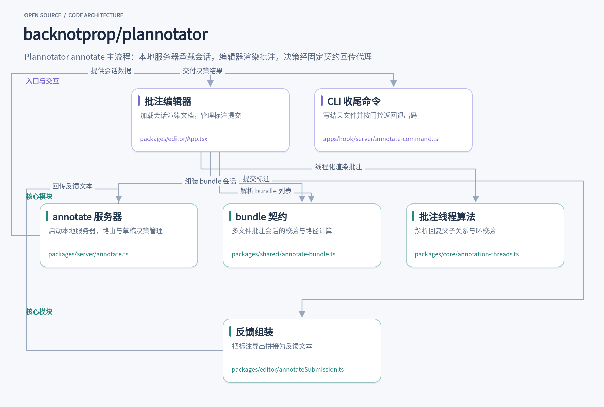
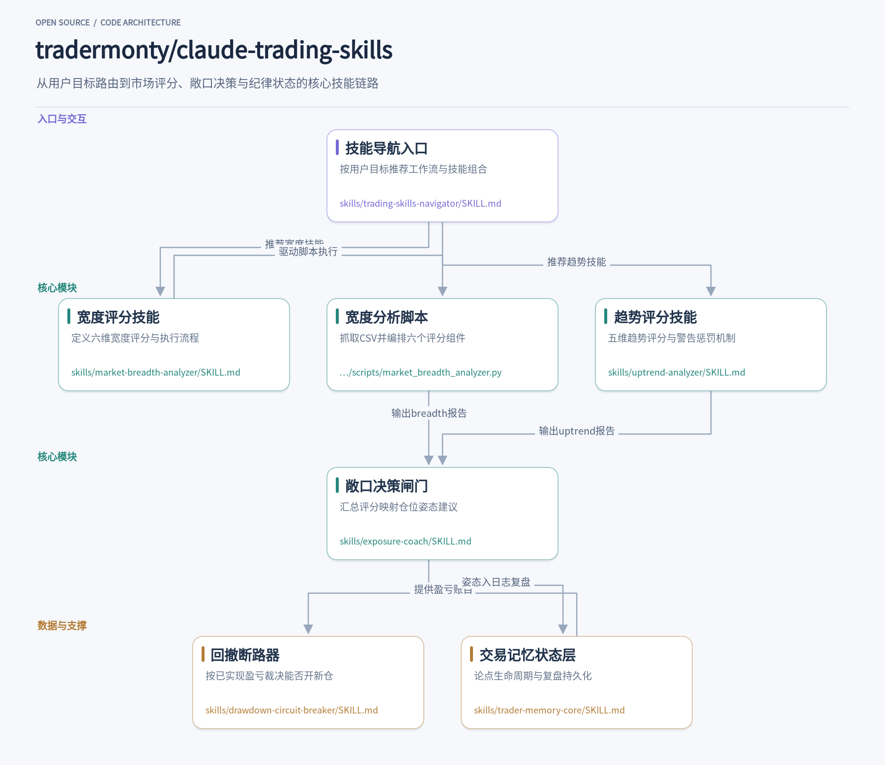
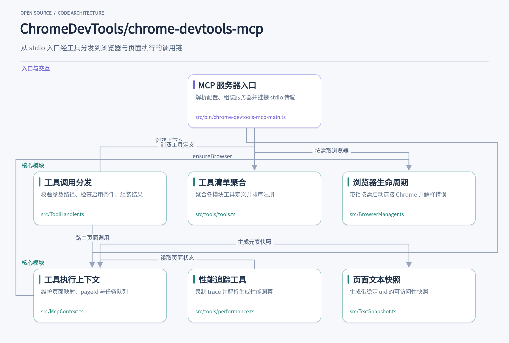

代理写完计划没法圈选批注、收盘后想快速判断市场却要翻一堆面板、真实浏览器里的报错 agent 够不着——这三个场景分别对应这周的三个开源项目。Plannotator 给 Claude Code、Codex 这类编码代理补上了浏览器里的批注闭环，圈选、评论、一键送回会话；claude-trading-skills 用七十多个可验证的脚本和十四条工作流，把个人投资者的每日复盘和仓位纪律串起来；chrome-devtools-mcp 则是一个 MCP 服务器，让编码 agent 直接操控真实 Chrome 做导航、截图、网络分析和性能追踪。三个项目领域不同，但都在解决同一类尴尬：工具的能力已经有了，缺的是把它接到你真正干活的地方。

## 1. plannotator

> 让 AI 编码代理的计划与代码评审回到浏览器批注闭环

[backnotprop/plannotator](https://github.com/backnotprop/plannotator) · `TypeScript` · **11,104** stars · 今日 **+408** · `Apache-2.0`

让 Claude Code 或 Codex 写一份重构计划，输出常常是终端里一大段 markdown：滚动费劲、没法在具体段落旁边写意见，更别提把批注精准送回代理。Plannotator 补的就是这一层。代理提出计划、HTML 原型或做完一轮工作后，调用 `plannotator annotate plan.md`，本地会启动一个服务器并在浏览器里打开批注界面；你在文档上圈选、评论、回答问题，点一次发送，反馈就以代理能读懂的文本回到会话的下一轮输入。除计划外它还能评审本地 diff 和远程 PR，支持 Git、Jujutsu、Perforce、GitHub 和 GitLab。

整个流程的技术形态很有意思：它不是常驻服务，而是一次 annotate 会话对应一个本地 Bun 服务器。核心在 [packages/server/annotate.ts](https://github.com/backnotprop/plannotator/blob/4afdf2537de4a55eb7ea4695918296662252d2be/packages/server/annotate.ts) 的 `startAnnotateServer`，它接收 markdown 内容、文件路径、UI 模式等选项，起服务器、提供 `/api/plan` 与 `/api/feedback` 路由，然后打开浏览器。`AnnotateServerResult` 里的 `waitForDecision` 返回一个 Promise，挂起等用户提交，反馈、批注、是否批准都从这个 Promise 流回调用方。会话结束即关停，不留后台进程。

批注对象也不限于单个文件。`annotate-bundle` 模式把多个文件合成一次评审，比如 `plannotator annotate spec.md mock.html notes.md`。契约定义在 [packages/shared/annotate-bundle.ts](https://github.com/backnotprop/plannotator/blob/4afdf2537de4a55eb7ea4695918296662252d2be/packages/shared/annotate-bundle.ts)：每个文件带 `path` 和 `renderAs`（markdown、html、mermaid、graphviz、asciidoc 或 code），`parseAnnotateBundle` 严格校验，少于两个文件、路径重复、渲染类型不合法都返回 null，坏负载开不出 bundle 界面。`annotateBundleRoot` 逐段比较目录求最深公共目录，文件列表按给定顺序展示，反馈也按这个顺序每文件一节。

浏览器端的主应用是 [packages/editor/App.tsx](https://github.com/backnotprop/plannotator/blob/4afdf2537de4a55eb7ea4695918296662252d2be/packages/editor/App.tsx)，一个体量很大的 React 组件，拉取 `/api/plan` 的会话数据后按模式渲染：单文件、文件夹、多条历史消息选择器、bundle，甚至运行中的本地应用（通过回环反向代理镜像目标 URL 再注入批注脚本）。细节做得相当克制：Mermaid 运行时不在启动时注册，而是第一张图出现时才动态 import，没有图的计划不付这份加载成本；KaTeX 和用户名字典则提前 eager 注册，保证首屏排版一致。标注草稿自动保存，链接的子文档、代码文件弹出窗都可以单独批注。

提交环节在 [packages/editor/annotateSubmission.ts](https://github.com/backnotprop/plannotator/blob/4afdf2537de4a55eb7ea4695918296662252d2be/packages/editor/annotateSubmission.ts)。`buildCompleteAnnotateFeedback` 把主文档批注、关联文档批注、编辑器批注、代码批注、消息批注分别导出再拼接，直接编辑和已保存的文件改动作为附加节合并。一个有意思的契约是 `ANNOTATE_NO_FEEDBACK_SENTENCE`，即 "User reviewed the document and has no feedback." 这个固定句子：所有现存 CLI 消费方的输出解析和严格门控的退出码都依赖这个精确字节序列，所以空反馈不能随便措辞，批准附带备注时也要复用它，确保"看过且无意见"永远不会被误读成修改请求。

批注支持回复线程，而线程数据可能来自不可信的外部输入，比如浏览器代理的工具调用或对 `/api/external-annotations` 的任意字段 PATCH。[packages/core/annotation-threads.ts](https://github.com/backnotprop/plannotator/blob/4afdf2537de4a55eb7ea4695918296662252d2be/packages/core/annotation-threads.ts) 用一条简单规则兜底：只有 `inReplyTo` 指向同列表中另一条批注、且沿父链走不会绕回自身的才算回复，孤儿、自引用、环成员全归为根。`resolveReplyParents` 用路径压缩做到线性复杂度，五千层深的恶意链也只走五千步。写入侧的 `validateReplyTarget` 在 ingest 时就拒绝会成环的赋值。结果是不管输入多脏，任何批注都不会从线程化渲染中丢失，回复永远挂在真实渲染的节点下。

闭环最后一环是 CLI 收尾。[apps/hook/server/annotate-command.ts](https://github.com/backnotprop/plannotator/blob/4afdf2537de4a55eb7ea4695918296662252d2be/apps/hook/server/annotate-command.ts) 的 `completeAnnotateCommand` 在决策落定后先写 stdout 再写结果文件——注释里解释了顺序：评审者的自动保存草稿此刻已销毁，完成的决定必须先到达至少一个通道。门控模式下退出码有明确区分：exit 1 表示门跑了但评审者未批准，exit 2 表示环境错误（结果文件发布失败），失败即闭合但语义不同，代理据此选择下一步。

从设计上值得借鉴的点不少：`annotate-bundle.ts` 和 `annotation-threads.ts` 都是零依赖的浏览器安全纯函数，放在 shared 与 core 包里让编辑器、两种服务器和各宿主复用同一套逻辑；能力协商贯穿始终，`approvalNotesSupported`、`clientLeaseSupported` 由传输层决定而非全局假设，`--tailscale` 会话因经过 serve 代理被视同远端关闭 client-lease 自动消解；`runGuardedShutdown` 给每个清理步骤单独隔离，一步抛错不会孤儿化后续的监听器和 WebSocket。加上对各代理的插件适配层和 Inbox 多代理消息面，它把"人类审核 AI 产出"做成了一条可组合、可审计的流水线。

## 2. claude-trading-skills

> 用 70 多个可验证脚本的 Claude Skills，把个人投资者的每日复盘、仓位纪律与交易日志串成闭环

[tradermonty/claude-trading-skills](https://github.com/tradermonty/claude-trading-skills) · `Python` · **4,787** stars · 今日 **+553** · `MIT`

晚上收盘后只有十五分钟，你想知道今天的市场还能不能加仓。打开 Claude，说一句“市场宽度怎么样”，trading-skills-navigator 会先接住这句话——这个仓库有七十多个技能和十四条工作流，新用户面对的不是一个工具，而是一片森林，navigator 就是林中的向导。它读一句自然语言目标，推荐一条具体路径：跑哪个 workflow、装哪些技能、要不要付费 API。比如你说“我只在市场环境允许时才做波段”，它会指向 swing-opportunity-daily，并明确告诉你筛选环节需要 FMP key，而风险闸门和纪律检查只依赖本地状态。

navigator 的路由不是让模型自由发挥。SKILL.md 里写得清楚：它背后是一个确定性的 Python 推荐器 scripts/recommend.py，消费仓库的 skills-index.yaml 和 workflows/*.yaml 元数据，输出稳定的 JSON。在 Claude Code 里脚本直接读仓库根目录的 SSoT；在 Claude Web App 没有仓库可言，脚本就回退到内置的 assets/metadata_snapshot.json，两种环境的推荐结果字节级一致。附带 246 条英日双语标注的路由基准用例做验证，这在以提示词为主的 Skills 生态里是少见的工程态度。

一条最常用的免费路径是 market-regime-daily。第一环是 market-breadth-analyzer：一个 Python 脚本从 GitHub Pages 上的公开 CSV 拉取约两千五百行宽度数据（2016 年至今），不需要任何 API key。脚本 market_breadth_analyzer.py 是真正的编排器——先抓数据、校验新鲜度（超过五天会警告），然后依次调用六个独立的 calculator 模块：宽度水平与趋势占 25%，8 日均线对 200 日均线交叉占 20%，峰谷周期占 20%，看空信号占 15%，历史分位与 S&P 500 背离各占 10%。

这套评分的容错设计值得借鉴。某个组件数据不足（比如检测不到峰谷标记）时，不是直接报错，而是把该组件剔除并按比例把权重重新分配给其余组件，报告里同时展示原始权重和生效权重。综合分映射到五个健康区间：80 分以上建议 90–100% 仓位，20 分以下只保留 25–40% 本金。分数还会写入 market_breadth_history.json（最多保留二十条），下次运行时对比出趋势在改善还是恶化——一次运行是快照，多次运行才构成判断。

第二环是 uptrend-analyzer，跟踪约两千八只美股、十一个板块的上涨比率，五维评分（整体宽度 30%、板块参与 25%、动量 20%、轮动 15%、历史语境 10%）。它的警告系统有意思：即使综合分较高，“商品板块比率同时超过周期与防御板块”这类晚周期信号会触发 −5 的仓位惩罚，惩罚可叠加、封顶 −10，在综合分计算完之后单独扣减。斜率先做 EMA(3) 平滑再打分，加速度用 10 对 10 窗口对比，数据不足时退化到 5 对 5。

两个评分最终汇入 exposure-coach——工作流的终点闸门。它消费上游技能的 JSON 报告（缺失输入会降低置信度但不会阻塞执行），输出一页 Market Posture：仓位上限、成长还是价值倾斜、参与度广还是窄，以及 NEW_ENTRY_ALLOWED、REDUCE_ONLY、CASH_PRIORITY 三选一的明确建议。README 反复强调这是给人审核的姿态建议，不是下单指令。它还实现了严格的溯源机制：用 --require-provenance --run-id 校验上游报告的 schema 版本、检索时间不晚于评估时刻、数据不超过配置天数，失败就在产出报告前停止。

风险不只来自市场，也来自自己。drawdown-circuit-breaker 读 trader-memory-core 的论点 YAML，只用已实现盈亏做判断：单日亏损超账户 2% 暂停、连续两笔亏损进入 24 小时冷却、周回撤 5%、月回撤 8% 各自触发不同时长的 HALTED，边界按纽约交易日历计算。状态数据残缺时它选择 fail closed——返回 PARTIAL 加 HALTED，宁可让你修好数据再开仓，也不在不确定的风险数字上放行。唯一例外是空状态目录：新用户没有历史记录不会被拦在门外。

整个体系的粘合剂是 trader-memory-core：每个投资想法是一个 thesis 对象，沿 IDEA → ENTRY_READY → ACTIVE → PARTIALLY_CLOSED → CLOSED 的生命周期流转，支持碎股与带乘数、方向的期货合约，每次部分平仓都往 status_history 追加含已实现盈亏的账目条目。项目定位写得很直白：目标不是把买卖决策外包给 AI，而是结构化你的复盘、风控与日志，让 Plan → Trade → Record → Review → Improve 循环转起来。对开发者而言，可借鉴的是 Skills 的组织方式——SKILL.md 叙述用法、Python 脚本负责确定性计算、技能之间用带溯源元数据的 JSON 传递数据、下游设校验闸门，再配一批 check_skill_catalog 之类的巡检脚本守住文档与代码的一致性。MIT 协议开源，作者的原则是“先为自己所用，再开放给他人”。这套模式搬到一个完全不同的领域，依然成立。

## 3. chrome-devtools-mcp

> 让编码 agent 直接操控真实 Chrome 做自动化、调试与性能分析的 MCP 服务器

[ChromeDevTools/chrome-devtools-mcp](https://github.com/ChromeDevTools/chrome-devtools-mcp) · `TypeScript` · **56,284** stars · 今日 **+664** · `Apache-2.0`

调试一个只在真实浏览器里复现的问题时，最缺的往往不是信息，而是让 agent 拿到这些信息的通道。console 里的报错、网络面板里失败的请求、性能面板里的 LCP 拆解，这些都锁在 DevTools 界面里，AI 助手够不着。chrome-devtools-mcp 把这扇门打开：它是一个 Model Context Protocol 服务器，用 Puppeteer 拉起一个真实的 Chrome，把导航、截图、网络分析、性能追踪等能力封装成 MCP 工具，Claude、Cursor、Copilot 这类编码 agent 可以直接调用。

接入方式很简单，在 MCP 客户端配置里写上 npx -y chrome-devtools-mcp@latest，然后在对话里说一句 Check the performance of https://developers.chrome.com，agent 就会调工具打开页面、录制 trace 并给出洞察。浏览器是按需启动的——仅仅连接服务器不会拉起 Chrome，只有某个工具真正需要浏览器实例时才 launch。项目要求 Node.js LTS 和当前稳定版 Chrome，官方只保证 Chrome 与 Chrome for Testing 可用。同一个包还附带 chrome-devtools CLI，不经过 MCP 也能在终端里 navigate_page、take_screenshot。

代码入口在 src/bin/chrome-devtools-mcp-main.ts：先用 ConfigParser 解析配置，创建 BrowserManager，再通过 McpServer.from 组装服务器并挂上 StdioServerTransport。这个文件对生命周期的处理相当细致——监听 stdin 的 end 和 close（stdio MCP 约定客户端关闭传输即退出），注册 SIGTERM/SIGINT/SIGHUP，并在 shutdown 里放了一个 5 秒的超时兜底，防止不响应的 Chrome 把进程挂死。

所有工具调用都会流经 src/ToolHandler.ts。它用 zod 严格校验参数，检查工具是否被某个分类开关禁用，并对文件路径参数做工作区 roots 校验，防止 agent 把不该写的路径传进来。浏览器连接有 60 秒上限：连不上就放弃本次尝试、下次重试，而不会让一个半开的 socket 永远卡住。并发控制也在这里——每个工具标注了 concurrency 级别，页面级工具按 pageId 路由到对应页面的任务队列，互相之间不会踩踏。

BrowserManager（src/BrowserManager.ts）负责 Chrome 的生命周期，用互斥锁串行化 launch/connect，并内置了不少实用错误翻译：root 用户启动 Chrome 被沙箱拒绝时给出明确提示，无 X server 的有头模式失败时建议 --headless 或 xvfb-run。McpContext（src/McpContext.ts）则是工具与浏览器之间的枢纽，维护 Target 到 McpPage 的映射、稳定的 pageId（跨重连也不复用）、选中页面状态和各类资源（录制中的 trace、heap snapshot、screencast）的释放逻辑，配置热更新时会按 FEATURE_CONTROLLERS 逐项同步。

工具清单由 src/tools/tools.ts 聚合，从 network、console、css、emulation 到 webauthn、lighthouse 共二十多个模块，按名称排序后注册。性能分析是招牌：src/tools/performance.ts 里的 performance_start_trace 会先导航到 about:blank 清空状态，按 DevTools 默认分类开 tracing，可选禁用缓存模拟冷加载，autoStop 时等 5 秒再停。停下的 trace 交给 parseRawTraceBuffer 解析，还能通过 CrUX API 拉取真实用户字段数据，把实验数据和线上体验放在一起看。失败路径也处理了——tracing.start 抛错时主动清掉 running 标志，避免整个会话再也录不了 trace。

自动化交互的可靠性来自 src/TextSnapshot.ts。它对页面做可访问性树快照，并用 loaderId 加 backendNodeId 生成跨快照稳定的元素 uid：同一个按钮在两次快照里 uid 不变，agent 引用它点击就不会错位。不在可访问性树里的节点（比如第三方工具返回的 DOM handle）会通过最近祖先被插入树中。对想给 agent 加浏览器能力的团队来说，这套「稳定 uid + 任务队列 + 按需浏览器」的组合，比裸用 Puppeteer 稳得多，源码在 https://github.com/ChromeDevTools/chrome-devtools-mcp。

Plannotator 的价值在于把评审动作压缩成一次点击，claude-trading-skills 用 navigator 解决了技能森林的入口问题，chrome-devtools-mcp 则让 DevTools 里锁着的数据流进 agent 的上下文。三个项目的源码都不大，读一遍用不了太久，感兴趣可以从各自的 GitHub 仓库拉下来跑跑看。
