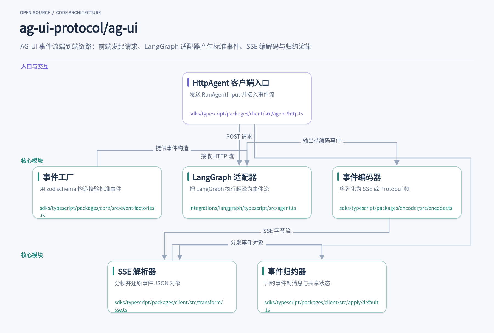

给 Agent 写前端界面，最花时间的往往不是模型调用本身，而是流式交互的胶水代码。回复要逐字打出来，工具调用要在界面上挂卡片，共享状态还得双向同步，LangGraph 一套事件格式，CrewAI 又是另一套，前端每个框架都得重写一遍。AG-UI 把这件事标准化了：agent 后端发出约 16 种标准事件，前端按事件类型归约渲染，传输、编码、状态同步由各语言的 SDK 包办。本文顺着它的实际接入场景展开，看看事件流怎么设计、状态怎么同步、哪些做法可以直接搬到自己的项目里。

## 1. ag-ui

> 用一套标准事件流把任意 AI Agent 接进前端应用的开放协议

[ag-ui-protocol/ag-ui](https://github.com/ag-ui-protocol/ag-ui) · `TypeScript` · **17,834** stars · 今日 **+355** · `MIT`

在应用里接入一个 Agent 后端，最磨人的往往不是模型本身，而是流式界面怎么写。用户的输入要发过去，助手的回复要逐字打出来，工具调用要在界面上挂卡片，共享状态还得双向同步——LangGraph 是一套事件格式，CrewAI 又是另一套，前端为每个框架都写一遍胶水代码。AG-UI（github.com/ag-ui-protocol/ag-ui）把这件事标准化了：agent 后端发出约 16 种标准事件，前端按事件类型归约渲染，中间的传输、编码、状态同步都由 SDK 包办。

它解决的问题可以放进整个协议栈里看：MCP 给 agent 工具，A2A 让 agent 互相通信，AG-UI 负责把 agent 带进用户界面。一个 LangGraph 部署只要跑一个适配器，前端用同一个客户端就能拿到流式文本、状态快照与增量、工具调用的完整生命周期，包括 human-in-the-loop 的中断与恢复。官方集成覆盖 LangChain、CrewAI、Mastra、Google ADK、AWS Strands、Microsoft Agent Framework 等，`npx create-ag-ui-app` 一条命令就能起一个可运行的模板。

客户端的入口在 `sdks/typescript/packages/client/src/agent/http.ts` 的 `HttpAgent`。它继承 `AbstractAgent`，在 `run()` 里把 `RunAgentInput` 交给 `enforceOutgoingInput` 做出口校验——未知字段剥掉并警告，已知字段格式错误则直接让 run 失败，字节还没出进程就被拦下。随后通过 `requestInit` 组装 POST 请求，Accept 头写明 `text/event-stream`，再用可注入的 `fetch` 发出。文件里还有个细节：默认 fetch 被 bind 到全局对象，因为浏览器原生 fetch 作为方法被别的接收者调用会抛 Illegal invocation。

服务端一侧，`integrations/langgraph/typescript/src/agent.ts` 的 `LangGraphAgent` 订阅 LangGraph 的多模式流（消息元组、事件模式、状态），把 LangChain 的消息结构翻译成 AG-UI 事件：文本对应 `TEXT_MESSAGE_*`，推理过程对应 `REASONING_*`，工具调用对应 `TOOL_CALL_*`，状态变化走 `STATE_SNAPSHOT` 和带 JSON Patch 的 `STATE_DELTA`。中断的处理尤其讲究：配置项 `emitInterruptOutcome` 默认关闭，因为已发布的客户端还在用旧的 `forwardedProps.command.resume` 通道恢复，一旦看到结构化 outcome 就不再发送恢复指令，会把 run 晾在那里。兼容窗口期里新旧两种表达并存，等客户端迁移到 `RunAgentInput.resume[]` 再切换。

传输层的编码由 `sdks/typescript/packages/encoder/src/encoder.ts` 的 `EventEncoder` 完成。默认走 SSE，每个事件序列化成 `data: {json}\n\n` 一帧；如果请求的 Accept 头里协商出了 Protobuf 媒体类型，就改用二进制帧——4 字节大端长度前缀加 protobuf 消息体。选择哪种完全由内容协商决定，同一套事件对象不用改一行代码。协议本身对传输保持中立，README 明确说 SSE、WebSocket、webhook 都能承载，middleware 层还支持宽松的事件格式匹配，让格式不完全一致的老 agent 也能互通。

字节流回到客户端后，`sdks/typescript/packages/client/src/transform/sse.ts` 的 `parseSSEStream` 按 SSE 规范分帧：用 `TextDecoder` 的流式模式处理被切断的 UTF-8 字符，按 `\n\n` 切出完整事件，多行 data 拼接后 `JSON.parse` 还原成事件对象。这里有个容易被忽视的防御点：分帧缓冲区上限 10 MB，与 C++ SDK 的 `SseParser::kMaxBufferSize` 保持一致。上限量的是残留尾部而不是单个 chunk，因为一个 chunk 恰好横跨两个合法事件的边界是传输分组的正常现象，不该被当成错误。

事件最终变成界面数据靠的是 `sdks/typescript/packages/client/src/apply/default.ts` 的归约器。`TEXT_MESSAGE_CONTENT` 按 token 追加文本，`TOOL_CALL_START` 找到或新建父 assistant 消息挂载调用，`STATE_DELTA` 用 fast-json-patch 应用增量。文件里最见功夫的是 `keepToolResultsWithCalls`：模型提供商要求 tool_call 后面紧跟它的结果，但快照合并时 id 常常不稳定，结果会漂移到别处。这个函数按 call id 建槽位，倒序回填漂移的结果，且只在 id 全局唯一时才前移——因为不少提供商每轮都复用 `call_0`，贸然前移可能把旧结果错配给还等用户确认的 human-in-the-loop 调用。

事件类型的合法构造由 `sdks/typescript/packages/core/src/event-factories.ts` 保证，每个 `create*Event` 工厂都用生成的 zod schema `parse` 一遍再返回，坏事件在构造时就失败。这个模块有个硬约束：它运行时依赖 zod，但主入口 `@ag-ui/core` 承诺不拉 zod，所以工厂绝不能被 index.ts 直接或间接再导出，这条规则由一个专门的结构化测试守护——打包时把 zod 标记为 external，只要输出里残留 zod 导入就失败。对做协议库的人来说，这种把依赖边界写进测试而不是文档的做法，很值得抄回自己的项目。

AG-UI 的价值在于把「agent 后端」和「前端渲染」彻底解耦：后端只管往事件流里写标准事件，前端按类型消费，中间换框架不用重写界面层。如果正在做多框架共存的 agent 产品，或者想让已有的 LangGraph/CrewAI 服务直接驱动一套统一 UI，值得花一个下午跑通它的事件归约示例，事件流的设计思路即使不直接采用协议本身也很有参考价值。
