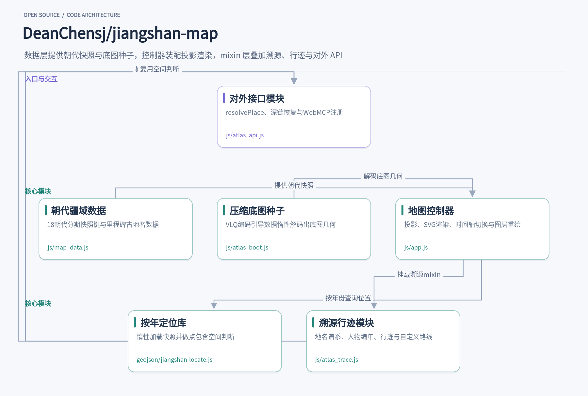

读史时最常见的困惑之一，是古地名和今天的地图对不上：六朝的建康、苏轼笔下的黄州、韩愈雪中驻马的蓝关，究竟在今天的哪里？从《资治通鉴》开篇的公元前 403 年到今天，疆域又是如何一步步从战国七雄演变为后来的版图？jiangshan-map（江山时序）把这些疑问收进了一张羊皮纸风格的交互地图：拖动时间轴，18 个历史时期的 198 张疆域快照按年份切换，点击任意古城即可查看它的地名谱系，搜索一位历史人物还能回放他的完整行迹。项目用纯前端 JavaScript 实现，GPL-3.0 协议，打开演示站就能直接上手。

## 1. jiangshan-map

> 一张可拖动的时间轴，装下中国 2400 余年疆域变迁

[DeanChensj/jiangshan-map](https://github.com/DeanChensj/jiangshan-map) · `JavaScript` · **6,683** stars · 今日 **+288** · `GPL-3.0`

读史时最常见的困惑之一，是古地名和今天的地图对不上：六朝的建康、苏轼写《赤壁赋》的黄州、韩愈雪中驻马的蓝关，究竟在今天的哪里？《资治通鉴》开篇的公元前 403 年到今天，疆域又如何一步步从战国七雄走到"秋海棠"再到"雄鸡"？jiangshan-map（江山时序）把这些问题收进了一张羊皮纸风格的交互地图：拖动时间轴，18 个历史时期的 198 张疆域快照按年份切换，点击任意古城就能看它的地名谱系，搜索一位历史人物可以回放他的完整行迹。项目是纯前端 JavaScript，GPL-3.0 协议，可以直接在浏览器里打开演示站体验。

整个数据模型的核心契约在 js/map_data.js：18 个朝代对象各自携带 fromYear/toYear、若干 phases 分期以及每期对应的快照键。以战国为例，从 s_zhanguo_a 到 s_zhanguo_e5 拆成 16 个阶段，前 316 年秦灭巴蜀、前 300 年燕将秦开辟辽东、前 230 年灭韩这样的疆域节点各占一个 phase。每个朝代还带 milestones 里程碑数组（年份、事件标题、发生地坐标）和 settlements 古地名数组（古名、今名、坐标、别名、消亡年份），时间轴上的事件气泡、地图上的古城标记都从这里来。这种"朝代—分期—快照"的三层结构，让两千四百年的连续变化变成了离散可切换的地图状态。

渲染与交互的宿主是 js/app.js 里的 HistoricalAtlasController，一个 ES6 类架构的控制器。它内置 MercatorProjector 投影类，把经纬度换算成屏幕坐标并支持大圆距离计算；地图用 SVG 绘制，图层包括疆域多边形、政区边界、河流改道、长城、运河与古城节点。用户拖动时间轴时，控制器根据年份匹配朝代与 phase 快照，重绘全部图层，并计算前一阶段的"Ghost Boundary"——用朱红色虚线叠出旧边界，让领土的得与失一眼可见。值得一提的是自动播放采用了事件驱动策略：播放头只跳到里程碑年份和快照边界，跳过约一千九百多个"什么都没发生"的年份，重绘地图的节点停留更久，普通事件停留时间刚好够读完标题。

首屏性能靠 js/atlas_boot.js 解决。它把初始海岸线等底图几何以 VLQ 变长编码压进一段 base64 字符串，启动时才惰性解码成坐标环，避免了首屏就拉取完整 GeoJSON。这种"压缩种子加按需解码"的做法对任何需要预置地理底图的前端项目都有参考价值。另一侧，geojson/jiangshan-locate.js 提供独立的按年定位能力：它只加载 index.json 加上覆盖目标年份的那一份快照（几百 KB），用射线法做点包含判断，输入 (经度, 纬度, 年份) 就能返回该点当年属于哪个政权、哪个大区、哪个郡。这个文件同时支持浏览器 script 标签和 Node require 两种引入方式，是一个可以单独复用的空间查询库。

两大特色功能以 mixin 形式挂在控制器上。js/atlas_trace.js 实现点地溯源、点人溯事：点击地图上的长安，卡片会按时间列出它在两千年里的历次名称与发生在那里的关键事件；搜索苏轼，地图会沿他的贬谪路线逐站回放，并支持多位人物行迹叠加对比，用不同颜色的轨迹线呈现。人物事件并非手写独立数据，而是从各朝代 milestones 的 persons 标签里收集再裁剪而成——_collectPersonEvents 会扫描里程碑文本，把提到这个人物的分句拆出来，配上对应地点坐标，甚至为君主级人物准备了从年表动态生成的临时档案。

对外能力由 js/atlas_api.js 收口。它暴露 resolvePlace、inspect、locate 等方法：resolvePlace 接受古今中英文地名（含别名、括号注记、行政区划后缀剥离），经过 strict、folded、substring 三轮匹配在战略关隘、古城、政区等候选里找到最佳结果，并做了细致的结果缓存。它还支持自定义多站路线——用 "长安;成都" 这样的分号语法声明多条轨迹，配合年份列表，控制器会逐站飞行并计算大圆距离。URL 查询参数可以完整恢复地图状态，形成可分享的深链，同时注册了 WebMCP 工具，让 AI 助手也能直接查询历史地理信息。

对想借鉴其工程思路的开发者来说，几处设计值得细看。一是 mixin 挂载模式：trace 和 api 模块在 install 时才绑定控制器引用，加载顺序无关，职责切分干净；二是 WeakMap 缓存贯穿渲染路径，形状包围盒、边界网格、人物事件结果都按引用缓存，避免重复计算；三是 resolvePlace 里对中文查询先做繁转简、对英文查询做多级归一化（撇号、空格、连字符折叠）再分级匹配，这套模糊匹配策略对任何多语言地名搜索都适用。仓库还附带一套 scripts 审计工具链（validate_atlas、audit_topology、repair_topology 等）用于校验数据一致性，仓库结构本身就是"数据密集型前端如何组织"的一个不错的样本。

对历史爱好者来说，jiangshan-map 是一个可以随手翻查的动态工具，读到某个年号时拖一下时间轴，疆域与古地名立刻对上号。对开发者而言，它示范了如何用纯前端技术组织一份体量不小的历史数据：时间轴切片、地名谱系、人物行迹三套数据各自独立又互相衔接，没有依赖后端服务，部署成本几乎为零。仓库在 GitHub 上开源，演示站即开即用，值得收藏进你的书签。
