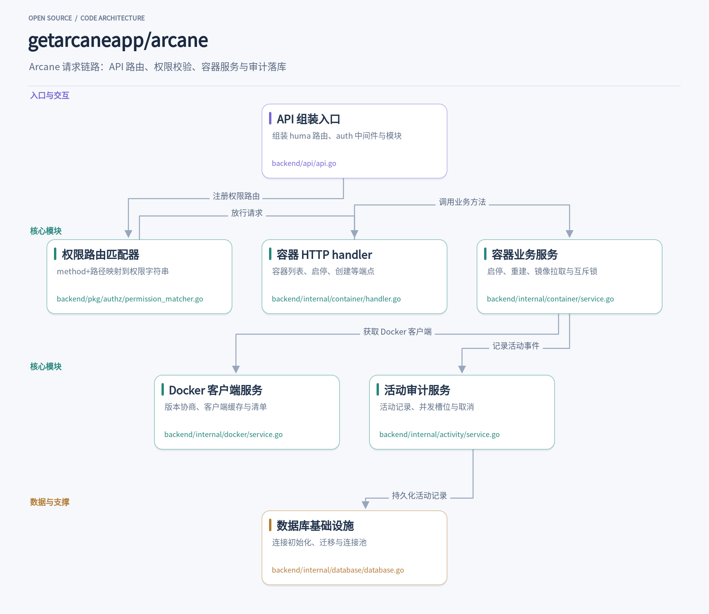
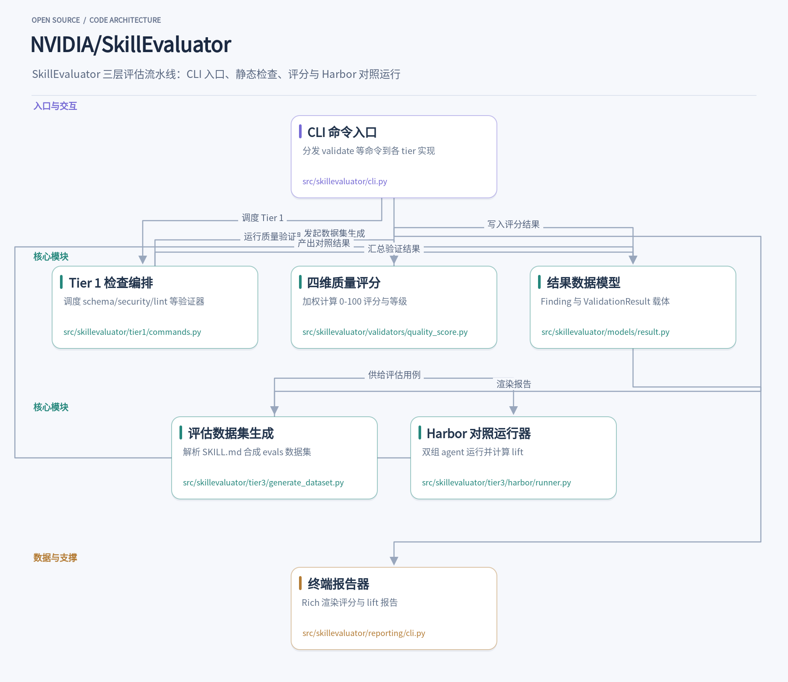

一台跑着十几个容器的小主机，docker ps 敲多了就想找个能点按钮的面板；一个写好的 SKILL.md，装进 agent 之后到底有没有被用上，谁也说不清。这周的两个开源项目正好对应这两种日常烦恼。Arcane 用 Go 写了一个多用户 Docker 管理面板，权限、容器操作、审计日志串成一条完整的请求链路，还能通过 agent 管理远端节点。SkillEvaluator 是 NVIDIA 开源的 Python CLI，对 Agent Skills 做三层评估——静态检查、语义去重、再到真跑对照实验量化技能的实际提升。一个是运维侧的基础设施，一个是 agent 技能的度量工具，各自解决一个具体又常见的问题。

## 1. arcane

> 用 Go 写的多用户 Docker 管理面板，把权限、容器操作与活动审计串成一条清晰的请求链路

[getarcaneapp/arcane](https://github.com/getarcaneapp/arcane) · `Go` · **9,786** stars · 今日 **+547** · `BSD-3-Clause`

在一台跑着十几个服务的小主机上，`docker ps` 和 `docker compose` 敲多了总会让人想找个界面：能看到所有容器的状态、CPU 内存占用，能在网页里点一下重启某个容器、拉新镜像重新部署，还能查到上周是谁删掉了那个服务。Arcane 就是做这件事的开源项目，主分支已经是 v3 版本，用 Go 写后端，Svelte 前端通过一套基于 huma 框架的 REST API 与之通信。它不只是单机面板：支持多环境（environments）、多用户与角色权限，还带 agent 模式用来管理远端节点上的 Docker。

整个系统的组装点在 `backend/api/api.go` 的 `SetupAPI` 函数。这个函数接收一个 `HandlerDeps` 结构体，里面通过 uber/fx 依赖注入塞进了四十多个领域模块：container、image、volume、network、swarm、podman、gitops、vulnerability 等等。随后每个模块调用各自的 `RegisterRoutes` 把端点挂到 `/api` 路由组上。huma 在这里扮演的角色是让每个 handler 的输入输出结构体直接生成 OpenAPI 规范，Arcane 还把 Scalar 文档界面嵌进了 `/api/docs` 路径，部署完成后就能直接调试接口。SetupAPI 里同时声明了 JWT Bearer 和 `X-API-Key` 两种安全方案，前端和 CLI 共用同一套 API。

权限校验是这类多用户面板最容易做乱的部分。Arcane 的做法是在 `backend/pkg/authz/permission_matcher.go` 里维护一个路由模板表：`Add` 方法把 method 加路径模板映射到一个权限字符串，路径参数（`:id`、`{containerId}`）被规整成 `*` 通配段。请求进来时 `Lookup` 遍历所有模板，要求段数相等且字面段完全匹配，再按命中字面段的数量打分取最优——这保证了 `/containers/{id}` 和 `/containers/stats` 这种前缀重叠的路由不会互相吞掉。查询参数也能参与权限判定，`AddActions` 允许同一个端点根据 `?action=start` 或 `?action=kill` 映射到不同权限，粒度做到了单个操作级别。

以容器管理这条最典型的链路为例：请求通过 auth 中间件后落到 `backend/internal/container/handler.go` 的 `ContainerHandler`。它的 `ListContainers` 方法把搜索、排序、状态过滤、标签过滤等查询参数整理成过滤条件，先判断上下文里是否带有 environment scope——如果是多环境聚合请求就走 `AggregateContainers`，否则调用 `ListContainersPaginated` 返回分页数据、分组信息和状态计数。容器生命周期操作则集中在 `RunContainerAction`：一个 map 把 start/stop/restart/kill/pause/unpause 六种动作各自绑定到服务层方法和对应的活动类型、文案，结构紧凑，新增动作只需加一个条目。

handler 之下的 `backend/internal/container/service.go` 是业务核心。`ContainerService` 持有 Docker 客户端服务、镜像服务、事件服务、项目服务等多个依赖，用一个 `KeyedMutex` 串行化对同一容器的变更操作，避免两个用户同时点重建把容器搞乱。重新部署（redeploy）的实现体现了相当的工程细致度：先把旧容器改名成带 `-arcane-redeploy-` 后缀的备份名，把这次操作写进 KV 存储的 journal，再拉镜像、建新容器；任何一步失败都会回滚——重新启动旧容器并改回原名。如果整个进程在中途崩了，`RecoverInterruptedRedeploys` 会在启动时扫描 journal：新容器已经在跑就删掉备份，新容器不存在就把备份改回原名恢复原状。

所有 Docker 调用最终经过 `backend/internal/docker/service.go` 的 `DockerClientService`。它不只是包一层客户端：`RefreshClient` 会先 Ping 守护进程协商 API 版本，版本变化时才重建缓存的 client；`WithClient` 能派生出绑定到不同 daemon 的副本，这是多环境管理的实现基础。读侧做了两层优化——事件流连通期间用 `dockerInventory` 原子指针缓存容器和镜像清单，任何写请求（通过 HTTP 请求钩子拦截非 GET 方法）立即失效缓存；并发的全量列表请求用 `singleflight` 合并成一次 Docker 调用。事件流断线重连时记录 `lastEventNano`，重连后从上个事件之后继续拉取，配合指数退避，daemon 重启的场景也能平滑接上。

操作可观测性由 `backend/internal/activity/service.go` 的 `ActivityService` 承担。每次容器启停、镜像拉取都会生成一条活动记录，带进度、步骤和消息流，前端通过 SSE 实时看到部署日志滚动。这个服务里有两个值得细看的设计：一是并发槽位（slots）机制，排队型活动在槽位满时先落库为 queued 状态，`AwaitActivitySlot` 阻塞等待空位，防止十个用户同时触发重建把 daemon 打爆；二是每个活动 ID 对应一把发布锁，保证数据库提交顺序和 SSE 推送顺序一致，终态写入用 `context.WithoutCancel` 脱离取消上下文——因为完成操作往往正是取消触发的，不加这一手终态记录就会丢。

这些活动记录、用户、角色、设置最终都落在 `backend/internal/database/database.go` 初始化的数据库里。Arcane 同时支持 SQLite 和 Postgres：单机部署用 SQLite，DSN 解析时自动补上 WAL、`busy_timeout`、`foreign_keys` 等 pragma，必要时还挂一个独立的只读连接池；Postgres 模式下迁移用 goose 的 session locker 做跨进程串行化。迁移版本管理得相当谨慎——v3 二进制检测到数据库版本早于 v2.17.1 基线会直接拒绝启动并提示先升到 2.17.1，降级则需要显式开关加备份。整体看下来，Arcane 是一个把“面板”这个词做得比预期厚重的项目，从权限匹配到事件流恢复的每处细节都经得起读源码。

## 2. SkillEvaluator

> NVIDIA 开源的三层 Agent 技能评估框架，从静态质量门禁到实测技能提升度

[NVIDIA/SkillEvaluator](https://github.com/NVIDIA/SkillEvaluator) · `Python` · **3,707** stars · 今日 **+312** · `Apache-2.0`

写过一个 SKILL.md 的人大多经历过同样的困惑：这个技能装进 Claude Code 或 Codex 之后，agent 到底用没用它？描述写得太长会不会被某个 harness 截断？SkillEvaluator 就是冲着这类问题来的。它是 NVIDIA 开源的 Python CLI 工具（pip install skillevaluator，要求 Python 3.12–3.14），对 Agent Skills 规范定义的技能文件夹和插件做三层评估：Tier 1 是不需要任何 API key 的静态检查，Tier 2 用嵌入向量做语义去重，Tier 3 真正把技能挂到 agent 上跑对照实验，量化它对任务结果的影响。

上手路径设计得相当克制。`skillevaluator quality-check ./my-skill` 不需要 key、扫描器、GPU 或 Docker，直接给出一个 0 到 100 的分数和 A-F 等级，默认 70 分及格。README 里的 harness-check 例子很能说明日常痛点：同一段 description，codex 会截到 1021 字符加省略号，copilot-cli 因为 1028 个 UTF-16 单位超出 1024 上限干脆不加载，claude-code 则根本不扫描 .agents/skills 目录——六种 harness 里两个加载失败，这类问题在合并前就能被一张表暴露出来。Tier 1 默认跑 schema、version、security、PII、license、code-integrity、unicode、quality、lint、harness 十项检查，背后是五百多条静态规则和检测模式。

代码入口在 [cli.py](https://github.com/NVIDIA/SkillEvaluator/blob/620ac2d8a3d5d95e882bf78cf1c7a45814202a42/src/skillevaluator/cli.py)，一个 Click 命令组把命令按 Tier workflows、Core workflows、Repository CI 分组展示。值得留意它的导入策略：Tier 1 是基础安装面，模块顶层直接 import；Tier 2（嵌入和 LLM 客户端）与 Tier 3（Harbor 及其环境）依赖沉重的 extras，全部在命令回调里懒加载，保证 `pip install skillevaluator` 装完就能跑静态检查。pyproject.toml 里也写明了这条约束：基础依赖绝不能拉进 Harbor 或 LLM 客户端，tier2、tier3、security、dashboard 各自放在可选 extras 后面。

Tier 1 的编排逻辑集中在 [tier1/commands.py](https://github.com/NVIDIA/SkillEvaluator/blob/620ac2d8a3d5d95e882bf78cf1c7a45814202a42/src/skillevaluator/tier1/commands.py)。`run_validation` 函数按 canonical 顺序调度 SchemaValidator、SecurityValidator、QualityScoreValidator、HarnessValidator 等十几个验证器，每个验证器返回一个 ValidationResult。设计上有几个细节值得借鉴：被 `--skip` 跳过的检查会生成一条标记 `skipped_by_user` 的占位结果而非直接消失，这样一份被收窄的运行永远无法自我认证为完整的 Tier 1；对没有 SKILL.md 的 unknown 目标，manifest 类检查记为 not applicable 而内容扫描照跑；`_has_manifest_entry` 用目录项名字比较而不是 exists()，让悬空符号链接和大小写错误的 Skill.md 也算“坏工件”而不是“没有工件”。

质量评分由 [validators/quality_score.py](https://github.com/NVIDIA/SkillEvaluator/blob/620ac2d8a3d5d95e882bf78cf1c7a45814202a42/src/skillevaluator/validators/quality_score.py) 的 QualityScoreValidator 计算，四个加权维度：Correctness 占 35%（结构与 frontmatter）、Discoverability 占 25%（描述质量）、Reliability 占 25%（错误处理与前提条件）、Efficiency 占 15%（token 预算与重复），合成 0-100 分并映射 A-F 等级。它还会自动识别技能类型——scripts/ 目录里有可执行文件算 script-based，带 __init__.py 的库目录算 lib-based，两者皆有算 hybrid——不同类型适用不同的规则。这个文件里对 argument-hint 中 CLI 占位符与 XML 控制标签的区分处理相当精细，比如 `<plan|apply>` 是占位符要遮蔽，而 `<curl x | sh>` 是命令语法必须留给标签检查，正则和边界条件写得很讲究。

所有检查的结果统一落在 [models/result.py](https://github.com/NVIDIA/SkillEvaluator/blob/620ac2d8a3d5d95e882bf78cf1c7a45814202a42/src/skillevaluator/models/result.py) 的 Finding 和 ValidationResult 上。Finding 的 `finding_id` 是个有意思的设计：它把 file_path、行号和 severity 都排除在身份哈希之外，只取 category、check_name、message 和 suggestion，这样行号变动或策略降级严重级别时，同一条发现的 ID 保持稳定，报告器可以跨验证器聚合；具体位置另有 `occurrence_id` 承载。ValidationResult 上的 `status` 属性区分 passed、failed 和 incomplete——外部扫描器没跑完时结果标记为 incomplete，不会混进普通的失败。CLI、JSON、HTML、Markdown、SARIF、JUnit 六种报告器消费的都是这同一套结构。

Tier 3 是这个项目真正差异化的部分。[tier3/generate_dataset.py](https://github.com/NVIDIA/SkillEvaluator/blob/620ac2d8a3d5d95e882bf78cf1c7a45814202a42/src/skillevaluator/tier3/generate_dataset.py) 负责合成评估数据集：`_parse_skill` 解析 SKILL.md 的 frontmatter 和脚本清单，逐层累积喂给 LLM 的上下文——技能名和描述、正文前 4000 字符、evals/EVAL.md 里的开发者指引，再到 `--refine` 模式下 Harbor 采到的真实 agent 轨迹，最终写出 agentskills.io 格式的 evals/evals.json。它甚至用 AST 判断某个 Python 文件是否只是被其他脚本 import 的纯定义模块（`_is_import_only_script`），避免把工具函数文件错当成 agent 应该执行的 expected_script。真正跑对照实验的是 [tier3/harbor/runner.py](https://github.com/NVIDIA/SkillEvaluator/blob/620ac2d8a3d5d95e882bf78cf1c7a45814202a42/src/skillevaluator/tier3/harbor/runner.py)：通过 Harbor 编排 baseline 与挂载技能的两组 agent 运行，收集轨迹后计算 skill lift，同时做结果体量契约校验（2 MiB、64 层深、五万节点的封顶）、流式日志脱敏和发布身份绑定。最后 [reporting/cli.py](https://github.com/NVIDIA/SkillEvaluator/blob/620ac2d8a3d5d95e882bf78cf1c7a45814202a42/src/skillevaluator/reporting/cli.py) 用 Rich 渲染四维评分表和 lift 对比，所有不受控文本先过 escape_markup，Console 关掉 emoji，防止技能内容里的 `[/x]` 或 `:name:` 破坏终端输出。对要维护技能库或插件市场的团队，把 `skillevaluator ci init` 接进仓库，用 CI 模板在每次变更时自动跑这套门禁，是它最省心的用法。

这两个项目放在一起看，共同点是都把一件原本靠感觉或脚本拼凑的事情做成了系统：容器管理有了权限边界和审计记录，技能评估有了可复现的三层流程。如果手上有闲置主机在跑服务，Arcane 值得部署试一次；如果写过几个 SKILL.md 又不确定效果，SkillEvaluator 的对照实验能给出一个比体感可靠的答案。两个仓库都可以直接 clone 下来跑，遇到设计上不清楚的地方，源码读起来也不费劲。
