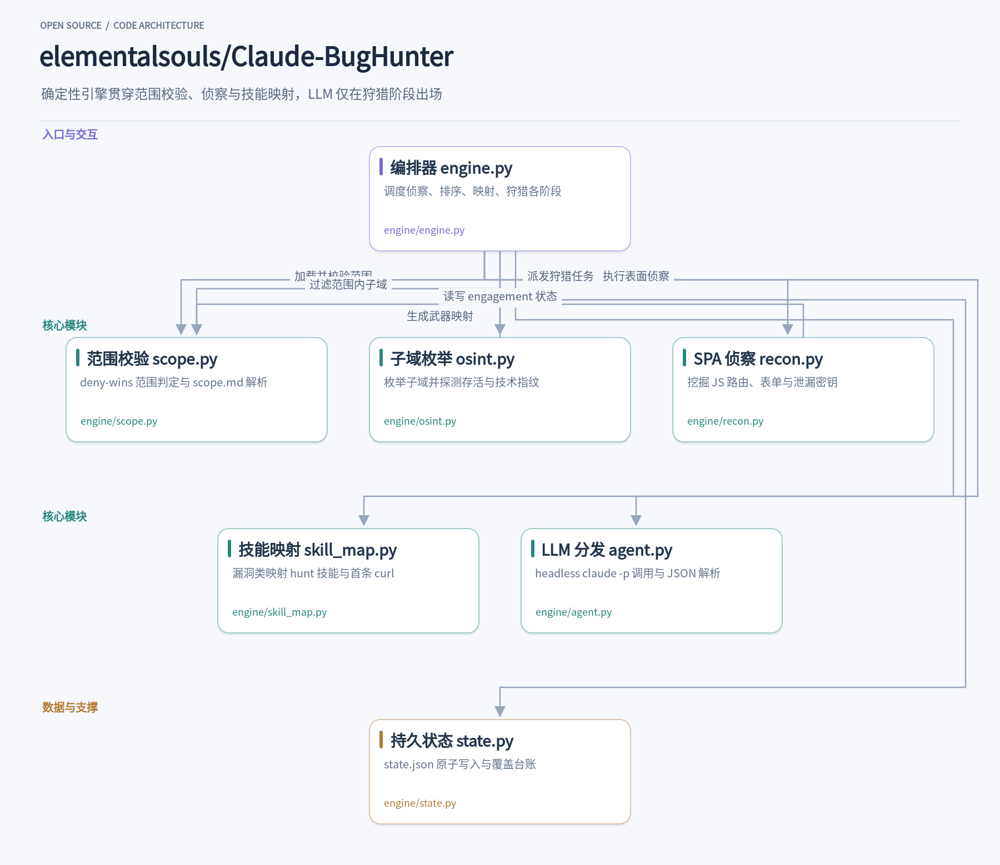
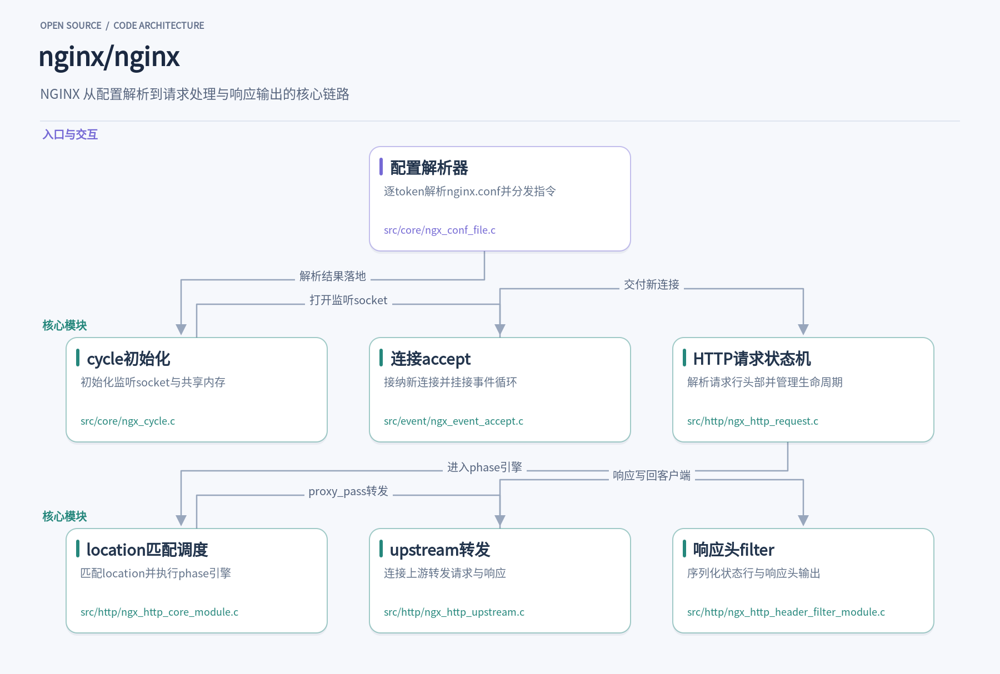

两个项目放在一起，场景差得很远。一个把 Claude Code 变成漏洞赏金研究的工具箱，83 个技能按话题自动触发，背后还有一台确定性引擎约束执行路径；另一个是撑起互联网大半流量的 NGINX，官方源码仓库如今就放在 GitHub 上，一条 nginx -s reload 背后是几十年打磨的进程模型与模块化设计。前者解决的是安全测试里知识零散、流程难复用的问题，后者回答的是万级并发下一台服务器如何保持稳定与可扩展。这篇博客分别展开：它们解决什么问题、怎样上手、内部模块如何配合，以及哪些设计细节值得搬到自己的项目里。

## 1. Claude-BugHunter

> 83 个狩猎技能加一台确定性引擎，把 Claude Code 变成会守规矩的赏金研究员

[elementalsouls/Claude-BugHunter](https://github.com/elementalsouls/Claude-BugHunter) · `Python` · **12,488** stars · 今日 **+1,349** · `MIT`

在 Claude Code 里输入一句 "Testing acme.com — an in-scope HackerOne target. Run recon and rank the surface"，几个相关技能会自动加载，先枚举子域、探测存活主机、识别技术栈，再告诉你应该从 api.acme.com 的 GraphQL introspection 和 auth.acme.com 的 OAuth 流程下手。这就是 Claude-BugHunter 的日常使用方式：它是一个面向漏洞赏金和外部红队的 Claude Code 技能包，83 个技能、15 个斜杠命令，从 681 份公开披露的 HackerOne 报告中整理出 24 类核心漏洞的检测模式、payload、绕过表和链式利用模板。技能按话题自动触发，不需要点名调用。

装好之后它解决的核心问题有两个。一个是知识问题：模型默认并不精通 OAuth redirect_uri 校验的十七种绕法，也不清楚 M365/Entra、Okta、vCenter 这类企业平台近年的 CVE 链和拿到凭据后的横向提权路径，技能包把这些沉淀成可加载的文本。另一个是纪律问题：赏金工作最忌越界和破坏，仓库在 engine/ 目录下配了一台确定性编排引擎，范围校验、状态持久化、调度去重全部是纯代码，LLM 只在侦察、狩猎、验证这几个真正需要判断力的阶段出场。

范围安全是整台引擎的地基，实现在 engine/scope.py。规则形式包括裸域名（匹配 apex 和任意子域）、*.通配符、精确主机、CIDR 网段和 re: 前缀的正则，匹配逻辑是 deny-wins：一条 out-of-scope 规则命中即拒绝，即使 in-scope 也同时匹配；没命中任何 in-scope 规则的默认拒绝。自测里专门防了后缀混淆，example.com.evil.com 和 notexample.com 都进不了门。scope.py 还能直接解析 hunt 脚手架生成的 scope.md，把从项目页面整行粘贴的 URL 自动降为主机名，否则带 scheme 的规则什么都匹配不上，整个 engagement 会静默变成全拒绝。

侦察阶段刻意不用模型。engine/osint.py 的 osint() 负责子域枚举：调 subfinder、assetfinder，再抓 crt.sh 的证书透明度数据，全部经 Scope 过滤后逐个探测存活和技术指纹。这里有个务实的细节——PATH 上的 httpx 经常是 Python 库而不是 ProjectDiscovery 的工具，_pd_httpx() 会校验 -version 输出里是否含 "projectdiscovery" 才敢用，否则回退到 curl 探测，保证脚本永远能跑。指纹识别靠响应头和页面标记，__next_data__ 对应 Next.js，wp-content 对应 WordPress，简单但够用。

engine/recon.py 处理的是 SPA 时代的真问题：现代站点每个路径都返回应用外壳，传统爬虫什么都找不到，真正的攻击面藏在 JS bundle 里引用的 API 路由和后端主机。spa_recon() 抓种子页和 robots/sitemap，拉同源 JS（默认最多 20 个），用一组正则挖相对 API 路由、绝对后端 URL、表单和 Next.js 数据路由，再按关键词启发式分类——参数名是 redirect、next 的归 open-redirect，路径含 /graphql 的归 graphql。同一批正则还做密钥扫描，AKIA 开头的 AWS key、sk-ant- 的 Anthropic key、JWT 都会被找出来，值做截断脱敏后直接作为 info-leak 类发现入库。

engine/skill_map.py 是自动化和专家操作之间的枢纽。CLASS_SKILL 把四十多个漏洞类别映射到具体的 hunt-* 技能，TECH_SKILL 按识别出的技术栈补充，CLASS_PROBE 给每个类别配一条可直接复制的首条 curl——SSTI 是 {{7*7}} 看有没有 49，SSRF 指向 169.254.169.254 的元数据地址。映射前会先扫描实际安装的技能目录（$CBH_SKILLS_DIR、仓库内 skills/、~/.claude/skills 三级解析），不存在的技能一律过滤，绝不指向没装的东西。engine.py 的 map 阶段把这些汇总成 arsenal.md：每个目标该用哪些技能、第一条 curl 是什么，让人把 20% 的专家精力花在 80% 自动化指出的地方。自动狩猎是 --hunt 显式开启的。

真正需要模型时走 engine/agent.py 的 run_agent()：以 headless 方式起 claude -p 子进程，注入 MCP 配置（有 Burp 时带上 send_http1_request、collaborator 等工具）和一份强制性的 Rules of Engagement——默认只读，禁止发邮件、禁止写操作、禁止实际使用暴露的凭据。回复要求以 fenced JSON 块结尾，extract_json() 从后往前找最后一个合法 JSON 解析成结构化数据。子进程超时、CLI 不在 PATH、usage limit 都返回带 error 字段的结构化结果而不是抛异常，单个二进制缺失不会炸掉整个阶段。一个反直觉的默认：技能在 agent 里默认关闭，注释里写明评估显示技能对 agent 能力提升近乎零却要多花 12-15k token。

engine/state.py 的 Engagement 类把一切落在磁盘上：每个 engagement 一个目录，state.json 存攻击面、工作清单、已测集合、候选与确认发现，写入用临时文件加 os.replace 原子替换；engine.log 追加式记录；evidence/ 存每个发现的证据文件。去重按 (url, param, vuln_class) 三元组，worklist 按优先级排序且过滤已测项，所以长时间运行可以随时杀掉再续跑。engine.py 的 hunt 阶段在派发前还有一道兜底范围闸门，出界目标直接记为 out_of_scope；候选发现的 PoC 若碰到了范围外主机会被 _scope_audit 扫出来打上标记。安装上它同时支持 Claude Code 插件和 git clone 后跑 scripts/install.sh 的复制安装，技能是标准 Agent Skills 格式，同一份安装可以铺到 OpenCode、Codex CLI 等多个 harness；cbh CLI 可用 pipx 单独装，HackerOne 凭据可选，留空不影响任何技能和公开工具。

## 2. nginx

> 从一条 nginx.conf 到万级并发背后的 C 语言工程典范

[nginx/nginx](https://github.com/nginx/nginx) · `C` · **32,323** stars · 今日 **+73** · `BSD-2-Clause`

深夜线上突发流量，运维同学的常规操作是往 nginx.conf 里加一段 location 规则，然后 nginx -s reload。几秒钟后新配置生效，业务无感知。这个看似简单的操作背后，是一套精心设计的进程模型和模块化架构在支撑。NGINX 的源码仓库（github.com/nginx/nginx）如今以官方身份开源在 GitHub 上，对于想理解高性能网络服务器如何运作的开发者来说，这份代码本身就是最好的教材。

NGINX 要解决的问题很明确：在单台机器上高效处理数万条并发连接，同时充当 Web 服务器、反向代理、负载均衡器和 API 网关。它用 master/worker 多进程模型替代了传统的每连接一进程/线程模型，master 进程负责读取和评估配置文件，worker 进程处理实际的数据。worker 数量可以在配置中固定，也可以设为 auto 自动匹配 CPU 核数。进程之间通过共享内存同步数据，这也是为什么速率限制等功能需要在配置中指定共享内存 zone——zone 的分配逻辑就在 src/core/ngx_cycle.c 里。

配置文件如何变成运行时行为？入口在 src/core/ngx_conf_file.c。ngx_conf_parse 函数逐字符读取配置，ngx_conf_read_token 做词法切分，处理引号、注释、转义和块结构。每个 token 序列被 ngx_conf_handler 接手，它遍历当前 cycle 中所有模块的 commands 数组，按指令名匹配，再校验参数数量、出现位置是否合法，最后调用该指令对应的 set 回调函数。整个解析器没有用 lex/yacc 之类的工具，几百行手写状态机覆盖了 NGINX 配置的全部语法，这种克制和自洽值得细读。

解析完成后的结果交给 ngx_init_cycle 落地。这个函数创建新的内存池，初始化 conf_ctx 数组，为每个核心模块调用 create_conf 和 init_conf，然后打开监听 socket、创建共享内存 zone、调用所有模块的 init 回调。reload 时新旧 cycle 的衔接逻辑也在其中：新的监听 socket 会尝试继承旧的文件描述符避免端口争用，共享内存 zone 如果名字和大小一致则直接复用旧的地址，保证限流计数器等状态在 reload 后不丢。这种对平滑升级的执着贯穿了整个代码库。

连接如何进入系统？worker 进程的事件循环里，src/event/ngx_event_accept.c 中的 ngx_event_accept 响应监听 socket 上的读事件。它循环调用 accept4 拿到新套接字，设置为非阻塞，从连接池里取一个 ngx_connection_t，分配独立的内存池，把读写事件处理器挂上去，最后调用 ls->handler 把连接交给具体的协议层——HTTP 就是其中之一。当描述符耗尽（EMFILE/ENFILE）时，它会主动关闭监听事件并设置 ngx_accept_disabled，用短暂的退避避免雪崩。对 Linux 上 EPOLLEXCLUSIVE 只唤醒第一个 worker 的问题，代码里也有针对性的重绑逻辑来均衡负载。

HTTP 请求的完整生命周期由 src/http/ngx_http_request.c 驱动。连接建立后先是 ngx_http_wait_request_handler 等待数据，收到字节后创建 ngx_http_request_t，进入 ngx_http_process_request_line 和 ngx_http_process_request_headers 两个解析阶段。头部处理用了一张静态表 ngx_http_headers_in，每个已知头部绑定了偏移量和处理函数，Host、Connection、Content-Length 等都有专门的逻辑。请求解析完毕后进入 phase 引擎，由 src/http/ngx_http_core_module.c 中的 ngx_http_core_find_location 做路由决策——静态前缀用三叉树加速，正则按声明顺序逐个尝试。

当 location 配置了 proxy_pass，请求被转交给 src/http/ngx_http_upstream.c。这个文件的体量在 HTTP 模块里数一数二，因为它要处理的事情实在太多：DNS 解析上游地址、建连、发送请求体、异步读取响应头和响应体、超时重试、故障切换到下一个 server、缓存查询与后台刷新。ngx_http_upstream_headers_in 表定义了上游响应头的处理策略——哪些透传给客户端、哪些忽略、哪些改写，比如 Location 头会经过 rewrite 处理。负载均衡的具体算法（轮询、哈希等）通过独立的 peer 模块挂接进来。

响应最终回到客户端要经过 filter 链。src/http/ngx_http_header_filter_module.c 中的 ngx_http_header_filter 是第一站，它把 ngx_http_headers_out_t 结构序列化为字节流：先精确计算所有头部的总长度，一次性分配缓冲区，再依次拷入状态行、Server、Date、Content-Type 等内容，避免了碎片化的多次小分配。状态码到文本的映射用了一张紧凑的静态数组，2XX/3XX/4XX/5XX 各占连续区间，直接索引取用。整个 NGINX 代码库没有炫技，但每一处取舍——内存池、静态表驱动、事件回调而非线程——都在为同一个目标服务：用最少的系统资源承载最多的并发。读这样的代码，学到的不只是一个服务器的实现，更是一种工程思维的范本。

Claude-BugHunter 的价值在于把散落在数百份漏洞报告里的经验压缩成可自动触发的技能，让重复的侦察工作有章可循；NGINX 则提醒我们，好的架构能支撑几十年的演进而不失去清晰度。一个是新兴的技能工程实践，一个是久经考验的系统设计范本，两者都在各自领域给出了可以直接阅读、直接借鉴的源码。有空的话，把仓库 clone 下来读一读，比看十篇架构文章更有收获。
