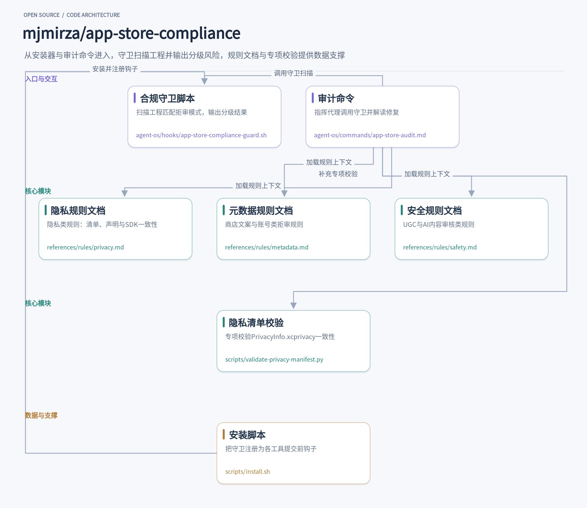

提审之后的等待最难熬：构建、上传、排队，几天后换来一封只有一两句话的拒信，开发者只能反复猜测到底是哪个权限声明或某行代码触发了审核员的注意，改一版再交，再等几天。mjmirza 的 app-store-compliance 把这个循环截断在提交之前。它是一个本地运行的检查工具，clone 仓库后跑一个脚本，把 Xcode 工程或 Android 项目目录传进去，它会扫描源码、Info.plist、权限声明和 Android 权限配置，输出一份按严重程度排序的风险清单，每条都带具体的文件路径和行号，以及对应的审核准则编号。小项目一秒左右扫完，大项目也不到一分钟。这篇文章顺着它的使用方式、内部模块和检查规则的设计展开，看看这类提交前检查工具是怎么把模糊的“审核经验”落成可执行的规则，以及哪些做法可以搬到自己的工程流水线里。

## 1. app-store-compliance

> 提交前用一条命令扫描 iOS/Android 工程，把 App Store 拒审风险变成带准则编号的修复清单

[mjmirza/app-store-compliance](https://github.com/mjmirza/app-store-compliance) · `Shell` · **2,724** stars · 今日 **+869**

每次提交 App Store 或 Google Play 之前的等待是很多移动开发者最煎熬的环节：构建、上传、排队审核，几天后收到一封只有一两句话的拒信，然后开始猜测到底哪里出了问题，改一版再交，再等几天。mjmirza 的 app-store-compliance 仓库把这段循环变成了一条可以在提交前运行的检查命令。clone 仓库后执行 agent-os/hooks/app-store-compliance-guard.sh，把你的 Xcode 工程或 Android 项目目录作为参数传入，脚本会在本地扫描源码、Info.plist、权限声明和 Android 权限，把命中的拒审风险按严重程度排序输出，每条带触发的文件和行号。小项目大约一秒扫完，大项目可能要一分钟，脚本会自己打印耗时。

扫描结束时最后一行是三种状态之一。CLEAR. 表示没有发现关键风险，可以继续做清单里的账号和商店文案检查；BLOCKED. 表示存在关键拒审风险，每条 [CRITICAL] 行下面都跟着一行 fix.，写明具体改法，修完再跑一遍；NOT CHECKED. 则说明目录里没找到 iOS 或 Android 工程，或者临时文件写不进去。守卫对跨平台框架也做了适配：Flutter、React Native/Expo、Ionic/Capacitor 项目都能识别，一个没有原生目录的托管 Expo 项目仍会读取 app.json 或 app.config 里的用途字符串、隐私清单和 Android 权限，想覆盖原生代码可以先跑 npx expo prebuild。

规则本身按类别组织在 references/rules/ 下，privacy.md、metadata.md、safety.md 这些文件里每条规则都注明平台、准则编号、严重级别、触发条件和修复方法，并附一段可直接执行的 grep 或 plutil 检测命令。以隐私类为例，APPLE-5.1.1-MISSING-USAGE-DESCRIPTION 规则捕捉"代码引用了 CLLocationManager 但 Info.plist 缺少对应用途描述"这类问题；APPLE-PRIVACY-MANIFEST-MISSING 针对 2024 年起 Apple 上传时强制校验的 PrivacyInfo.xcprivacy；还有针对 Flutter 插件和 React Native 原生模块的专门条目，比如 pubspec.yaml 依赖 permission_handler 或 geolocator 却找不到隐私清单的情况。值得注意的是这些 markdown 规则文件是从 data/rejection-patterns.json 生成的可读文档，守卫匹配时用的是结构化数据，md 文件主要供人和 AI 代理查阅完整准则上下文。

metadata.md 覆盖商店文案与元数据这一大块拒审来源：应用名超长、标题里带 emoji 或全大写、宣传"coming soon"的未上线功能、截图里出现 Apple 设备形象、中国区商店里引用外部 AI 服务、以及 2026 年起必须作答的社交媒体能力申报和新的年龄分级问卷。safety.md 则处理用户生成内容和 AI 生成内容的应用必须具备的审核机制——内容过滤、举报入口、屏蔽用户、公布的联系方式，这些在 guideline 1.2 下是关键级别。许多规则还标注了来源，有的镜像 fastlane precheck 的既有检查，有的来自真实的 Apple 拒审邮件，准则编号都能追溯到 Apple 或 Google 的官方页面。

除了独立运行，这个项目的另一大形态是装进 AI 编码工具里，让检查跑在每一次提交之前。scripts/install.sh 支持一条命令安装到 Claude Code、Codex、Gemini CLI、Cursor、Copilot、Grok、Qwen、Kimi 等十余种工具（--tool all 会装进它找到的所有工具），它把守卫脚本复制到工具配置目录，注册 PreToolUse 钩子，并合并各工具自己的配置文件；除 Claude Code 外需要 python3，Windows 上的 Claude Code 还会同时匹配 PowerShell 命令。装好后，代理每次要执行上传到 App Store Connect 或 Play Console 的命令前，钩子都会先扫描一遍，发现关键风险就拦截命令并输出报告，也可以用 APP_STORE_GUARD_OK=1 环境变量强制放行。

装进 Claude Code 时还会带上 agent-os/commands/app-store-audit.md 定义的审计命令，它相当于一套给代理执行的操作规程：先对项目根目录跑守卫拿到分级结果，再从技能目录加载与该应用类型匹配的规则文件补全上下文；如果用户把商店文案拉到了本地 metadata 目录，就运行 metadata-audit.py 审真实文案，还能用 --propose 写出修改建议；再跑 monitor.py 监控 Apple 开发者公告的更新影响；最后完成扫描器看不到的人工检查——演示账号可用且不设审不过的 2FA、生产后端在审核期间在线、隐私营养标签与运行时行为一致等，输出一张按严重程度排序的发现表。

在隐私这个最高频的拒审点上，仓库还提供了一个独立的专项校验：scripts/validate-privacy-manifest.py 检查 PrivacyInfo.xcprivacy 的内部一致性。Apple 在上传后会通过 ITMS-91xxx 邮件拒绝清单不合规的构建，一个二进制可能装进 TestFlight 却进不了审核。脚本按 TN3181 校验 NSPrivacyTracking 与 NSPrivacyTrackingDomains 的双向匹配（对应 ITMS-91064 的两种矛盾情形）、每个收集数据类型必须带全四个必填键、用途代码必须在白名单内、NSPrivacyAccessedAPITypes 不允许为空数组且每项要有理由代码。它由审计流程在需要时单独调用，作为对守卫粗粒度检查的补充。从整体设计看，这个项目值得借鉴的地方在于把"规则、检测、修复"三件事绑在同一条数据上：一条拒审模式既是扫描器的匹配目标，又是人可读的文档，还是 AI 代理的修复指引，一处更新处处生效。

对独立开发者和小的移动团队来说，这类工具的价值不在于保证过审，而在于把最常见的拒审原因提前摆到桌面上，省掉一轮来回数天的试错。即使不直接使用这个仓库，把它的检查思路接进 CI，在每次构建时跑一遍权限与声明扫描，成本很低，收益却可能是一次少等的两三天。感兴趣的话，仓库里的规则文件本身就是一份不错的拒审案例索引，翻一遍也值得。
