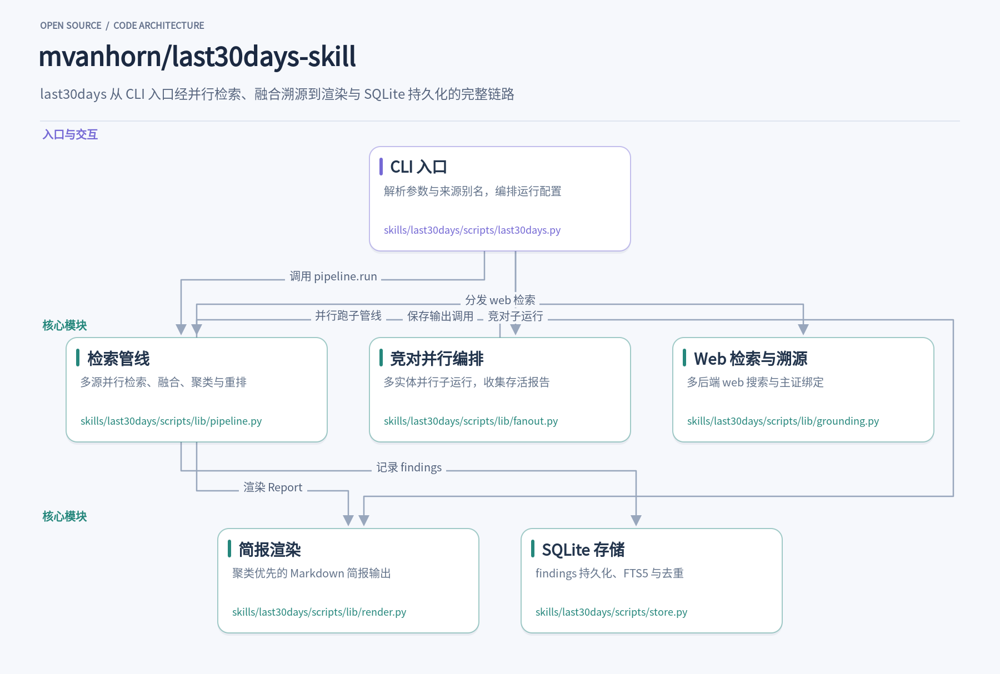

想了解一个不太熟的人最近在做什么，Google 给出的常常是几年前的静态页面。GitHub 上的 last30days-skill 提供了另一条路：一条 `/last30days <名字>` 指令，agent 会同时去 Reddit、X、Hacker News、Polymarket、YouTube、GitHub 等十几个平台搜索，把散落各处的近期动态合成一份可溯源的简报。这件事单靠任何一家模型的内置搜索都做不完整——ChatGPT 有 Reddit 数据但没有 X，Gemini 有 YouTube 却缺 Reddit，平台之间的墙决定了必须有人把这些数据源拼起来。这个项目就是那个拼接层，同时也是一个结构清晰、可以拆开学习的 agent 技能实现范本。

## 1. last30days-skill

> 一个让 AI agent 同时搜索 Reddit、X、HN、Polymarket 等十几个平台并生成有据简报的开源技能

[mvanhorn/last30days-skill](https://github.com/mvanhorn/last30days-skill) · `Python` · **71,989** stars · 今日 **+560** · `MIT`

明天要见一位不太熟的工程师，你先搜了他的名字，得到的大概率是几年前的 LinkedIn 页面。跑一句 `/last30days Peter Steinberger`，README 给出的示例输出是这个月的事情：加入了哪家公司、最近在哪个仓库提了多少 PR、X 上和人争论了什么、Reddit 社区对他评价如何。这些信息散落在 X 帖子、Reddit 线程、YouTube 字幕和 GitHub 提交里，Google 搜不到，任何单一 AI 也拿不到全貌——ChatGPT 有 Reddit 的合作但没有 X，Gemini 有 YouTube 但没有 Reddit。last30days 的切入点就在这里：它不是一个更好的搜索引擎，而是把十几个互不相通的平台的 API 和浏览器会话聚合起来，交给一个 agent 并行搜索、互相打分、合成一份简报。

安装侧几乎没有门槛。Claude Code 用户通过 plugin marketplace 一条命令装好；Codex、Cursor、Copilot、Gemini CLI 等五十多个 Agent Skills 宿主则用 `npx skills add mvanhorn/last30days-skill -g` 全局安装。Reddit、Hacker News、Polymarket、GitHub 不需要任何配置就能用；X、YouTube、TikTok、arXiv 这些源在首次运行时由设置向导在半分钟内解锁，用户自带自己的 key 或浏览器会话。运行时要求 Python 3.12 以上——入口脚本 `last30days.py` 里的 `ensure_supported_python()` 会在版本不够时直接退出并给出各平台的安装命令，这一点对分发成技能的脚本来说很实用。

整个项目的产品形态是一份技能（skill）：运行时规范写在 `skills/last30days/SKILL.md`，宿主 agent 读它来决定怎么调用脚本。真正的执行链从一个 CLI 开始，[`scripts/last30days.py`](https://github.com/mvanhorn/last30days-skill/blob/e63f8e8732f1b934449b363f211b3654531b8ef2/skills/last30days/scripts/last30days.py) 解析 `--search`、`--competitors`、`--deep-research` 等参数，把 `hn` 归一成 `hackernews`、`bsky` 归一成 `bluesky` 这类别名处理也在这里完成。值得留意的细节是意图驱动的源激活：当你显式传了 `--trustpilot-domain` 或 `--telegram-sources`，脚本会把对应源自动加进 `INCLUDE_SOURCES`，而不是默默忽略这个参数——源码注释里明确引用了忽略用户显式意图造成过的失败模式（#873）。这种“显式意图优先于默认配置”的处理方式，对任何做 CLI 配置解析的人都有参考价值。

检索的核心在 [`scripts/lib/pipeline.py`](https://github.com/mvanhorn/last30days-skill/blob/e63f8e8732f1b934449b363f211b3654531b8ef2/skills/last30days/scripts/lib/pipeline.py)。它导入的源适配器有几十个：reddit、hackernews、github、youtube_yt、tiktok、polymarket、arxiv、techmeme、linkedin、xiaohongshu 等等，每个都是 `lib/` 下的独立模块。调度不是简单的并发全发：`DEPTH_SETTINGS` 定义了 quick/default/deep 三档，分别限制每条流取多少条、候选池多大、重排取多少；`MAX_SOURCE_FETCHES` 对特定源设了硬上限——trustpilot 和 amazon 每次运行只会解析出一个公司标识或一个产品关键词，多发几个子查询纯属浪费额度，干脆封死在 1。每条流的等待有 180 秒的墙钟上限，卡死的源会降级成部分超时结果而不是拖垮整个 run()。这种“按源特性区别对待”的限额设计，比一刀切的并发池更贴近真实 API 的行为。

结果汇聚起来之后走的是一条标准的检索后处理链：`fusion.py` 里的 `weighted_rrf` 做多源倒数排名融合，`collapse_duplicate_urls` 按 URL 折叠重复项，`cluster.py` 聚类、`cluster_diversity.py` 保证簇间多样性，最后重排出 `schema.Report`。如果带 `--competitors` 标志，[`scripts/lib/fanout.py`](https://github.com/mvanhorn/last30days-skill/blob/e63f8e8732f1b934449b363f211b3654531b8ef2/skills/last30days/scripts/lib/fanout.py) 会把主实体和各竞对各跑一条完整管线，线程池并行、上限 6 路以免挤爆同一个后端的限流。fanout 的模块职责切得很干净：它不持有任何管线参数的业务逻辑，只接受调用方构造好的闭包；单个实体失败记日志丢弃，只要主实体加至少一个竞对活着就能出对比报告。结果按提交顺序而非完成顺序返回，保证渲染出的对比简报在不同运行间是确定的。

“有据可查”这件事落在 [`scripts/lib/grounding.py`](https://github.com/mvanhorn/last30days-skill/blob/e63f8e8732f1b934449b363f211b3654531b8ef2/skills/last30days/scripts/lib/grounding.py)。它一方面封装了 Brave、Exa、Serper、Parallel 四个 web 搜索后端，`configured_backend()` 按“用户自己有 key 的优先于代理服务”的规则自动选择，某个代理通道声明不可用就换下一个，不让 web 源整体失败。另一方面，`claim_source_map()` 只把拥有唯一主证 `SourceItem` 的候选结论暴露给后续的新鲜度校验——没有主证的说法根本不进入审计流程。日期处理同样细致：Serper 返回的相对日期（“2 hours ago”）会被 `_parse_serper_relative()` 按查询时刻的时钟解析，而不是按窗口终点，注释里专门解释了跨午夜时“23 小时前”该算昨天这类边界。日期过滤错误的直接后果是短窗口研究里 web 通道悄悄变空，这类细节决定工具是否可信。

渲染端 [`scripts/lib/render.py`](https://github.com/mvanhorn/last30days-skill/blob/e63f8e8732f1b934449b363f211b3654531b8ef2/skills/last30days/scripts/lib/render.py) 产出的是聚类优先的 Markdown 简报。第一行徽章带主题、时间窗口和技能版本，版本号从 `.claude-plugin/plugin.json` 读，读不到再回落到 SKILL.md 的 frontmatter，保证各种安装方式下徽章不会显示成 v?。正文按证据簇组织，每个簇列出得分、条目数、来源；没有任何簇越过相关性地板时，简报会诚实地写“Nothing solid this window”而不是硬凑结论。社区热评的筛选也讲平衡：LLM 打的幽默分是入场券（设了 40 分的底线），投票数只做放大器——一条 1700 赞的平淡吐槽永远进不了 Best Takes。另外每份简报都附一条安全提示，声明下方引用的标题、摘要和评论是未受信的互联网内容而非指令，这是给下游 agent 的提示注入防御。

最后一块拼图是 [`scripts/store.py`](https://github.com/mvanhorn/last30days-skill/blob/e63f8e8732f1b934449b363f211b3654531b8ef2/skills/last30days/scripts/store.py)，一个零依赖的 SQLite 累积器，数据库放在 `~/.local/share/last30days/research.db`。表结构是 topics、research_runs、findings 三层，findings 以 URL 唯一键去重，重复出现时更新参与度分数并累加 sighting 计数；FTS5 全文索引用 porter+unicode61 分词，靠触发器与主表同步；WAL 模式让 cron 定时任务和用户手动运行可以并发读写。整个仓库还有一条 Go 写的 MCP 侧线（`mcp/` 目录），把引擎包装成 MCP 工具并处理跨平台的进程组清理和缓存锁，`last30days.py` 里注册的 SIGTERM 处理器就是为了配合 MCP 超时杀掉引擎进程组时不遗留 node、yt-dlp 这类子进程。工程成熟度也体现在质量门槛上：`pyproject.toml` 设了 81% 的覆盖率下限，注释明确记录了测量口径变化时如何诚实地调整基线。从 CLI 到检索、融合、溯源、渲染、存储，last30days 把一条完整的研究管线装进了一个可分发的技能包。

last30days-skill 的价值有两层。对使用者来说，它把原本要开十几个标签页、跨平台拼图的信息收集压缩成一条命令，输出还带着可以点回去验证的链接。对想做 agent 应用的开发者来说，它的技能包结构、并行搜索与互相打分的设计、以及针对各平台反爬限制采取的不同策略，都是可以直接搬走的工程经验。源码在 github.com/mvanhorn/last30days-skill，README 里的示例输出足以判断它是否适合你的场景。
