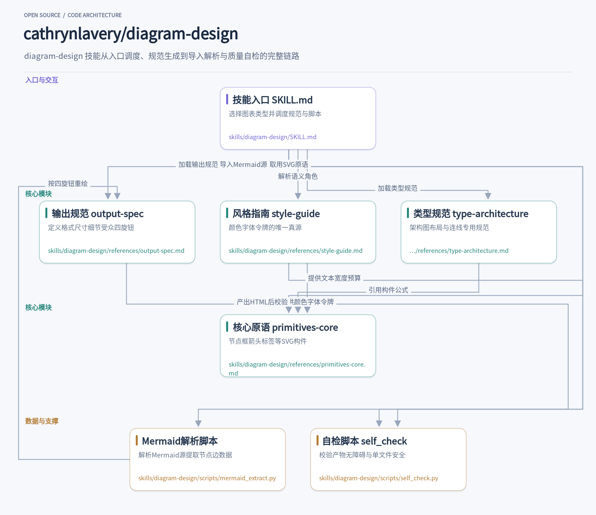
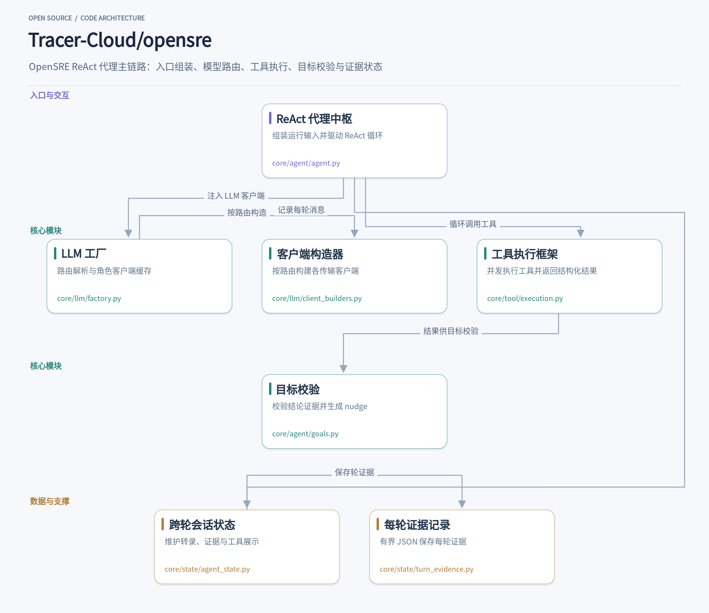
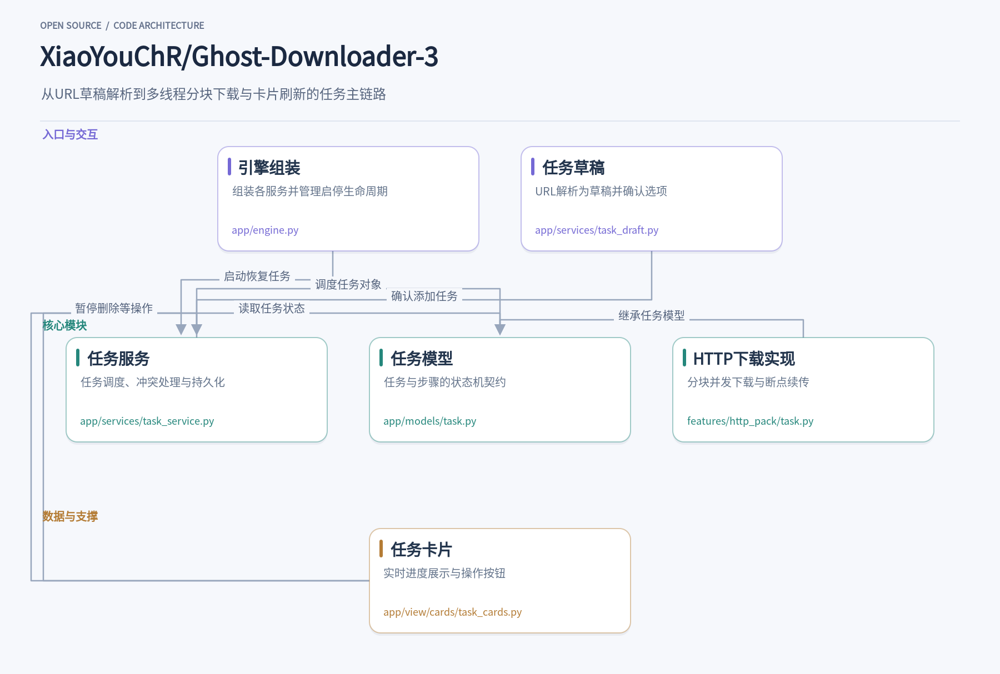

这周看的三个项目来自完全不同的方向。cathrynlavery/diagram-design 把“怎么画出好看的图表”写成一份给智能体读的规范，Claude Code 里一句话就能产出排版讲究的自包含 HTML+SVG 架构图。OpenSRE 立足凌晨两点 CI 变红的场景，自动读日志、测假设、区分环境问题和代码问题，再推一个修复提交等人审核。Ghost-Downloader-3 则解决另一类日常烦恼：断点续传和多协议下载，它用 pwrite 直接写文件偏移，省掉了分块下载后合并那一步。三个项目规模不一，设计上都有值得拆开看的地方。

## 1. diagram-design

> 让编码智能体产出编辑级自包含 HTML+SVG 图表的 Agent Skill

[cathrynlavery/diagram-design](https://github.com/cathrynlavery/diagram-design) · `HTML` · **70,283** stars · 今日 **+518** · `MIT`

在终端里对 Claude Code 或 Cursor 说一句“给我的应用画一张架构图：前端、后端、数据库、Redis 缓存”，几分钟后得到一个双击就能打开的 .html 文件——里面是内联 SVG、精心设计的排版和配色，而不是 Mermaid 渲染出的那种千篇一律的框图。这就是 cathrynlavery/diagram-design 解决的问题。它不是又一个画图库，而是一份给智能体读的“技能”（Agent Skill）：51 种图表类型的完整绘制规范、一套可换肤的设计系统和配套校验脚本，装进任何支持 Agent Skills 的宿主（Claude Code、Codex、Cursor、GitHub Copilot、Windsurf 等）就能用。安装只需 npx skills add cathrynlavery/diagram-design，Claude Code 里也可以走插件市场拿自动更新。

技能的指挥中枢是 skills/diagram-design/SKILL.md。智能体接到绘图请求后先读它：第 3 节是一张从“你想表达什么”到“用哪种视觉类型”的路由表——组件加连接的一张快照选架构图，时间排序的消息交互选时序图，任务依赖带环的选弧线图，共 51 种。路由分两层：先按行为特征匹配语义模式（比如“扇入队列/瓶颈”或“补偿性安全分层”），再落到最近的视觉类型，语义模式管行为原语和更紧的复杂度预算，类型规范管布局语法。这种“行为优先、布局其次”的分层选择，比单纯按图形名字挑选准确得多。文档还反复强调一个反直觉的原则：最高质量的动作通常是删除——九个节点以上多半该拆成两张图，连线在布局能表达关系时就应该去掉，目标密度 4/10。

确定类型后，智能体会先陈述计划（类型、尺寸预设、会被预算裁掉的内容），让用户有机会重定向，然后再加载对应的 type-*.md 规范动手绘制。以最常用的架构图为例，references/type-architecture.md 规定了按信任边界分组、主流向固定一个方向、虚线矩形标注 VPC 或安全组等布局约定，还给出两段直角肘形连线的 path 公式、箭头交叉时的桥接弧写法，以及管理域用横带、流量域用方框的嵌套包含语法。每个类型规范都配有反模式清单：所有节点都标珊瑚色会让层级崩塌，把托管数据库画进子网是在撒谎——只有它的私有端点才属于那里。仓库里还有几十个 verify-*.py 脚本在 CI 里逐类型验证这些约定。

视觉质量的底层来自两份文档。references/primitives-core.md 是共享的 SVG 构件库：节点框的五层结构（纸质底衬、描边框、矩形类型标签、无衬线名称、等宽技术副标签）、三色箭头 marker、底部图例条，以及六条“不可协商”的连线规则——直角连线强制、标签与线之间 6–10px 间隙、同边多连线扇形分布附着点、连线不得穿过非端点节点框。references/style-guide.md 则是颜色的唯一真源：所有规范都写语义角色（ink、muted、accent、link）而非十六进制值，换肤只需改这一个文件。默认皮肤是白烟纸底、墨黑、焦橘强调色的编辑风调色板，每个角色都有 WCAG 对比度契约，scripts/verify-contrast.py 会在 CI 里逐一核验。accent 有硬性纪律：每张图最多一到两个焦点元素，珊瑚色是编辑手法，不是标记系统。

从存量图表迁移也有完整链路。已有的 drawio、Mermaid、Excalidraw、PlantUML 源文件可以导入重绘——注意是“重绘”而非“转换”：SKILL.md 明确把“复刻 Mermaid 渲染器的布局”列为反模式，因为那会把自动间距和自动布线原样搬进来，丢掉编辑级排版。references/output-spec.md 用四个旋钮控制重绘结果：格式（html/svg/png）、尺寸（从 doc-inline 到 social-og、print-a4 共十档 viewBox 预设，每档带各自的字号阶梯）、细节层级（faithful/balanced/simplified，决定节点数上限和裁剪顺序）、受众（engineer/mixed/executive，同一个节点在三档下分别叫 Auth Service、Auth Service、Sign-in）。任何裁剪都要写进“保真台账”向用户报告——读者看不见图里少了什么，提问的人需要知道。

导入链路的工程实现相当克制。scripts/mermaid_extract.py 把 Mermaid 文本解析成规范化的中间表示（节点、边、ER 基数、象限点），支持 flowchart、时序图、状态图、ER 图和象限图五种语法，能直接读 Markdown 里的 mermaid 代码块。它的信任边界写在文件开头：只解析有界文本，永不执行、渲染或请求任何 Mermaid 内容，点击目标和样式指令计数后丢弃，标签只作为惰性文本输出。文件大小、节点数、边数、单条语句长度全部设了上限。输出侧的闭环由 scripts/self_check.py 完成——它随技能一起安装，让智能体自己验证产物：无障碍 SVG 契约（title/desc、role=img、唯一 ID）、单文件安全规则（除批准的 Google Fonts 样式表外无远程资源、无可执行属性）、绘制内容不越出 viewBox、文本宽度按字符预算（全角字符 1em）不超出所在框。中文标签有专门章节：Geist 不含 CJK，text 元素需扩展字体栈，且 12px 是 Han 字形的地板。

这个项目最值得借鉴的设计，是把“品味”拆成了可执行的约束。许多团队也想让 AI 产出好看的图，通常止步于一句“要美观”；diagram-design 把它拆成对比度比值、字号阶梯、连线圆角半径、标签遮罩间隙、焦点元素上限这些可校验的数字，再用几十个 verify 脚本在 CI 里守住，SKILL.md §9 的“品味门”则要求智能体产出前自查。第二个借鉴点是把技能本身当作产品内容来写：SKILL.md 不是安装说明，而是给智能体的操作手册，靠结构化 Markdown 而非代码驱动行为。第三个是渐进信任：默认皮肤开箱即用，但首次在项目里画图会触发“风格门”，提示你用网站 URL 或设计系统生成品牌皮肤并保存为 profile。如果你在写需要 LLM 遵守复杂规范的应用，这份 repo 的文档结构本身就是范本。

使用上有几个实际取舍值得知道。产物默认依赖一次 Google Fonts 请求来加载 Instrument Serif、Geist 和 Geist Mono；要完全离线，把字体源切到 system 模式即可，self_check.py --offline 会确认链接已移除。PNG 和 SVG 导出都从 HTML 派生，规范明确禁止手写独立 SVG 文件——HTML 是唯一真源，所有质量门都针对它写。仓库语言标注为 HTML、MIT 协议，官方构建只来自这个仓库，README 里列出了各宿主的安装路径和隐私说明链接。对想在文档、博客或演示里摆脱“AI 味”图表的开发者，这是目前把设计规范工程化做得最彻底的一套开源方案。

## 2. opensre

> 开源 CI/CD 可靠性代理，用可复用 ReAct 循环替你调查失败的流水线

[Tracer-Cloud/opensre](https://github.com/Tracer-Cloud/opensre) · `Python` · **14,402** stars · 今日 **+399** · `Apache-2.0`

凌晨两点，CI 变红。流水线只告诉你某一步失败了，日志几百行，错误信息散在三个 job 里。多数团队的应对是再跑一次，赶上线的人没空做根因分析，flaky 检查越积越多，main 分支长时间红着。OpenSRE（github.com/Tracer-Cloud/opensre）就是冲着这个场景来的：一个开源的 SRE 代理，CI 失败后自动读日志、测试假设、区分是 CI 本身的问题还是代码引入的问题，然后推一个修复提交等人审核。它自托管、模型自选，Apache 2.0 协议，Python 3.12 起步。

上手路径很短。macOS 或 Linux 上 `curl -fsSL https://install.opensre.com | bash` 一条命令装好，运行 `opensre` 登录即可。默认激活托管模型，但项目反复强调的核心卖点是用你自己的模型：Anthropic、OpenAI、Bedrock、Ollama 以及各类 OpenAI 兼容端点都支持。它也处理生产事故——把 Grafana、CloudWatch、Datadog、Kubernetes、Slack、GitHub 这些集成接进来，在交互 shell 里描述事故，代理自己挑合适的工具去查日志、看指标、翻 pod 状态和部署历史。README 里明确说项目处于 public alpha，API 和集成还会演化。

所有交互界面（shell、Slack 网关）背后跑的是同一个代理，定义在 `core/agent/agent.py`。这个 `Agent` 类刻意保持薄：构造时注入 LLM 客户端、系统提示、工具列表和迭代上限，`run()` 只负责把配置组装成一次运行的输入，然后交给 `run_react_loop` 去跑真正的“思考—调用工具—观察”循环。作者在文件头注释里写得很直白：Agent 不包含循环本身，它只持有配置，并通过几个 mixin（事件发射、工具过滤、转向控制）提供循环回调的钩子。想定制工具过滤逻辑，子类化即可，不必重写循环。

模型接入层是另一处值得细看的设计。`core/llm/factory.py` 把 provider 与传输方式的路由决策收拢到 `resolve_llm_route()` 一个函数里：CLI 代理、LiteLLM 还是原生 SDK，Azure 路由怎么走，只决策一次，之后所有角色复用。角色分四档——AGENT 是带工具调用的客户端，REASONING、CLASSIFICATION、TOOLCALL 分别对应流式推理、中档分类和轻量工具选择。`get_llm(role)` 是唯一入口，按配置键缓存客户端，`/model` 切换后调 `reset_llm_clients()` 清缓存。具体客户端的构造在 `core/llm/client_builders.py`，其中 OpenAI 兼容 provider、自定义 Anthropic 端点、Bedrock 的双客户端各走各的分支，构造导入全部延迟到函数内部，避免模块导入时拉起整个 provider 栈。

工具执行框架在 `core/tool/execution.py`，这是代理的“手和眼”。`execute_tool_calls` 接收模型请求的工具调用列表，按 provider 顺序返回结构化结果，但连续的并发安全调用会一起跑在线程池里，上限由 `MAX_CONCURRENT_TOOL_CALLS` 控制。规则考虑得很细：会结束回合的调用必须独占响应，记账类调用排在它前面；回合一旦终止或宿主取消，未启动的调用全部跳过，但仍各生成一个错误结果——因为 provider 要求每个 tool-call id 都有应答。执行前后有 `before_tool_call` / `after_tool_call` 生命周期钩子，`compose_tool_execution_hooks` 能把多组钩子按序合成，任何一组拦截即阻断。每个结果都是冻结的 `ToolExecutionResult`，错误也结构化返回给模型。

循环何时结束由 `core/agent/goals.py` 决定，这里是整个项目理念最清楚的地方：结论必须有证据。`should_accept_with_goal` 在循环想收尾时检查目标是否达成——默认规则要求最终文本非空且至少有一条工具返回的证据，否则生成一段 nudge 提示注入回去，让代理继续收集证据或采取行动。到了迭代上限目标仍未满足，循环输出的是“未完成的交接”而不是接受一个没有支撑的结论，每次接受或拒绝都通过 `record_decision` 记入可观测性系统。默认校验只是廉价兜底，`Goal` 支持自定义 `verify` 回调和 `nudge` 文案，把验收标准交给调用方定义。

跨轮状态由 `core/state/agent_state.py` 的 `MutableAgentState` 管理，它只保留必须跨回合存活的东西：消息转录、每轮证据、会话已展示的工具列表。每轮文本默认窗口 12 轮，超出部分压缩成会话摘要；开了结构化历史则改用基于 token 的压缩。真正记录“代理做了什么”的是 `core/state/turn_evidence.py` 的 `TurnEvidence`：每轮以有序的 JSON 条目保存用户原话、每次工具调用及其结果、最终回复，连 provider 原始消息（含推理内容）都按客户端绑定存档，同绑定的客户端后续可以逐字节重发。`cap_text` 截断时保头保尾，因为工具输出的形状在开头、结论在结尾。证据按文本从新到旧匹配回转录，匹配不上的对话自动降级为纯文本回放，宁可退化也不回放错误的轮次——这种对证据链完整性的执念，正是做根因分析的代理该有的工程底色。

对想借鉴 Agent 架构的开发者，这个仓库有几处可以直接抄的思路：路由决策收敛到单点并全局复用，避免不同客户端漂移；代理与循环分离、以钩子扩展；结论验收与预算管理解耦成独立的 Goal 对象；证据与转录双轨存储、按需降级。再加上 import-linter 管住的模块边界和覆盖到每层包的 vulture 配置，它展示的是一个认真当产品做的代理框架，而不只是一个能跑的 demo。

## 3. Ghost-Downloader-3

> 一个用 pwrite 直写文件偏移、免分块合并的多协议下载器

[XiaoYouChR/Ghost-Downloader-3](https://github.com/XiaoYouChR/Ghost-Downloader-3) · `Python` · **15,116** stars · 今日 **+701** · `GPL-3.0`

下载大文件时最让人头疼的场景大概是这样：网络时好时坏，任务下到一半断了，重新来过又要把已下载的部分重走一遍；或者服务器限制了单连接速度，明明带宽充足，下载器却跑不满。Ghost-Downloader-3 把这两件事都处理得比较干净。它是一个跨 Windows、macOS、Linux、Android 四端的开源下载器，用 Python 和 PySide6 写成，支持 HTTP、磁力/BT、FTP、M3U8、MPEG-DASH、eD2k 等协议，B 站和 YouTube 的解析、GitHub 与 HuggingFace 的镜像加速则以插件包的形式挂在主程序之外。项目在 GitHub 上有一万五千多星，GPL-3.0 协议。

它的多线程下载不落临时分片文件。很多下载器把文件切成若干块分别下载、最后拼接，而这里每个 subworker 直接用 `pwrite` 把数据写进目标文件的不同偏移（见 [features/http_pack/task.py](https://github.com/XiaoYouChR/Ghost-Downloader-3/blob/4f57c5aa98934c66b450a44b0b23edcf5a27daec/features/http_pack/task.py) 中 `_runSubworker` 的 `pwrite(fd, chunk, subworker.position)`），文件从下载第一秒起就是最终形态，只是中间有空洞。断点信息记录在同目录的 `.ghd` 侧文件里，每个 subworker 的 start、position、end 以 24 字节一组紧凑打包，`_loadRecord` 在恢复时直接读回分片布局，继续从断点写。

慢分片处理也值得看。`_splitSlowest` 会找出剩余字节最多的 subworker，把它一分为二：原分片保留前半段，新建一个 subworker 接管后半段，立刻作为新的协程任务并发下载。`_reassignSubworker` 在剩余量超过阈值时触发这一刀。更进一步的 `_autoSpeedUp` 维护最近五秒的速度历史，只有当速度足够平稳（最大偏差不超过均值 15%）时才认定当前处于稳定状态，然后一次性补四个分片，五秒后比较“分片增长比”和“速度提升比”——如果速度提升不到分片增长的八成，说明服务器端已限速，自动加速就此关闭，不再无谓地加连接。

任务的入口是一条“草稿”流水线。用户粘贴 URL（或浏览器扩展推送进来）后，`app/services/task_draft.py` 里的 `TaskDraft` 为每个 URL 建 `DraftItem`，把解析请求提交给 FeatureService，解析完成后生成具体的 Task 供用户确认目录、文件名等选项。这里有个很讨巧的实现：`setUrls` 用 `difflib.SequenceMatcher` 对新旧 URL 列表做 diff，相同的区间原样保留，只对新增的 URL 发起解析、对消失的 URL 取消协程，避免用户在输入框里每敲一个字符就触发全量重解析。

确认之后任务进入 `app/services/task_service.py` 的 `TaskService`。它内部的 `TaskStore` 在添加任务时会为输出文件创建占位记录，遇到同名文件按配置走“保留两者 / 覆盖 / 询问”三种策略，自动重命名为 `name(1).ext` 的形式；持久化则写入 `tasks.jsonl`，每行一个任务的 JSON 序列化，先写临时文件再原子替换。队列部分由 `TaskQueue` 管理，`resumeSaved` 在应用启动时恢复全部历史任务。`app/engine.py` 的 `Engine` 把这些服务组装起来：任务服务、限速表、功能包、浏览器扩展监听和 aria2 兼容 RPC 各自接线，`start()` 里依次恢复任务、激活插件、启动两个端口监听。

各协议共享的任务抽象在 `app/models/task.py`。`Task` 持有一组 `TaskStep`，每个 step 有独立的状态机（WAITING/RUNNING/PAUSED/COMPLETED/FAILED），任务整体状态由选中的 step 聚合而来：任一失败即失败，全部完成才算完成。HTTP 下载就是单个 `HttpTaskStep`；B 站这类站点的任务会由多个 step 组成，比如先取视频流、再取音频、最后合并。子类通过 `__init_subclass__` 自动注册到类注册表，`fromDict` 反序列化时按 `模块名.类名` 还原出具体协议的子类，这让 tasks.jsonl 里的记录重启后能精确恢复。

界面层的代表是 `app/view/cards/task_cards.py` 的 `TaskCard`。它用声明式的 `FieldSpec` 和 `ButtonSpec` 描述信息栏与按钮：速度、ETA、大小三个字段各绑定一个按任务状态返回文本的函数，暂停/继续按钮的状态表会根据 RUNNING、COMPLETED 等状态切换图标和可用性——BT 任务完成后这个按钮变成做种开关。校验值按钮上叠了一个 `ProgressRing`，计算 MD5/SHA256 时图标位置换成小进度环，计算中再点一下即取消，这些操作最终都回调 `TaskService` 的对应方法。状态没变且不在运行时，`refresh` 直接跳过重绘，避免列表长时的无谓开销。

对想借鉴的开发者来说，有三处设计值得抄作业：pwrite 直写偏移加轻量进度侧文件的断点方案，省掉了合并阶段也简化了磁盘占用；用 SequenceMatcher 做 URL 列表增量解析，思路可以推广到任何“编辑中的列表需要后台逐项处理”的场景；以及协议以 pack 形式外挂、共享 Task/TaskStep 契约的插件架构，HTTP、BT、M3U8 各自实现 step 的 `run`，主程序只认状态机。网络层用 wreq 构建带真实浏览器 TLS 指纹的客户端，配合 `matchRange` 按 RFC 9110 校验 Content-Range，这些细节让它在反爬环境下的表现比普通下载器扎实得多。

diagram-design 的价值在于证明了“给智能体的技能”可以做到什么精细程度；OpenSRE 把 ReAct 循环落到 CI 排障这个足够窄、足够疼的切口上；Ghost-Downloader-3 则展示了客户端工具在协议覆盖和文件写入策略上还能怎么抠细节。三个仓库都值得 clone 下来翻翻源码，前两个可以直接装进日常工具链试用。
