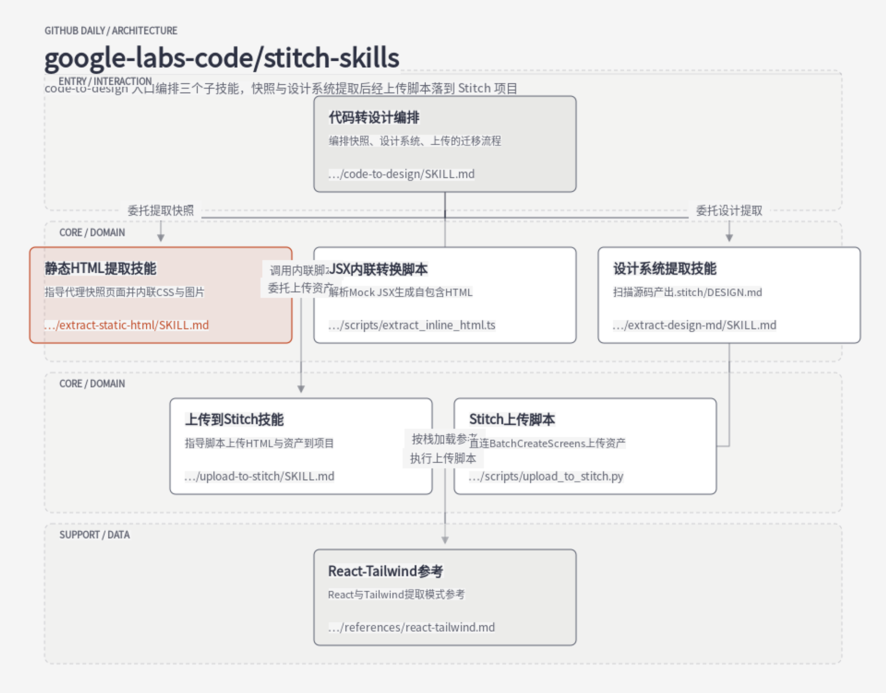

本地跑着一个 5173 端口的 React 后台，对 Claude Code 或 Cursor 说一句“把这个 dashboard 上传到 Stitch 项目”，起快照、抽取设计系统、上传资产这些后续步骤就由技能包办。google-labs-code/stitch-skills 是一套遵循 Agent Skills 开放标准的技能库，与 Google Stitch 的 MCP 服务器配套，Gemini CLI、Codex 也能直接加载。仓库主体是一个个 SKILL.md 加配套脚本，语言统计里的 TypeScript 与 Python 大都来自这些工具，把“如何与 Stitch 打交道”同时写成了代理可读的说明书和可以直接执行的代码。

## 1. stitch-skills

> 一套 SKILL.md 编排的代理技能库，一句话把前端应用搬进 Google Stitch

[google-labs-code/stitch-skills](https://github.com/google-labs-code/stitch-skills) · `TypeScript` · **12,347** stars · 今日 **+422** · `Apache-2.0`

一个跑在 localhost:5173 的 React 后台，加上一句“把这个 dashboard 上传到 Stitch 项目”，编码代理就能接手剩下的活：起快照、抽设计系统、传资产。这背后是 google-labs-code/stitch-skills，一套遵循 Agent Skills 开放标准的技能库，为 Google Stitch 的 MCP 服务器配套，兼容 Claude Code、Gemini CLI、Cursor、Codex 等代理。仓库的主角是一个个 SKILL.md 加配套脚本，语言统计里的 TypeScript 与 Python 大都来自这些工具。

它解决的问题很具体：已有应用想回到设计态继续迭代，手工重画成本高，截图又丢掉样式语义。这个库把能力拆成 stitch-design、stitch-build、stitch-utilities 三个插件，覆盖设计工作流、组件生成与辅助工具，`npx plugins add google-labs-code/stitch-skills` 可以装进 Claude Code 或 Cursor，Codex 走 marketplace，`npx skills add` 支持按技能挑选。前提是 Stitch MCP 服务器已在代理环境配置好，技能库本身不含后端。

迁移链路的入口是 [code-to-design 的 SKILL.md](https://github.com/google-labs-code/stitch-skills/blob/9f4e828e77634e230978be45fec5501554dbe4b2/plugins/stitch-design/skills/code-to-design/SKILL.md)。frontmatter 里的 description 写得相当强硬：用户表达“保存”“迁移”“上传”现有应用的意图时必须用这个技能，即便只是简单 save，因为只有它能保证设计系统被提取、资产被正确关联。正文把流程拆成五步，逐步委托给 extract-static-html、extract-design-md、manage-design-system、upload-to-stitch，自己只做编排。description 兼职路由规则，这个写法值得抄。

[extract-static-html 技能](https://github.com/google-labs-code/stitch-skills/blob/9f4e828e77634e230978be45fec5501554dbe4b2/plugins/stitch-design/skills/extract-static-html/SKILL.md) 负责把运行中的页面变成单文件 HTML。技能先给用户摆两条路线：Puppeteer 快照保真最高、零配置，浏览器子代理适合要先填表单点按钮的场景。快照脚本从 document.styleSheets 抓 CSSOM，Vite 开发态与 CSS-in-JS 的动态样式都能收进来；图片、srcset、图标字体统一转 base64；`--html-class dark` 切深色模式，`--auth-script` 挂登录逻辑，`--inline-canvas` 把 ECharts 画布序列化成图。

应用实在跑不起来时还有静态兜底：手工压平一个 MockPage.jsx，交给 [extract_inline_html.ts](https://github.com/google-labs-code/stitch-skills/blob/9f4e828e77634e230978be45fec5501554dbe4b2/plugins/stitch-design/skills/extract-static-html/scripts/extract_inline_html.ts)。脚本用 @babel/parser 解析 JSX，避开脆弱的正则；抓图环节带并发限制器和 SSRF 校验，isSafeUrl 拦下内网地址与重定向循环，CSS url() 的提取干脆逐字符扫描。工具细节做得扎实，代理执行时的失败率才压得下来。

设计系统侧的 [extract-design-md 技能](https://github.com/google-labs-code/stitch-skills/blob/9f4e828e77634e230978be45fec5501554dbe4b2/plugins/stitch-design/skills/extract-design-md/SKILL.md) 无需构建或渲染，直接读源码。它先看 package.json 判断技术栈，再按需加载 references/ 下的框架知识，React 项目读 [react-tailwind.md](https://github.com/google-labs-code/stitch-skills/blob/9f4e828e77634e230978be45fec5501554dbe4b2/plugins/stitch-design/skills/extract-design-md/references/react-tailwind.md)，其中规定 tailwind.config.js 优先级最高，其次才是 globals.css 与 theme 文件。产出写入 .stitch/DESIGN.md，头部必须带 name 和 colors 的 YAML 块，颜色按功能角色分组并取描述性名字，例如 Deep Muted Teal-Navy，供下游技能解析复用。

上传环节最能体现用脚本补模型短板的思路。MCP 工具调用的参数属于模型输出，一个 53KB 的 PNG 编码成 base64 约七万字符，远超约 16K 的输出上限，中途必然截断。[upload_to_stitch.py](https://github.com/google-labs-code/stitch-skills/blob/9f4e828e77634e230978be45fec5501554dbe4b2/plugins/stitch-design/skills/upload-to-stitch/scripts/upload_to_stitch.py) 绕开模型，进程内读文件、编码，直接 POST 到 BatchCreateScreens 接口，HTML 走 htmlCode 字段、图片走 screenshot，`--title` 建议填路由路径方便识别。执行前 [upload-to-stitch 技能](https://github.com/google-labs-code/stitch-skills/blob/9f4e828e77634e230978be45fec5501554dbe4b2/plugins/stitch-design/skills/upload-to-stitch/SKILL.md) 强制代理把文件路径与大小报给用户确认，这个 checkpoint 设计值得借鉴。

整套库可借鉴的骨架是三层：SKILL.md 管编排与路由，references/ 放按需加载的框架知识，scripts/ 放确定性执行。中间产物统一落在 .stitch/ 目录，HTML 快照与 DESIGN.md 成为可复用的本地状态，其他技能接着消费；技能之间显式声明依赖，选择性安装时要把前置带齐。把自己的领域工作流照这个模子拆解，配上 MCP 后端，是一条可复制的代理生态接入路径。

看这个仓库的收获，除了 Stitch 集成本身，还有 SKILL.md 这种组织方式：触发条件、步骤说明和脚本收在同一个技能目录里，代理读得懂，人也能接着维护。想给自己的内部工具配一套代理技能，照这里的结构写一遍，比从零琢磨格式省事得多。
