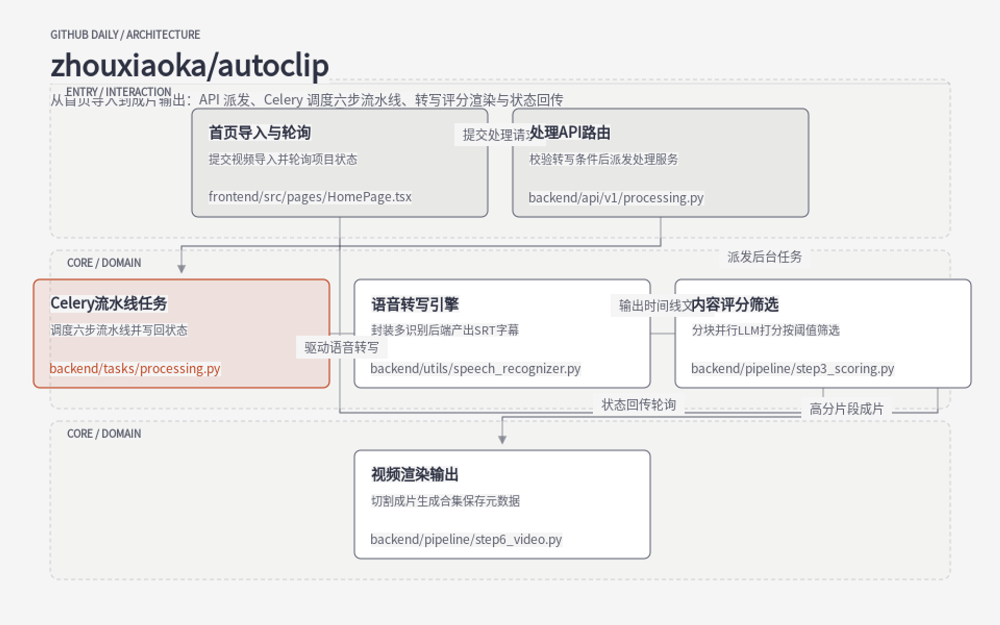

两小时的播客录完，想发抖音和 YouTube Shorts，过去要自己翻时间轴找高光、剪竖屏、上字幕、写文案。AutoClip 把这条链路压成一次导入：贴一个链接或选本地文件，它转写音频，用 LLM 挑出值得剪的片段，切出竖屏成片，烧上字幕，连封面和标题也一起出。项目在 GitHub 上已有超过一万五千星，MIT 协议，核心用 Python 写，桌面壳是 Tauri。本地优先是它最明确的取舍：剪辑和渲染全在自己机器上跑，没有上传队列，也没有订阅费。

## 1. autoclip

> 本地优先的开源 AI 视频切片工具，转写、评分、渲染一条流水线全在本机完成

[zhouxiaoka/autoclip](https://github.com/zhouxiaoka/autoclip) · `Python` · **15,322** stars · 今日 **+980** · `MIT`

两小时的播客录完，想发抖音和 YouTube Shorts，以往要自己翻时间轴找高光、剪竖屏、上字幕、写文案。AutoClip 把这条链路压成一次导入：贴一个链接或选本地文件，它转写音频、用 LLM 挑出值得剪的片段、切出竖屏成片、烧字幕、出封面和标题。项目在 GitHub 上已有超过一万五千星，MIT 协议，核心用 Python 写，桌面壳是 Tauri。定位也干脆：本地优先，剪辑和渲染全在自己机器上跑，没有上传队列，没有订阅费。

入口不止一条。链接走 yt-dlp 解析，本地文件直接拖入，v1.6 新增的 [Live Replay](https://github.com/zhouxiaoka/autoclip/blob/9e62c07c5770b1206bbd5ecea8304e82e8bb1c5c/README.md) 标签页接住 OBS、Twitch、YouTube、Kick、Discord 和本地录像六种回放源；连上 OBS WebSocket（4455 端口）后，下播即自动裁剪入队，裁剪用 `-c copy` 无损完成。模型层给了两条路：自带 OpenAI、Gemini、DashScope 这类 API Key，或者用 Ollama / LM Studio 加本地 Whisper、SenseVoice 完全离线跑。桌面界面和文档覆盖 13 种语言，阿拉伯语的 RTL 字幕也在照顾范围内。

代码结构分三层：React 前端、FastAPI 后端、Celery 任务队列，外面包一层 Tauri 桌面壳。链路起点在 [frontend/src/pages/HomePage.tsx](https://github.com/zhouxiaoka/autoclip/blob/9e62c07c5770b1206bbd5ecea8304e82e8bb1c5c/frontend/src/pages/HomePage.tsx)：CreativeImport 负责导入，useProjectPolling 每 30 秒轮询项目状态，FirstRunSetup 会拦下导入，直到用户保存了至少一个 AI 服务配置，免得任务派出去就注定失败。请求进后端后，[backend/api/v1/processing.py](https://github.com/zhouxiaoka/autoclip/blob/9e62c07c5770b1206bbd5ecea8304e82e8bb1c5c/backend/api/v1/processing.py) 的 `POST /projects/{id}/process` 先把 transcription_gate 挪出事件循环跑校验，再交给 ProcessingService 派发，慢活全部推向后台。

后台主线在 [backend/tasks/processing.py](https://github.com/zhouxiaoka/autoclip/blob/9e62c07c5770b1206bbd5ecea8304e82e8bb1c5c/backend/tasks/processing.py)。process_video_pipeline 先写一条 Task 记录就关掉数据库会话——流水线可能跑很久，占着连接迟早出问题；随后 asyncio.run 驱动六步流水线适配器。桌面模式下 /process、/retry、前端自动启动这些入口可能并发派发同一项目，代码用线程锁加活动项目集合做去重，重复任务直接跳过。项目被删时 checkpoint 抛出 ProjectDeleted，流水线停手，不再写库写文件。这些都是单机场景里实打实会踩的坑。

转写是后续一切的数据底座，[backend/utils/speech_recognizer.py](https://github.com/zhouxiaoka/autoclip/blob/9e62c07c5770b1206bbd5ecea8304e82e8bb1c5c/backend/utils/speech_recognizer.py) 把它封装成多后端引擎：本地 Whisper、OpenAI、Azure、Google、阿里云、自定义 API。本地转写带真实的时间预算：默认 3 倍音长、至少 180 秒，探不出时长就封顶 30 分钟；_WhisperClock 起守护线程跑解码，主线程每 0.25 秒查一次死线，解码卡在某个 segment 内部也能超时退出。最值得借鉴的是 describe_whisper_failure：DLL 加载失败、内存不足、模型文件残缺，统统被映射成「去设置页换 tiny 模型、检查 VC++ 运行库」这样的下一步指引，用户看到的永远是该做什么。

评分在 [backend/pipeline/step3_scoring.py](https://github.com/zhouxiaoka/autoclip/blob/9e62c07c5770b1206bbd5ecea8304e82e8bb1c5c/backend/pipeline/step3_scoring.py)。时间线按 chunk_index 分组，map_chunks 并行送 LLM 批量打分；返回数量对不上时，align_scores 按 outline 对齐再兜底，不整块丢弃。阈值解析分三层：命令行覆盖、设置页保存值、代码默认 0.7——源码注释里写着，设置页那个值以前只改了 API 进程的内存，流水线从来没读过。打完分先按 final_score 排，再按 id 排，高光强度和时间顺序两头都要。

渲染落在 [backend/pipeline/step6_video.py](https://github.com/zhouxiaoka/autoclip/blob/9e62c07c5770b1206bbd5ecea8304e82e8bb1c5c/backend/pipeline/step6_video.py)。VideoGenerator 强制要求项目内专属的 clips_dir 和 collections_dir，传空直接抛 ValueError，不再拿全局路径兜底，产物归属因此清晰。切片交给 VideoProcessor.batch_extract_clips 批量切割，合集连缩略图一起生成，clips_metadata.json 和 collections_metadata.json 最后落盘，供前端展示。配合 v1.6 的统一成片卡片，切换目标平台一键重导出，旧产物不丢。

打包思路同样值得看。[pyproject.toml](https://github.com/zhouxiaoka/autoclip/blob/9e62c07c5770b1206bbd5ecea8304e82e8bb1c5c/pyproject.toml) 以 autoclip-mcp 之名发包，入口指向 backend.cli:main 和 backend.mcp_server:main，uvx autoclip-mcp 就能拉起 MCP server，把整条剪辑流水线暴露给编辑器和 Agent 调用；依赖全部钉死版本，字体、ONNX 模型、词库、片尾模板都随包分发。要借鉴的可以收拢成三句：本地优先当作产品立场，错误文案当成界面来做，并发去重与取消点写进任务层，不指望队列语义。做桌面 AI 工具的团队，这份代码是很好的参照。

转写、评分、渲染留在本机，素材不用上传，批量处理长视频时也不必等云端排队，对直播录像和播客素材尤其省事。MIT 协议加 Python 核心，意味着评分和转写这部分可以拆出来接进自己的流程。手上要是有积压的录像，装一个跑一遍，来回切换软件省下的时间立刻能感觉到。
