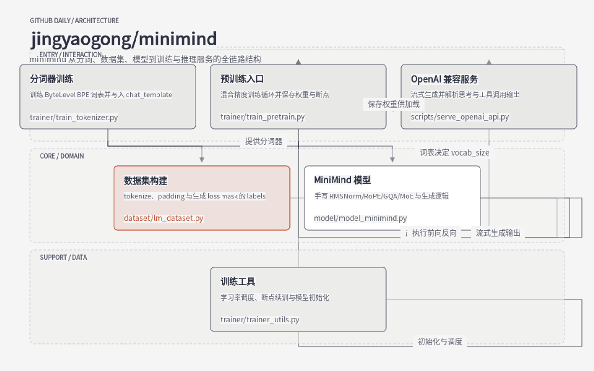
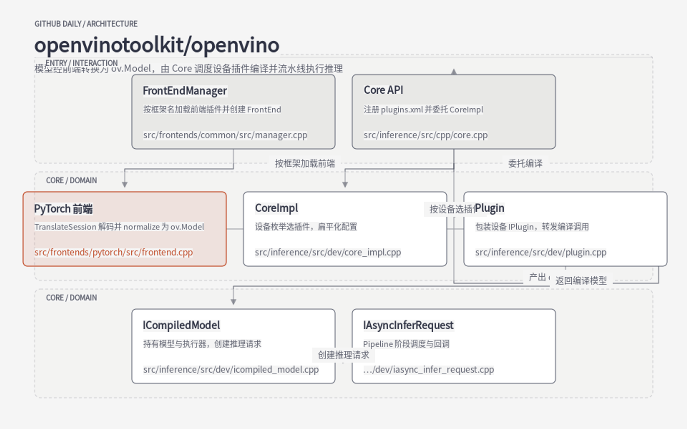

这周看两个方向不同的项目。一个是 jingyaogong/minimind，它回答的问题是：一个语言模型从 jsonl 原始文本到能在聊天框里流式回答，中间每一步到底发生了什么。作者把分词器训练、数据集构建、Transformer 实现、预训练、SFT、LoRA 到 OpenAI 兼容服务全部压缩进几份可通读的 Python 文件，最低版本的 64M 模型在单卡 3090 上两小时就能跑完 SFT。另一个是 openvinotoolkit/openvino，处理的是模型训练完之后的事：怎么把 PyTorch 模型变成能在 CPU、GPU、NPU 上跑的推理程序。`ov.convert_model` 一行转换，换个设备字符串就能切换硬件，pip 直接安装。一个管从 0 训出来，一个管训完之后部署出去，正好接得上。

## 1. minimind

> 从分词器到 OpenAI 兼容服务，两小时从 0 训出一个 64M 语言模型的全链路实现

[jingyaogong/minimind](https://github.com/jingyaogong/minimind) · `Python` · **72,207** stars · 今日 **+660** · `Apache-2.0`

假设你租了一张 3090，想弄清楚一个语言模型从原始 jsonl 文本到能在聊天框里流式回答问题，中间到底发生了什么。jingyaogong/minimind 把这整条链路压缩到几份可通读的 Python 文件里：`trainer/train_tokenizer.py` 训练 BPE 词表并写入 chat_template，`dataset/lm_dataset.py` 把 jsonl 变成带 loss mask 的张量，`model/model_minimind.py` 用 PyTorch 原生实现整个 Transformer，`trainer/train_pretrain.py` 跑预训练，最后 `scripts/serve_openai_api.py` 把权重变成一个 OpenAI 协议的流式服务。README 里那句“两小时”指的是 SFT 阶段单卡 3090 跑完 1 个 epoch 的实测耗时，最低版本体积约为 GPT-3 的 1/2700，个人 GPU 就能完整复现。

链路的起点是分词器。`train_tokenizer.py` 里的 `train_tokenizer` 函数用 `tokenizers` 库训练一个 ByteLevel BPE 词表，默认 6400 词。它同时兼容两种数据格式：预训练语料的 `{"text": ...}` 和 SFT 数据的 `conversations` 结构，`get_texts` 会逐行解析并产出文本，取不到任何文本时直接抛错而不是静默产出一个空词表。词表里预留了 `<tool_call>`、`<tool_response>`、`<think>` 等模板标记，还有一批 `<|bufferN|>` 占位 token 供后续扩展。更关键的是它把完整的 chat_template 写进 `tokenizer_config.json`，这份 Jinja 模板规定了 system、user、assistant、tool 各角色的拼接方式，训练和推理两端共用同一份模板，格式不会漂移。脚本开头的注释也提醒：项目已自带训练好的分词器，重新训练会导致模型输出与社区权重不兼容，这个脚本主要供学习参考。

文本变成 token id 之后，`dataset/lm_dataset.py` 负责组织成训练样本。`PretrainDataset` 很直接：加 bos、eos，padding 到 `max_length`，labels 复制 input_ids 并把 pad 位置置为 -100，让交叉熵忽略它们。`SFTDataset` 的精细之处在于 `generate_labels`：它在 token 序列里扫描 `<|im_start|>assistant\n` 到 `<|im_end|>\n` 之间的区段，只有 assistant 回复部分的 label 才保留，其余位置全部置 -100。这意味着 loss 只落在模型该学会生成的内容上，用户提问和系统提示不参与梯度。数据侧还有两个细节：`pre_processing_chat` 以约 20% 的概率随机插入一条 system 提示增强鲁棒性（带 tools 的数据完整保留），`post_processing_chat` 以约 80% 的概率移除空的 `<think>` 标签，让模型在开启思考模式时不至于永远输出空思考。

模型本体在 `model/model_minimind.py`，从 `RMSNorm`、`precompute_freqs_cis`、`apply_rotary_pos_emb` 开始全部手写。`Attention` 类实现了 GQA：8 个注意力头共享 4 组 KV 头，`repeat_kv` 负责扩展，q、k 在旋转位置编码前各过一次 per-head 的 RMSNorm。注意力计算有两条路径：训练或首次前向时走 `F.scaled_dot_product_attention` 的 flash 路径，带 KV cache 的增量解码或存在自定义 attention_mask 时退回手写的 softmax 路径，保证功能完整。FFN 是标准的 SwiGLU 三投影结构；把 `MiniMindConfig` 的 `use_moe` 打开后，`MiniMindBlock` 会换用 `MOEFeedForward`，top-1 路由用直通估计器传梯度，训练时还计算负载均衡的 `aux_loss`。`MiniMindModel.forward` 会把各层的 aux_loss 汇总返回，训练脚本里直接 `loss = res.loss + res.aux_loss`。

预训练的执行在 `trainer/train_pretrain.py`。`train_epoch` 每一步先用 `get_lr` 更新学习率（线性 warmup 加余弦衰减，最低衰减到 0.1 倍），在 autocast 上下文里做前向，loss 除以 `accumulation_steps` 后 `scaler.scale(loss).backward()`，累积到步数后 unscale、按 `grad_clip=1.0` 裁剪梯度再 step。混合精度默认 bfloat16，`resolve_dtype` 会在显卡不原生支持 bf16 时自动回退 float16 并打印提示。分布式也是一等公民：`init_distributed_mode` 检测 `RANK` 环境变量决定是否走 DDP，`DistributedSampler`、`torch.compile` 都有开关。训练中途按 `save_interval` 保存权重，同时调用 `lm_checkpoint` 落盘一份含 optimizer、scaler、epoch、step 的 resume 文件。

`trainer/trainer_utils.py` 是所有训练脚本共用的工具层，里面藏着不少实用设计。`lm_checkpoint` 保存时先写 `.tmp` 再 `os.replace`，避免训练崩溃留下半截权重；续训加载时如果检测到 GPU 数量变化，会按 `saved_ws // current_ws` 自动换算 step，多卡切单卡不会错乱。配合它的 `SkipBatchSampler` 在重建 DataLoader 时跳过已训练的批次，续训能精确到 step 级恢复。`init_model` 按 `MiniMindConfig` 建模型、按命名规则找权重文件、`strict=False` 加载，并打印总参数量与激活参数量（MoE 会显示成类似 198M-A64M 的形式）。这些函数被 pretrain、full_sft、dpo、grpo 等全部训练脚本复用，每份训练脚本因此只需要关心自己的 loss 逻辑。

训练完成后，`scripts/serve_openai_api.py` 用 FastAPI 把模型变成服务。`generate_stream_response` 在后台线程里调 `model.generate` 并挂一个 `CustomStreamer`，把解码文本推进队列，主线程从队列消费并做增量解析：遇到 `</think>` 之前的片段放进 `reasoning_content` 字段，之后放进 `content`，进入 `<tool_call>` 块后攒到闭合标签再 `json.loads` 成标准的 `tool_calls` 结构，以 SSE 格式按 OpenAI 的 delta 协议吐出。非流式路径则一次生成后用 `parse_response` 拆出正文、思考和工具调用。请求体支持 `open_thinking` 和 `chat_template_kwargs` 两种方式开启思考模式，模板尾部会据此决定是输出 `<think>\n` 还是直接给出空思考。`init_model` 还能在基础权重之上叠加 LoRA 权重加载。

这个项目值得借鉴的地方在于各环节的边界划分：模板属于分词器、loss mask 属于数据集、结构与生成属于模型、调度与断点属于工具层、协议解析属于服务层，任何一层都可以单独替换实验。README 也提到模型兼容 transformers、llama.cpp、vllm、ollama 等生态，`scripts/convert_model.py` 可把 LoRA 权重合并进基座模型导出完整权重。如果你想真正读懂一个语言模型的每一行代码，或者需要一个能在自己 GPU 上从 0 跑通全流程的教学底座，从 `train_tokenizer.py` 一路读到 `serve_openai_api.py` 是一条现成的路径。

## 2. openvino

> 一行 convert_model 把 PyTorch 模型变成可跨 CPU/GPU/NPU 部署的推理图

[openvinotoolkit/openvino](https://github.com/openvinotoolkit/openvino) · `C++` · **12,952** stars · 今日 **+151** · `Apache-2.0`

把一个 PyTorch 模型部署到没有 Python 环境的边缘设备上，通常要在框架自带的导出工具和推理引擎之间做大量胶水工作。OpenVINO 把这件事压缩成三步：`ov.convert_model` 转换模型、`ov.Core().compile_model` 编译到目标设备、再调用推理拿到输出。README 里的示例就是用 torch.hub 拉一个 shufflenet，给一个随机输入作为 example_input，转换后直接编译到 CPU 上跑。设备字符串换成 GPU 或 NPU，其余代码不变，这是它最吸引人的地方。pip install 一条命令即可安装，Python 要求 3.11 以上，底层是 C++ 实现并绑定了 C++、Python、C、Node.js 多语言 API。

转换这一步背后是一个插件化的前端体系。`ov.convert_model` 会进入 `src/frontends/common/src/manager.cpp` 里的 FrontEndManager，它维护一张框架名到插件文件名的映射表：pytorch、onnx、tf、tflite、paddle、jax、ir 各自对应一个动态库。`load_by_framework` 按名字找到插件并调用其 creator 函数创建 FrontEnd 对象；`load_by_model` 则反过来，逐个加载插件调用 `supported(variants)` 让前端自报是否认得这份输入。有趣的是这里还有一份 hidden_frontends 名单，目前列着 gguf，这类前端不会出现在 available_front_ends 里，也不会被自动选中，只能通过 load_by_framework 显式请求，避免 core.read_model 意外吃到尚未完整支持的格式。

PyTorch 前端的转换主体在 `src/frontends/pytorch/src/frontend.cpp`。`FrontEnd::convert` 先 flush_places 固化调用方设置过的输入信息，然后创建 TranslateSession，借助 op_table 里的算子翻译器把 TorchScript/FX 图逐节点译成 ov.Model 的算子。翻译完成后进入 normalize，这是整段代码里最见功力的部分：它用 `ov::pass::Manager` 组织了几十个 pass，并按依赖关系分成多批。比如 GPTQ 相关的 pattern 替换必须最先跑，因为一旦其他变换改动了图结构，GPTQ 的模式就再也匹配不上；`MaxPoolDynamicKernelResolver` 又被刻意安排在前一批 pass 完成形状校验之后、`SequenceMarkReplacer` 收敛 kernel_size 之前，注释里把这种顺序约束写得非常清楚。

normalize 里还有不少针对 PyTorch 语义怪癖的处理。list、tuple、dict 这类 Python 容器在 traced 图里会留下 ListUnpack、TupleConstruct、GetItem 之类的元操作，各有专门的 Replacer 把它们消解成普通算子。函数末尾有个细节：如果模型第一个 Parameter 没有任何消费者，它多半是 forward(self, ...) 里的 self 参数，会被直接移除。转换结束后 collect_unconverted_ops 会扫描残留的 PtFrameworkNode，把没能翻译的算子连同失败原因汇总成报告，而不是留下一个行为不明的图。

转换出的 ov.Model 交给 `src/inference/src/cpp/core.cpp` 里的 Core。这一层是面向绑定层的薄壳，每个方法都通过宏包一层异常归一化，然后转给 CoreImpl。构造 Core 时会去两个候选位置找 plugins.xml：libopenvino.so 旁边的 openvino-版本号 目录，或者库所在目录本身，找到后按其中的绝对路径注册设备插件；找不到也不报错，因为还有 register_compile_time_plugins 兜底加载编译期内置的插件。compile_model 的重载覆盖了内存中的 Model、磁盘路径加权重文件、字符串加权重 Tensor 等多种输入形态，最终都收束到 CoreImpl 的同名方法。

CoreImpl 在 `src/inference/src/dev/core_impl.cpp` 里承担了真正的调度工作。设备名解析、按设备选插件、扁平化 `ov::device::properties` 嵌套配置都在这里完成。配置扁平化的逻辑值得细看：用户写 core.compile_model(model, 'GPU', ov::device::properties('CPU', ov::cache_path(''))) 时，属于其他设备的子属性会被剔除，属于目标设备的会被展开到顶层，虚拟设备则保留原样继续下传。同一文件里还有多候选设备库的枚举逻辑，多个插件库声称同一个设备时，先各自调用导出的探测函数枚举设备并按 fingerprint 合并去重，再按评分挑选，遇到空 fingerprint 或同一库重复上报同一 fingerprint 会直接断言失败，防止静默丢设备。

选中的设备插件由 `src/inference/src/dev/plugin.cpp` 的 Plugin 类包装，它持有 IPlugin 指针和所在动态库的 shared_ptr，保证编译结果存活期间库不会被卸载。compile_model 返回的 ICompiledModel 在 icompiled_model.cpp 里重建了 Parameter 和 Result 节点来暴露输入输出端口，并挂上任务执行器与回调执行器。

最终执行落在 `src/inference/src/dev/iasync_infer_request.cpp`：推理被组织成 Pipeline，每个阶段是 executor 加 task 的二元组，`start_async` 把第一阶段丢给执行器，每个阶段任务完成后再把下一阶段提交到各自的执行器，异常通过 exception_ptr 沿链传递，末阶段统一置状态、触发回调、兑现 promise。同步 infer 则走 ImmediateExecutor 组成的 m_sync_pipeline。wait 只需等待最后一个 future，整条流水线的生命周期就都被覆盖了。对想做类似运行时的开发者来说，这套前端插件化、按设备解耦编译、用 Pipeline 抽象异步执行的分层，是OpenVINO 源码里最值得反复阅读的部分。

minimind 的价值在于把每个环节摊开给你看：loss mask 怎么构造、chat_template 写在哪、SFT 和 RLHF 的数据格式差在哪，这些问题在黑盒大模型里很难有直观答案。OpenVINO 则把部署侧常见的胶水代码收敛成了三个调用，转换、编译、推理，设备差异被藏在设备字符串后面。如果你的工作流程是从头训一个小模型再部署到边缘设备，这两个项目可以串起来用：minimind 训出的权重导出为 ONNX 或 TorchScript，再用 `ov.convert_model` 编译到目标硬件。源码都不大，值得花一个下午通读一遍。
